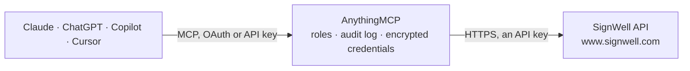

<!-- Generated by scripts/export-github-catalog.mjs in the anythingmcp-website repository. Do not edit by hand. -->

# SignWell MCP connector

Drive SignWell (developer-friendly e-signature) from any AI agent: documents, templates, signature requests, signers. 8 tools, API key + application ID auth. The AnythingMCP connector gives Claude, ChatGPT, Microsoft Copilot, Cursor and Gemini 8 MCP tools for SignWell: 4 read and 4 can change data.

**Category:** [E-Signature](../e-signature.md) · **Tools:** 8 · **Setup guide:** [anythingmcp.com](https://anythingmcp.com/guides/signwell-to-mcp) · [Deutsch](https://anythingmcp.com/de/guides/signwell-to-mcp) · [Italiano](https://anythingmcp.com/it/guides/signwell-to-mcp) · [Español](https://anythingmcp.com/es/guides/signwell-to-mcp) · [日本語](https://anythingmcp.com/ja/guides/signwell-to-mcp) · [Русский](https://anythingmcp.com/ru/guides/signwell-to-mcp) · [中文](https://anythingmcp.com/zh/guides/signwell-to-mcp)

## Start without code

No installation and no terminal: AnythingMCP Cloud runs the SignWell connector for you, operated by helpcode.ai in Frankfurt, Germany.

1. **Click the button above** and create an account or sign in. The SignWell connector opens, ready to install.
2. **Paste the API key or token from your SignWell account.** Every click is in the [step-by-step guide](https://anythingmcp.com/guides/signwell-to-mcp).
3. **Click Install.** AnythingMCP shows the address of your MCP server.
4. **Add that address to your assistant:** [Claude](https://anythingmcp.com/guides/connect-signwell-to-claude) · [ChatGPT](https://anythingmcp.com/guides/connect-signwell-to-chatgpt) · [Microsoft Copilot](https://anythingmcp.com/guides/connect-signwell-to-copilot) · [Cursor](https://anythingmcp.com/guides/connect-signwell-to-cursor) · [Gemini CLI](https://anythingmcp.com/guides/connect-signwell-to-gemini) · [Meta Muse](https://anythingmcp.com/guides/connect-signwell-to-muse).
5. **Ask your first question**, for example: *What's the signing status of document DCT-2026-089 sent to legal@oria.tech?*

Prefer help with the setup? [Talk to us](https://anythingmcp.com/contact).

## How it works

- **The AI client** speaks MCP (Streamable HTTP) to AnythingMCP and only sees tool names, descriptions and results. It never gets the SignWell credentials.
- **AnythingMCP** checks the client's role, builds the call from the tool definition, adds the credentials (an API key), calls SignWell, logs the call and returns the result.
- **SignWell** sees an ordinary API client with the rights of the account the credentials belong to.

## Tools

| Tool | What it does | Access |
|---|---|---|
| [`signwell_list_documents`](#signwell_list_documents) | List documents with filters. | read |
| [`signwell_get_document`](#signwell_get_document) | Fetch a document by ID with recipients + signing status. | read |
| [`signwell_create_document_from_url`](#signwell_create_document_from_url) | Create a document from public file URLs and send for signature. | write |
| [`signwell_create_document_from_template`](#signwell_create_document_from_template) | Create a document from a SignWell template + recipient mapping. | write |
| [`signwell_send_reminder`](#signwell_send_reminder) | Send a reminder email to pending recipients on a document. | write |
| [`signwell_cancel_document`](#signwell_cancel_document) | Cancel a document (no further signing). | write |
| [`signwell_get_document_files`](#signwell_get_document_files) | Get URLs of the document's signed files. | read |
| [`signwell_list_templates`](#signwell_list_templates) | List templates available on the account. | read |

## Tool reference

Every parameter as the AI client sees it in `tools/list`. Source: [`packages/backend/src/adapters/intl/signwell.json`](../../../packages/backend/src/adapters/intl/signwell.json).

### `signwell_list_documents`

List documents with filters.

**Access:** read · **Call:** `GET /documents/`

| Parameter | Type | Required | Description |
|---|---|---|---|
| `limit` | integer | no | Per page (max 100). |
| `offset` | integer | no | Offset. |
| `search` | string | no | Substring filter on document name. |
| `status` | string | no | Draft, Sent, Completed, Canceled, Declined. |
| `folder_id` | string | no | Filter by folder. |

### `signwell_get_document`

Fetch a document by ID with recipients + signing status.

**Access:** read · **Call:** `GET /documents/{documentId}/`

| Parameter | Type | Required | Description |
|---|---|---|---|
| `documentId` | string | yes | Document ID. |

### `signwell_create_document_from_url`

Create a document from public file URLs and send for signature. Required: files + recipients. test_mode=true is safe.

**Access:** write · **Call:** `POST /documents/`

| Parameter | Type | Required | Description |
|---|---|---|---|
| `name` | string | no | Document name. |
| `subject` | string | no | Email subject. |
| `message` | string | no | Email body. |
| `test_mode` | boolean | no | true = test (no real signature/email). |
| `draft` | boolean | no | true = create as draft (don't send yet). |
| `files` | any[] | yes | [{file_url:'https://...pdf', name:'Contract.pdf'}]. |
| `recipients` | any[] | yes | [{id:'r1', name, email, message?, signing_order?, sender:bool, deliver_email:bool}]. ids are arbitrary strings that you use to place fields. |
| `fields` | any[] | no | Optional: pre-placed signature/text/date fields [[{type:'signature', recipient_id:'r1', x:100, y:100, page:1, width:200, height:50}]]. Inner array per page. |
| `expires_in` | integer | no | Days until expiration. |
| `reminders` | boolean | no | Send automatic reminders. |
| `redirect_url` | string | no | URL signer sees after completing. |
| `metadata` | object | no | Free-form metadata (string K/V). |
| `with_signature_page` | boolean | no | Append SignWell signature page (audit trail). |

### `signwell_create_document_from_template`

Create a document from a SignWell template + recipient mapping. Required: template_id + recipients.

**Access:** write · **Call:** `POST /document_templates/documents/`

| Parameter | Type | Required | Description |
|---|---|---|---|
| `template_id` | string | yes | Template ID. |
| `name` | string | no | Document name. |
| `subject` | string | no | Email subject. |
| `message` | string | no | Email body. |
| `test_mode` | boolean | no | Test mode. |
| `draft` | boolean | no | Create as draft. |
| `recipients` | any[] | yes | [{placeholder_name:'Client', name, email}]. placeholder_name matches a placeholder defined on the template. |
| `template_fields` | any[] | no | [{api_id:'company_name', value:'ACME'}] — pre-fill template variables. |
| `expires_in` | integer | no | Expiration days. |
| `reminders` | boolean | no | Reminders. |
| `redirect_url` | string | no | Post-sign redirect. |
| `metadata` | object | no | Metadata. |

### `signwell_send_reminder`

Send a reminder email to pending recipients on a document.

**Access:** write · **Call:** `POST /documents/{documentId}/remind/`

| Parameter | Type | Required | Description |
|---|---|---|---|
| `documentId` | string | yes | Document ID. |

### `signwell_cancel_document`

Cancel a document (no further signing). Irreversible.

**Access:** write · **Call:** `DELETE /documents/{documentId}/`

| Parameter | Type | Required | Description |
|---|---|---|---|
| `documentId` | string | yes | Document ID. |

### `signwell_get_document_files`

Get URLs of the document's signed files. Returns presigned URLs valid for ~24h.

**Access:** read · **Call:** `GET /documents/{documentId}/completed_pdf/`

| Parameter | Type | Required | Description |
|---|---|---|---|
| `documentId` | string | yes | Document ID. |

### `signwell_list_templates`

List templates available on the account.

**Access:** read · **Call:** `GET /document_templates/`

| Parameter | Type | Required | Description |
|---|---|---|---|
| `limit` | integer | no | Per page. |
| `offset` | integer | no | Offset. |

## Run it yourself

AnythingMCP is open source (AGPL-3.0). [Run it with Docker](../../../README.md#run-it-yourself), open **Connectors → Store**, pick **SignWell** and enter `SIGNWELL_API_KEY`, `SIGNWELL_APPLICATION_ID`, then add your MCP server URL to the AI client.

[← E-Signature connectors](../e-signature.md) · [All categories](../README.md)
