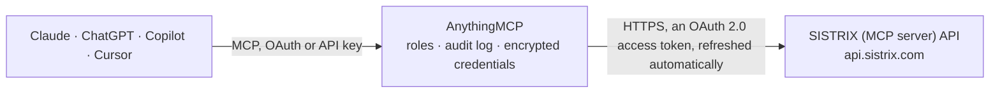

<!-- Generated by scripts/export-github-catalog.mjs in the anythingmcp-website repository. Do not edit by hand. -->

# SISTRIX (MCP server) MCP connector

Connect Claude, ChatGPT or Copilot to SISTRIX through SISTRIX's official MCP server: Visibility Index and history, ranking keywords and URLs, competitors, keyword data and SERPs, backlinks, AI … The AnythingMCP connector gives Claude, ChatGPT, Microsoft Copilot, Cursor and Gemini 11 MCP tools for SISTRIX (MCP server), all read-only.

**Category:** [Analytics](../analytics.md) · **Tools:** 11 · **Setup guide:** [anythingmcp.com](https://anythingmcp.com/guides/sistrix-mcp-to-mcp) · [Deutsch](https://anythingmcp.com/de/guides/sistrix-mcp-to-mcp) · [Italiano](https://anythingmcp.com/it/guides/sistrix-mcp-to-mcp) · [Español](https://anythingmcp.com/es/guides/sistrix-mcp-to-mcp) · [日本語](https://anythingmcp.com/ja/guides/sistrix-mcp-to-mcp) · [Русский](https://anythingmcp.com/ru/guides/sistrix-mcp-to-mcp) · [中文](https://anythingmcp.com/zh/guides/sistrix-mcp-to-mcp)

## Start without code

No installation and no terminal: AnythingMCP Cloud runs the SISTRIX (MCP server) connector for you, operated by helpcode.ai in Frankfurt, Germany.

1. **Click the button above** and create an account or sign in. The SISTRIX (MCP server) connector opens, ready to install.
2. **Sign in with your SISTRIX (MCP server) account** when AnythingMCP asks. The first time, an admin creates a small app in the SISTRIX (MCP server) developer console. Every click is in the [step-by-step guide](https://anythingmcp.com/guides/sistrix-mcp-to-mcp).
3. **Click Install.** AnythingMCP shows the address of your MCP server.
4. **Add that address to your assistant:** [Claude](https://anythingmcp.com/guides/connect-sistrix-mcp-to-claude) · [ChatGPT](https://anythingmcp.com/guides/connect-sistrix-mcp-to-chatgpt) · [Microsoft Copilot](https://anythingmcp.com/guides/connect-sistrix-mcp-to-copilot) · [Cursor](https://anythingmcp.com/guides/connect-sistrix-mcp-to-cursor) · [Gemini CLI](https://anythingmcp.com/guides/connect-sistrix-mcp-to-gemini) · [Meta Muse](https://anythingmcp.com/guides/connect-sistrix-mcp-to-muse).
5. **Ask your first question**, for example: *What's the Visibility Index for bergmann-gartenbau.de in Germany this week and its all-time high date and value?*

Prefer help with the setup? [Talk to us](https://anythingmcp.com/contact).

## How it works

- **The AI client** speaks MCP (Streamable HTTP) to AnythingMCP and only sees tool names, descriptions and results. It never gets the SISTRIX (MCP server) credentials.
- **AnythingMCP** checks the client's role, builds the call from the tool definition, adds the credentials (an OAuth 2.0 access token, refreshed automatically), calls SISTRIX (MCP server), logs the call and returns the result.
- **SISTRIX (MCP server)** sees an ordinary API client with the rights of the account the credentials belong to.

## Tools

| Tool | What it does | Access |
|---|---|---|
| [`sistrix_mcp_domain`](#sistrix_mcp_domain) | SEO figures of any domain, host, directory or URL, chosen with view: visindex (Visibility Index now, at a date, or its weekly or daily history),… | read |
| [`sistrix_mcp_keyword`](#sistrix_mcp_keyword) | Data about a search term, chosen with view: seo (the organic results page, optionally only one domain), metrics (competition, CPC, search volume, clicks,… | read |
| [`sistrix_mcp_keyword_domain_seo`](#sistrix_mcp_keyword_domain_seo) | Every keyword a domain ranks for, with position and URL; filter by position range, SERP feature or regular expressions on keyword, URL or host. | read |
| [`sistrix_mcp_links`](#sistrix_mcp_links) | Backlinks of a domain (no country), chosen with view: list (individual links with source, target and anchor text, filterable by regular expressions),… | read |
| [`sistrix_mcp_ai_check`](#sistrix_mcp_ai_check) | How brands and domains appear in AI answers (ChatGPT, Gemini, AI Overviews, AI Mode, Perplexity and others) without a configured tracker, chosen with view:… | read |
| [`sistrix_mcp_ai_tracker_overview`](#sistrix_mcp_ai_tracker_overview) | The AI visibility trackers (prompt tracking) set up in the SISTRIX account, with their hash and name. | read |
| [`sistrix_mcp_ai_tracker`](#sistrix_mcp_ai_tracker) | Results of one configured AI tracker by its hash: visibility, competitors, sources, prompts and their environment, chosen with view. | read |
| [`sistrix_mcp_ai_prompt_answers`](#sistrix_mcp_ai_prompt_answers) | The answers AI models gave to one prompt, with the brands and sources they mention. | read |
| [`sistrix_mcp_ai_topicresearch`](#sistrix_mcp_ai_topicresearch) | Topics and prompts people ask AI assistants around a keyword, for content and GEO planning. | read |
| [`sistrix_mcp_project`](#sistrix_mcp_project) | Your SISTRIX Optimizer projects, chosen with view: overview (all projects with hash and name; start here), ranking (tracked keyword rankings),… | read |
| [`sistrix_mcp_project_onpage`](#sistrix_mcp_project_onpage) | The onpage crawl of an Optimizer project, chosen with view: meta, overview, crawl, issue, urls, links, resources, resources_usage and cookies. | read |

## Tool reference

Every parameter as the AI client sees it in `tools/list`. Source: [`packages/backend/src/adapters/de/sistrix-mcp.json`](../../../packages/backend/src/adapters/de/sistrix-mcp.json).

### `sistrix_mcp_domain`

SEO figures of any domain, host, directory or URL, chosen with view: visindex (Visibility Index now, at a date, or its weekly or daily history), visindex_overview (how far the history goes, all-time high and low), kwcount and kwcount_top10 (ranking keywords), urlcount (ranking URLs), ranking_distribution (keywords per results page), traffic_estimation (top URLs by estimated clicks), competitors, ideas and opportunities.

**Access:** read · **Call:** `domain /mcp`

| Parameter | Type | Required | Description |
|---|---|---|---|
| `domain` | string | yes | Domain, host, directory or URL, e.g. example.com. |
| `view` | `visindex` \| `visindex_overview` \| `kwcount` \| `kwcount_top10` \| `urlcount` \| `ranking_distribution` \| `traffic_estimation` \| `competitors` \| `ideas` \| `opportunities` | yes | Which dataset. |
| `country` | string | no | Country as a lowercase two-letter code, e.g. de, at, ch, us; SISTRIX writes the United Kingdom as uk, not gb. Default de. |
| `history` | boolean | no | true for the history instead of the current value. |
| `daily` | boolean | no | Daily instead of weekly values (visindex). |
| `date` | string | no | A past date, YYYY-MM-DD. |
| `limit` | integer | no | Maximum rows to return. |
| `offset` | integer | no | Rows to skip. |

### `sistrix_mcp_keyword`

Data about a search term, chosen with view: seo (the organic results page, optionally only one domain), metrics (competition, CPC, search volume, clicks, device split), traffic, competition, searchintent (four independent 0-100 intent scores), serpfeatures and traffic_estimation (clicks per position).

**Access:** read · **Call:** `keyword /mcp`

| Parameter | Type | Required | Description |
|---|---|---|---|
| `keyword` | string | yes | The search term, e.g. laufschuhe. |
| `view` | `seo` \| `metrics` \| `traffic` \| `competition` \| `searchintent` \| `serpfeatures` \| `traffic_estimation` | yes | Which dataset. |
| `country` | string | no | Country as a lowercase two-letter code, e.g. de, at, ch, us; SISTRIX writes the United Kingdom as uk, not gb. Default de. |
| `domain` | string | no | Only results of this domain (view seo). |
| `date` | string | no | A past date, YYYY-MM-DD. |
| `limit` | integer | no | Maximum rows to return. |

### `sistrix_mcp_keyword_domain_seo`

Every keyword a domain ranks for, with position and URL; filter by position range, SERP feature or regular expressions on keyword, URL or host. The main tool for striking-distance and content gap work.

**Access:** read · **Call:** `keyword_domain_seo /mcp`

| Parameter | Type | Required | Description |
|---|---|---|---|
| `domain` | string | yes | Domain, host, directory or URL. |
| `country` | string | no | Country as a lowercase two-letter code, e.g. de, at, ch, us; SISTRIX writes the United Kingdom as uk, not gb. Default de. |
| `from_pos` | integer | no | Lowest position, e.g. 11. |
| `to_pos` | integer | no | Highest position, e.g. 20. |
| `regex_keyword` | string | no | Only keywords matching this regular expression. |
| `regex_url` | string | no | Only URLs matching this regular expression. |
| `search` | string | no | One exact keyword. |
| `date` | string | no | A past date, YYYY-MM-DD. |
| `limit` | integer | no | Maximum rows to return. |
| `offset` | integer | no | Rows to skip. |

### `sistrix_mcp_links`

Backlinks of a domain (no country), chosen with view: list (individual links with source, target and anchor text, filterable by regular expressions), linktexts (anchor texts) and linktargets (most linked URLs with link, domain, host, network and IP counts).

**Access:** read · **Call:** `links /mcp`

| Parameter | Type | Required | Description |
|---|---|---|---|
| `domain` | string | yes | Domain, host or URL. |
| `view` | `list` \| `linktexts` \| `linktargets` | yes | Which dataset. |
| `limit` | integer | no | Maximum rows to return. |
| `offset` | integer | no | Rows to skip. |

### `sistrix_mcp_ai_check`

How brands and domains appear in AI answers (ChatGPT, Gemini, AI Overviews, AI Mode, Perplexity and others) without a configured tracker, chosen with view: overview, competitors, prompts (prompts with the answer text), prompts_count (history per day) and sources (cited hosts, domains or URLs).

**Access:** read · **Call:** `ai_check /mcp`

| Parameter | Type | Required | Description |
|---|---|---|---|
| `brands` | string[] | no | Brand names, up to 100. |
| `domains` | string[] | no | Domains, up to 100. |
| `view` | `overview` \| `competitors` \| `prompts` \| `prompts_count` \| `sources` | yes | Which dataset. |
| `country` | string | no | Country code; omit for all countries. |
| `model` | string | no | Only this AI model. |
| `limit` | integer | no | Maximum rows to return. |
| `page` | integer | no | Page number. |

### `sistrix_mcp_ai_tracker_overview`

The AI visibility trackers (prompt tracking) set up in the SISTRIX account, with their hash and name. Call it before ai_tracker.

**Access:** read · **Call:** `ai_tracker_overview /mcp`

No parameters.

### `sistrix_mcp_ai_tracker`

Results of one configured AI tracker by its hash: visibility, competitors, sources, prompts and their environment, chosen with view.

**Access:** read · **Call:** `ai_tracker /mcp`

| Parameter | Type | Required | Description |
|---|---|---|---|
| `hash` | string | yes | Tracker hash from ai_tracker_overview. |
| `view` | string | no | Which dataset, as the server lists them. |
| `limit` | integer | no | Maximum rows to return. |
| `page` | integer | no | Page number. |

### `sistrix_mcp_ai_prompt_answers`

The answers AI models gave to one prompt, with the brands and sources they mention.

**Access:** read · **Call:** `ai_prompt_answers /mcp`

| Parameter | Type | Required | Description |
|---|---|---|---|
| `prompt` | string | yes | The prompt text. |
| `country` | string | no | Country code. |
| `model` | string | no | Only this AI model. |
| `limit` | integer | no | Maximum rows to return. |

### `sistrix_mcp_ai_topicresearch`

Topics and prompts people ask AI assistants around a keyword, for content and GEO planning.

**Access:** read · **Call:** `ai_topicresearch /mcp`

| Parameter | Type | Required | Description |
|---|---|---|---|
| `keyword` | string | yes | Topic or keyword. |
| `country` | string | no | Country code. |
| `limit` | integer | no | Maximum rows to return. |

### `sistrix_mcp_project`

Your SISTRIX Optimizer projects, chosen with view: overview (all projects with hash and name; start here), ranking (tracked keyword rankings), visibilityindex (project Visibility Index), competitors and keyword_serps.

**Access:** read · **Call:** `project /mcp`

| Parameter | Type | Required | Description |
|---|---|---|---|
| `view` | `overview` \| `ranking` \| `visibilityindex` \| `competitors` \| `keyword_serps` | yes | Which dataset. |
| `hash` | string | no | Project hash from view overview (not needed for overview). |
| `date` | string | no | A past date, YYYY-MM-DD. |
| `limit` | integer | no | Maximum rows to return. |
| `offset` | integer | no | Rows to skip. |

### `sistrix_mcp_project_onpage`

The onpage crawl of an Optimizer project, chosen with view: meta, overview, crawl, issue, urls, links, resources, resources_usage and cookies.

**Access:** read · **Call:** `project_onpage /mcp`

| Parameter | Type | Required | Description |
|---|---|---|---|
| `hash` | string | yes | Project hash from project view overview. |
| `view` | `meta` \| `overview` \| `crawl` \| `issue` \| `urls` \| `links` \| `resources` \| `resources_usage` \| `cookies` | yes | Which dataset. |
| `limit` | integer | no | Maximum rows to return. |
| `page` | integer | no | Page number. |
| `offset` | integer | no | Rows to skip. |

## Run it yourself

AnythingMCP is open source (AGPL-3.0). [Run it with Docker](../../../README.md#run-it-yourself), open **Connectors → Store**, pick **SISTRIX (MCP server)**, then add your MCP server URL to the AI client.

[← Analytics connectors](../analytics.md) · [All categories](../README.md)
