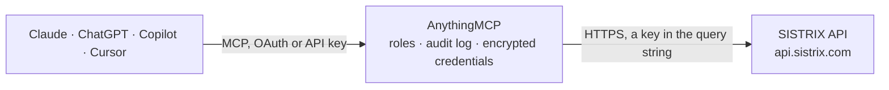

<!-- Generated by scripts/export-github-catalog.mjs in the anythingmcp-website repository. Do not edit by hand. -->

# SISTRIX MCP connector

Give your AI SISTRIX SEO data: the Visibility Index (Sichtbarkeitsindex) and its history, ranking keywords, competitors, top URLs, keyword rankings, metrics and questions, and backlinks, with the … The AnythingMCP connector gives Claude, ChatGPT, Microsoft Copilot, Cursor and Gemini 18 MCP tools for SISTRIX, all read-only.

**Category:** [Analytics](../analytics.md) · **Tools:** 18 · **Setup guide:** [anythingmcp.com](https://anythingmcp.com/guides/sistrix-to-mcp) · [Deutsch](https://anythingmcp.com/de/guides/sistrix-to-mcp) · [Italiano](https://anythingmcp.com/it/guides/sistrix-to-mcp) · [Español](https://anythingmcp.com/es/guides/sistrix-to-mcp) · [日本語](https://anythingmcp.com/ja/guides/sistrix-to-mcp) · [Русский](https://anythingmcp.com/ru/guides/sistrix-to-mcp) · [中文](https://anythingmcp.com/zh/guides/sistrix-to-mcp)

## Start without code

No installation and no terminal: AnythingMCP Cloud runs the SISTRIX connector for you, operated by helpcode.ai in Frankfurt, Germany.

1. **Click the button above** and create an account or sign in. The SISTRIX connector opens, ready to install.
2. **Paste the API key or token from your SISTRIX account.** Every click is in the [step-by-step guide](https://anythingmcp.com/guides/sistrix-to-mcp).
3. **Click Install.** AnythingMCP shows the address of your MCP server.
4. **Add that address to your assistant:** [Claude](https://anythingmcp.com/guides/connect-sistrix-to-claude) · [ChatGPT](https://anythingmcp.com/guides/connect-sistrix-to-chatgpt) · [Microsoft Copilot](https://anythingmcp.com/guides/connect-sistrix-to-copilot) · [Cursor](https://anythingmcp.com/guides/connect-sistrix-to-cursor) · [Gemini CLI](https://anythingmcp.com/guides/connect-sistrix-to-gemini) · [Meta Muse](https://anythingmcp.com/guides/connect-sistrix-to-muse).
5. **Ask your first question**, for example: *What's our current Sichtbarkeitsindex and keyword counts for holzprofi.de (country de)?*

Prefer help with the setup? [Talk to us](https://anythingmcp.com/contact).

## How it works

- **The AI client** speaks MCP (Streamable HTTP) to AnythingMCP and only sees tool names, descriptions and results. It never gets the SISTRIX credentials.
- **AnythingMCP** checks the client's role, builds the call from the tool definition, adds the credentials (a key in the query string), calls SISTRIX, logs the call and returns the result.
- **SISTRIX** sees an ordinary API client with the rights of the account the credentials belong to.

## Tools

| Tool | What it does | Access |
|---|---|---|
| [`sistrix_get_credits`](#sistrix_get_credits) | Show how many SISTRIX API credits this key has left this week. | read |
| [`sistrix_list_countries`](#sistrix_list_countries) | List the country codes SISTRIX supports for Google (and Amazon marketplace) data. | read |
| [`sistrix_domain_overview`](#sistrix_domain_overview) | Latest key figures of a domain, host, path or URL: Visibility Index (Sichtbarkeitsindex), number of SEO keywords and of Google Ads keywords, each with its date. | read |
| [`sistrix_visibility_index`](#sistrix_visibility_index) | SISTRIX Visibility Index (Sichtbarkeitsindex) of a domain, host, path or URL: the current value, the value of a past week (date), or the weekly history… | read |
| [`sistrix_keyword_count`](#sistrix_keyword_count) | Number of keywords a domain, host, path or URL ranks for in Google's top 100, now, on a past date, or as weekly history. | read |
| [`sistrix_ranking_distribution`](#sistrix_ranking_distribution) | How many keywords of a domain rank on each of Google's first ten result pages (page01 = positions 1 to 10, page02 = 11 to 20...), now, for a past week, or… | read |
| [`sistrix_competitors`](#sistrix_competitors) | SEO competitors of a domain, host, path or URL with their similarity (match, in %); the analysed domain itself appears with 100. | read |
| [`sistrix_ranking_keywords`](#sistrix_ranking_keywords) | Keywords a domain, host, path or URL ranks for in Google: keyword, position, competition, search traffic (0 to 100) and ranking URL. | read |
| [`sistrix_top_urls`](#sistrix_top_urls) | The best-ranking URLs of a domain, host or path with their top-10 and top-100 keyword counts and their share of the domain's Visibility Index. | read |
| [`sistrix_traffic_estimation`](#sistrix_traffic_estimation) | Paths of a domain with the most estimated organic clicks: estimated clicks, share of clicks (%) and number of top-100 keywords per path. | read |
| [`sistrix_keyword_opportunities`](#sistrix_keyword_opportunities) | Keywords a domain ranks for beyond page one that could reach page one with little effort: gain (0 to 100), current position, ranking URL and competition. | read |
| [`sistrix_keyword_serp`](#sistrix_keyword_serp) | The organic Google ranking for a keyword: position, domain and URL of each result, now or for a past week. | read |
| [`sistrix_keyword_metrics`](#sistrix_keyword_metrics) | Main metrics of a keyword: competition, CPC, search traffic (0 to 100), clicks and the mobile and desktop share. | read |
| [`sistrix_keyword_traffic`](#sistrix_keyword_traffic) | Search traffic (0 to 100) and clicks of a keyword in one country, all countries (show_all_countries) or as history (show_all). | read |
| [`sistrix_keyword_questions`](#sistrix_keyword_questions) | Google queries that combine a keyword with question words (what, how, why...), with search volume. | read |
| [`sistrix_links_overview`](#sistrix_links_overview) | Backlink overview of a domain, host or path: total backlinks and the number of linking hosts, domains, networks and class C IP ranges. | read |
| [`sistrix_backlinks`](#sistrix_backlinks) | Backlinks of a domain: source URL (url.from), link text and target URL (url.to). | read |
| [`sistrix_link_texts`](#sistrix_link_texts) | Most-used anchor texts of the backlinks of a domain, host or path, with the number of links and of linking hosts, domains, IPs and networks. | read |

## Tool reference

Every parameter as the AI client sees it in `tools/list`. Source: [`packages/backend/src/adapters/de/sistrix.json`](../../../packages/backend/src/adapters/de/sistrix.json).

### `sistrix_get_credits`

Show how many SISTRIX API credits this key has left this week. Free: costs no credits.

**Access:** read · **Call:** `GET /credits`

No parameters.

### `sistrix_list_countries`

List the country codes SISTRIX supports for Google (and Amazon marketplace) data. Free: costs no credits.

**Access:** read · **Call:** `GET /countries`

No parameters.

### `sistrix_domain_overview`

Latest key figures of a domain, host, path or URL: Visibility Index (Sichtbarkeitsindex), number of SEO keywords and of Google Ads keywords, each with its date. Costs 5 credits.

**Access:** read · **Call:** `GET /domain.overview`

| Parameter | Type | Required | Description |
|---|---|---|---|
| `domain` | string | no | Domain to analyse, e.g. sistrix.de. Set exactly one of domain, host, path or url. |
| `host` | string | no | Hostname (subdomain), e.g. www.sistrix.de. Instead of domain. |
| `path` | string | no | Directory, e.g. www.sistrix.de/news/. Instead of domain. |
| `url` | string | no | Single URL, e.g. https://www.sistrix.de/test/. Instead of domain. |
| `country` | string | no | Country code in lower case, e.g. de, at, ch, uk, us, it, fr, es. Default: the country of the SISTRIX account. sistrix_list_countries lists them. |

### `sistrix_visibility_index`

SISTRIX Visibility Index (Sichtbarkeitsindex) of a domain, host, path or URL: the current value, the value of a past week (date), or the weekly history (history=true), or the daily values of the last 30 days (daily=true). Costs 1 credit per value returned; the full history can be hundreds of values, so set limit.

**Access:** read · **Call:** `GET /domain.visibilityindex`

| Parameter | Type | Required | Description |
|---|---|---|---|
| `domain` | string | no | Domain to analyse, e.g. sistrix.de. Set exactly one of domain, host, path or url. |
| `host` | string | no | Hostname (subdomain), e.g. www.sistrix.de. Instead of domain. |
| `path` | string | no | Directory, e.g. www.sistrix.de/news/. Instead of domain. |
| `url` | string | no | Single URL, e.g. https://www.sistrix.de/test/. Instead of domain. |
| `country` | string | no | Country code in lower case, e.g. de, at, ch, uk, us, it, fr, es. Default: the country of the SISTRIX account. sistrix_list_countries lists them. |
| `date` | string | no | A past date, YYYY-MM-DD: returns the weekly value of that week. Leave out for the current value. |
| `history` | boolean | no | true returns the weekly history, newest first. Combine with limit. |
| `daily` | boolean | no | true returns the daily values of the last 30 days instead of weekly ones. |
| `limit` | integer | no | Maximum values when history is true (default 10). Each value costs 1 credit; without a limit SISTRIX returns the whole history. |

### `sistrix_keyword_count`

Number of keywords a domain, host, path or URL ranks for in Google's top 100, now, on a past date, or as weekly history. Costs 1 credit per value returned.

**Access:** read · **Call:** `GET /domain.kwcount.seo`

| Parameter | Type | Required | Description |
|---|---|---|---|
| `domain` | string | no | Domain to analyse, e.g. sistrix.de. Set exactly one of domain, host, path or url. |
| `host` | string | no | Hostname (subdomain), e.g. www.sistrix.de. Instead of domain. |
| `path` | string | no | Directory, e.g. www.sistrix.de/news/. Instead of domain. |
| `url` | string | no | Single URL, e.g. https://www.sistrix.de/test/. Instead of domain. |
| `country` | string | no | Country code in lower case, e.g. de, at, ch, uk, us, it, fr, es. Default: the country of the SISTRIX account. sistrix_list_countries lists them. |
| `date` | string | no | A past date, YYYY-MM-DD: returns the weekly value of that week. Leave out for the current value. |
| `history` | boolean | no | true returns the weekly history (up to 100 weeks unless limited). |
| `limit` | integer | no | Maximum values when history is true (default 10). Each value costs 1 credit. |

### `sistrix_ranking_distribution`

How many keywords of a domain rank on each of Google's first ten result pages (page01 = positions 1 to 10, page02 = 11 to 20...), now, for a past week, or as history. Costs 1 credit per date returned.

**Access:** read · **Call:** `GET /domain.ranking.distribution`

| Parameter | Type | Required | Description |
|---|---|---|---|
| `domain` | string | no | Domain to analyse, e.g. sistrix.de. Set exactly one of domain, host, path or url. |
| `host` | string | no | Hostname (subdomain), e.g. www.sistrix.de. Instead of domain. |
| `path` | string | no | Directory, e.g. www.sistrix.de/news/. Instead of domain. |
| `url` | string | no | Single URL, e.g. https://www.sistrix.de/test/. Instead of domain. |
| `country` | string | no | Country code in lower case, e.g. de, at, ch, uk, us, it, fr, es. Default: the country of the SISTRIX account. sistrix_list_countries lists them. |
| `date` | string | no | A past date, YYYY-MM-DD: returns the weekly value of that week. Leave out for the current value. |
| `history` | boolean | no | true returns the last 10 weekly distributions. |
| `percent` | boolean | no | true returns percentages instead of keyword counts. |

### `sistrix_competitors`

SEO competitors of a domain, host, path or URL with their similarity (match, in %); the analysed domain itself appears with 100. Costs 1 credit per competitor returned.

**Access:** read · **Call:** `GET /domain.competitors.seo`

| Parameter | Type | Required | Description |
|---|---|---|---|
| `domain` | string | no | Domain to analyse, e.g. sistrix.de. Set exactly one of domain, host, path or url. |
| `host` | string | no | Hostname (subdomain), e.g. www.sistrix.de. Instead of domain. |
| `path` | string | no | Directory, e.g. www.sistrix.de/news/. Instead of domain. |
| `url` | string | no | Single URL, e.g. https://www.sistrix.de/test/. Instead of domain. |
| `country` | string | no | Country code in lower case, e.g. de, at, ch, uk, us, it, fr, es. Default: the country of the SISTRIX account. sistrix_list_countries lists them. |
| `limit` | integer | no | Maximum competitors (default 10). Each one returned costs 1 credit. |

### `sistrix_ranking_keywords`

Keywords a domain, host, path or URL ranks for in Google: keyword, position, competition, search traffic (0 to 100) and ranking URL. Filter by a search term or position range. Costs 1 credit per keyword returned.

**Access:** read · **Call:** `GET /keyword.domain.seo`

| Parameter | Type | Required | Description |
|---|---|---|---|
| `domain` | string | no | Domain to analyse, e.g. sistrix.de. Set exactly one of domain, host, path or url. |
| `host` | string | no | Hostname (subdomain), e.g. www.sistrix.de. Instead of domain. |
| `path` | string | no | Directory, e.g. www.sistrix.de/news/. Instead of domain. |
| `url` | string | no | Single URL, e.g. https://www.sistrix.de/test/. Instead of domain. |
| `country` | string | no | Country code in lower case, e.g. de, at, ch, uk, us, it, fr, es. Default: the country of the SISTRIX account. sistrix_list_countries lists them. |
| `date` | string | no | A past date, YYYY-MM-DD: returns the weekly value of that week. Leave out for the current value. |
| `limit` | integer | no | Maximum keywords (default 10). Each one returned costs 1 credit. |
| `offset` | integer | no | Rows to skip, for paging (10 starts at the 11th). |
| `search` | string | no | Only keywords containing this term, e.g. shoes. |
| `from_pos` | integer | no | Only rankings from this position on, e.g. 11. |
| `to_pos` | integer | no | Only rankings up to this position, e.g. 20. |
| `serp_feature` | string | no | Only keywords whose results page shows this SERP feature, as the upper-case SISTRIX feature code, e.g. FEATURED (featured snippet) or SITELINKS. An unknown code fails with error 1007. |
| `ai_answer` | boolean | no | true: only keywords whose results page shows an AI answer box. |
| `regex_keyword` | string | no | Only keywords matching this regular expression (unencoded; the connector encodes it). |
| `regex_url` | string | no | Only rankings whose URL matches this regular expression. |

### `sistrix_top_urls`

The best-ranking URLs of a domain, host or path with their top-10 and top-100 keyword counts and their share of the domain's Visibility Index. Costs 1 credit per URL returned.

**Access:** read · **Call:** `GET /domain.urls`

| Parameter | Type | Required | Description |
|---|---|---|---|
| `domain` | string | no | Domain to analyse, e.g. sistrix.de. Set exactly one of domain, host, path or url. |
| `host` | string | no | Hostname (subdomain), e.g. www.sistrix.de. Instead of domain. |
| `path` | string | no | Directory, e.g. www.sistrix.de/news/. Instead of domain. |
| `url` | string | no | Single URL, e.g. https://www.sistrix.de/test/. Instead of domain. |
| `country` | string | no | Country code in lower case, e.g. de, at, ch, uk, us, it, fr, es. Default: the country of the SISTRIX account. sistrix_list_countries lists them. |
| `date` | string | no | A past date, YYYY-MM-DD: returns the weekly value of that week. Leave out for the current value. |
| `limit` | integer | no | Maximum URLs (default 10). Each one returned costs 1 credit. |
| `offset` | integer | no | Rows to skip, for paging (10 starts at the 11th). |
| `regex_url` | string | no | Only URLs matching this regular expression (unencoded). |

### `sistrix_traffic_estimation`

Paths of a domain with the most estimated organic clicks: estimated clicks, share of clicks (%) and number of top-100 keywords per path. Costs 1 credit per path returned.

**Access:** read · **Call:** `GET /domain.traffic.estimation`

| Parameter | Type | Required | Description |
|---|---|---|---|
| `domain` | string | no | Domain to analyse, e.g. sistrix.de. Set exactly one of domain, host, path or url. |
| `host` | string | no | Hostname (subdomain), e.g. www.sistrix.de. Instead of domain. |
| `path` | string | no | Directory, e.g. www.sistrix.de/news/. Instead of domain. |
| `url` | string | no | Single URL, e.g. https://www.sistrix.de/test/. Instead of domain. |
| `country` | string | no | Country code in lower case, e.g. de, at, ch, uk, us, it, fr, es. Default: the country of the SISTRIX account. sistrix_list_countries lists them. |
| `limit` | integer | no | Maximum paths (default 10). Each one returned costs 1 credit. |
| `offset` | integer | no | Rows to skip, for paging (10 starts at the 11th). |

### `sistrix_keyword_opportunities`

Keywords a domain ranks for beyond page one that could reach page one with little effort: gain (0 to 100), current position, ranking URL and competition. Costs 1 credit per keyword returned.

**Access:** read · **Call:** `GET /domain.opportunities`

| Parameter | Type | Required | Description |
|---|---|---|---|
| `domain` | string | no | Domain to analyse, e.g. sistrix.de. Set exactly one of domain, host, path or url. |
| `host` | string | no | Hostname (subdomain), e.g. www.sistrix.de. Instead of domain. |
| `path` | string | no | Directory, e.g. www.sistrix.de/news/. Instead of domain. |
| `url` | string | no | Single URL, e.g. https://www.sistrix.de/test/. Instead of domain. |
| `country` | string | no | Country code in lower case, e.g. de, at, ch, uk, us, it, fr, es. Default: the country of the SISTRIX account. sistrix_list_countries lists them. |
| `limit` | integer | no | Maximum keywords (default 10). Each one returned costs 1 credit. |
| `offset` | integer | no | Rows to skip, for paging (10 starts at the 11th). |

### `sistrix_keyword_serp`

The organic Google ranking for a keyword: position, domain and URL of each result, now or for a past week. With domain or url plus history=true, the weekly ranking history of that site for the keyword. Costs 1 credit per ranking returned.

**Access:** read · **Call:** `GET /keyword.seo`

| Parameter | Type | Required | Description |
|---|---|---|---|
| `kw` | string | yes | The keyword, e.g. laufschuhe. |
| `country` | string | no | Country code in lower case, e.g. de, at, ch, uk, us, it, fr, es. Default: the country of the SISTRIX account. sistrix_list_countries lists them. |
| `date` | string | no | A past date, YYYY-MM-DD: returns the weekly value of that week. Leave out for the current value. |
| `limit` | integer | no | Maximum rankings (default 10). Each one returned costs 1 credit. |
| `domain` | string | no | Only the rankings of this domain for the keyword. |
| `url` | string | no | Only the rankings of this URL for the keyword. |
| `history` | boolean | no | With domain or url: weekly ranking history. |

### `sistrix_keyword_metrics`

Main metrics of a keyword: competition, CPC, search traffic (0 to 100), clicks and the mobile and desktop share. Costs 5 credits per keyword.

**Access:** read · **Call:** `GET /keyword.seo.metrics`

| Parameter | Type | Required | Description |
|---|---|---|---|
| `kw` | string | yes | The keyword, e.g. laufschuhe. |
| `country` | string | no | Country code in lower case, e.g. de, at, ch, uk, us, it, fr, es. Default: the country of the SISTRIX account. sistrix_list_countries lists them. |

### `sistrix_keyword_traffic`

Search traffic (0 to 100) and clicks of a keyword in one country, all countries (show_all_countries) or as history (show_all). Costs 1 credit per value returned.

**Access:** read · **Call:** `GET /keyword.seo.traffic`

| Parameter | Type | Required | Description |
|---|---|---|---|
| `kw` | string | yes | The keyword, e.g. laufschuhe. |
| `country` | string | no | Country code in lower case, e.g. de, at, ch, uk, us, it, fr, es. Default: the country of the SISTRIX account. sistrix_list_countries lists them. |
| `show_all` | boolean | no | true returns the full traffic history of the keyword (one credit per value). |
| `show_all_countries` | boolean | no | true returns the values for every country (one credit per country). |

### `sistrix_keyword_questions`

Google queries that combine a keyword with question words (what, how, why...), with search volume. Costs 1 credit per question returned.

**Access:** read · **Call:** `GET /keyword.questions`

| Parameter | Type | Required | Description |
|---|---|---|---|
| `kw` | string | yes | The keyword, e.g. laufschuhe. |
| `country` | string | no | Country code in lower case, e.g. de, at, ch, uk, us, it, fr, es. Default: the country of the SISTRIX account. sistrix_list_countries lists them. |
| `lang` | string | no | Language of the questions (ISO 639), e.g. de, en. Default the account language. |
| `limit` | integer | no | Maximum questions (default 10). Each one returned costs 1 credit. |
| `page` | integer | no | Result page, with limit questions per page. |

### `sistrix_links_overview`

Backlink overview of a domain, host or path: total backlinks and the number of linking hosts, domains, networks and class C IP ranges. Costs 25 credits.

**Access:** read · **Call:** `GET /links.overview`

| Parameter | Type | Required | Description |
|---|---|---|---|
| `domain` | string | no | Domain whose backlinks to read, e.g. sistrix.de. Set exactly one of domain, host or path. |
| `host` | string | no | Hostname, e.g. www.sistrix.de. Instead of domain. |
| `path` | string | no | Directory, e.g. www.sistrix.de/news/. Instead of domain. |

### `sistrix_backlinks`

Backlinks of a domain: source URL (url.from), link text and target URL (url.to). Costs 1 credit per link returned, at most 250 credits per request.

**Access:** read · **Call:** `GET /links.list`

| Parameter | Type | Required | Description |
|---|---|---|---|
| `domain` | string | yes | Domain whose backlinks to list, e.g. sistrix.de. |
| `limit` | integer | no | Maximum links (default 10). Each costs 1 credit; SISTRIX returns up to 10,000 when left out (billed at most 250 credits). |
| `offset` | integer | no | Rows to skip, for paging (10 starts at the 11th). |
| `regex_link_from` | string | no | Only links whose source URL matches this regular expression. |
| `regex_link_to` | string | no | Only links whose target URL matches this regular expression. |
| `regex_link_text` | string | no | Only links whose anchor text matches this regular expression. |

### `sistrix_link_texts`

Most-used anchor texts of the backlinks of a domain, host or path, with the number of links and of linking hosts, domains, IPs and networks. Costs 1 credit per text returned.

**Access:** read · **Call:** `GET /links.linktexts`

| Parameter | Type | Required | Description |
|---|---|---|---|
| `domain` | string | no | Domain whose backlinks to read, e.g. sistrix.de. Set exactly one of domain, host or path. |
| `host` | string | no | Hostname, e.g. www.sistrix.de. Instead of domain. |
| `path` | string | no | Directory, e.g. www.sistrix.de/news/. Instead of domain. |
| `limit` | integer | no | Maximum texts (default 10). Each one returned costs 1 credit. |

## Run it yourself

AnythingMCP is open source (AGPL-3.0). [Run it with Docker](../../../README.md#run-it-yourself), open **Connectors → Store**, pick **SISTRIX** and enter `SISTRIX_API_KEY`, then add your MCP server URL to the AI client.

[← Analytics connectors](../analytics.md) · [All categories](../README.md)
