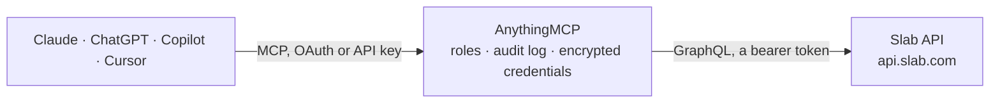

<!-- Generated by scripts/export-github-catalog.mjs in the anythingmcp-website repository. Do not edit by hand. -->

# Slab MCP connector

Read and organize Slab (team wiki) from any AI agent via its GraphQL API: search posts, read a post, list topics and their posts, create a post. 6 tools, API token (Business and Enterprise plans). The AnythingMCP connector gives Claude, ChatGPT, Microsoft Copilot, Cursor and Gemini 6 MCP tools for Slab: 5 read and 1 can change data.

**Category:** [Knowledge Base](../knowledge.md) · **Tools:** 6 · **Setup guide:** [anythingmcp.com](https://anythingmcp.com/guides/slab-to-mcp) · [Deutsch](https://anythingmcp.com/de/guides/slab-to-mcp) · [Italiano](https://anythingmcp.com/it/guides/slab-to-mcp) · [Español](https://anythingmcp.com/es/guides/slab-to-mcp) · [日本語](https://anythingmcp.com/ja/guides/slab-to-mcp) · [Русский](https://anythingmcp.com/ru/guides/slab-to-mcp) · [中文](https://anythingmcp.com/zh/guides/slab-to-mcp)

## Start without code

No installation and no terminal: AnythingMCP Cloud runs the Slab connector for you, operated by helpcode.ai in Frankfurt, Germany.

1. **Click the button above** and create an account or sign in. The Slab connector opens, ready to install.
2. **Paste the API key or token from your Slab account.** Every click is in the [step-by-step guide](https://anythingmcp.com/guides/slab-to-mcp).
3. **Click Install.** AnythingMCP shows the address of your MCP server.
4. **Add that address to your assistant:** [Claude](https://anythingmcp.com/guides/connect-slab-to-claude) · [ChatGPT](https://anythingmcp.com/guides/connect-slab-to-chatgpt) · [Microsoft Copilot](https://anythingmcp.com/guides/connect-slab-to-copilot) · [Cursor](https://anythingmcp.com/guides/connect-slab-to-cursor) · [Gemini CLI](https://anythingmcp.com/guides/connect-slab-to-gemini) · [Meta Muse](https://anythingmcp.com/guides/connect-slab-to-muse).
5. **Ask your first question**, for example: *Show me the 'Invoice process 2026' post and its last update date.*

Prefer help with the setup? [Talk to us](https://anythingmcp.com/contact).

## How it works

- **The AI client** speaks MCP (Streamable HTTP) to AnythingMCP and only sees tool names, descriptions and results. It never gets the Slab credentials.
- **AnythingMCP** checks the client's role, builds the call from the tool definition, adds the credentials (a bearer token), calls Slab, logs the call and returns the result.
- **Slab** sees an ordinary API client with the rights of the account the credentials belong to.

## Tools

| Tool | What it does | Access |
|---|---|---|
| [`slab_get_organization`](#slab_get_organization) | Return the Slab organization the token belongs to (id, name, host). | read |
| [`slab_get_post`](#slab_get_post) | Fetch one post by ID: title, owner, topics, timestamps and its content as Quill Delta JSON (the text is the concatenation of the insert strings). | read |
| [`slab_search_posts`](#slab_search_posts) | Full-text search over the posts Slab Bot can see. | read |
| [`slab_list_topics`](#slab_list_topics) | List every topic (folder) of the organization with its ID, name and parent topic. | read |
| [`slab_get_topic_posts`](#slab_get_topic_posts) | List the posts inside one topic (ID, title, timestamps). | read |
| [`slab_create_post`](#slab_create_post) | Create a new, empty post with a title, optionally inside a topic. | write |

## Tool reference

Every parameter as the AI client sees it in `tools/list`. Source: [`packages/backend/src/adapters/intl/slab.json`](../../../packages/backend/src/adapters/intl/slab.json).

### `slab_get_organization`

Return the Slab organization the token belongs to (id, name, host). A cheap call to check that the token works.

**Access:** read · **Call:** `query query Organization { organization { id name host } }`

No parameters.

### `slab_get_post`

Fetch one post by ID: title, owner, topics, timestamps and its content as Quill Delta JSON (the text is the concatenation of the insert strings).

**Access:** read · **Call:** `query query GetPost($id: ID!) { post(id: $id) { id title content insertedAt updatedAt publishedAt archivedAt linkAccess owner { id name } topics { id name } } }`

| Parameter | Type | Required | Description |
|---|---|---|---|
| `id` | string | yes | Post ID, from slab_search_posts or slab_get_topic_posts. |

### `slab_search_posts`

Full-text search over the posts Slab Bot can see. Returns title, a highlighted snippet and the post's ID, owner and topics. Cursor-paginated: pass pageInfo.endCursor back as after.

**Access:** read · **Call:** `query query SearchPosts($query: String!, $first: Int = 20, $after: String) { search(query: $query, types: [POST], first: $first, after: $after) { pageInfo { hasNextPage endCursor } edges { node { ... on PostSearchResult { title highlight post { id title updatedAt publishedAt owner { name } topics { id name } } } } } } }`

| Parameter | Type | Required | Description |
|---|---|---|---|
| `query` | string | yes | Search text. |
| `first` | integer | no | Max results per page (default 20). |
| `after` | string | no | Cursor from the previous page's pageInfo.endCursor. |

### `slab_list_topics`

List every topic (folder) of the organization with its ID, name and parent topic. Slab returns the whole list at once, without paging.

**Access:** read · **Call:** `query query ListTopics { organization { topics { id name parent { id name } } } }`

No parameters.

### `slab_get_topic_posts`

List the posts inside one topic (ID, title, timestamps). Slab returns them all at once, without paging.

**Access:** read · **Call:** `query query TopicPosts($id: ID!) { topic(id: $id) { id name posts { id title updatedAt publishedAt archivedAt } } }`

| Parameter | Type | Required | Description |
|---|---|---|---|
| `topicId` | string | yes | Topic ID, from slab_list_topics. |

### `slab_create_post`

Create a new, empty post with a title, optionally inside a topic. Slab creates posts blank: add content afterwards with updatePostContent (Quill Delta) via slab_graphql_mutation.

**Access:** write · **Call:** `mutation mutation CreatePost($title: String, $topicId: ID) { createPost(title: $title, topicId: $topicId) { id title insertedAt topics { id name } } }`

| Parameter | Type | Required | Description |
|---|---|---|---|
| `title` | string | yes | Post title. |
| `topicId` | string | no | Topic to create the post in, from slab_list_topics. |

## Run it yourself

AnythingMCP is open source (AGPL-3.0). [Run it with Docker](../../../README.md#run-it-yourself), open **Connectors → Store**, pick **Slab** and enter `SLAB_API_TOKEN`, then add your MCP server URL to the AI client.

[← Knowledge Base connectors](../knowledge.md) · [All categories](../README.md)
