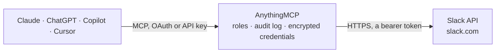

<!-- Generated by scripts/export-github-catalog.mjs in the anythingmcp-website repository. Do not edit by hand. -->

# Slack MCP connector

Let your AI work in Slack: find channels and people, read channel history and threads, catch up on what was said, post messages and thread replies, and react with emoji. The AnythingMCP connector gives Claude, ChatGPT, Microsoft Copilot, Cursor and Gemini 11 MCP tools for Slack: 8 read and 3 can change data.

**Category:** [Messaging](../messaging.md) · **Tools:** 11 · **Setup guide:** [anythingmcp.com](https://anythingmcp.com/guides/slack-to-mcp) · [Deutsch](https://anythingmcp.com/de/guides/slack-to-mcp) · [Italiano](https://anythingmcp.com/it/guides/slack-to-mcp) · [Español](https://anythingmcp.com/es/guides/slack-to-mcp) · [日本語](https://anythingmcp.com/ja/guides/slack-to-mcp) · [Русский](https://anythingmcp.com/ru/guides/slack-to-mcp) · [中文](https://anythingmcp.com/zh/guides/slack-to-mcp)

## Start without code

No installation and no terminal: AnythingMCP Cloud runs the Slack connector for you, operated by helpcode.ai in Frankfurt, Germany.

1. **Click the button above** and create an account or sign in. The Slack connector opens, ready to install.
2. **Paste the API key or token from your Slack account.** Every click is in the [step-by-step guide](https://anythingmcp.com/guides/slack-to-mcp).
3. **Click Install.** AnythingMCP shows the address of your MCP server.
4. **Add that address to your assistant:** [Claude](https://anythingmcp.com/guides/connect-slack-to-claude) · [ChatGPT](https://anythingmcp.com/guides/connect-slack-to-chatgpt) · [Microsoft Copilot](https://anythingmcp.com/guides/connect-slack-to-copilot) · [Cursor](https://anythingmcp.com/guides/connect-slack-to-cursor) · [Gemini CLI](https://anythingmcp.com/guides/connect-slack-to-gemini) · [Meta Muse](https://anythingmcp.com/guides/connect-slack-to-muse).
5. **Ask your first question**, for example: *Show the latest message in #finance-monthly that mentions invoice INV-2026-045 this month.*

Prefer help with the setup? [Talk to us](https://anythingmcp.com/contact).

## How it works

- **The AI client** speaks MCP (Streamable HTTP) to AnythingMCP and only sees tool names, descriptions and results. It never gets the Slack credentials.
- **AnythingMCP** checks the client's role, builds the call from the tool definition, adds the credentials (a bearer token), calls Slack, logs the call and returns the result.
- **Slack** sees an ordinary API client with the rights of the account the credentials belong to.

## Tools

| Tool | What it does | Access |
|---|---|---|
| [`slack_auth_test`](#slack_auth_test) | Check the token and return who it acts as: workspace name, URL and id, the user id, and for a bot token the bot id. | read |
| [`slack_list_conversations`](#slack_list_conversations) | List the workspace's conversations the token can see: public channels by default, and private channels, group DMs or direct messages on request. | read |
| [`slack_get_conversation_info`](#slack_get_conversation_info) | Get the details of one channel or conversation by id: name, topic, purpose, creator, creation time, archive state and whether the token is a member,… | read |
| [`slack_get_conversation_history`](#slack_get_conversation_history) | Read the messages of a channel or conversation, newest first, optionally within a time window. | read |
| [`slack_get_thread_replies`](#slack_get_thread_replies) | Read a thread: the parent message followed by its replies in order, for a channel and the parent message's ts. | read |
| [`slack_list_users`](#slack_list_users) | List the members of the workspace, including bots, invited and deactivated accounts, with id, name, real name, display name, title, time zone and flags such… | read |
| [`slack_get_user_info`](#slack_get_user_info) | Get one person's profile by user id: name, real and display name, title, time zone, status, and whether the account is deleted, a bot or an admin. | read |
| [`slack_join_channel`](#slack_join_channel) | Make the app a member of a public channel so it can read the channel's history. | write |
| [`slack_post_message`](#slack_post_message) | Post a message to a channel or conversation, or as a reply in a thread when thread_ts is given. | write |
| [`slack_add_reaction`](#slack_add_reaction) | Add an emoji reaction to a message, identified by its channel and ts. | write |
| [`slack_search_messages`](#slack_search_messages) | Search messages across the workspace with Slack search syntax (in:#channel, from:@name, before:, after:, has:link). | read |

## Tool reference

Every parameter as the AI client sees it in `tools/list`. Source: [`packages/backend/src/adapters/intl/slack.json`](../../../packages/backend/src/adapters/intl/slack.json).

### `slack_auth_test`

Check the token and return who it acts as: workspace name, URL and id, the user id, and for a bot token the bot id.

**Access:** read · **Call:** `GET /auth.test`

No parameters.

### `slack_list_conversations`

List the workspace's conversations the token can see: public channels by default, and private channels, group DMs or direct messages on request. Returns id, name, topic, purpose, archive and membership state per conversation, plus next_cursor for the next page.

**Access:** read · **Call:** `GET /conversations.list`

| Parameter | Type | Required | Description |
|---|---|---|---|
| `types` | string | no | Comma-separated conversation types: public_channel (default), private_channel, mpim, im, e.g. "public_channel,private_channel". |
| `exclude_archived` | boolean | no | true to leave out archived channels (default false). |
| `limit` | integer | no | Maximum conversations per page, 1 to 1000 (default 100). |
| `cursor` | string | no | response_metadata.next_cursor from the previous response, to fetch the next page with the same other arguments. |
| `team_id` | string | no | Workspace id; only needed with a token of an org-wide Enterprise Grid app. |

### `slack_get_conversation_info`

Get the details of one channel or conversation by id: name, topic, purpose, creator, creation time, archive state and whether the token is a member, optionally with the member count.

**Access:** read · **Call:** `GET /conversations.info`

| Parameter | Type | Required | Description |
|---|---|---|---|
| `channel` | string | yes | Conversation id, e.g. C0123456789. |
| `include_num_members` | boolean | no | true to add num_members (default false). |

### `slack_get_conversation_history`

Read the messages of a channel or conversation, newest first, optionally within a time window. Each message has its ts, user, text, thread_ts and reply count when it starts a thread, and reactions; has_more and next_cursor page further back.

**Access:** read · **Call:** `GET /conversations.history`

| Parameter | Type | Required | Description |
|---|---|---|---|
| `channel` | string | yes | Conversation id, e.g. C0123456789. |
| `oldest` | string | no | Only messages after this Unix timestamp in seconds, e.g. "1759276800" or a message ts. |
| `latest` | string | no | Only messages before this Unix timestamp in seconds (default now). |
| `inclusive` | boolean | no | true to include messages exactly at oldest or latest. |
| `limit` | integer | no | Maximum messages per page, 1 to 999 (default 100). |
| `cursor` | string | no | response_metadata.next_cursor from the previous response, to fetch the next page with the same other arguments. |

### `slack_get_thread_replies`

Read a thread: the parent message followed by its replies in order, for a channel and the parent message's ts. has_more and next_cursor page through long threads.

**Access:** read · **Call:** `GET /conversations.replies`

| Parameter | Type | Required | Description |
|---|---|---|---|
| `channel` | string | yes | Conversation id the thread is in. |
| `ts` | string | yes | ts of the thread's parent message (its thread_ts), e.g. "1712345678.123456". |
| `oldest` | string | no | Only replies after this Unix timestamp in seconds. |
| `latest` | string | no | Only replies before this Unix timestamp in seconds. |
| `inclusive` | boolean | no | true to include replies exactly at oldest or latest. |
| `limit` | integer | no | Maximum messages per page, 1 to 1000. |
| `cursor` | string | no | response_metadata.next_cursor from the previous response, to fetch the next page with the same other arguments. |

### `slack_list_users`

List the members of the workspace, including bots, invited and deactivated accounts, with id, name, real name, display name, title, time zone and flags such as deleted, is_bot and is_admin. Email addresses appear only with the users:read.email scope.

**Access:** read · **Call:** `GET /users.list`

| Parameter | Type | Required | Description |
|---|---|---|---|
| `limit` | integer | no | Maximum users per page, 1 to 1000 (Slack recommends 200 or fewer for large workspaces). |
| `cursor` | string | no | response_metadata.next_cursor from the previous response, to fetch the next page with the same other arguments. |
| `team_id` | string | no | Workspace id; only needed with a token of an org-wide Enterprise Grid app. |

### `slack_get_user_info`

Get one person's profile by user id: name, real and display name, title, time zone, status, and whether the account is deleted, a bot or an admin. The email address appears only with the users:read.email scope.

**Access:** read · **Call:** `GET /users.info`

| Parameter | Type | Required | Description |
|---|---|---|---|
| `user` | string | yes | User id, e.g. U0123456789. |

### `slack_join_channel`

Make the app a member of a public channel so it can read the channel's history. Private channels cannot be joined this way: someone in the channel invites the app instead.

**Access:** write · **Call:** `POST /conversations.join`

| Parameter | Type | Required | Description |
|---|---|---|---|
| `channel` | string | yes | Id of the public channel, e.g. C0123456789. |

### `slack_post_message`

Post a message to a channel or conversation, or as a reply in a thread when thread_ts is given. Returns the posted message with its ts and the channel id.

**Access:** write · **Call:** `POST /chat.postMessage`

| Parameter | Type | Required | Description |
|---|---|---|---|
| `channel` | string | yes | Conversation id to post in, e.g. C0123456789. |
| `text` | string | yes | Message text in Slack mrkdwn, up to 4,000 characters. |
| `thread_ts` | string | no | ts of the parent message to reply in its thread. |
| `reply_broadcast` | boolean | no | With thread_ts: true to also show the reply in the channel (default false). |
| `unfurl_links` | boolean | no | false to stop link previews for text links. |
| `unfurl_media` | boolean | no | false to stop previews of media links. |

### `slack_add_reaction`

Add an emoji reaction to a message, identified by its channel and ts.

**Access:** write · **Call:** `POST /reactions.add`

| Parameter | Type | Required | Description |
|---|---|---|---|
| `channel` | string | yes | Conversation id of the message. |
| `timestamp` | string | yes | ts of the message, e.g. "1712345678.123456". |
| `name` | string | yes | Emoji name without colons, e.g. "thumbsup", "white_check_mark" or "thumbsup::skin-tone-3". |

### `slack_search_messages`

Search messages across the workspace with Slack search syntax (in:#channel, from:@name, before:, after:, has:link). Works only with a user token (xoxp-) that has the search:read scope. Returns matches with channel, user, ts, text and permalink, and paging information.

**Access:** read · **Call:** `GET /search.messages`

| Parameter | Type | Required | Description |
|---|---|---|---|
| `query` | string | yes | Search query, e.g. "invoice in:#finance after:2026-10-01". |
| `count` | integer | no | Results per page, 1 to 100 (default 20). |
| `page` | integer | no | Page number, starting at 1. |
| `sort` | `score` \| `timestamp` | no | Sort by relevance (score, default) or time (timestamp). |
| `sort_dir` | `asc` \| `desc` | no | Sort direction (default desc). |

## Run it yourself

AnythingMCP is open source (AGPL-3.0). [Run it with Docker](../../../README.md#run-it-yourself), open **Connectors → Store**, pick **Slack** and enter `SLACK_TOKEN`, then add your MCP server URL to the AI client.

[← Messaging connectors](../messaging.md) · [All categories](../README.md)
