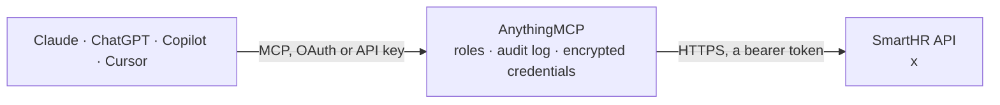

<!-- Generated by scripts/export-github-catalog.mjs in the anythingmcp-website repository. Do not edit by hand. -->

# SmartHR MCP connector

SmartHR, the Japanese HR and labour management cloud: employees with departments, job titles, employment types, grades, work locations and custom fields, dependents and childcare leaves, user … The AnythingMCP connector gives Claude, ChatGPT, Microsoft Copilot, Cursor and Gemini 30 MCP tools for SmartHR: 24 read and 6 can change data.

**Category:** [HR](../hr.md) · **Tools:** 30 · **Setup guide:** [anythingmcp.com](https://anythingmcp.com/guides/smarthr-to-mcp) · [Deutsch](https://anythingmcp.com/de/guides/smarthr-to-mcp) · [Italiano](https://anythingmcp.com/it/guides/smarthr-to-mcp) · [Español](https://anythingmcp.com/es/guides/smarthr-to-mcp) · [日本語](https://anythingmcp.com/ja/guides/smarthr-to-mcp) · [Русский](https://anythingmcp.com/ru/guides/smarthr-to-mcp) · [中文](https://anythingmcp.com/zh/guides/smarthr-to-mcp)

## Start without code

No installation and no terminal: AnythingMCP Cloud runs the SmartHR connector for you, operated by helpcode.ai in Frankfurt, Germany.

1. **Click the button above** and create an account or sign in. The SmartHR connector opens, ready to install.
2. **Paste the API key or token from your SmartHR account.** Every click is in the [step-by-step guide](https://anythingmcp.com/guides/smarthr-to-mcp).
3. **Click Install.** AnythingMCP shows the address of your MCP server.
4. **Add that address to your assistant:** [Claude](https://anythingmcp.com/guides/connect-smarthr-to-claude) · [ChatGPT](https://anythingmcp.com/guides/connect-smarthr-to-chatgpt) · [Microsoft Copilot](https://anythingmcp.com/guides/connect-smarthr-to-copilot) · [Cursor](https://anythingmcp.com/guides/connect-smarthr-to-cursor) · [Gemini CLI](https://anythingmcp.com/guides/connect-smarthr-to-gemini) · [Meta Muse](https://anythingmcp.com/guides/connect-smarthr-to-muse).
5. **Ask your first question**, for example: *Find employee with employee code E-2026-311 and give full crew record fields needed for payroll.*

Prefer help with the setup? [Talk to us](https://anythingmcp.com/contact).

## How it works

- **The AI client** speaks MCP (Streamable HTTP) to AnythingMCP and only sees tool names, descriptions and results. It never gets the SmartHR credentials.
- **AnythingMCP** checks the client's role, builds the call from the tool definition, adds the credentials (a bearer token), calls SmartHR, logs the call and returns the result.
- **SmartHR** sees an ordinary API client with the rights of the account the credentials belong to.

## Tools

| Tool | What it does | Access |
|---|---|---|
| [`smarthr_list_companies`](#smarthr_list_companies) | List the companies (会社) of the SmartHR tenant: id, name, corporate number, address and representative. | read |
| [`smarthr_list_biz_establishments`](#smarthr_list_biz_establishments) | List the business establishments (事業所) used for social and labour insurance: id, name, address, insurance numbers and owner. | read |
| [`smarthr_list_departments`](#smarthr_list_departments) | List departments (部署) with id, name, code, position (sort order), parent and full path. | read |
| [`smarthr_get_department`](#smarthr_get_department) | Read one department (部署) with its name, code, parent and position in the tree. | read |
| [`smarthr_create_department`](#smarthr_create_department) | Create a department (部署), optionally under a parent department. | write |
| [`smarthr_update_department`](#smarthr_update_department) | Rename or move a department (部署): name is always sent; code, parent and position only when given. | write |
| [`smarthr_list_job_titles`](#smarthr_list_job_titles) | List job titles (役職, positions) with id, name and rank. | read |
| [`smarthr_list_employment_types`](#smarthr_list_employment_types) | List employment types (雇用形態) with id, name and preset_type (full_timer, part_timer, contract_worker ...). | read |
| [`smarthr_list_grades`](#smarthr_list_grades) | List grades (等級) with id, name and position, as used in the employee grade field. | read |
| [`smarthr_list_work_locations`](#smarthr_list_work_locations) | List work locations (勤務地) with id, name and address, as used in work_location_id of an employee. | read |
| [`smarthr_list_payment_periods`](#smarthr_list_payment_periods) | List the pay period settings (給与支給形態) such as monthly or hourly, used in payment_period_id of an employee. | read |
| [`smarthr_list_crew_custom_field_templates`](#smarthr_list_crew_custom_field_templates) | List the custom employee fields (カスタム従業員項目): id (template_id for writes), name, type (string, text, decimal, date, enum, file), options and group. | read |
| [`smarthr_list_crew_custom_field_template_groups`](#smarthr_list_crew_custom_field_template_groups) | List the groups of custom employee fields (カスタム項目グループ), optionally with their templates. | read |
| [`smarthr_list_crews`](#smarthr_list_crews) | Search employees (従業員, crews). | read |
| [`smarthr_get_crew`](#smarthr_get_crew) | Read one employee (従業員) with every field, or only the fields listed: names and readings, contact, address, employment, departments, job titles, insurance… | read |
| [`smarthr_create_crew`](#smarthr_create_crew) | Register a new employee (従業員). | write |
| [`smarthr_update_crew`](#smarthr_update_crew) | Change fields of an employee (従業員) with a partial update (PATCH): only the fields you send change, and a filled name, reading, gender, birth date or address… | write |
| [`smarthr_invite_crew`](#smarthr_invite_crew) | Invite an employee to SmartHR: sends the invitation email to the email of the employee, from the given inviter, optionally with an employee information form… | write |
| [`smarthr_delete_crew`](#smarthr_delete_crew) | Delete an employee (従業員) and all of their data for good. | write |
| [`smarthr_list_crew_input_forms`](#smarthr_list_crew_input_forms) | List the employee information forms (従業員情報収集フォーム) that can be sent with an invitation: id, name and fields asked. | read |
| [`smarthr_list_crew_dependents`](#smarthr_list_crew_dependents) | List the dependents (家族, family members) of an employee: name, relation, birth date, whether they are a tax or health insurance dependent, income and custom… | read |
| [`smarthr_get_crew_dependent`](#smarthr_get_crew_dependent) | Read one dependent (家族) of an employee with all fields. | read |
| [`smarthr_list_dependent_relations`](#smarthr_list_dependent_relations) | List the relation types (続柄) usable for dependents, e.g. spouse, child; filter spouse returns only spouse relations. | read |
| [`smarthr_list_crew_childcare_leaves`](#smarthr_list_crew_childcare_leaves) | List maternity and childcare leaves (産休育休) of an employee with their periods. | read |
| [`smarthr_list_users`](#smarthr_list_users) | List SmartHR user accounts (ユーザー): id, email, role, admin flag, invitation state and, with embed crew, the linked employee. | read |
| [`smarthr_get_user`](#smarthr_get_user) | Read one SmartHR user account with role, admin flag and invitation dates. | read |
| [`smarthr_list_payrolls`](#smarthr_list_payrolls) | List payroll runs (給与明細グループ): id, payment type (salary or bonus), paid date, period, status (fixed, published) and name. | read |
| [`smarthr_get_payroll`](#smarthr_get_payroll) | Read one payroll run (給与明細グループ) with its status, dates and settings. | read |
| [`smarthr_list_payslips`](#smarthr_list_payslips) | List the payslips (給与明細) of a payroll run: per employee the allowances, deductions, attendance and totals. | read |
| [`smarthr_get_payslip`](#smarthr_get_payslip) | Read one payslip (給与明細) with allowances, deductions, attendance and aggregates. | read |

## Tool reference

Every parameter as the AI client sees it in `tools/list`. Source: [`packages/backend/src/adapters/jp/smarthr.json`](../../../packages/backend/src/adapters/jp/smarthr.json).

### `smarthr_list_companies`

List the companies (会社) of the SmartHR tenant: id, name, corporate number, address and representative. The install check.

**Access:** read · **Call:** `GET /v1/companies`

| Parameter | Type | Required | Description |
|---|---|---|---|
| `embed` | `owner` | no | owner adds the company owner. |
| `page` | integer | no | Page, 1-based (default 1). The x-total-count header gives the total; call again with _pagination.nextCursor as page while it is present. |
| `per_page` | integer | no | Rows per page, 1 to 100 (default 10). |

### `smarthr_list_biz_establishments`

List the business establishments (事業所) used for social and labour insurance: id, name, address, insurance numbers and owner.

**Access:** read · **Call:** `GET /v1/biz_establishments`

| Parameter | Type | Required | Description |
|---|---|---|---|
| `embed` | `soc_ins_owner` \| `lab_ins_owner` \| `company` | no | Embed soc_ins_owner, lab_ins_owner or company. |
| `page` | integer | no | Page, 1-based (default 1). The x-total-count header gives the total; call again with _pagination.nextCursor as page while it is present. |
| `per_page` | integer | no | Rows per page, 1 to 100 (default 10). |

### `smarthr_list_departments`

List departments (部署) with id, name, code, position (sort order), parent and full path. Employees link to them through department_ids.

**Access:** read · **Call:** `GET /v1/departments`

| Parameter | Type | Required | Description |
|---|---|---|---|
| `code` | string | no | Only the department with this code. |
| `sort` | string | no | Sort field, e.g. position or -updated_at. |
| `page` | integer | no | Page, 1-based (default 1). The x-total-count header gives the total; call again with _pagination.nextCursor as page while it is present. |
| `per_page` | integer | no | Rows per page, 1 to 100 (default 10). |

### `smarthr_get_department`

Read one department (部署) with its name, code, parent and position in the tree.

**Access:** read · **Call:** `GET /v1/departments/{id}`

| Parameter | Type | Required | Description |
|---|---|---|---|
| `id` | string | yes | Department id. |

### `smarthr_create_department`

Create a department (部署), optionally under a parent department.

**Access:** write · **Call:** `POST /v1/departments`

| Parameter | Type | Required | Description |
|---|---|---|---|
| `name` | string | yes | Department name. |
| `code` | string | no | Department code. |
| `parent_id` | string | no | Parent department id. |
| `position` | integer | no | Sort position among its siblings. |
| `company_id` | string | no | Company id, when the tenant has several companies. |

### `smarthr_update_department`

Rename or move a department (部署): name is always sent; code, parent and position only when given.

**Access:** write · **Call:** `PATCH /v1/departments/{id}`

| Parameter | Type | Required | Description |
|---|---|---|---|
| `id` | string | yes | Department id. |
| `name` | string | yes | Department name. |
| `code` | string | no | Department code. |
| `parent_id` | string | no | Parent department id. |
| `position` | integer | no | Sort position. |

### `smarthr_list_job_titles`

List job titles (役職, positions) with id, name and rank. Employees carry them in positions.

**Access:** read · **Call:** `GET /v1/job_titles`

| Parameter | Type | Required | Description |
|---|---|---|---|
| `sort` | string | no | Sort field, e.g. rank. |
| `page` | integer | no | Page, 1-based (default 1). The x-total-count header gives the total; call again with _pagination.nextCursor as page while it is present. |
| `per_page` | integer | no | Rows per page, 1 to 100 (default 10). |

### `smarthr_list_employment_types`

List employment types (雇用形態) with id, name and preset_type (full_timer, part_timer, contract_worker ...).

**Access:** read · **Call:** `GET /v1/employment_types`

| Parameter | Type | Required | Description |
|---|---|---|---|
| `page` | integer | no | Page, 1-based (default 1). The x-total-count header gives the total; call again with _pagination.nextCursor as page while it is present. |
| `per_page` | integer | no | Rows per page, 1 to 100 (default 10). |

### `smarthr_list_grades`

List grades (等級) with id, name and position, as used in the employee grade field.

**Access:** read · **Call:** `GET /v1/grades`

| Parameter | Type | Required | Description |
|---|---|---|---|
| `page` | integer | no | Page, 1-based (default 1). The x-total-count header gives the total; call again with _pagination.nextCursor as page while it is present. |
| `per_page` | integer | no | Rows per page, 1 to 100 (default 10). |

### `smarthr_list_work_locations`

List work locations (勤務地) with id, name and address, as used in work_location_id of an employee.

**Access:** read · **Call:** `GET /v1/work_locations`

| Parameter | Type | Required | Description |
|---|---|---|---|
| `page` | integer | no | Page, 1-based (default 1). The x-total-count header gives the total; call again with _pagination.nextCursor as page while it is present. |
| `per_page` | integer | no | Rows per page, 1 to 100 (default 10). |

### `smarthr_list_payment_periods`

List the pay period settings (給与支給形態) such as monthly or hourly, used in payment_period_id of an employee.

**Access:** read · **Call:** `GET /v1/payment_periods`

| Parameter | Type | Required | Description |
|---|---|---|---|
| `sort` | string | no | Sort field. |
| `page` | integer | no | Page, 1-based (default 1). The x-total-count header gives the total; call again with _pagination.nextCursor as page while it is present. |
| `per_page` | integer | no | Rows per page, 1 to 100 (default 10). |

### `smarthr_list_crew_custom_field_templates`

List the custom employee fields (カスタム従業員項目): id (template_id for writes), name, type (string, text, decimal, date, enum, file), options and group.

**Access:** read · **Call:** `GET /v1/crew_custom_field_templates`

| Parameter | Type | Required | Description |
|---|---|---|---|
| `embed` | `group` | no | group replaces group_id with the group object. |
| `page` | integer | no | Page, 1-based (default 1). The x-total-count header gives the total; call again with _pagination.nextCursor as page while it is present. |
| `per_page` | integer | no | Rows per page, 1 to 100 (default 10). |

### `smarthr_list_crew_custom_field_template_groups`

List the groups of custom employee fields (カスタム項目グループ), optionally with their templates.

**Access:** read · **Call:** `GET /v1/crew_custom_field_template_groups`

| Parameter | Type | Required | Description |
|---|---|---|---|
| `embed` | `templates` | no | templates adds the templates of each group. |
| `page` | integer | no | Page, 1-based (default 1). The x-total-count header gives the total; call again with _pagination.nextCursor as page while it is present. |
| `per_page` | integer | no | Rows per page, 1 to 100 (default 10). |

### `smarthr_list_crews`

Search employees (従業員, crews). Filter by employee code, status (employed, absent, retired), employment type, department, job title, hire or resignation dates, ids, or free text over name, business name, department and title. By default only a short set of fields is returned; ask for more with fields. Personal data: only request the fields the task needs.

**Access:** read · **Call:** `GET /v1/crews`

| Parameter | Type | Required | Description |
|---|---|---|---|
| `q` | string | no | Free text over name, business name, department and job title. |
| `emp_code` | string | no | Employee number (社員番号). |
| `emp_status` | `employed` \| `absent` \| `retired` | no | employed (在籍), absent (休職) or retired (退職). |
| `employment_type_id` | string | no | Employment type id(s), comma separated. |
| `department_id` | string | no | Department id(s), comma separated. |
| `position_id` | string | no | Job title id(s), comma separated. |
| `id` | string | no | Employee id(s), comma separated. |
| `user_id` | string | no | User id(s), comma separated. |
| `gender` | `male` \| `female` | no | Gender on the family register: male or female. |
| `entered_at_from` | string | no | Hired on or after, YYYY-MM-DD. |
| `entered_at_to` | string | no | Hired on or before, YYYY-MM-DD. |
| `resigned_at_from` | string | no | Resigned on or after, YYYY-MM-DD. |
| `resigned_at_to` | string | no | Resigned on or before, YYYY-MM-DD. |
| `sort` | string | no | Sort field, e.g. emp_code or -updated_at (newest change first; use it for incremental syncs). |
| `fields` | string | no | Fields to return, comma separated. Default is a short profile; e.g. add birth_at,address,custom_fields only when needed. |
| `page` | integer | no | Page, 1-based (default 1). The x-total-count header gives the total; call again with _pagination.nextCursor as page while it is present. |
| `per_page` | integer | no | Rows per page, 1 to 100 (default 10). |

### `smarthr_get_crew`

Read one employee (従業員) with every field, or only the fields listed: names and readings, contact, address, employment, departments, job titles, insurance numbers, salary data, bank accounts and custom fields. Contains sensitive personal data: pass fields to limit what is read.

**Access:** read · **Call:** `GET /v1/crews/{id}`

| Parameter | Type | Required | Description |
|---|---|---|---|
| `id` | string | yes | Employee (crew) id from smarthr_list_crews. |
| `fields` | string | no | Fields to return, comma separated, e.g. id,last_name,first_name,departments,positions. Omit for all. |

### `smarthr_create_crew`

Register a new employee (従業員). Names, readings, gender and status are required. The person is not invited to SmartHR until smarthr_invite_crew. Personal data: enter only what the user gave you.

**Access:** write · **Call:** `POST /v1/crews`

| Parameter | Type | Required | Description |
|---|---|---|---|
| `emp_code` | string | no | Employee number (社員番号). |
| `emp_status` | `employed` \| `absent` \| `retired` | yes | employed (在籍), absent (休職) or retired (退職). |
| `last_name` | string | yes | Family name (姓). |
| `first_name` | string | yes | Given name (名). |
| `last_name_yomi` | string | yes | Family name in katakana (姓カナ). |
| `first_name_yomi` | string | yes | Given name in katakana (名カナ). |
| `business_last_name` | string | no | Business family name (ビジネスネーム). |
| `business_first_name` | string | no | Business given name. |
| `gender` | `male` \| `female` | yes | Gender on the family register: male or female. |
| `birth_at` | string | no | Birth date, YYYY-MM-DD. |
| `email` | string | no | Email address; used for the SmartHR invitation. |
| `tel_number` | string | no | Phone number. |
| `entered_at` | string | no | Hire date (入社年月日), YYYY-MM-DD. |
| `resigned_at` | string | no | Resignation date (退職年月日), YYYY-MM-DD. |
| `resigned_reason` | string | no | Reason for resignation. |
| `employment_type_id` | string | no | Employment type id from smarthr_list_employment_types. |
| `department_ids` | string[] | no | Department ids from smarthr_list_departments; replaces the current departments. |
| `positions` | string[] | no | Job title names (役職); replaces the current titles. Unknown names create a new job title. |
| `grade` | string | no | Grade name (等級). |
| `work_location_id` | string | no | Work location id from smarthr_list_work_locations. |
| `biz_establishment_id` | string | no | Business establishment id from smarthr_list_biz_establishments. |
| `contract_type` | `unlimited` \| `fixed_term` | no | unlimited (無期) or fixed_term (有期). |
| `contract_start_on` | string | no | Contract start, YYYY-MM-DD. |
| `contract_end_on` | string | no | Contract end, YYYY-MM-DD. |
| `custom_fields` | object[] | no | Custom field values: [{"template_id": "...", "value": "..."}] with template ids from smarthr_list_crew_custom_field_templates (dates YYYY-MM-DD, enum by option id or physical name). |

### `smarthr_update_crew`

Change fields of an employee (従業員) with a partial update (PATCH): only the fields you send change, and a filled name, reading, gender, birth date or address cannot be emptied. Read the employee first and show the change before saving.

**Access:** write · **Call:** `PATCH /v1/crews/{id}`

| Parameter | Type | Required | Description |
|---|---|---|---|
| `id` | string | yes | Employee (crew) id. |
| `emp_code` | string | no | Employee number (社員番号). |
| `emp_status` | `employed` \| `absent` \| `retired` | no | employed (在籍), absent (休職) or retired (退職). |
| `last_name` | string | no | Family name (姓). |
| `first_name` | string | no | Given name (名). |
| `last_name_yomi` | string | no | Family name in katakana (姓カナ). |
| `first_name_yomi` | string | no | Given name in katakana (名カナ). |
| `business_last_name` | string | no | Business family name (ビジネスネーム). |
| `business_first_name` | string | no | Business given name. |
| `gender` | `male` \| `female` | no | Gender on the family register: male or female. |
| `birth_at` | string | no | Birth date, YYYY-MM-DD. |
| `email` | string | no | Email address; used for the SmartHR invitation. |
| `tel_number` | string | no | Phone number. |
| `entered_at` | string | no | Hire date (入社年月日), YYYY-MM-DD. |
| `resigned_at` | string | no | Resignation date (退職年月日), YYYY-MM-DD. |
| `resigned_reason` | string | no | Reason for resignation. |
| `employment_type_id` | string | no | Employment type id from smarthr_list_employment_types. |
| `department_ids` | string[] | no | Department ids from smarthr_list_departments; replaces the current departments. |
| `positions` | string[] | no | Job title names (役職); replaces the current titles. Unknown names create a new job title. |
| `grade` | string | no | Grade name (等級). |
| `work_location_id` | string | no | Work location id from smarthr_list_work_locations. |
| `biz_establishment_id` | string | no | Business establishment id from smarthr_list_biz_establishments. |
| `contract_type` | `unlimited` \| `fixed_term` | no | unlimited (無期) or fixed_term (有期). |
| `contract_start_on` | string | no | Contract start, YYYY-MM-DD. |
| `contract_end_on` | string | no | Contract end, YYYY-MM-DD. |
| `custom_fields` | object[] | no | Custom field values: [{"template_id": "...", "value": "..."}] with template ids from smarthr_list_crew_custom_field_templates (dates YYYY-MM-DD, enum by option id or physical name). |

### `smarthr_invite_crew`

Invite an employee to SmartHR: sends the invitation email to the email of the employee, from the given inviter, optionally with an employee information form (従業員情報収集フォーム). A second call re-invites. Confirm with the user first.

**Access:** write · **Call:** `PUT /v1/crews/{id}/invite`

| Parameter | Type | Required | Description |
|---|---|---|---|
| `id` | string | yes | Employee (crew) id. |
| `inviter_user_id` | string | yes | User id of the inviter, from smarthr_list_users. |
| `crew_input_form_id` | string | no | Employee information form id, from smarthr_list_crew_input_forms. |

### `smarthr_delete_crew`

Delete an employee (従業員) and all of their data for good. To record a resignation use smarthr_update_crew with emp_status retired and resigned_at instead. Installed switched off.

**Access:** write · **Call:** `DELETE /v1/crews/{id}`

| Parameter | Type | Required | Description |
|---|---|---|---|
| `id` | string | yes | Employee (crew) id. |

### `smarthr_list_crew_input_forms`

List the employee information forms (従業員情報収集フォーム) that can be sent with an invitation: id, name and fields asked.

**Access:** read · **Call:** `GET /v1/crew_input_forms`

| Parameter | Type | Required | Description |
|---|---|---|---|
| `page` | integer | no | Page, 1-based (default 1). The x-total-count header gives the total; call again with _pagination.nextCursor as page while it is present. |
| `per_page` | integer | no | Rows per page, 1 to 100 (default 10). |

### `smarthr_list_crew_dependents`

List the dependents (家族, family members) of an employee: name, relation, birth date, whether they are a tax or health insurance dependent, income and custom fields. Personal data.

**Access:** read · **Call:** `GET /v1/crews/{crew_id}/dependents`

| Parameter | Type | Required | Description |
|---|---|---|---|
| `crew_id` | string | yes | Employee (crew) id. |
| `page` | integer | no | Page, 1-based (default 1). The x-total-count header gives the total; call again with _pagination.nextCursor as page while it is present. |
| `per_page` | integer | no | Rows per page, 1 to 100 (default 10). |

### `smarthr_get_crew_dependent`

Read one dependent (家族) of an employee with all fields. Personal data.

**Access:** read · **Call:** `GET /v1/crews/{crew_id}/dependents/{id}`

| Parameter | Type | Required | Description |
|---|---|---|---|
| `crew_id` | string | yes | Employee (crew) id. |
| `id` | string | yes | Dependent id. |

### `smarthr_list_dependent_relations`

List the relation types (続柄) usable for dependents, e.g. spouse, child; filter spouse returns only spouse relations.

**Access:** read · **Call:** `GET /v1/dependent_relations`

| Parameter | Type | Required | Description |
|---|---|---|---|
| `filter` | `spouse` | no | spouse for spouse relations only. |
| `page` | integer | no | Page, 1-based (default 1). The x-total-count header gives the total; call again with _pagination.nextCursor as page while it is present. |
| `per_page` | integer | no | Rows per page, 1 to 100 (default 10). |

### `smarthr_list_crew_childcare_leaves`

List maternity and childcare leaves (産休育休) of an employee with their periods.

**Access:** read · **Call:** `GET /v1/crews/{crew_id}/maternity_childcare_leaves`

| Parameter | Type | Required | Description |
|---|---|---|---|
| `crew_id` | string | yes | Employee (crew) id. |
| `page` | integer | no | Page, 1-based (default 1). The x-total-count header gives the total; call again with _pagination.nextCursor as page while it is present. |
| `per_page` | integer | no | Rows per page, 1 to 100 (default 10). |

### `smarthr_list_users`

List SmartHR user accounts (ユーザー): id, email, role, admin flag, invitation state and, with embed crew, the linked employee. A user is the login; a crew is the employee record.

**Access:** read · **Call:** `GET /v1/users`

| Parameter | Type | Required | Description |
|---|---|---|---|
| `sort` | string | no | Sort field. |
| `embed` | `crew` \| `biz_establishment` \| `biz_establishment_company` \| `department_company` | no | Embed crew, biz_establishment, biz_establishment_company or department_company. |
| `page` | integer | no | Page, 1-based (default 1). The x-total-count header gives the total; call again with _pagination.nextCursor as page while it is present. |
| `per_page` | integer | no | Rows per page, 1 to 100 (default 10). |

### `smarthr_get_user`

Read one SmartHR user account with role, admin flag and invitation dates.

**Access:** read · **Call:** `GET /v1/users/{id}`

| Parameter | Type | Required | Description |
|---|---|---|---|
| `id` | string | yes | User id. |
| `embed` | `crew` \| `biz_establishment` \| `biz_establishment_company` \| `department_company` | no | Embed crew, biz_establishment, biz_establishment_company or department_company. |

### `smarthr_list_payrolls`

List payroll runs (給与明細グループ): id, payment type (salary or bonus), paid date, period, status (fixed, published) and name. Needs the payslip feature of SmartHR.

**Access:** read · **Call:** `GET /v1/payrolls`

| Parameter | Type | Required | Description |
|---|---|---|---|
| `payment_type` | `salary` \| `bonus` | no | salary (給与) or bonus (賞与). |
| `paid_at_from` | string | no | Paid on or after, YYYY-MM-DD. |
| `paid_at_to` | string | no | Paid on or before, YYYY-MM-DD. |
| `page` | integer | no | Page, 1-based (default 1). The x-total-count header gives the total; call again with _pagination.nextCursor as page while it is present. |
| `per_page` | integer | no | Rows per page, 1 to 100 (default 10). |

### `smarthr_get_payroll`

Read one payroll run (給与明細グループ) with its status, dates and settings.

**Access:** read · **Call:** `GET /v1/payrolls/{id}`

| Parameter | Type | Required | Description |
|---|---|---|---|
| `id` | string | yes | Payroll id from smarthr_list_payrolls. |

### `smarthr_list_payslips`

List the payslips (給与明細) of a payroll run: per employee the allowances, deductions, attendance and totals. Salary data: read only what the task needs, filter by crew_id.

**Access:** read · **Call:** `GET /v1/payrolls/{payroll_id}/payslips`

| Parameter | Type | Required | Description |
|---|---|---|---|
| `payroll_id` | string | yes | Payroll id. |
| `crew_id` | string | no | Employee id(s), comma separated. |
| `embed` | `company` | no | company adds the company. |
| `page` | integer | no | Page, 1-based (default 1). The x-total-count header gives the total; call again with _pagination.nextCursor as page while it is present. |
| `per_page` | integer | no | Rows per page, 1 to 100 (default 10). |

### `smarthr_get_payslip`

Read one payslip (給与明細) with allowances, deductions, attendance and aggregates.

**Access:** read · **Call:** `GET /v1/payrolls/{payroll_id}/payslips/{id}`

| Parameter | Type | Required | Description |
|---|---|---|---|
| `payroll_id` | string | yes | Payroll id. |
| `id` | string | yes | Payslip id. |
| `embed` | `company` | no | company adds the company. |

## Run it yourself

AnythingMCP is open source (AGPL-3.0). [Run it with Docker](../../../README.md#run-it-yourself), open **Connectors → Store**, pick **SmartHR** and enter `SMARTHR_HOST`, `SMARTHR_ACCESS_TOKEN`, then add your MCP server URL to the AI client.

[← HR connectors](../hr.md) · [All categories](../README.md)
