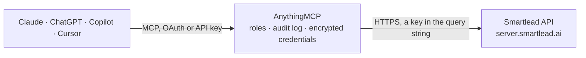

<!-- Generated by scripts/export-github-catalog.mjs in the anythingmcp-website repository. Do not edit by hand. -->

# Smartlead MCP connector

Smartlead cold email outreach from any AI agent: campaigns, sequences and schedules, leads and categories, master inbox replies, campaign and account analytics, sender mailboxes with warmup, and webhooks. The AnythingMCP connector gives Claude, ChatGPT, Microsoft Copilot, Cursor and Gemini 43 MCP tools for Smartlead: 23 read and 20 can change data.

**Category:** [CRM](../crm.md) · **Tools:** 43 · **Setup guide:** [anythingmcp.com](https://anythingmcp.com/guides/smartlead-to-mcp) · [Deutsch](https://anythingmcp.com/de/guides/smartlead-to-mcp) · [Italiano](https://anythingmcp.com/it/guides/smartlead-to-mcp) · [Español](https://anythingmcp.com/es/guides/smartlead-to-mcp) · [日本語](https://anythingmcp.com/ja/guides/smartlead-to-mcp) · [Русский](https://anythingmcp.com/ru/guides/smartlead-to-mcp) · [中文](https://anythingmcp.com/zh/guides/smartlead-to-mcp)

## Start without code

No installation and no terminal: AnythingMCP Cloud runs the Smartlead connector for you, operated by helpcode.ai in Frankfurt, Germany.

1. **Click the button above** and create an account or sign in. The Smartlead connector opens, ready to install.
2. **Paste the API key or token from your Smartlead account.** Every click is in the [step-by-step guide](https://anythingmcp.com/guides/smartlead-to-mcp).
3. **Click Install.** AnythingMCP shows the address of your MCP server.
4. **Add that address to your assistant:** [Claude](https://anythingmcp.com/guides/connect-smartlead-to-claude) · [ChatGPT](https://anythingmcp.com/guides/connect-smartlead-to-chatgpt) · [Microsoft Copilot](https://anythingmcp.com/guides/connect-smartlead-to-copilot) · [Cursor](https://anythingmcp.com/guides/connect-smartlead-to-cursor) · [Gemini CLI](https://anythingmcp.com/guides/connect-smartlead-to-gemini) · [Meta Muse](https://anythingmcp.com/guides/connect-smartlead-to-muse).
5. **Ask your first question**, for example: *Find lead by email lucia.martin@novelys.tech and tell me which campaigns she's in*

Prefer help with the setup? [Talk to us](https://anythingmcp.com/contact).

## How it works

- **The AI client** speaks MCP (Streamable HTTP) to AnythingMCP and only sees tool names, descriptions and results. It never gets the Smartlead credentials.
- **AnythingMCP** checks the client's role, builds the call from the tool definition, adds the credentials (a key in the query string), calls Smartlead, logs the call and returns the result.
- **Smartlead** sees an ordinary API client with the rights of the account the credentials belong to.

## Tools

| Tool | What it does | Access |
|---|---|---|
| [`smartlead_list_campaigns`](#smartlead_list_campaigns) | List all email campaigns, newest first, with status (DRAFTED, ACTIVE, PAUSED, STOPPED, ARCHIVED), schedule, sending limits and tracking settings. | read |
| [`smartlead_get_campaign`](#smartlead_get_campaign) | Get one campaign: status, schedule, sending limits, stop-lead setting, tracking settings and client. | read |
| [`smartlead_get_campaign_sequences`](#smartlead_get_campaign_sequences) | Get the email sequence of a campaign: steps with delays, subjects, bodies and A/B variants. | read |
| [`smartlead_list_campaign_email_accounts`](#smartlead_list_campaign_email_accounts) | List the sender mailboxes attached to a campaign, with their sending limits and warmup state. | read |
| [`smartlead_create_campaign`](#smartlead_create_campaign) | Create an empty campaign in DRAFTED status. | write |
| [`smartlead_update_campaign_status`](#smartlead_update_campaign_status) | Start, pause, stop or archive a campaign. | write |
| [`smartlead_update_campaign_settings`](#smartlead_update_campaign_settings) | Change campaign settings: name, open and click tracking, when to stop emailing a lead, plain text, follow-up percentage, AI mailbox matching, unsubscribe text. | write |
| [`smartlead_update_campaign_schedule`](#smartlead_update_campaign_schedule) | Set when a campaign sends: time zone, weekdays, sending window, minutes between emails, new leads per day and start time. | write |
| [`smartlead_save_campaign_sequences`](#smartlead_save_campaign_sequences) | Replace the email sequence of a campaign. | write |
| [`smartlead_add_email_accounts_to_campaign`](#smartlead_add_email_accounts_to_campaign) | Attach sender mailboxes to a campaign so it can send from them. | write |
| [`smartlead_list_campaign_leads`](#smartlead_list_campaign_leads) | List the leads of a campaign with their status, category and lead fields. | read |
| [`smartlead_get_lead_by_email`](#smartlead_get_lead_by_email) | Find a lead by email address across all campaigns. | read |
| [`smartlead_get_lead`](#smartlead_get_lead) | Get one lead by its id: contact fields, custom fields and global status. | read |
| [`smartlead_get_lead_campaign_overview`](#smartlead_get_lead_campaign_overview) | Show every campaign a lead is in, with its status and progress in each. | read |
| [`smartlead_get_lead_message_history`](#smartlead_get_lead_message_history) | Get the full email thread between a campaign and a lead: sent emails and replies with times, subjects, bodies and the stats_id and message_id needed to reply. | read |
| [`smartlead_add_leads_to_campaign`](#smartlead_add_leads_to_campaign) | Add up to 400 leads to a campaign. | write |
| [`smartlead_update_lead`](#smartlead_update_lead) | Update the fields of a lead in a campaign (email is required by the API even when unchanged). | write |
| [`smartlead_update_lead_category`](#smartlead_update_lead_category) | Set the category of a lead in a campaign (Interested, Meeting Request, Not Interested, Out Of Office...), optionally pausing it. | write |
| [`smartlead_pause_lead`](#smartlead_pause_lead) | Pause a lead in a campaign: no further sequence emails go out until it is resumed. | write |
| [`smartlead_resume_lead`](#smartlead_resume_lead) | Resume a paused lead in a campaign, now or after a delay in days. | write |
| [`smartlead_unsubscribe_lead_from_campaign`](#smartlead_unsubscribe_lead_from_campaign) | Unsubscribe a lead from one campaign. | write |
| [`smartlead_unsubscribe_lead_globally`](#smartlead_unsubscribe_lead_globally) | Unsubscribe a lead from every campaign of the account and block future imports of the address. | write |
| [`smartlead_delete_lead_from_campaign`](#smartlead_delete_lead_from_campaign) | Remove a lead from a campaign, with its progress in that campaign. | write |
| [`smartlead_list_lead_categories`](#smartlead_list_lead_categories) | List the lead categories (global and custom) with ids, e.g. Interested, Meeting Request, Not Interested, Do Not Contact, Out Of Office. | read |
| [`smartlead_list_inbox_replies`](#smartlead_list_inbox_replies) | List lead replies from the master inbox across campaigns, newest first, with filters for campaign, mailbox, category and reply time. | read |
| [`smartlead_get_inbox_item`](#smartlead_get_inbox_item) | Get one master inbox thread by its id, with lead, campaign and messages. | read |
| [`smartlead_reply_to_lead`](#smartlead_reply_to_lead) | Send a reply to a lead in an existing campaign thread, from the mailbox of that thread. | write |
| [`smartlead_create_lead_note`](#smartlead_create_lead_note) | Add an internal note to a lead in a campaign (shown in the master inbox). | write |
| [`smartlead_get_campaign_analytics`](#smartlead_get_campaign_analytics) | Get the totals of a campaign: sent, opened, clicked, replied, bounced, unsubscribed, plus lead progress counts. | read |
| [`smartlead_get_campaign_analytics_by_date`](#smartlead_get_campaign_analytics_by_date) | Get campaign totals (sent, opens, clicks, replies, bounces, unsubscribes) for a date range. | read |
| [`smartlead_get_campaign_sequence_analytics`](#smartlead_get_campaign_sequence_analytics) | Get per-step and per-variant results of a campaign sequence for a date range: sent, opens, clicks, replies, positive replies, bounces. | read |
| [`smartlead_get_campaign_statistics`](#smartlead_get_campaign_statistics) | List the individual sent emails of a campaign with lead, step, sent time, open, click, reply and bounce state. | read |
| [`smartlead_get_overall_analytics`](#smartlead_get_overall_analytics) | Get account-wide sending results for a date range: sent, opens, clicks, replies, positive replies, bounces and rates, optionally limited to campaigns or… | read |
| [`smartlead_list_email_accounts`](#smartlead_list_email_accounts) | List the sender mailboxes of the account: address, provider, daily limits, SMTP/IMAP health, warmup status and campaigns in use. | read |
| [`smartlead_get_email_account`](#smartlead_get_email_account) | Get one sender mailbox with its limits, signature, connection health and warmup details. | read |
| [`smartlead_get_warmup_stats`](#smartlead_get_warmup_stats) | Get the warmup results of a mailbox for the last 7 days: warmup emails sent, landed in inbox, landed in spam, replies. | read |
| [`smartlead_update_email_account`](#smartlead_update_email_account) | Change a mailbox: daily sending limit, sender name, signature, BCC, custom tracking domain, minutes between emails. | write |
| [`smartlead_update_warmup`](#smartlead_update_warmup) | Turn warmup on or off for a mailbox and set its daily warmup volume, ramp-up and reply rate. | write |
| [`smartlead_list_campaign_webhooks`](#smartlead_list_campaign_webhooks) | List the webhooks of a campaign with their URL and event types. | read |
| [`smartlead_upsert_campaign_webhook`](#smartlead_upsert_campaign_webhook) | Create a campaign webhook, or update one when its id is passed. | write |
| [`smartlead_delete_campaign_webhook`](#smartlead_delete_campaign_webhook) | Delete a webhook of a campaign. | write |
| [`smartlead_list_clients`](#smartlead_list_clients) | List the clients of an agency (white-label) account with their ids, names and emails. | read |
| [`smartlead_list_lead_lists`](#smartlead_list_lead_lists) | List the lead lists (lead pools outside campaigns) with ids, names and lead counts. | read |

## Tool reference

Every parameter as the AI client sees it in `tools/list`. Source: [`packages/backend/src/adapters/intl/smartlead.json`](../../../packages/backend/src/adapters/intl/smartlead.json).

### `smartlead_list_campaigns`

List all email campaigns, newest first, with status (DRAFTED, ACTIVE, PAUSED, STOPPED, ARCHIVED), schedule, sending limits and tracking settings.

**Access:** read · **Call:** `GET /campaigns/`

| Parameter | Type | Required | Description |
|---|---|---|---|
| `client_id` | integer | no | Only campaigns of this client (agency accounts), from smartlead_list_clients. |
| `include_tags` | boolean | no | Also return the campaign tags. |

### `smartlead_get_campaign`

Get one campaign: status, schedule, sending limits, stop-lead setting, tracking settings and client.

**Access:** read · **Call:** `GET /campaigns/{campaign_id}`

| Parameter | Type | Required | Description |
|---|---|---|---|
| `campaign_id` | integer | yes | Campaign id from smartlead_list_campaigns. |
| `include_tags` | boolean | no | Also return the campaign tags. |

### `smartlead_get_campaign_sequences`

Get the email sequence of a campaign: steps with delays, subjects, bodies and A/B variants.

**Access:** read · **Call:** `GET /campaigns/{campaign_id}/sequences`

| Parameter | Type | Required | Description |
|---|---|---|---|
| `campaign_id` | integer | yes | Campaign id from smartlead_list_campaigns. |

### `smartlead_list_campaign_email_accounts`

List the sender mailboxes attached to a campaign, with their sending limits and warmup state.

**Access:** read · **Call:** `GET /campaigns/{campaign_id}/email-accounts`

| Parameter | Type | Required | Description |
|---|---|---|---|
| `campaign_id` | integer | yes | Campaign id from smartlead_list_campaigns. |

### `smartlead_create_campaign`

Create an empty campaign in DRAFTED status. Then add sequences, a schedule, mailboxes and leads, and start it with smartlead_update_campaign_status.

**Access:** write · **Call:** `POST /campaigns/create`

| Parameter | Type | Required | Description |
|---|---|---|---|
| `name` | string | yes | Campaign name. |
| `client_id` | integer | no | Client to assign the campaign to (agency accounts). |

### `smartlead_update_campaign_status`

Start, pause, stop or archive a campaign. STOPPED ends the campaign for good; use PAUSED to halt sending temporarily.

**Access:** write · **Call:** `POST /campaigns/{campaign_id}/status`

| Parameter | Type | Required | Description |
|---|---|---|---|
| `campaign_id` | integer | yes | Campaign id from smartlead_list_campaigns. |
| `status` | `START` \| `PAUSED` \| `STOPPED` \| `ARCHIVED` | yes | New status. START launches or resumes the campaign (not ACTIVE). |

### `smartlead_update_campaign_settings`

Change campaign settings: name, open and click tracking, when to stop emailing a lead, plain text, follow-up percentage, AI mailbox matching, unsubscribe text.

**Access:** write · **Call:** `POST /campaigns/{campaign_id}/settings`

| Parameter | Type | Required | Description |
|---|---|---|---|
| `campaign_id` | integer | yes | Campaign id from smartlead_list_campaigns. |
| `name` | string | no | New campaign name. |
| `track_settings` | string[] | no | Tracking to switch off: DONT_TRACK_EMAIL_OPEN, DONT_TRACK_LINK_CLICK, DONT_TRACK_REPLY_TO_AN_EMAIL. [] tracks everything. |
| `stop_lead_settings` | `REPLY_TO_AN_EMAIL` \| `OPENED_EMAIL` \| `CLICKED_LINK` \| `NEVER` | no | When to stop emailing a lead. |
| `unsubscribe_text` | string | no | Unsubscribe link text. |
| `send_as_plain_text` | boolean | no | Send emails as plain text. |
| `follow_up_percentage` | integer | no | Share of daily volume reserved for follow-ups, 0-100. |
| `enable_ai_esp_matching` | boolean | no | Match each lead with a mailbox of the same email provider. |
| `client_id` | integer | no | Client id (agency accounts). |

### `smartlead_update_campaign_schedule`

Set when a campaign sends: time zone, weekdays, sending window, minutes between emails, new leads per day and start time.

**Access:** write · **Call:** `POST /campaigns/{campaign_id}/schedule`

| Parameter | Type | Required | Description |
|---|---|---|---|
| `campaign_id` | integer | yes | Campaign id from smartlead_list_campaigns. |
| `timezone` | string | yes | IANA time zone, e.g. Europe/Berlin. |
| `days_of_the_week` | integer[] | yes | Sending days, 0 = Sunday to 6 = Saturday, e.g. [1,2,3,4,5]. |
| `start_hour` | string | yes | Start of the sending window, HH:MM (24 h). |
| `end_hour` | string | yes | End of the sending window, HH:MM (24 h). |
| `min_time_btw_emails` | integer | no | Minimum minutes between two emails of a mailbox. |
| `max_new_leads_per_day` | integer | no | Maximum new leads contacted per day. |
| `schedule_start_time` | string | no | Campaign start, ISO 8601 (UTC); omit to start as soon as the campaign is started. |

### `smartlead_save_campaign_sequences`

Replace the email sequence of a campaign. Send every step: steps left out are removed. Keep the id of existing steps to update them in place.

**Access:** write · **Call:** `POST /campaigns/{campaign_id}/sequences`

| Parameter | Type | Required | Description |
|---|---|---|---|
| `campaign_id` | integer | yes | Campaign id from smartlead_list_campaigns. |
| `sequences` | object[] | yes | Steps: [{"id": 123 (existing step, optional), "seq_number": 1, "seq_delay_details": {"delay_in_days": 0}, "subject": "Quick question, {{first_name}}", "email_body": "
Hi {{first_name}}
"}]. A/B variants go in "seq_variants": [{"subject", "email_body", "variant_label": "A"}]; follow-ups with an empty subject stay in the same thread. |

### `smartlead_add_email_accounts_to_campaign`

Attach sender mailboxes to a campaign so it can send from them.

**Access:** write · **Call:** `POST /campaigns/{campaign_id}/email-accounts`

| Parameter | Type | Required | Description |
|---|---|---|---|
| `campaign_id` | integer | yes | Campaign id from smartlead_list_campaigns. |
| `email_account_ids` | integer[] | yes | Email account ids from smartlead_list_email_accounts. |

### `smartlead_list_campaign_leads`

List the leads of a campaign with their status, category and lead fields. Paged with offset and limit; the answer carries total_leads.

**Access:** read · **Call:** `GET /campaigns/{campaign_id}/leads`

| Parameter | Type | Required | Description |
|---|---|---|---|
| `campaign_id` | integer | yes | Campaign id from smartlead_list_campaigns. |
| `offset` | integer | no | Number of records to skip (default 0). |
| `limit` | integer | no | Page size (default 100). |
| `status` | string | no | Lead status filter, e.g. STARTED, INPROGRESS, COMPLETED, PAUSED, STOPPED. |
| `lead_category_id` | integer | no | Only leads in this category (smartlead_list_lead_categories). |
| `emailStatus` | string | no | Email status filter, e.g. is_opened, is_clicked, is_replied, is_bounced, is_unsubscribed. |
| `created_at_gt` | string | no | Only leads added after this ISO 8601 timestamp. |
| `last_sent_time_gt` | string | no | Only leads emailed after this ISO 8601 timestamp. |
| `event_time_gt` | string | no | Only leads with an event (open, click, reply) after this ISO 8601 timestamp. |

### `smartlead_get_lead_by_email`

Find a lead by email address across all campaigns. Returns the lead id and fields, and the campaigns it is in.

**Access:** read · **Call:** `GET /leads/`

| Parameter | Type | Required | Description |
|---|---|---|---|
| `email` | string | yes | Lead email address. |

### `smartlead_get_lead`

Get one lead by its id: contact fields, custom fields and global status.

**Access:** read · **Call:** `GET /leads/{lead_id}`

| Parameter | Type | Required | Description |
|---|---|---|---|
| `lead_id` | integer | yes | Lead id (the lead.id from smartlead_list_campaign_leads or smartlead_get_lead_by_email). |

### `smartlead_get_lead_campaign_overview`

Show every campaign a lead is in, with its status and progress in each.

**Access:** read · **Call:** `GET /leads/{lead_id}/campaign-overview`

| Parameter | Type | Required | Description |
|---|---|---|---|
| `lead_id` | integer | yes | Lead id (the lead.id from smartlead_list_campaign_leads or smartlead_get_lead_by_email). |

### `smartlead_get_lead_message_history`

Get the full email thread between a campaign and a lead: sent emails and replies with times, subjects, bodies and the stats_id and message_id needed to reply.

**Access:** read · **Call:** `GET /campaigns/{campaign_id}/leads/{lead_id}/message-history`

| Parameter | Type | Required | Description |
|---|---|---|---|
| `campaign_id` | integer | yes | Campaign id from smartlead_list_campaigns. |
| `lead_id` | integer | yes | Lead id (the lead.id from smartlead_list_campaign_leads or smartlead_get_lead_by_email). |
| `show_plain_text_response` | boolean | no | Return bodies as plain text instead of HTML. |
| `event_time_gt` | string | no | Only messages after this ISO 8601 timestamp. |

### `smartlead_add_leads_to_campaign`

Add up to 400 leads to a campaign. Leads on the global block list, unsubscribed, or already in other campaigns are skipped unless the settings say otherwise. Returns counts of uploaded, duplicate and blocked leads.

**Access:** write · **Call:** `POST /campaigns/{campaign_id}/leads`

| Parameter | Type | Required | Description |
|---|---|---|---|
| `campaign_id` | integer | yes | Campaign id from smartlead_list_campaigns. |
| `lead_list` | object[] | yes | Leads: [{"email": "jane@example.com", "first_name": "Jane", "last_name": "Doe", "company_name": "Acme", "custom_fields": {"role": "CTO"}}]. email is required; also phone_number, website, location, linkedin_profile, company_url. |
| `settings` | object | no | Import options: {"ignore_global_block_list": false, "ignore_unsubscribe_list": false, "ignore_duplicate_leads_in_other_campaign": false, "return_lead_ids": true}. |

### `smartlead_update_lead`

Update the fields of a lead in a campaign (email is required by the API even when unchanged).

**Access:** write · **Call:** `POST /campaigns/{campaign_id}/leads/{lead_id}/`

| Parameter | Type | Required | Description |
|---|---|---|---|
| `campaign_id` | integer | yes | Campaign id from smartlead_list_campaigns. |
| `lead_id` | integer | yes | Lead id (the lead.id from smartlead_list_campaign_leads or smartlead_get_lead_by_email). |
| `email` | string | yes | Lead email address. |
| `first_name` | string | no | First name. |
| `last_name` | string | no | Last name. |
| `company_name` | string | no | Company name. |
| `phone_number` | string | no | Phone number. |
| `website` | string | no | Website. |
| `location` | string | no | Location. |
| `linkedin_profile` | string | no | LinkedIn profile URL. |
| `company_url` | string | no | Company URL. |
| `custom_fields` | object | no | Custom fields used as {{variables}} in the sequence, e.g. {"role": "CTO"}. At most 200 fields. |

### `smartlead_update_lead_category`

Set the category of a lead in a campaign (Interested, Meeting Request, Not Interested, Out Of Office...), optionally pausing it.

**Access:** write · **Call:** `POST /campaigns/{campaign_id}/leads/{lead_id}/category`

| Parameter | Type | Required | Description |
|---|---|---|---|
| `campaign_id` | integer | yes | Campaign id from smartlead_list_campaigns. |
| `lead_id` | integer | yes | Lead id (the lead.id from smartlead_list_campaign_leads or smartlead_get_lead_by_email). |
| `category_id` | integer | yes | Category id from smartlead_list_lead_categories. |
| `pause_lead` | boolean | no | Also pause the lead in this campaign. |

### `smartlead_pause_lead`

Pause a lead in a campaign: no further sequence emails go out until it is resumed.

**Access:** write · **Call:** `POST /campaigns/{campaign_id}/leads/{lead_id}/pause`

| Parameter | Type | Required | Description |
|---|---|---|---|
| `campaign_id` | integer | yes | Campaign id from smartlead_list_campaigns. |
| `lead_id` | integer | yes | Lead id (the lead.id from smartlead_list_campaign_leads or smartlead_get_lead_by_email). |

### `smartlead_resume_lead`

Resume a paused lead in a campaign, now or after a delay in days.

**Access:** write · **Call:** `POST /campaigns/{campaign_id}/leads/{lead_id}/resume`

| Parameter | Type | Required | Description |
|---|---|---|---|
| `campaign_id` | integer | yes | Campaign id from smartlead_list_campaigns. |
| `lead_id` | integer | yes | Lead id (the lead.id from smartlead_list_campaign_leads or smartlead_get_lead_by_email). |
| `resume_lead_with_delay_days` | integer | no | Days to wait before the next email (0 or omitted: right away). |

### `smartlead_unsubscribe_lead_from_campaign`

Unsubscribe a lead from one campaign. It receives no further emails from that campaign.

**Access:** write · **Call:** `POST /campaigns/{campaign_id}/leads/{lead_id}/unsubscribe`

| Parameter | Type | Required | Description |
|---|---|---|---|
| `campaign_id` | integer | yes | Campaign id from smartlead_list_campaigns. |
| `lead_id` | integer | yes | Lead id (the lead.id from smartlead_list_campaign_leads or smartlead_get_lead_by_email). |

### `smartlead_unsubscribe_lead_globally`

Unsubscribe a lead from every campaign of the account and block future imports of the address.

**Access:** write · **Call:** `POST /leads/{lead_id}/unsubscribe`

| Parameter | Type | Required | Description |
|---|---|---|---|
| `lead_id` | integer | yes | Lead id (the lead.id from smartlead_list_campaign_leads or smartlead_get_lead_by_email). |

### `smartlead_delete_lead_from_campaign`

Remove a lead from a campaign, with its progress in that campaign. The lead stays in other campaigns.

**Access:** write · **Call:** `DELETE /campaigns/{campaign_id}/leads/{lead_id}`

| Parameter | Type | Required | Description |
|---|---|---|---|
| `campaign_id` | integer | yes | Campaign id from smartlead_list_campaigns. |
| `lead_id` | integer | yes | Lead id (the lead.id from smartlead_list_campaign_leads or smartlead_get_lead_by_email). |

### `smartlead_list_lead_categories`

List the lead categories (global and custom) with ids, e.g. Interested, Meeting Request, Not Interested, Do Not Contact, Out Of Office.

**Access:** read · **Call:** `GET /leads/fetch-categories`

No parameters.

### `smartlead_list_inbox_replies`

List lead replies from the master inbox across campaigns, newest first, with filters for campaign, mailbox, category and reply time.

**Access:** read · **Call:** `POST /master-inbox/inbox-replies`

| Parameter | Type | Required | Description |
|---|---|---|---|
| `offset` | integer | no | Records to skip (default 0). |
| `limit` | integer | no | Page size (default 20). |
| `filters` | object | no | Filters, e.g. {"campaignId": [123], "emailAccountId": [45], "leadCategories": {"categoryIdsIn": [1]}, "replyTimeBetween": ["2026-10-01T00:00:00Z", "2026-10-31T23:59:59Z"], "search": "acme"}. |
| `sortBy` | string | no | Sort order, REPLY_TIME_DESC (default) or REPLY_TIME_ASC. |
| `fetch_message_history` | boolean | no | Also return the message history of each thread. |

### `smartlead_get_inbox_item`

Get one master inbox thread by its id, with lead, campaign and messages.

**Access:** read · **Call:** `GET /master-inbox/{inbox_item_id}`

| Parameter | Type | Required | Description |
|---|---|---|---|
| `inbox_item_id` | integer | yes | Inbox item id from smartlead_list_inbox_replies. |

### `smartlead_reply_to_lead`

Send a reply to a lead in an existing campaign thread, from the mailbox of that thread. Takes the stats_id and message_id of the email being answered from smartlead_get_lead_message_history.

**Access:** write · **Call:** `POST /campaigns/{campaign_id}/reply-email-thread`

| Parameter | Type | Required | Description |
|---|---|---|---|
| `campaign_id` | integer | yes | Campaign id from smartlead_list_campaigns. |
| `email_stats_id` | string | yes | stats_id of the message being answered. |
| `email_body` | string | yes | Reply body, HTML allowed. |
| `reply_message_id` | string | no | message_id of the message being answered. |
| `reply_email_time` | string | no | time of the message being answered, ISO 8601. |
| `reply_email_body` | string | no | Body of the message being answered, quoted below the reply. |
| `cc` | string | no | Comma-separated CC addresses. |
| `bcc` | string | no | Comma-separated BCC addresses. |
| `add_signature` | boolean | no | Append the mailbox signature. |
| `to_email` | string | no | Recipient, when different from the lead. |
| `scheduled_time` | string | no | Send later, ISO 8601. |

### `smartlead_create_lead_note`

Add an internal note to a lead in a campaign (shown in the master inbox).

**Access:** write · **Call:** `POST /master-inbox/create-note`

| Parameter | Type | Required | Description |
|---|---|---|---|
| `email_lead_map_id` | integer | yes | Campaign lead map id (the id of the lead row in smartlead_list_campaign_leads, also called lead_map_id). |
| `note_message` | string | yes | Note text. |

### `smartlead_get_campaign_analytics`

Get the totals of a campaign: sent, opened, clicked, replied, bounced, unsubscribed, plus lead progress counts.

**Access:** read · **Call:** `GET /campaigns/{campaign_id}/analytics`

| Parameter | Type | Required | Description |
|---|---|---|---|
| `campaign_id` | integer | yes | Campaign id from smartlead_list_campaigns. |

### `smartlead_get_campaign_analytics_by_date`

Get campaign totals (sent, opens, clicks, replies, bounces, unsubscribes) for a date range.

**Access:** read · **Call:** `GET /campaigns/{campaign_id}/analytics-by-date`

| Parameter | Type | Required | Description |
|---|---|---|---|
| `campaign_id` | integer | yes | Campaign id from smartlead_list_campaigns. |
| `start_date` | string | yes | Start date, YYYY-MM-DD. |
| `end_date` | string | yes | End date, YYYY-MM-DD. |
| `time_zone` | string | no | IANA time zone for the day boundaries (default UTC). |

### `smartlead_get_campaign_sequence_analytics`

Get per-step and per-variant results of a campaign sequence for a date range: sent, opens, clicks, replies, positive replies, bounces.

**Access:** read · **Call:** `GET /campaigns/{campaign_id}/sequence-analytics`

| Parameter | Type | Required | Description |
|---|---|---|---|
| `campaign_id` | integer | yes | Campaign id from smartlead_list_campaigns. |
| `start_date` | string | yes | Start date, YYYY-MM-DD. |
| `end_date` | string | yes | End date, YYYY-MM-DD. |
| `time_zone` | string | no | IANA time zone (default UTC). |

### `smartlead_get_campaign_statistics`

List the individual sent emails of a campaign with lead, step, sent time, open, click, reply and bounce state. Paged with offset and limit.

**Access:** read · **Call:** `GET /campaigns/{campaign_id}/statistics`

| Parameter | Type | Required | Description |
|---|---|---|---|
| `campaign_id` | integer | yes | Campaign id from smartlead_list_campaigns. |
| `offset` | integer | no | Number of records to skip (default 0). |
| `limit` | integer | no | Page size (default 100). |
| `email_sequence_number` | integer | no | Only this sequence step (1, 2, ...). |
| `email_status` | string | no | Only emails in this state: opened, clicked, replied, unsubscribed, bounced. |
| `sent_time_start_date` | string | no | Sent after this ISO 8601 timestamp. |
| `sent_time_end_date` | string | no | Sent before this ISO 8601 timestamp. |

### `smartlead_get_overall_analytics`

Get account-wide sending results for a date range: sent, opens, clicks, replies, positive replies, bounces and rates, optionally limited to campaigns or clients.

**Access:** read · **Call:** `GET /analytics/overall-stats-v2`

| Parameter | Type | Required | Description |
|---|---|---|---|
| `start_date` | string | yes | Start date, YYYY-MM-DD. |
| `end_date` | string | yes | End date, YYYY-MM-DD. |
| `timezone` | string | no | IANA time zone (default UTC). |
| `campaign_ids` | string | no | Comma-separated campaign ids. |
| `client_ids` | string | no | Comma-separated client ids. |

### `smartlead_list_email_accounts`

List the sender mailboxes of the account: address, provider, daily limits, SMTP/IMAP health, warmup status and campaigns in use.

**Access:** read · **Call:** `GET /email-accounts/`

| Parameter | Type | Required | Description |
|---|---|---|---|
| `offset` | integer | no | Number of records to skip (default 0). |
| `limit` | integer | no | Page size (default 100). |
| `username` | string | no | Filter by mailbox address. |
| `client_id` | integer | no | Only mailboxes of this client. |
| `isInUse` | string | no | true for mailboxes attached to a campaign, false for unused ones. |
| `emailWarmupStatus` | string | no | Warmup status filter, ACTIVE or INACTIVE. |
| `isSmtpSuccess` | string | no | false to find mailboxes with a broken SMTP connection. |

### `smartlead_get_email_account`

Get one sender mailbox with its limits, signature, connection health and warmup details.

**Access:** read · **Call:** `GET /email-accounts/{email_account_id}/`

| Parameter | Type | Required | Description |
|---|---|---|---|
| `email_account_id` | integer | yes | Email account id from smartlead_list_email_accounts. |
| `fetch_campaigns` | boolean | no | Also list the campaigns using the mailbox. |

### `smartlead_get_warmup_stats`

Get the warmup results of a mailbox for the last 7 days: warmup emails sent, landed in inbox, landed in spam, replies.

**Access:** read · **Call:** `GET /email-accounts/{email_account_id}/warmup-stats`

| Parameter | Type | Required | Description |
|---|---|---|---|
| `email_account_id` | integer | yes | Email account id from smartlead_list_email_accounts. |

### `smartlead_update_email_account`

Change a mailbox: daily sending limit, sender name, signature, BCC, custom tracking domain, minutes between emails.

**Access:** write · **Call:** `POST /email-accounts/{email_account_id}`

| Parameter | Type | Required | Description |
|---|---|---|---|
| `email_account_id` | integer | yes | Email account id from smartlead_list_email_accounts. |
| `max_email_per_day` | integer | no | Daily sending limit. |
| `from_name` | string | no | Sender name. |
| `signature` | string | no | HTML signature. |
| `bcc` | string | no | BCC address for every email. |
| `custom_tracking_url` | string | no | Custom tracking domain. |
| `time_to_wait_in_mins` | integer | no | Minutes between two emails. |
| `client_id` | integer | no | Client the mailbox belongs to. |

### `smartlead_update_warmup`

Turn warmup on or off for a mailbox and set its daily warmup volume, ramp-up and reply rate.

**Access:** write · **Call:** `POST /email-accounts/{email_account_id}/warmup`

| Parameter | Type | Required | Description |
|---|---|---|---|
| `email_account_id` | integer | yes | Email account id from smartlead_list_email_accounts. |
| `warmup_enabled` | boolean | yes | true to warm up, false to stop. |
| `total_warmup_per_day` | integer | no | Warmup emails per day. |
| `daily_rampup` | integer | no | Daily increase of warmup emails. |
| `reply_rate_percentage` | integer | no | Share of warmup emails that get a reply, in percent. |

### `smartlead_list_campaign_webhooks`

List the webhooks of a campaign with their URL and event types.

**Access:** read · **Call:** `GET /campaigns/{campaign_id}/webhooks`

| Parameter | Type | Required | Description |
|---|---|---|---|
| `campaign_id` | integer | yes | Campaign id from smartlead_list_campaigns. |

### `smartlead_upsert_campaign_webhook`

Create a campaign webhook, or update one when its id is passed. Smartlead POSTs the chosen events to the URL.

**Access:** write · **Call:** `POST /campaigns/{campaign_id}/webhooks`

| Parameter | Type | Required | Description |
|---|---|---|---|
| `campaign_id` | integer | yes | Campaign id from smartlead_list_campaigns. |
| `id` | integer | no | Webhook id to update; omit to create a new one. |
| `name` | string | yes | Webhook name. |
| `webhook_url` | string | yes | HTTPS URL that receives the events. |
| `event_types` | string[] | yes | Events: EMAIL_SENT, EMAIL_OPEN, EMAIL_LINK_CLICK, EMAIL_REPLY, EMAIL_BOUNCE, LEAD_UNSUBSCRIBED, LEAD_CATEGORY_UPDATED. |
| `categories` | string[] | no | For LEAD_CATEGORY_UPDATED: category names that trigger it, e.g. ["Interested"]. |

### `smartlead_delete_campaign_webhook`

Delete a webhook of a campaign. Events stop being delivered to its URL.

**Access:** write · **Call:** `DELETE /campaigns/{campaign_id}/webhooks/{webhook_id}`

| Parameter | Type | Required | Description |
|---|---|---|---|
| `campaign_id` | integer | yes | Campaign id from smartlead_list_campaigns. |
| `webhook_id` | integer | yes | Webhook id from smartlead_list_campaign_webhooks. |

### `smartlead_list_clients`

List the clients of an agency (white-label) account with their ids, names and emails.

**Access:** read · **Call:** `GET /client/`

No parameters.

### `smartlead_list_lead_lists`

List the lead lists (lead pools outside campaigns) with ids, names and lead counts.

**Access:** read · **Call:** `GET /lead-list/`

| Parameter | Type | Required | Description |
|---|---|---|---|
| `listName` | string | no | Filter by list name. |
| `offset` | integer | no | Number of records to skip (default 0). |
| `limit` | integer | no | Page size (default 100). |

## Run it yourself

AnythingMCP is open source (AGPL-3.0). [Run it with Docker](../../../README.md#run-it-yourself), open **Connectors → Store**, pick **Smartlead** and enter `SMARTLEAD_API_KEY`, then add your MCP server URL to the AI client.

[← CRM connectors](../crm.md) · [All categories](../README.md)
