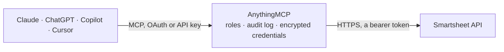

<!-- Generated by scripts/export-github-catalog.mjs in the anythingmcp-website repository. Do not edit by hand. -->

# Smartsheet MCP connector

Let your AI work in Smartsheet: search and read sheets, rows, columns, sheet summaries and cell history, comments and attachments, browse workspaces, folders, reports and dashboards, list users and … The AnythingMCP connector gives Claude, ChatGPT, Microsoft Copilot, Cursor and Gemini 38 MCP tools for Smartsheet: 26 read and 12 can change data.

**Category:** [Project Management](../project-management.md) · **Tools:** 38 · **Setup guide:** [anythingmcp.com](https://anythingmcp.com/guides/smartsheet-to-mcp) · [Deutsch](https://anythingmcp.com/de/guides/smartsheet-to-mcp) · [Italiano](https://anythingmcp.com/it/guides/smartsheet-to-mcp) · [Español](https://anythingmcp.com/es/guides/smartsheet-to-mcp) · [日本語](https://anythingmcp.com/ja/guides/smartsheet-to-mcp) · [Русский](https://anythingmcp.com/ru/guides/smartsheet-to-mcp) · [中文](https://anythingmcp.com/zh/guides/smartsheet-to-mcp)

## Start without code

No installation and no terminal: AnythingMCP Cloud runs the Smartsheet connector for you, operated by helpcode.ai in Frankfurt, Germany.

1. **Click the button above** and create an account or sign in. The Smartsheet connector opens, ready to install.
2. **Paste the API key or token from your Smartsheet account.** Every click is in the [step-by-step guide](https://anythingmcp.com/guides/smartsheet-to-mcp).
3. **Click Install.** AnythingMCP shows the address of your MCP server.
4. **Add that address to your assistant:** [Claude](https://anythingmcp.com/guides/connect-smartsheet-to-claude) · [ChatGPT](https://anythingmcp.com/guides/connect-smartsheet-to-chatgpt) · [Microsoft Copilot](https://anythingmcp.com/guides/connect-smartsheet-to-copilot) · [Cursor](https://anythingmcp.com/guides/connect-smartsheet-to-cursor) · [Gemini CLI](https://anythingmcp.com/guides/connect-smartsheet-to-gemini) · [Meta Muse](https://anythingmcp.com/guides/connect-smartsheet-to-muse).
5. **Ask your first question**, for example: *Find invoice INV-2026-042 in our Accounts Receivable sheet and show the row number, amount and due date.*

Prefer help with the setup? [Talk to us](https://anythingmcp.com/contact).

## How it works

- **The AI client** speaks MCP (Streamable HTTP) to AnythingMCP and only sees tool names, descriptions and results. It never gets the Smartsheet credentials.
- **AnythingMCP** checks the client's role, builds the call from the tool definition, adds the credentials (a bearer token), calls Smartsheet, logs the call and returns the result.
- **Smartsheet** sees an ordinary API client with the rights of the account the credentials belong to.

## Tools

| Tool | What it does | Access |
|---|---|---|
| [`smartsheet_get_current_user`](#smartsheet_get_current_user) | The user the access token belongs to: id, email, name, account (organisation) id and name, admin flags, locale and time zone. | read |
| [`smartsheet_list_sheets`](#smartsheet_list_sheets) | List the sheets the user can open: id, name, access level, permalink, created and modified dates. | read |
| [`smartsheet_get_sheet`](#smartsheet_get_sheet) | Read a sheet: its columns (id, title, type, options, primary) and rows, each row with id, rowNumber, parentId (for hierarchy) and cells as columnId, value… | read |
| [`smartsheet_get_row`](#smartsheet_get_row) | Read one row of a sheet with its cells (columnId, value, displayValue), parent and sibling ids and modification date. | read |
| [`smartsheet_search_sheet`](#smartsheet_search_sheet) | Search the text of one sheet: returns the matching rows (objectId is the row id, text shows the match, contextData the row content). | read |
| [`smartsheet_search`](#smartsheet_search) | Search everything the user can access: sheet, report, dashboard, folder, workspace and template names, cell data, comments, attachments and summary fields. | read |
| [`smartsheet_list_columns`](#smartsheet_list_columns) | List the columns of a sheet: id, index, title, type (TEXT_NUMBER, DATE, DATETIME, CHECKBOX, PICKLIST, MULTI_PICKLIST, CONTACT_LIST, MULTI_CONTACT_LIST,… | read |
| [`smartsheet_get_cell_history`](#smartsheet_get_cell_history) | The change history of one cell: every earlier value with modifiedAt and modifiedBy, newest first. | read |
| [`smartsheet_get_sheet_summary`](#smartsheet_get_sheet_summary) | Read the sheet summary fields of a sheet (the key-value fields shown in the Summary panel, often totals and project status): id, title, type, value,… | read |
| [`smartsheet_list_discussions`](#smartsheet_list_discussions) | List the discussions (comment threads) of a sheet, on the sheet itself and on its rows: id, title, parentType (SHEET or ROW), parentId, commentCount, last… | read |
| [`smartsheet_list_row_discussions`](#smartsheet_list_row_discussions) | List the discussions (comment threads) of one row. | read |
| [`smartsheet_list_attachments`](#smartsheet_list_attachments) | List every attachment of a sheet (sheet, row and comment attachments): id, name, attachmentType (FILE, LINK, GOOGLE_DRIVE, ...), mimeType, sizeInKb,… | read |
| [`smartsheet_list_row_attachments`](#smartsheet_list_row_attachments) | List the attachments of one row, including those on its comments. | read |
| [`smartsheet_get_attachment`](#smartsheet_get_attachment) | Get one attachment with a temporary download URL (url, valid for urlExpiresInMillis milliseconds, usually 2 minutes) for files, or the link for LINK and… | read |
| [`smartsheet_list_workspaces`](#smartsheet_list_workspaces) | List the workspaces the user can access: id, name, access level and permalink. | read |
| [`smartsheet_get_workspace`](#smartsheet_get_workspace) | Read a workspace's metadata: id, name, access level, permalink, created and modified dates. | read |
| [`smartsheet_list_workspace_children`](#smartsheet_list_workspace_children) | List what is directly inside a workspace: sheets, reports, dashboards (sights), folders and templates, each with id, name, resourceType and permalink. | read |
| [`smartsheet_get_folder`](#smartsheet_get_folder) | Read a folder's metadata: id, name, permalink, created and modified dates. | read |
| [`smartsheet_list_folder_children`](#smartsheet_list_folder_children) | List what is directly inside a folder: sheets, reports, dashboards, subfolders and templates. | read |
| [`smartsheet_list_reports`](#smartsheet_list_reports) | List the reports the user can open: id, name, access level, permalink and whether it is a sheet summary report. | read |
| [`smartsheet_get_report`](#smartsheet_get_report) | Read a report: its columns (virtualId, title, type) and rows gathered from the source sheets, each row with sheetId and cells keyed by virtualColumnId. | read |
| [`smartsheet_list_dashboards`](#smartsheet_list_dashboards) | List the dashboards (called sights in the API) the user can open: id, name, access level and permalink. | read |
| [`smartsheet_get_dashboard`](#smartsheet_get_dashboard) | Read a dashboard: its widgets (type, title, position and content such as the sheet or report a chart or metric reads, rich text, shortcuts, images). | read |
| [`smartsheet_list_users`](#smartsheet_list_users) | List the users of the organisation account: id, email, name, status, admin and licensed-sheet-creator flags, seat type. | read |
| [`smartsheet_get_user`](#smartsheet_get_user) | Read one user of the organisation: email, name, admin flags, status, title, department, sheet count. | read |
| [`smartsheet_list_shares`](#smartsheet_list_shares) | List who a sheet, report, dashboard or workspace is shared with: each share with id, type (USER or GROUP), email or groupId, name, accessLevel (VIEWER,… | read |
| [`smartsheet_add_rows`](#smartsheet_add_rows) | Add rows to a sheet. | write |
| [`smartsheet_update_rows`](#smartsheet_update_rows) | Change cells of existing rows, or move rows. | write |
| [`smartsheet_delete_rows`](#smartsheet_delete_rows) | Delete rows from a sheet, with their child rows, attachments and comments. | write |
| [`smartsheet_add_columns`](#smartsheet_add_columns) | Add columns to a sheet. | write |
| [`smartsheet_update_column`](#smartsheet_update_column) | Change a column: rename it, change its type or dropdown options, move it (index), hide or lock it, set a description, width, validation or column formula. | write |
| [`smartsheet_create_discussion`](#smartsheet_create_discussion) | Start a comment thread on a sheet with a first comment. | write |
| [`smartsheet_create_row_discussion`](#smartsheet_create_row_discussion) | Start a comment thread on one row of a sheet, with its first comment. | write |
| [`smartsheet_add_comment`](#smartsheet_add_comment) | Reply to an existing discussion (comment thread) on a sheet or row. | write |
| [`smartsheet_create_sheet_in_workspace`](#smartsheet_create_sheet_in_workspace) | Create a sheet at the top level of a workspace, either with your own columns (exactly one with "primary": true, usually TEXT_NUMBER) or as a copy of a… | write |
| [`smartsheet_create_sheet_in_folder`](#smartsheet_create_sheet_in_folder) | Create a sheet inside a folder, with your own columns (exactly one primary) or as a copy of a template or sheet (from_id). | write |
| [`smartsheet_share_asset`](#smartsheet_share_asset) | Share a sheet, report, dashboard or workspace with people (by email) or a group, at a given access level. | write |
| [`smartsheet_create_update_request`](#smartsheet_create_update_request) | Email people an update request: a form where they can edit the given rows (and columns) without opening the sheet. | write |

## Tool reference

Every parameter as the AI client sees it in `tools/list`. Source: [`packages/backend/src/adapters/intl/smartsheet.json`](../../../packages/backend/src/adapters/intl/smartsheet.json).

### `smartsheet_get_current_user`

The user the access token belongs to: id, email, name, account (organisation) id and name, admin flags, locale and time zone. Use it to check the token and to know who "me" is.

**Access:** read · **Call:** `GET /users/me`

| Parameter | Type | Required | Description |
|---|---|---|---|
| `include` | `groups` | no | groups adds the groups the user belongs to. |

### `smartsheet_list_sheets`

List the sheets the user can open: id, name, access level, permalink, created and modified dates. Paged with page and page_size; filter by modified_since to find recently changed sheets. To find a sheet by name use smartsheet_search with scopes sheetNames.

**Access:** read · **Call:** `GET /sheets`

| Parameter | Type | Required | Description |
|---|---|---|---|
| `modified_since` | string | no | Only sheets modified on or after this ISO 8601 date-time, e.g. 2026-10-01T00:00:00Z. |
| `page` | integer | no | Page number, starting at 1 (default 1). The answer carries totalPages and totalCount. |
| `page_size` | integer | no | Items per page (default 100). |
| `include_all` | boolean | no | true returns every item in one answer and ignores page and page_size. Use it only for small lists. |

### `smartsheet_get_sheet`

Read a sheet: its columns (id, title, type, options, primary) and rows, each row with id, rowNumber, parentId (for hierarchy) and cells as columnId, value and displayValue. Big sheets: ask for a page of rows (page, page_size), only some rows (row_numbers or row_ids), only some columns (column_ids) or only rows changed since a date. Add include=discussions,attachments to get those too.

**Access:** read · **Call:** `GET /sheets/{sheet_id}`

| Parameter | Type | Required | Description |
|---|---|---|---|
| `sheet_id` | string | yes | Sheet id, from smartsheet_list_sheets or smartsheet_search (a long number; pass it as text to keep every digit). |
| `column_ids` | string | no | Only these columns, comma-separated column ids. |
| `row_ids` | string | no | Only these rows, comma-separated row ids. |
| `row_numbers` | string | no | Only these rows, comma-separated row numbers (1-based, as shown in Smartsheet). Missing numbers are ignored. |
| `rows_modified_since` | string | no | Only rows modified since this ISO 8601 date-time. |
| `filter_id` | string | no | Apply this saved sheet filter: rows it hides are marked filteredOut (use exclude=filteredOutRows to drop them). |
| `include` | string | no | Comma-separated extras: attachments, discussions, columnType, filters, filterDefinitions, format, objectValue, ownerInfo, rowPermalink, source, writerInfo, crossSheetReferences, proofs, ganttConfig. |
| `exclude` | string | no | Comma-separated elements to leave out: filteredOutRows, nonexistentCells (empty cells), linkInFromCellDetails, linksOutToCellsDetails. |
| `level` | integer | no | Data format level: 0 (default) returns multi-contact and multi-picklist cells as text; 2 returns multi-contact cells as objects, 3 also multi-picklist cells. Use 3 with include=objectValue to read them as lists. |
| `page` | integer | no | Page of rows, starting at 1. |
| `page_size` | integer | no | Rows per page (default: all rows). |

### `smartsheet_get_row`

Read one row of a sheet with its cells (columnId, value, displayValue), parent and sibling ids and modification date. include=columns adds the column definitions, include=discussions,attachments their lists.

**Access:** read · **Call:** `GET /sheets/{sheet_id}/rows/{row_id}`

| Parameter | Type | Required | Description |
|---|---|---|---|
| `sheet_id` | string | yes | Sheet id, from smartsheet_list_sheets or smartsheet_search (a long number; pass it as text to keep every digit). |
| `row_id` | string | yes | Row id, from smartsheet_get_sheet (rows[].id). |
| `include` | string | no | Comma-separated extras: attachments, columns, columnType, discussions, filters, format, objectValue, proofs, rowPermalink, writerInfo. |
| `exclude` | string | no | Comma-separated elements to leave out: nonexistentCells, filteredOutRows, linkInFromCellDetails, linksOutToCellsDetails. |
| `level` | integer | no | Data format level: 0 (default) returns multi-contact and multi-picklist cells as text; 2 returns multi-contact cells as objects, 3 also multi-picklist cells. Use 3 with include=objectValue to read them as lists. |

### `smartsheet_search_sheet`

Search the text of one sheet: returns the matching rows (objectId is the row id, text shows the match, contextData the row content). Wrap the query in double quotes for an exact phrase. Newly changed data can take a while to become searchable.

**Access:** read · **Call:** `GET /search/sheets/{sheet_id}`

| Parameter | Type | Required | Description |
|---|---|---|---|
| `sheet_id` | string | yes | Sheet id, from smartsheet_list_sheets or smartsheet_search (a long number; pass it as text to keep every digit). |
| `query` | string | yes | Text to look for. Wrap it in double quotes for an exact match. |

### `smartsheet_search`

Search everything the user can access: sheet, report, dashboard, folder, workspace and template names, cell data, comments, attachments and summary fields. Each result has objectType, objectId, text, contextData and parentObjectId/parentObjectName. Use scopes to search only names, e.g. sheetNames to find a sheet by name.

**Access:** read · **Call:** `GET /search`

| Parameter | Type | Required | Description |
|---|---|---|---|
| `query` | string | yes | Text to look for. Wrap it in double quotes for an exact match. |
| `scopes` | string | no | Comma-separated scopes: attachments, cellData, comments, folderNames, reportNames, sheetNames, sightNames (dashboards), summaryFields, templateNames, workspaceNames. Default: all. |
| `modified_since` | string | no | Only objects modified on or after this ISO 8601 date-time. |
| `include` | `favoriteFlag` | no | favoriteFlag marks results that are in the user's favorites. |

### `smartsheet_list_columns`

List the columns of a sheet: id, index, title, type (TEXT_NUMBER, DATE, DATETIME, CHECKBOX, PICKLIST, MULTI_PICKLIST, CONTACT_LIST, MULTI_CONTACT_LIST, DURATION, PREDECESSOR, ABSTRACT_DATETIME), primary flag, options of dropdown columns, validation and system column type. Use the ids when writing cells.

**Access:** read · **Call:** `GET /sheets/{sheet_id}/columns`

| Parameter | Type | Required | Description |
|---|---|---|---|
| `sheet_id` | string | yes | Sheet id, from smartsheet_list_sheets or smartsheet_search (a long number; pass it as text to keep every digit). |
| `level` | integer | no | Data format level: 0 (default) returns multi-contact and multi-picklist cells as text; 2 returns multi-contact cells as objects, 3 also multi-picklist cells. Use 3 with include=objectValue to read them as lists. |
| `page` | integer | no | Page number, starting at 1 (default 1). The answer carries totalPages and totalCount. |
| `page_size` | integer | no | Items per page (default 100). |
| `include_all` | boolean | no | true returns every item in one answer and ignores page and page_size. Use it only for small lists. |

### `smartsheet_get_cell_history`

The change history of one cell: every earlier value with modifiedAt and modifiedBy, newest first. Limited by Smartsheet to 30 calls per minute per token.

**Access:** read · **Call:** `GET /sheets/{sheet_id}/rows/{row_id}/columns/{column_id}/history`

| Parameter | Type | Required | Description |
|---|---|---|---|
| `sheet_id` | string | yes | Sheet id, from smartsheet_list_sheets or smartsheet_search (a long number; pass it as text to keep every digit). |
| `row_id` | string | yes | Row id, from smartsheet_get_sheet (rows[].id). |
| `column_id` | string | yes | Column id, from smartsheet_list_columns or smartsheet_get_sheet (columns[].id). |
| `include` | string | no | Comma-separated extras: columnType, objectValue. |
| `level` | integer | no | Data format level: 0 (default) returns multi-contact and multi-picklist cells as text; 2 returns multi-contact cells as objects, 3 also multi-picklist cells. Use 3 with include=objectValue to read them as lists. |
| `page` | integer | no | Page number, starting at 1. |
| `page_size` | integer | no | Items per page (default 100). |

### `smartsheet_get_sheet_summary`

Read the sheet summary fields of a sheet (the key-value fields shown in the Summary panel, often totals and project status): id, title, type, value, displayValue and formula of each field.

**Access:** read · **Call:** `GET /sheets/{sheet_id}/summary`

| Parameter | Type | Required | Description |
|---|---|---|---|
| `sheet_id` | string | yes | Sheet id, from smartsheet_list_sheets or smartsheet_search (a long number; pass it as text to keep every digit). |
| `include` | string | no | Comma-separated extras: format, writerInfo. |
| `exclude` | string | no | Comma-separated elements to leave out: displayValue, image, imageAltText. |

### `smartsheet_list_discussions`

List the discussions (comment threads) of a sheet, on the sheet itself and on its rows: id, title, parentType (SHEET or ROW), parentId, commentCount, last comment date and author. Set include=comments to get the comments of each thread.

**Access:** read · **Call:** `GET /sheets/{sheet_id}/discussions`

| Parameter | Type | Required | Description |
|---|---|---|---|
| `sheet_id` | string | yes | Sheet id, from smartsheet_list_sheets or smartsheet_search (a long number; pass it as text to keep every digit). |
| `include` | string | no | Comma-separated extras: comments (the comments of each thread), attachments (only together with comments). |
| `page` | integer | no | Page number, starting at 1 (default 1). The answer carries totalPages and totalCount. |
| `page_size` | integer | no | Items per page (default 100). |
| `include_all` | boolean | no | true returns every item in one answer and ignores page and page_size. Use it only for small lists. |

### `smartsheet_list_row_discussions`

List the discussions (comment threads) of one row. Set include=comments to get the comments themselves.

**Access:** read · **Call:** `GET /sheets/{sheet_id}/rows/{row_id}/discussions`

| Parameter | Type | Required | Description |
|---|---|---|---|
| `sheet_id` | string | yes | Sheet id, from smartsheet_list_sheets or smartsheet_search (a long number; pass it as text to keep every digit). |
| `row_id` | string | yes | Row id, from smartsheet_get_sheet (rows[].id). |
| `include` | string | no | Comma-separated extras: comments, attachments (only together with comments). |
| `page` | integer | no | Page number, starting at 1 (default 1). The answer carries totalPages and totalCount. |
| `page_size` | integer | no | Items per page (default 100). |
| `include_all` | boolean | no | true returns every item in one answer and ignores page and page_size. Use it only for small lists. |

### `smartsheet_list_attachments`

List every attachment of a sheet (sheet, row and comment attachments): id, name, attachmentType (FILE, LINK, GOOGLE_DRIVE, ...), mimeType, sizeInKb, parentType and parentId, created date and author. Use smartsheet_get_attachment for a download link.

**Access:** read · **Call:** `GET /sheets/{sheet_id}/attachments`

| Parameter | Type | Required | Description |
|---|---|---|---|
| `sheet_id` | string | yes | Sheet id, from smartsheet_list_sheets or smartsheet_search (a long number; pass it as text to keep every digit). |
| `page` | integer | no | Page number, starting at 1 (default 1). The answer carries totalPages and totalCount. |
| `page_size` | integer | no | Items per page (default 100). |
| `include_all` | boolean | no | true returns every item in one answer and ignores page and page_size. Use it only for small lists. |

### `smartsheet_list_row_attachments`

List the attachments of one row, including those on its comments.

**Access:** read · **Call:** `GET /sheets/{sheet_id}/rows/{row_id}/attachments`

| Parameter | Type | Required | Description |
|---|---|---|---|
| `sheet_id` | string | yes | Sheet id, from smartsheet_list_sheets or smartsheet_search (a long number; pass it as text to keep every digit). |
| `row_id` | string | yes | Row id, from smartsheet_get_sheet (rows[].id). |
| `page` | integer | no | Page number, starting at 1 (default 1). The answer carries totalPages and totalCount. |
| `page_size` | integer | no | Items per page (default 100). |
| `include_all` | boolean | no | true returns every item in one answer and ignores page and page_size. Use it only for small lists. |

### `smartsheet_get_attachment`

Get one attachment with a temporary download URL (url, valid for urlExpiresInMillis milliseconds, usually 2 minutes) for files, or the link for LINK and cloud attachments.

**Access:** read · **Call:** `GET /sheets/{sheet_id}/attachments/{attachment_id}`

| Parameter | Type | Required | Description |
|---|---|---|---|
| `sheet_id` | string | yes | Sheet id, from smartsheet_list_sheets or smartsheet_search (a long number; pass it as text to keep every digit). |
| `attachment_id` | string | yes | Attachment id, from smartsheet_list_attachments. |

### `smartsheet_list_workspaces`

List the workspaces the user can access: id, name, access level and permalink. Paged with a token: pass lastKey of the answer as last_key for the next page.

**Access:** read · **Call:** `GET /workspaces`

| Parameter | Type | Required | Description |
|---|---|---|---|
| `max_items` | integer | no | Items per page, at least 100 (default 100). |
| `last_key` | string | no | Paging token: the lastKey value of the previous answer. Leave it out for the first page; when lastKey is missing from an answer, there is nothing more. |

### `smartsheet_get_workspace`

Read a workspace's metadata: id, name, access level, permalink, created and modified dates. Use smartsheet_list_workspace_children for its content.

**Access:** read · **Call:** `GET /workspaces/{workspace_id}/metadata`

| Parameter | Type | Required | Description |
|---|---|---|---|
| `workspace_id` | string | yes | Workspace id, from smartsheet_list_workspaces. |

### `smartsheet_list_workspace_children`

List what is directly inside a workspace: sheets, reports, dashboards (sights), folders and templates, each with id, name, resourceType and permalink. Open folders with smartsheet_list_folder_children. Paged with a token (last_key).

**Access:** read · **Call:** `GET /workspaces/{workspace_id}/children`

| Parameter | Type | Required | Description |
|---|---|---|---|
| `workspace_id` | string | yes | Workspace id, from smartsheet_list_workspaces. |
| `children_resource_types` | string | no | Comma-separated child types to list: sheets, reports, sights (dashboards), folders, templates (templates needs sheets too). Default: all of them. |
| `include` | string | no | Comma-separated extras: source, ownerInfo. |
| `max_items` | integer | no | Items per page, at least 100 (default 100). |
| `last_key` | string | no | Paging token: the lastKey value of the previous answer. Leave it out for the first page; when lastKey is missing from an answer, there is nothing more. |

### `smartsheet_get_folder`

Read a folder's metadata: id, name, permalink, created and modified dates.

**Access:** read · **Call:** `GET /folders/{folder_id}/metadata`

| Parameter | Type | Required | Description |
|---|---|---|---|
| `folder_id` | string | yes | Folder id, from smartsheet_list_workspace_children or smartsheet_list_folder_children. |

### `smartsheet_list_folder_children`

List what is directly inside a folder: sheets, reports, dashboards, subfolders and templates. Paged with a token (last_key).

**Access:** read · **Call:** `GET /folders/{folder_id}/children`

| Parameter | Type | Required | Description |
|---|---|---|---|
| `folder_id` | string | yes | Folder id, from smartsheet_list_workspace_children or smartsheet_list_folder_children. |
| `children_resource_types` | string | no | Comma-separated child types to list: sheets, reports, sights (dashboards), folders, templates (templates needs sheets too). Default: all of them. |
| `include` | string | no | Comma-separated extras: source, ownerInfo. |
| `max_items` | integer | no | Items per page, at least 100 (default 100). |
| `last_key` | string | no | Paging token: the lastKey value of the previous answer. Leave it out for the first page; when lastKey is missing from an answer, there is nothing more. |

### `smartsheet_list_reports`

List the reports the user can open: id, name, access level, permalink and whether it is a sheet summary report.

**Access:** read · **Call:** `GET /reports`

| Parameter | Type | Required | Description |
|---|---|---|---|
| `modified_since` | string | no | Only reports modified on or after this ISO 8601 date-time. |

### `smartsheet_get_report`

Read a report: its columns (virtualId, title, type) and rows gathered from the source sheets, each row with sheetId and cells keyed by virtualColumnId. include=sourceSheets lists the sheets it reads; include=scope shows which sheets and workspaces it covers. Paged (100 rows by default).

**Access:** read · **Call:** `GET /reports/{report_id}`

| Parameter | Type | Required | Description |
|---|---|---|---|
| `report_id` | string | yes | Report id, from smartsheet_list_reports or smartsheet_search. |
| `include` | string | no | Comma-separated extras: attachments, discussions, proofs, format, objectValue, scope, source, sourceSheets. |
| `exclude` | string | no | Comma-separated elements to leave out: linkInFromCellDetails, linksOutToCellsDetails. |
| `level` | integer | no | Data format level: 0 (default) returns multi-contact and multi-picklist cells as text; 2 returns multi-contact cells as objects, 3 also multi-picklist cells. Use 3 with include=objectValue to read them as lists. |
| `page` | integer | no | Page of rows, starting at 1. |
| `page_size` | integer | no | Rows per page (default 100). |

### `smartsheet_list_dashboards`

List the dashboards (called sights in the API) the user can open: id, name, access level and permalink. Paged with a token (last_key).

**Access:** read · **Call:** `GET /sights`

| Parameter | Type | Required | Description |
|---|---|---|---|
| `max_items` | integer | no | Items per page, at least 100 (default 100). |
| `last_key` | string | no | Paging token: the lastKey value of the previous answer. Leave it out for the first page; when lastKey is missing from an answer, there is nothing more. |

### `smartsheet_get_dashboard`

Read a dashboard: its widgets (type, title, position and content such as the sheet or report a chart or metric reads, rich text, shortcuts, images).

**Access:** read · **Call:** `GET /sights/{sight_id}`

| Parameter | Type | Required | Description |
|---|---|---|---|
| `sight_id` | string | yes | Dashboard (sight) id, from smartsheet_list_dashboards or smartsheet_search. |
| `include` | string | no | Comma-separated extras: objectValue, source. |
| `level` | integer | no | Data format level for widget content: 0 text (default), 2 multi-contact, 3 multi-picklist, 4 metric widgets with sheet summary fields. |

### `smartsheet_list_users`

List the users of the organisation account: id, email, name, status, admin and licensed-sheet-creator flags, seat type. System admins see every user; other users get a limited view. Filter by email to look someone up.

**Access:** read · **Call:** `GET /users`

| Parameter | Type | Required | Description |
|---|---|---|---|
| `email` | string | no | Only these users, comma-separated email addresses. |
| `include` | `lastLogin` | no | lastLogin adds the last login time (system admins only). |
| `page` | integer | no | Page number, starting at 1 (default 1). The answer carries totalPages and totalCount. |
| `page_size` | integer | no | Items per page (default 100). |
| `include_all` | boolean | no | true returns every item in one answer and ignores page and page_size. Use it only for small lists. |

### `smartsheet_get_user`

Read one user of the organisation: email, name, admin flags, status, title, department, sheet count. Some fields are shown to system admins only.

**Access:** read · **Call:** `GET /users/{user_id}`

| Parameter | Type | Required | Description |
|---|---|---|---|
| `user_id` | string | yes | User id, from smartsheet_list_users. |

### `smartsheet_list_shares`

List who a sheet, report, dashboard or workspace is shared with: each share with id, type (USER or GROUP), email or groupId, name, accessLevel (VIEWER, COMMENTER, EDITOR, EDITOR_SHARE, ADMIN, OWNER) and scope (ITEM or WORKSPACE). Paged with a token (last_key).

**Access:** read · **Call:** `GET /shares`

| Parameter | Type | Required | Description |
|---|---|---|---|
| `asset_type` | `sheet` \| `report` \| `sight` \| `workspace` | yes | Kind of asset. |
| `asset_id` | string | yes | Id of the sheet, report, dashboard (sight) or workspace. |
| `sharing_include` | `ITEM` \| `WORKSPACE` | no | ITEM lists only shares made on the item itself, WORKSPACE also those inherited from its workspace. |
| `max_items` | integer | no | Items per page, at least 100 (default 100). |
| `last_key` | string | no | Paging token: the lastKey value of the previous answer. Leave it out for the first page; when lastKey is missing from an answer, there is nothing more. |

### `smartsheet_add_rows`

Add rows to a sheet. Each row gives its cells as {"columnId": <id>, "value": <value>} and where it goes: "toBottom": true (or "toTop": true), "parentId": <row id> to indent it under a row, "siblingId": <row id> to place it after that row. Dates are YYYY-MM-DD, checkboxes true or false, contact cells an email; "formula": "=SUM([Cost]1:[Cost]5)" instead of value sets a formula. Returns the new rows with their ids.

**Access:** write · **Call:** `POST /sheets/{sheet_id}/rows`

| Parameter | Type | Required | Description |
|---|---|---|---|
| `sheet_id` | string | yes | Sheet id, from smartsheet_list_sheets or smartsheet_search (a long number; pass it as text to keep every digit). |
| `rows` | object[] | yes | Rows to add, e.g. [{"toBottom": true, "cells": [{"columnId": 7960873114331012, "value": "New task"}, {"columnId": 642523719853956, "value": "2026-11-15"}]}]. Up to 500 rows per call is a safe size. |
| `allow_partial_success` | boolean | no | true adds the valid rows even when others fail (default false: all or nothing). |
| `override_validation` | boolean | no | true accepts values outside a column's validation (cells must then set "strict": false). |

### `smartsheet_update_rows`

Change cells of existing rows, or move rows. Each row needs its "id" and the cells to change as {"columnId": <id>, "value": <value>}; other cells stay as they are. A location field (toTop, toBottom, parentId, siblingId) moves the row; "expanded" and "locked" can be set too. Set a cell value to "" to clear it.

**Access:** write · **Call:** `PUT /sheets/{sheet_id}/rows`

| Parameter | Type | Required | Description |
|---|---|---|---|
| `sheet_id` | string | yes | Sheet id, from smartsheet_list_sheets or smartsheet_search (a long number; pass it as text to keep every digit). |
| `rows` | object[] | yes | Rows to update, e.g. [{"id": 2361756178769796, "cells": [{"columnId": 7960873114331012, "value": "Done"}]}]. |
| `allow_partial_success` | boolean | no | true updates the valid rows even when others fail (default false: all or nothing). |
| `override_validation` | boolean | no | true accepts values outside a column's validation (cells must then set "strict": false). |

### `smartsheet_delete_rows`

Delete rows from a sheet, with their child rows, attachments and comments. It cannot be undone through the API: confirm the rows with the user first.

**Access:** write · **Call:** `DELETE /sheets/{sheet_id}/rows`

| Parameter | Type | Required | Description |
|---|---|---|---|
| `sheet_id` | string | yes | Sheet id, from smartsheet_list_sheets or smartsheet_search (a long number; pass it as text to keep every digit). |
| `row_ids` | string | yes | Comma-separated ids of the rows to delete. Keep it to a few hundred ids per call. |
| `ignore_rows_not_found` | boolean | no | true deletes the rows that exist and skips unknown ids; false (default) deletes nothing when an id is unknown. |

### `smartsheet_add_columns`

Add columns to a sheet. Each column needs "title", "type" and "index" (0-based position); dropdown columns (PICKLIST, MULTI_PICKLIST) take "options", e.g. [{"title": "Status", "type": "PICKLIST", "options": ["Open", "Done"], "index": 3}]. Types: TEXT_NUMBER, DATE, DATETIME, CHECKBOX, PICKLIST, MULTI_PICKLIST, CONTACT_LIST, MULTI_CONTACT_LIST, DURATION, PREDECESSOR.

**Access:** write · **Call:** `POST /sheets/{sheet_id}/columns`

| Parameter | Type | Required | Description |
|---|---|---|---|
| `sheet_id` | string | yes | Sheet id, from smartsheet_list_sheets or smartsheet_search (a long number; pass it as text to keep every digit). |
| `columns` | object[] | yes | Columns to add, each with title, type and index, optionally options, description, width, hidden, locked, validation, formula. |

### `smartsheet_update_column`

Change a column: rename it, change its type or dropdown options, move it (index), hide or lock it, set a description, width, validation or column formula. Only the fields given change. Changing the type can convert or drop cell values: confirm first.

**Access:** write · **Call:** `PUT /sheets/{sheet_id}/columns/{column_id}`

| Parameter | Type | Required | Description |
|---|---|---|---|
| `sheet_id` | string | yes | Sheet id, from smartsheet_list_sheets or smartsheet_search (a long number; pass it as text to keep every digit). |
| `column_id` | string | yes | Column id, from smartsheet_list_columns or smartsheet_get_sheet (columns[].id). |
| `title` | string | no | New column title. |
| `type` | `TEXT_NUMBER` \| `DATE` \| `DATETIME` \| `CHECKBOX` \| `PICKLIST` \| `MULTI_PICKLIST` \| `CONTACT_LIST` \| `MULTI_CONTACT_LIST` \| `DURATION` \| `PREDECESSOR` \| `ABSTRACT_DATETIME` | no | New column type. |
| `index` | integer | no | New 0-based position of the column. |
| `options` | string[] | no | Dropdown options for PICKLIST and MULTI_PICKLIST columns; replaces the current list. |
| `description` | string | no | Column description. |
| `hidden` | boolean | no | Hide (true) or show (false) the column. |
| `locked` | boolean | no | Lock (true) or unlock (false) the column (needs admin access to the sheet). |
| `width` | integer | no | Display width in pixels. |
| `validation` | boolean | no | Turn the column's value validation on or off. |
| `formula` | string | no | Column formula applied to every row, e.g. =[Cost]@row * [Quantity]@row. |

### `smartsheet_create_discussion`

Start a comment thread on a sheet with a first comment. To comment on a row use smartsheet_create_row_discussion; to answer an existing thread use smartsheet_add_comment. People following the sheet may be notified.

**Access:** write · **Call:** `POST /sheets/{sheet_id}/discussions`

| Parameter | Type | Required | Description |
|---|---|---|---|
| `sheet_id` | string | yes | Sheet id, from smartsheet_list_sheets or smartsheet_search (a long number; pass it as text to keep every digit). |
| `text` | string | yes | The comment text. @mentions are not resolved through the API. |

### `smartsheet_create_row_discussion`

Start a comment thread on one row of a sheet, with its first comment. Followers of the sheet may be notified.

**Access:** write · **Call:** `POST /sheets/{sheet_id}/rows/{row_id}/discussions`

| Parameter | Type | Required | Description |
|---|---|---|---|
| `sheet_id` | string | yes | Sheet id, from smartsheet_list_sheets or smartsheet_search (a long number; pass it as text to keep every digit). |
| `row_id` | string | yes | Row id, from smartsheet_get_sheet (rows[].id). |
| `text` | string | yes | The comment text. |

### `smartsheet_add_comment`

Reply to an existing discussion (comment thread) on a sheet or row.

**Access:** write · **Call:** `POST /sheets/{sheet_id}/discussions/{discussion_id}/comments`

| Parameter | Type | Required | Description |
|---|---|---|---|
| `sheet_id` | string | yes | Sheet id, from smartsheet_list_sheets or smartsheet_search (a long number; pass it as text to keep every digit). |
| `discussion_id` | string | yes | Discussion id, from smartsheet_list_discussions or smartsheet_list_row_discussions. |
| `text` | string | yes | The comment text. |

### `smartsheet_create_sheet_in_workspace`

Create a sheet at the top level of a workspace, either with your own columns (exactly one with "primary": true, usually TEXT_NUMBER) or as a copy of a template or sheet (from_id). Returns the new sheet id and permalink.

**Access:** write · **Call:** `POST /workspaces/{workspace_id}/sheets`

| Parameter | Type | Required | Description |
|---|---|---|---|
| `workspace_id` | string | yes | Workspace id, from smartsheet_list_workspaces. |
| `name` | string | yes | Name of the new sheet. |
| `columns` | object[] | no | Columns of a blank sheet, e.g. [{"title": "Task", "type": "TEXT_NUMBER", "primary": true}, {"title": "Due", "type": "DATE"}, {"title": "Status", "type": "PICKLIST", "options": ["Open", "Done"]}]. Leave out when from_id is given. |
| `from_id` | string | no | Id of a template or sheet to copy instead of giving columns. |
| `include` | string | no | With from_id: comma-separated parts to copy as well: attachments, cellLinks, data, discussions, filters, forms, ruleRecipients, rules. |

### `smartsheet_create_sheet_in_folder`

Create a sheet inside a folder, with your own columns (exactly one primary) or as a copy of a template or sheet (from_id).

**Access:** write · **Call:** `POST /folders/{folder_id}/sheets`

| Parameter | Type | Required | Description |
|---|---|---|---|
| `folder_id` | string | yes | Folder id, from smartsheet_list_workspace_children or smartsheet_list_folder_children. |
| `name` | string | yes | Name of the new sheet. |
| `columns` | object[] | no | Columns of a blank sheet; exactly one with "primary": true. Leave out when from_id is given. |
| `from_id` | string | no | Id of a template or sheet to copy instead of giving columns. |
| `include` | string | no | With from_id: comma-separated parts to copy as well: attachments, cellLinks, data, discussions, filters, forms, ruleRecipients, rules. |

### `smartsheet_share_asset`

Share a sheet, report, dashboard or workspace with people (by email) or a group, at a given access level. send_email notifies them. Confirm the recipients and the access level with the user first.

**Access:** write · **Call:** `POST /shares`

| Parameter | Type | Required | Description |
|---|---|---|---|
| `asset_type` | `sheet` \| `report` \| `sight` \| `workspace` | yes | Kind of asset. |
| `asset_id` | string | yes | Id of the sheet, report, dashboard (sight) or workspace. |
| `shares` | object[] | yes | Shares to create, each with exactly one of email or groupId, and accessLevel: VIEWER, COMMENTER, EDITOR, EDITOR_SHARE, ADMIN; optional subject, message and ccMe for the email. Example: [{"email": "anna@example.com", "accessLevel": "EDITOR"}]. |
| `send_email` | boolean | no | true sends the recipients an email (default false). |

### `smartsheet_create_update_request`

Email people an update request: a form where they can edit the given rows (and columns) without opening the sheet. Sent once right away unless a schedule is given. Recipients must be email addresses. Confirm before sending.

**Access:** write · **Call:** `POST /sheets/{sheet_id}/updaterequests`

| Parameter | Type | Required | Description |
|---|---|---|---|
| `sheet_id` | string | yes | Sheet id, from smartsheet_list_sheets or smartsheet_search (a long number; pass it as text to keep every digit). |
| `send_to` | object[] | yes | Recipients, e.g. [{"email": "anna@example.com"}]. |
| `row_ids` | integer[] | yes | Ids of the rows to include. |
| `column_ids` | integer[] | no | Ids of the columns to include (default: all). |
| `subject` | string | no | Email subject. |
| `message` | string | no | Email message. |
| `cc_me` | boolean | no | true sends the sender a copy. |
| `include_attachments` | boolean | no | true lets the recipients see the row attachments. |
| `include_discussions` | boolean | no | true lets the recipients see the row comments. |
| `layout` | `HORIZONTAL` \| `VERTICAL` | no | Form layout when several rows are included. |
| `schedule` | object | no | Optional schedule, e.g. {"type": "WEEKLY", "dayDescriptors": ["MONDAY"], "startAt": "2026-11-02T09:00:00Z"}. Without it the request is sent once now. |

## Run it yourself

AnythingMCP is open source (AGPL-3.0). [Run it with Docker](../../../README.md#run-it-yourself), open **Connectors → Store**, pick **Smartsheet** and enter `SMARTSHEET_API_URL`, `SMARTSHEET_ACCESS_TOKEN`, then add your MCP server URL to the AI client.

[← Project Management connectors](../project-management.md) · [All categories](../README.md)
