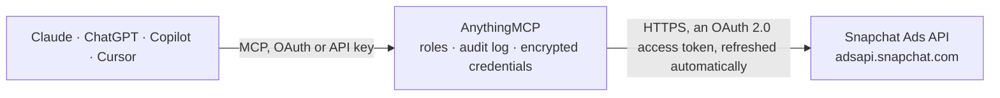

<!-- Generated by scripts/export-github-catalog.mjs in the anythingmcp-website repository. Do not edit by hand. -->

# Snapchat Ads MCP connector

Let your AI work with your Snapchat ads: list organizations, ad accounts, campaigns, ad squads, ads, creatives and audiences, read impressions, swipes and spend per day or in total, and pause or … The AnythingMCP connector gives Claude, ChatGPT, Microsoft Copilot, Cursor and Gemini 16 MCP tools for Snapchat Ads: 14 read and 2 can change data.

**Category:** [Advertising](../advertising.md) · **Tools:** 16 · **Setup guide:** [anythingmcp.com](https://anythingmcp.com/guides/snapchat-to-mcp) · [Deutsch](https://anythingmcp.com/de/guides/snapchat-to-mcp) · [Italiano](https://anythingmcp.com/it/guides/snapchat-to-mcp) · [Español](https://anythingmcp.com/es/guides/snapchat-to-mcp) · [日本語](https://anythingmcp.com/ja/guides/snapchat-to-mcp) · [Русский](https://anythingmcp.com/ru/guides/snapchat-to-mcp) · [中文](https://anythingmcp.com/zh/guides/snapchat-to-mcp)

## Start without code

No installation and no terminal: AnythingMCP Cloud runs the Snapchat Ads connector for you, operated by helpcode.ai in Frankfurt, Germany.

1. **Click the button above** and create an account or sign in. The Snapchat Ads connector opens, ready to install.
2. **Sign in with your Snapchat Ads account** when AnythingMCP asks. The first time, an admin creates a small app in the Snapchat Ads developer console. Every click is in the [step-by-step guide](https://anythingmcp.com/guides/snapchat-to-mcp).
3. **Click Install.** AnythingMCP shows the address of your MCP server.
4. **Add that address to your assistant:** [Claude](https://anythingmcp.com/guides/connect-snapchat-to-claude) · [ChatGPT](https://anythingmcp.com/guides/connect-snapchat-to-chatgpt) · [Microsoft Copilot](https://anythingmcp.com/guides/connect-snapchat-to-copilot) · [Cursor](https://anythingmcp.com/guides/connect-snapchat-to-cursor) · [Gemini CLI](https://anythingmcp.com/guides/connect-snapchat-to-gemini) · [Meta Muse](https://anythingmcp.com/guides/connect-snapchat-to-muse).
5. **Ask your first question**, for example: *Show campaign ids, status and daily budgets for ad account 701234567890123, filter name contains BlackFriday*

Prefer help with the setup? [Talk to us](https://anythingmcp.com/contact).

## How it works

- **The AI client** speaks MCP (Streamable HTTP) to AnythingMCP and only sees tool names, descriptions and results. It never gets the Snapchat Ads credentials.
- **AnythingMCP** checks the client's role, builds the call from the tool definition, adds the credentials (an OAuth 2.0 access token, refreshed automatically), calls Snapchat Ads, logs the call and returns the result.
- **Snapchat Ads** sees an ordinary API client with the rights of the account the credentials belong to.

## Tools

| Tool | What it does | Access |
|---|---|---|
| [`snapchat_get_me`](#snapchat_get_me) | Read the Snapchat Business user who authorized the connector: id, email, display name, organization id and member status. | read |
| [`snapchat_list_organizations`](#snapchat_list_organizations) | List the organizations the user belongs to, with their ad accounts (id, name, currency, time zone, status) when with_ad_accounts is true (default). | read |
| [`snapchat_list_ad_accounts`](#snapchat_list_ad_accounts) | List the ad accounts of one organization: id, name, type, status, currency, time zone, advertiser and lifetime spend cap (micro-currency). | read |
| [`snapchat_get_ad_account`](#snapchat_get_ad_account) | Read one ad account: name, type, status, currency, time zone, advertiser and lifetime spend cap (micro-currency). | read |
| [`snapchat_list_campaigns`](#snapchat_list_campaigns) | List the campaigns of an ad account: id, name, status (ACTIVE or PAUSED), delivery status, objective, start and end time, daily budget and lifetime spend… | read |
| [`snapchat_get_campaign`](#snapchat_get_campaign) | Read one campaign: name, status, delivery status, objective, schedule, budget and spend cap (micro-currency). | read |
| [`snapchat_list_ad_squads`](#snapchat_list_ad_squads) | List the ad squads (ad sets) of a campaign: id, name, status, delivery status, type, placement, optimization goal, bid and budget (micro-currency), schedule… | read |
| [`snapchat_get_ad_squad`](#snapchat_get_ad_squad) | Read one ad squad: status, delivery status, placement, optimization goal, bid, budget (micro-currency), schedule and targeting. | read |
| [`snapchat_list_ads`](#snapchat_list_ads) | List the ads of an ad squad: id, name, creative id, status, delivery status, type and review status with rejection reasons. | read |
| [`snapchat_get_ad`](#snapchat_get_ad) | Read one ad: name, ad squad, creative id, status, delivery status, type and review status with rejection reasons. | read |
| [`snapchat_list_creatives`](#snapchat_list_creatives) | List the creatives of an ad account: id, name, type, headline, brand name, call to action, main media id, review status and web view URL. | read |
| [`snapchat_get_creative`](#snapchat_get_creative) | Read one creative: name, type, headline, brand name, call to action, main media id, review status and web view properties. | read |
| [`snapchat_get_stats`](#snapchat_get_stats) | Read performance statistics of an ad account, campaign, ad squad or ad: impressions, swipes, spend and any other metric in fields, as one total or per day… | read |
| [`snapchat_list_audiences`](#snapchat_list_audiences) | List the audience segments of an ad account (customer lists, lookalikes, pixel and engagement audiences): id, name, description, source type, status,… | read |
| [`snapchat_set_campaign_status`](#snapchat_set_campaign_status) | Pause a campaign (status PAUSED) or turn it back on (ACTIVE). | write |
| [`snapchat_set_campaign_daily_budget`](#snapchat_set_campaign_daily_budget) | Change a campaign's daily budget, in micro-currency (e.g. 50000000 = 50.00 in the ad account's currency). | write |

## Tool reference

Every parameter as the AI client sees it in `tools/list`. Source: [`packages/backend/src/adapters/intl/snapchat.json`](../../../packages/backend/src/adapters/intl/snapchat.json).

### `snapchat_get_me`

Read the Snapchat Business user who authorized the connector: id, email, display name, organization id and member status. A cheap check that the sign-in works.

**Access:** read · **Call:** `GET /me`

No parameters.

### `snapchat_list_organizations`

List the organizations the user belongs to, with their ad accounts (id, name, currency, time zone, status) when with_ad_accounts is true (default). Start here to find ad account ids.

**Access:** read · **Call:** `GET /me/organizations`

| Parameter | Type | Required | Description |
|---|---|---|---|
| `with_ad_accounts` | boolean | no | Include each organization's ad accounts (default true). |

### `snapchat_list_ad_accounts`

List the ad accounts of one organization: id, name, type, status, currency, time zone, advertiser and lifetime spend cap (micro-currency).

**Access:** read · **Call:** `GET /organizations/{organization_id}/adaccounts`

| Parameter | Type | Required | Description |
|---|---|---|---|
| `organization_id` | string | yes | Organization id (a UUID) from snapchat_list_organizations or snapchat_get_me. |

### `snapchat_get_ad_account`

Read one ad account: name, type, status, currency, time zone, advertiser and lifetime spend cap (micro-currency).

**Access:** read · **Call:** `GET /adaccounts/{ad_account_id}`

| Parameter | Type | Required | Description |
|---|---|---|---|
| `ad_account_id` | string | yes | Ad account id (a UUID) from snapchat_list_ad_accounts or snapchat_list_organizations. |

### `snapchat_list_campaigns`

List the campaigns of an ad account: id, name, status (ACTIVE or PAUSED), delivery status, objective, start and end time, daily budget and lifetime spend cap (micro-currency: divide by 1,000,000).

**Access:** read · **Call:** `GET /adaccounts/{ad_account_id}/campaigns`

| Parameter | Type | Required | Description |
|---|---|---|---|
| `ad_account_id` | string | yes | Ad account id (a UUID) from snapchat_list_ad_accounts or snapchat_list_organizations. |
| `limit` | integer | no | Entities per page, 50 to 1000 (default 50). |
| `cursor` | string | no | Cursor for the next page: the cursor= value inside next_link of the previous answer. |
| `read_deleted_entities` | boolean | no | true to include deleted entities. |

### `snapchat_get_campaign`

Read one campaign: name, status, delivery status, objective, schedule, budget and spend cap (micro-currency).

**Access:** read · **Call:** `GET /campaigns/{campaign_id}`

| Parameter | Type | Required | Description |
|---|---|---|---|
| `campaign_id` | string | yes | Campaign id (a UUID). |

### `snapchat_list_ad_squads`

List the ad squads (ad sets) of a campaign: id, name, status, delivery status, type, placement, optimization goal, bid and budget (micro-currency), schedule and targeting.

**Access:** read · **Call:** `GET /campaigns/{campaign_id}/adsquads`

| Parameter | Type | Required | Description |
|---|---|---|---|
| `campaign_id` | string | yes | Campaign id (a UUID). |
| `limit` | integer | no | Entities per page, 50 to 1000 (default 50). |
| `cursor` | string | no | Cursor for the next page: the cursor= value inside next_link of the previous answer. |
| `read_deleted_entities` | boolean | no | true to include deleted entities. |

### `snapchat_get_ad_squad`

Read one ad squad: status, delivery status, placement, optimization goal, bid, budget (micro-currency), schedule and targeting.

**Access:** read · **Call:** `GET /adsquads/{ad_squad_id}`

| Parameter | Type | Required | Description |
|---|---|---|---|
| `ad_squad_id` | string | yes | Ad squad id (a UUID). |

### `snapchat_list_ads`

List the ads of an ad squad: id, name, creative id, status, delivery status, type and review status with rejection reasons.

**Access:** read · **Call:** `GET /adsquads/{ad_squad_id}/ads`

| Parameter | Type | Required | Description |
|---|---|---|---|
| `ad_squad_id` | string | yes | Ad squad id (a UUID). |
| `limit` | integer | no | Entities per page, 50 to 1000 (default 50). |
| `cursor` | string | no | Cursor for the next page: the cursor= value inside next_link of the previous answer. |
| `read_deleted_entities` | boolean | no | true to include deleted entities. |

### `snapchat_get_ad`

Read one ad: name, ad squad, creative id, status, delivery status, type and review status with rejection reasons.

**Access:** read · **Call:** `GET /ads/{ad_id}`

| Parameter | Type | Required | Description |
|---|---|---|---|
| `ad_id` | string | yes | Ad id (a UUID). |

### `snapchat_list_creatives`

List the creatives of an ad account: id, name, type, headline, brand name, call to action, main media id, review status and web view URL.

**Access:** read · **Call:** `GET /adaccounts/{ad_account_id}/creatives`

| Parameter | Type | Required | Description |
|---|---|---|---|
| `ad_account_id` | string | yes | Ad account id (a UUID) from snapchat_list_ad_accounts or snapchat_list_organizations. |
| `limit` | integer | no | Entities per page, 50 to 1000 (default 50). |
| `cursor` | string | no | Cursor for the next page: the cursor= value inside next_link of the previous answer. |

### `snapchat_get_creative`

Read one creative: name, type, headline, brand name, call to action, main media id, review status and web view properties.

**Access:** read · **Call:** `GET /creatives/{creative_id}`

| Parameter | Type | Required | Description |
|---|---|---|---|
| `creative_id` | string | yes | Creative id (a UUID). |

### `snapchat_get_stats`

Read performance statistics of an ad account, campaign, ad squad or ad: impressions, swipes, spend and any other metric in fields, as one total or per day or hour. spend is in micro-currency (divide by 1,000,000). DAY and HOUR need start_time and end_time on whole hours (DAY on midnight in the ad account's time zone); DAY covers at most 31 days and HOUR 7 days. Metrics are final 48 hours after the end of a day.

**Access:** read · **Call:** `GET /{entity_type}/{entity_id}/stats`

| Parameter | Type | Required | Description |
|---|---|---|---|
| `entity_type` | `adaccounts` \| `campaigns` \| `adsquads` \| `ads` | yes | adaccounts, campaigns, adsquads or ads. |
| `entity_id` | string | yes | Id (UUID) of that ad account, campaign, ad squad or ad. |
| `granularity` | `TOTAL` \| `DAY` \| `HOUR` \| `LIFETIME` | no | TOTAL (default, one total for the period), DAY, HOUR or LIFETIME. |
| `fields` | string | no | Comma-separated metrics (default impressions,swipes,spend). Others: video_views, screen_time_millis, quartile_1, quartile_2, quartile_3, view_completion, uniques, frequency, conversion_purchases, conversion_purchases_value, conversion_sign_ups, total_installs. |
| `start_time` | string | no | Start, ISO 8601 on a whole hour, e.g. 2026-10-01T00:00:00 (in the ad account's time zone) or with an offset. |
| `end_time` | string | no | End (exclusive), ISO 8601 on a whole hour. |
| `breakdown` | `ad` \| `adsquad` \| `campaign` | no | Split by child entity: campaign (ad account only), adsquad (campaign only) or ad. |
| `swipe_up_attribution_window` | `1_DAY` \| `7_DAY` \| `28_DAY` | no | 1_DAY, 7_DAY or 28_DAY (default). |
| `view_attribution_window` | `none` \| `1_HOUR` \| `3_HOUR` \| `6_HOUR` \| `1_DAY` \| `7_DAY` \| `28_DAY` | no | none, 1_HOUR, 3_HOUR, 6_HOUR, 1_DAY (default), 7_DAY or 28_DAY. |
| `omit_empty` | boolean | no | true to leave out days or entities with no data. |

### `snapchat_list_audiences`

List the audience segments of an ad account (customer lists, lookalikes, pixel and engagement audiences): id, name, description, source type, status, whether it can be targeted, upload status, approximate size and retention days.

**Access:** read · **Call:** `GET /adaccounts/{ad_account_id}/segments`

| Parameter | Type | Required | Description |
|---|---|---|---|
| `ad_account_id` | string | yes | Ad account id (a UUID) from snapchat_list_ad_accounts or snapchat_list_organizations. |
| `limit` | integer | no | Entities per page, 50 to 1000 (default 50). |
| `cursor` | string | no | Cursor for the next page: the cursor= value inside next_link of the previous answer. |

### `snapchat_set_campaign_status`

Pause a campaign (status PAUSED) or turn it back on (ACTIVE). Turning a campaign on starts spending its budget. Before calling, tell the user exactly what will change and wait for their yes. Only the status changes; Snapchat validates the campaign afterwards and refuses the change if it is invalid.

**Access:** write · **Call:** `PATCH /adaccounts/{ad_account_id}/campaigns/{campaign_id}`

| Parameter | Type | Required | Description |
|---|---|---|---|
| `ad_account_id` | string | yes | Ad account id (a UUID) from snapchat_list_ad_accounts or snapchat_list_organizations. |
| `campaign_id` | string | yes | Campaign id (a UUID). |
| `status` | `ACTIVE` \| `PAUSED` | yes | PAUSED or ACTIVE. |

### `snapchat_set_campaign_daily_budget`

Change a campaign's daily budget, in micro-currency (e.g. 50000000 = 50.00 in the ad account's currency). This changes how much money is spent. Before calling, tell the user exactly what will change and wait for their yes. Installed switched off.

**Access:** write · **Call:** `PATCH /adaccounts/{ad_account_id}/campaigns/{campaign_id}`

| Parameter | Type | Required | Description |
|---|---|---|---|
| `ad_account_id` | string | yes | Ad account id (a UUID) from snapchat_list_ad_accounts or snapchat_list_organizations. |
| `campaign_id` | string | yes | Campaign id (a UUID). |
| `daily_budget_micro` | integer | yes | New daily budget in micro-currency (amount times 1,000,000). |

## Run it yourself

AnythingMCP is open source (AGPL-3.0). [Run it with Docker](../../../README.md#run-it-yourself), open **Connectors → Store**, pick **Snapchat Ads** and enter `SNAPCHAT_CLIENT_ID`, `SNAPCHAT_CLIENT_SECRET`, then add your MCP server URL to the AI client.

[← Advertising connectors](../advertising.md) · [All categories](../README.md)
