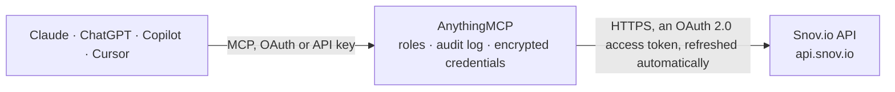

<!-- Generated by scripts/export-github-catalog.mjs in the anythingmcp-website repository. Do not edit by hand. -->

# Snov.io MCP connector

Drive Snov.io lead enrichment and outreach from your AI: find a person's email from name and company domain, verify emails, list the emails of a domain, manage prospect lists and see drip campaigns … The AnythingMCP connector gives Claude, ChatGPT, Microsoft Copilot, Cursor and Gemini 11 MCP tools for Snov.io: 6 read and 5 can change data.

**Category:** [Data Enrichment](../enrichment.md) · **Tools:** 11 · **Setup guide:** [anythingmcp.com](https://anythingmcp.com/guides/snov-to-mcp) · [Deutsch](https://anythingmcp.com/de/guides/snov-to-mcp) · [Italiano](https://anythingmcp.com/it/guides/snov-to-mcp) · [Español](https://anythingmcp.com/es/guides/snov-to-mcp) · [日本語](https://anythingmcp.com/ja/guides/snov-to-mcp) · [Русский](https://anythingmcp.com/ru/guides/snov-to-mcp) · [中文](https://anythingmcp.com/zh/guides/snov-to-mcp)

## Start without code

No installation and no terminal: AnythingMCP Cloud runs the Snov.io connector for you, operated by helpcode.ai in Frankfurt, Germany.

1. **Click the button above** and create an account or sign in. The Snov.io connector opens, ready to install.
2. **Sign in with your Snov.io account** when AnythingMCP asks. The first time, an admin creates a small app in the Snov.io developer console. Every click is in the [step-by-step guide](https://anythingmcp.com/guides/snov-to-mcp).
3. **Click Install.** AnythingMCP shows the address of your MCP server.
4. **Add that address to your assistant:** [Claude](https://anythingmcp.com/guides/connect-snov-to-claude) · [ChatGPT](https://anythingmcp.com/guides/connect-snov-to-chatgpt) · [Microsoft Copilot](https://anythingmcp.com/guides/connect-snov-to-copilot) · [Cursor](https://anythingmcp.com/guides/connect-snov-to-cursor) · [Gemini CLI](https://anythingmcp.com/guides/connect-snov-to-gemini) · [Meta Muse](https://anythingmcp.com/guides/connect-snov-to-muse).
5. **Ask your first question**, for example: *Find email for Marta Alvarez at heliocore.energy (first name Marta, last name Alvarez).*

Prefer help with the setup? [Talk to us](https://anythingmcp.com/contact).

## How it works

- **The AI client** speaks MCP (Streamable HTTP) to AnythingMCP and only sees tool names, descriptions and results. It never gets the Snov.io credentials.
- **AnythingMCP** checks the client's role, builds the call from the tool definition, adds the credentials (an OAuth 2.0 access token, refreshed automatically), calls Snov.io, logs the call and returns the result.
- **Snov.io** sees an ordinary API client with the rights of the account the credentials belong to.

## Tools

| Tool | What it does | Access |
|---|---|---|
| [`snov_balance`](#snov_balance) | Remaining credit balance of the account, with days until the monthly limit resets and until the subscription ends. | read |
| [`snov_get_domain_emails_count`](#snov_get_domain_emails_count) | How many emails Snov.io knows for a company domain, before spending a credit on snov_domain_search. | read |
| [`snov_domain_search`](#snov_domain_search) | Start a search for the emails of a company domain. | read |
| [`snov_get_domain_search_result`](#snov_get_domain_search_result) | Read the emails found by snov_domain_search: up to 50 emails per page, total_count, meta.next for the next page and status (completed or in_progress; when… | read |
| [`snov_email_finder`](#snov_email_finder) | Find a person's email from first name, last name and company domain. | write |
| [`snov_email_verifier`](#snov_email_verifier) | Check whether one email address can receive mail: valid, invalid, catch-all, disposable or webmail, with the SMTP and MX checks. | write |
| [`snov_email_finder_by_url`](#snov_email_finder_by_url) | Find the emails of a person from a LinkedIn profile URL. | write |
| [`snov_list_prospect_lists`](#snov_list_prospect_lists) | List the prospect lists of the account (id, name, number of contacts). | read |
| [`snov_create_prospect_list`](#snov_create_prospect_list) | Create a new, empty prospect list and return its id for snov_add_prospect_to_list. | write |
| [`snov_add_prospect_to_list`](#snov_add_prospect_to_list) | Add a prospect (person) to a list. | write |
| [`snov_list_drip_campaigns`](#snov_list_drip_campaigns) | List the drip (email outreach) campaigns: id, name, the prospect list used, status (Active, Paused, Draft) and dates. | read |

## Tool reference

Every parameter as the AI client sees it in `tools/list`. Source: [`packages/backend/src/adapters/intl/snov.json`](../../../packages/backend/src/adapters/intl/snov.json).

### `snov_balance`

Remaining credit balance of the account, with days until the monthly limit resets and until the subscription ends. Free; use it before bulk lookups.

**Access:** read · **Call:** `GET /get-balance`

No parameters.

### `snov_get_domain_emails_count`

How many emails Snov.io knows for a company domain, before spending a credit on snov_domain_search. Free.

**Access:** read · **Call:** `POST /get-domain-emails-count`

| Parameter | Type | Required | Description |
|---|---|---|---|
| `domain` | string | yes | Company domain, e.g. snov.io. |

### `snov_domain_search`

Start a search for the emails of a company domain. Returns a task_hash; read the emails with snov_get_domain_search_result. Costs 1 credit per unique request, so check snov_get_domain_emails_count first.

**Access:** read · **Call:** `POST https://api.snov.io/v2/domain-search/domain-emails/start`

| Parameter | Type | Required | Description |
|---|---|---|---|
| `domain` | string | yes | Company domain, e.g. snov.io, without https:// or a path. |
| `next` | string | no | For the next page: meta.next from the previous snov_get_domain_search_result. |

### `snov_get_domain_search_result`

Read the emails found by snov_domain_search: up to 50 emails per page, total_count, meta.next for the next page and status (completed or in_progress; when in progress wait a few seconds and ask again). The emails are not verified. Free.

**Access:** read · **Call:** `GET https://api.snov.io/v2/domain-search/domain-emails/result/{task_hash}`

| Parameter | Type | Required | Description |
|---|---|---|---|
| `task_hash` | string | yes | task_hash returned by snov_domain_search (meta.task_hash). |

### `snov_email_finder`

Find a person's email from first name, last name and company domain. Spends credits; the answer lists the emails found with their status.

**Access:** write · **Call:** `POST /get-emails-from-names`

| Parameter | Type | Required | Description |
|---|---|---|---|
| `domain` | string | yes | Company domain. |
| `firstName` | string | yes | First name. |
| `lastName` | string | yes | Last name. |

### `snov_email_verifier`

Check whether one email address can receive mail: valid, invalid, catch-all, disposable or webmail, with the SMTP and MX checks. Spends a credit.

**Access:** write · **Call:** `POST /get-emails-verification-status`

| Parameter | Type | Required | Description |
|---|---|---|---|
| `email` | string | yes | Email to verify. |

### `snov_email_finder_by_url`

Find the emails of a person from a LinkedIn profile URL. Spends credits.

**Access:** write · **Call:** `POST /get-emails-by-url`

| Parameter | Type | Required | Description |
|---|---|---|---|
| `url` | string | yes | LinkedIn profile URL. |

### `snov_list_prospect_lists`

List the prospect lists of the account (id, name, number of contacts). Use the id with snov_add_prospect_to_list. Free.

**Access:** read · **Call:** `GET /get-user-lists`

No parameters.

### `snov_create_prospect_list`

Create a new, empty prospect list and return its id for snov_add_prospect_to_list. Free.

**Access:** write · **Call:** `POST /lists`

| Parameter | Type | Required | Description |
|---|---|---|---|
| `name` | string | yes | List name. |

### `snov_add_prospect_to_list`

Add a prospect (person) to a list. Required: email + listId.

**Access:** write · **Call:** `POST /add-prospect-to-list`

| Parameter | Type | Required | Description |
|---|---|---|---|
| `email` | string | yes | Prospect email. |
| `fullName` | string | no | Full name. |
| `firstName` | string | no | First name. |
| `lastName` | string | no | Last name. |
| `position` | string | no | Job title. |
| `companyName` | string | no | Company name. |
| `country` | string | no | Country. |
| `listId` | integer | yes | Target list ID. |
| `customFields` | object | no | Custom fields object. |

### `snov_list_drip_campaigns`

List the drip (email outreach) campaigns: id, name, the prospect list used, status (Active, Paused, Draft) and dates. Free.

**Access:** read · **Call:** `GET /get-user-campaigns`

No parameters.

## Run it yourself

AnythingMCP is open source (AGPL-3.0). [Run it with Docker](../../../README.md#run-it-yourself), open **Connectors → Store**, pick **Snov.io** and enter `SNOV_CLIENT_ID`, `SNOV_CLIENT_SECRET`, then add your MCP server URL to the AI client.

[← Data Enrichment connectors](../enrichment.md) · [All categories](../README.md)
