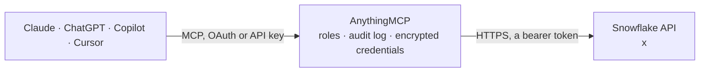

<!-- Generated by scripts/export-github-catalog.mjs in the anythingmcp-website repository. Do not edit by hand. -->

# Snowflake MCP connector

Ask your Snowflake data questions from Claude, ChatGPT or Copilot through Snowflake's official managed MCP server: Cortex Agents, Cortex Analyst semantic views, Cortex Search and your own functions, … The AnythingMCP connector gives Claude, ChatGPT, Microsoft Copilot, Cursor and Gemini 5 MCP tools for Snowflake: 3 read and 2 can change data.

**Category:** [Databases](../database.md) · **Tools:** 5 · **Setup guide:** [anythingmcp.com](https://anythingmcp.com/guides/snowflake-to-mcp) · [Deutsch](https://anythingmcp.com/de/guides/snowflake-to-mcp) · [Italiano](https://anythingmcp.com/it/guides/snowflake-to-mcp) · [Español](https://anythingmcp.com/es/guides/snowflake-to-mcp) · [日本語](https://anythingmcp.com/ja/guides/snowflake-to-mcp) · [Русский](https://anythingmcp.com/ru/guides/snowflake-to-mcp) · [中文](https://anythingmcp.com/zh/guides/snowflake-to-mcp)

## Start without code

No installation and no terminal: AnythingMCP Cloud runs the Snowflake connector for you, operated by helpcode.ai in Frankfurt, Germany.

1. **Click the button above** and create an account or sign in. The Snowflake connector opens, ready to install.
2. **Paste the API key or token from your Snowflake account.** Every click is in the [step-by-step guide](https://anythingmcp.com/guides/snowflake-to-mcp).
3. **Click Install.** AnythingMCP shows the address of your MCP server.
4. **Add that address to your assistant:** [Claude](https://anythingmcp.com/guides/connect-snowflake-to-claude) · [ChatGPT](https://anythingmcp.com/guides/connect-snowflake-to-chatgpt) · [Microsoft Copilot](https://anythingmcp.com/guides/connect-snowflake-to-copilot) · [Cursor](https://anythingmcp.com/guides/connect-snowflake-to-cursor) · [Gemini CLI](https://anythingmcp.com/guides/connect-snowflake-to-gemini) · [Meta Muse](https://anythingmcp.com/guides/connect-snowflake-to-muse).
5. **Ask your first question**, for example: *What's the status and expected delivery date for purchase order PO-2026-0457 for BrightLight GmbH?*

Prefer help with the setup? [Talk to us](https://anythingmcp.com/contact).

## How it works

- **The AI client** speaks MCP (Streamable HTTP) to AnythingMCP and only sees tool names, descriptions and results. It never gets the Snowflake credentials.
- **AnythingMCP** checks the client's role, builds the call from the tool definition, adds the credentials (a bearer token), calls Snowflake, logs the call and returns the result.
- **Snowflake** sees an ordinary API client with the rights of the account the credentials belong to.

## Tools

| Tool | What it does | Access |
|---|---|---|
| [`snowflake_business_data_agent`](#snowflake_business_data_agent) | Example of the CORTEX_AGENT_RUN tool type (a Cortex Agent): "Answers governed business data questions by using configured Cortex Analyst and Cortex Search… | read |
| [`snowflake_revenue_semantic_view`](#snowflake_revenue_semantic_view) | Example of the CORTEX_ANALYST_MESSAGE tool type (Cortex Analyst over a semantic view): "Semantic view for all revenue tables." Turns a question in natural… | read |
| [`snowflake_product_search`](#snowflake_product_search) | Example of the CORTEX_SEARCH_SERVICE_QUERY tool type (a Cortex Search service): "cortex search service for all products." Keyword and vector search over… | read |
| [`snowflake_sql_exec_tool`](#snowflake_sql_exec_tool) | Example of the SYSTEM_EXECUTE_SQL tool type: "A tool to execute SQL queries against the connected Snowflake database." Runs one SQL statement with the… | write |
| [`snowflake_my_custom_tool`](#snowflake_my_custom_tool) | Example of the GENERIC tool type (a UDF or stored procedure exposed as a tool): "Custom tool description." Its inputs are the input_schema declared in the… | write |

## Tool reference

Every parameter as the AI client sees it in `tools/list`. Source: [`packages/backend/src/adapters/intl/snowflake.json`](../../../packages/backend/src/adapters/intl/snowflake.json).

### `snowflake_business_data_agent`

Example of the CORTEX_AGENT_RUN tool type (a Cortex Agent): "Answers governed business data questions by using configured Cortex Analyst and Cortex Search resources." The agent picks and orchestrates its own tools and returns its answer with reasoning steps and citations.

**Access:** read · **Call:** `business_data_agent /mcp`

| Parameter | Type | Required | Description |
|---|---|---|---|
| `message` | string | yes | The question or instruction for the agent, in natural language. |

### `snowflake_revenue_semantic_view`

Example of the CORTEX_ANALYST_MESSAGE tool type (Cortex Analyst over a semantic view): "Semantic view for all revenue tables." Turns a question in natural language into SQL over the semantic view and returns the SQL statement.

**Access:** read · **Call:** `revenue-semantic-view /mcp`

| Parameter | Type | Required | Description |
|---|---|---|---|
| `message` | string | yes | The user's question. |

### `snowflake_product_search`

Example of the CORTEX_SEARCH_SERVICE_QUERY tool type (a Cortex Search service): "cortex search service for all products." Keyword and vector search over unstructured text, returning the matching rows and a request ID.

**Access:** read · **Call:** `product-search /mcp`

| Parameter | Type | Required | Description |
|---|---|---|---|
| `query` | string | yes | Unstructured text query. |
| `columns` | string[] | no | List of columns to return. |
| `filter` | object | no | Filter query on the ATTRIBUTES columns of the search service, built from the matching operators @eq (text or numeric equality), @contains (array contains), @gte and @lte (numeric or date greater/less than or equal), combined with @and, @or and @not. Example: {"@and": [{"@gte": {"numeric_col": 10.5}}, {"@lte": {"numeric_col": 12.5}}]}. |
| `limit` | integer | no | Max number of results to return. |

### `snowflake_sql_exec_tool`

Example of the SYSTEM_EXECUTE_SQL tool type: "A tool to execute SQL queries against the connected Snowflake database." Runs one SQL statement with the role's privileges (read-only unless the server sets read_only: false); results over 250 KB are truncated. Installed switched off.

**Access:** write · **Call:** `sql_exec_tool /mcp`

| Parameter | Type | Required | Description |
|---|---|---|---|
| `sql` | string | yes | Single SQL query to execute. |

### `snowflake_my_custom_tool`

Example of the GENERIC tool type (a UDF or stored procedure exposed as a tool): "Custom tool description." Its inputs are the input_schema declared in the server specification, here a single string named query; results over 250 KB are truncated.

**Access:** write · **Call:** `my_custom_tool /mcp`

| Parameter | Type | Required | Description |
|---|---|---|---|
| `query` | string | no | The function argument declared in the tool's input_schema. |

## Run it yourself

AnythingMCP is open source (AGPL-3.0). [Run it with Docker](../../../README.md#run-it-yourself), open **Connectors → Store**, pick **Snowflake** and enter `SNOWFLAKE_ACCOUNT_HOST`, `SNOWFLAKE_DATABASE`, `SNOWFLAKE_SCHEMA`, `SNOWFLAKE_MCP_SERVER`, `SNOWFLAKE_PAT`, then add your MCP server URL to the AI client.

[← Databases connectors](../database.md) · [All categories](../README.md)
