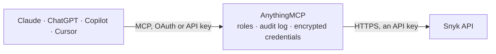

<!-- Generated by scripts/export-github-catalog.mjs in the anythingmcp-website repository. Do not edit by hand. -->

# Snyk MCP connector

Let your AI check Snyk: organizations, targets and projects, vulnerabilities and other issues with fix paths, SBOMs, dependencies, package checks by purl, members, ignores and policies, and tag … The AnythingMCP connector gives Claude, ChatGPT, Microsoft Copilot, Cursor and Gemini 25 MCP tools for Snyk: 20 read and 5 can change data.

**Category:** [Infrastructure](../infrastructure.md) · **Tools:** 25 · **Setup guide:** [anythingmcp.com](https://anythingmcp.com/guides/snyk-to-mcp) · [Deutsch](https://anythingmcp.com/de/guides/snyk-to-mcp) · [Italiano](https://anythingmcp.com/it/guides/snyk-to-mcp) · [Español](https://anythingmcp.com/es/guides/snyk-to-mcp) · [日本語](https://anythingmcp.com/ja/guides/snyk-to-mcp) · [Русский](https://anythingmcp.com/ru/guides/snyk-to-mcp) · [中文](https://anythingmcp.com/zh/guides/snyk-to-mcp)

## Start without code

No installation and no terminal: AnythingMCP Cloud runs the Snyk connector for you, operated by helpcode.ai in Frankfurt, Germany.

1. **Click the button above** and create an account or sign in. The Snyk connector opens, ready to install.
2. **Paste the API key or token from your Snyk account.** Every click is in the [step-by-step guide](https://anythingmcp.com/guides/snyk-to-mcp).
3. **Click Install.** AnythingMCP shows the address of your MCP server.
4. **Add that address to your assistant:** [Claude](https://anythingmcp.com/guides/connect-snyk-to-claude) · [ChatGPT](https://anythingmcp.com/guides/connect-snyk-to-chatgpt) · [Microsoft Copilot](https://anythingmcp.com/guides/connect-snyk-to-copilot) · [Cursor](https://anythingmcp.com/guides/connect-snyk-to-cursor) · [Gemini CLI](https://anythingmcp.com/guides/connect-snyk-to-gemini) · [Meta Muse](https://anythingmcp.com/guides/connect-snyk-to-muse).
5. **Ask your first question**, for example: *Show open critical issues for project 'web-api' in Nimbus Software GmbH in the last 30 days*

Prefer help with the setup? [Talk to us](https://anythingmcp.com/contact).

## How it works

- **The AI client** speaks MCP (Streamable HTTP) to AnythingMCP and only sees tool names, descriptions and results. It never gets the Snyk credentials.
- **AnythingMCP** checks the client's role, builds the call from the tool definition, adds the credentials (an API key), calls Snyk, logs the call and returns the result.
- **Snyk** sees an ordinary API client with the rights of the account the credentials belong to.

## Tools

| Tool | What it does | Access |
|---|---|---|
| [`snyk_get_self`](#snyk_get_self) | Read the Snyk user or service account the token belongs to: id, name, username, email and default organization. | read |
| [`snyk_list_orgs`](#snyk_list_orgs) | List the organizations the token can access: id, name, slug, group id and whether it is personal. | read |
| [`snyk_get_org`](#snyk_get_org) | Read one organization: name, slug, group id and dates. | read |
| [`snyk_list_projects`](#snyk_list_projects) | List the projects of an organization (one per scanned manifest, container image, Code or IaC target): id, name, type, origin, target reference, status,… | read |
| [`snyk_get_project`](#snyk_get_project) | Read one project: name, type, origin, target file and reference, status, test frequency, tags, attributes and the latest issue counts. | read |
| [`snyk_list_issues`](#snyk_list_issues) | List the issues of a whole organization across all products (open source vulnerabilities and licenses, Code, IaC, container, secrets): id, title, type,… | read |
| [`snyk_list_project_issues`](#snyk_list_project_issues) | List the issues of one project, with the same fields and filters as snyk_list_issues. | read |
| [`snyk_get_issue`](#snyk_get_issue) | Read one issue by its id from snyk_list_issues: title, severity, status, problems, coordinates with the affected package versions and remedies, and the project. | read |
| [`snyk_list_targets`](#snyk_list_targets) | List the targets of an organization (a repository, container image or CLI upload that holds projects): id, display name, URL, private flag and source type. | read |
| [`snyk_get_target`](#snyk_get_target) | Read one target: display name, URL, private flag, source type and dates. | read |
| [`snyk_get_project_sbom`](#snyk_get_project_sbom) | Export the software bill of materials (SBOM) of a project from its latest scan, in CycloneDX or SPDX: every component with version, purl and, unless… | read |
| [`snyk_list_package_issues`](#snyk_list_package_issues) | Check one open source package version for known vulnerabilities before using it, by its package URL (purl), e.g. pkg:npm/lodash@4.17.20 or… | read |
| [`snyk_list_org_members`](#snyk_list_org_members) | List the members of an organization: user id, name, username, email, login method and role. | read |
| [`snyk_list_policies`](#snyk_list_policies) | List the organization-level ignore policies (the consistent ignores used by Snyk Code and newer products): id, name, ignore type, reason, expiry, review… | read |
| [`snyk_get_policy`](#snyk_get_policy) | Read one organization-level policy: its condition (the finding it matches), ignore type, reason, expiry and review state. | read |
| [`snyk_list_aggregated_issues`](#snyk_list_aggregated_issues) | List the open source or container issues of one project with fix details from the v1 API: package and version, severity, CVSS and priority score, exploit… | read |
| [`snyk_list_issue_paths`](#snyk_list_issue_paths) | Show how a vulnerable package gets into a project: every dependency path from the project to the issue, with the package versions along the way. | read |
| [`snyk_list_dependencies`](#snyk_list_dependencies) | List the open source dependencies used across an organization's projects: package name and version, type, licenses, how many issues by severity, the… | read |
| [`snyk_list_project_ignores`](#snyk_list_project_ignores) | List the ignores of one project (v1): for each issue id the ignore rules with reason, reason type, expiry, path and who created them. | read |
| [`snyk_list_integrations`](#snyk_list_integrations) | List the SCM and registry integrations of an organization (github, gitlab, bitbucket-cloud, azure-repos, docker-hub, ecr ...) with their integration ids. | read |
| [`snyk_add_project_tag`](#snyk_add_project_tag) | Add a tag (key and value) to a project, e.g. team:payments, to group and filter projects. | write |
| [`snyk_remove_project_tag`](#snyk_remove_project_tag) | Remove a tag (key and value) from a project. | write |
| [`snyk_set_project_attributes`](#snyk_set_project_attributes) | Set a project's business criticality, environment and lifecycle attributes, which feed prioritisation and reports. | write |
| [`snyk_create_ignore`](#snyk_create_ignore) | Ignore an issue in a project (v1, open source and container projects), so it no longer counts in tests, reports and pull request checks. | write |
| [`snyk_delete_ignore`](#snyk_delete_ignore) | Delete all ignore rules of an issue in a project (v1), so it counts again in tests and reports. | write |

## Tool reference

Every parameter as the AI client sees it in `tools/list`. Source: [`packages/backend/src/adapters/intl/snyk.json`](../../../packages/backend/src/adapters/intl/snyk.json).

### `snyk_get_self`

Read the Snyk user or service account the token belongs to: id, name, username, email and default organization. A quick check that the token and region work. Read-only.

**Access:** read · **Call:** `GET /rest/self`

No parameters.

### `snyk_list_orgs`

List the organizations the token can access: id, name, slug, group id and whether it is personal. Most tools need the organization id. Read-only.

**Access:** read · **Call:** `GET /rest/orgs`

| Parameter | Type | Required | Description |
|---|---|---|---|
| `name` | string | no | Only organizations whose name contains this text. |
| `slug` | string | no | Only the organization with this exact slug. |
| `group_id` | string | no | Only organizations of this group id. |
| `starting_after` | string | no | Cursor for the next page: the starting_after value in links.next of the previous answer. Leave empty for the first page. |
| `limit` | integer | no | Results per page, up to 100. |

### `snyk_get_org`

Read one organization: name, slug, group id and dates. Read-only.

**Access:** read · **Call:** `GET /rest/orgs/{org_id}`

| Parameter | Type | Required | Description |
|---|---|---|---|
| `org_id` | string | yes | Organization id (a UUID) from snyk_list_orgs, not the slug. |

### `snyk_list_projects`

List the projects of an organization (one per scanned manifest, container image, Code or IaC target): id, name, type, origin, target reference, status, tags, attributes and, with latest_issue_counts, the open issues by severity. Read-only.

**Access:** read · **Call:** `GET /rest/orgs/{org_id}/projects`

| Parameter | Type | Required | Description |
|---|---|---|---|
| `org_id` | string | yes | Organization id (a UUID) from snyk_list_orgs, not the slug. |
| `names` | string | no | Only projects with these exact names, comma-separated. |
| `names_start_with` | string | no | Only projects whose name starts with this text. |
| `target_id` | string | no | Only projects of these target ids, comma-separated. |
| `types` | string | no | Only these project types, comma-separated, e.g. npm,maven,pip,sast,dockerfile,deb. |
| `origins` | string | no | Only these origins, comma-separated, e.g. github,gitlab,cli,docker-hub. |
| `tags` | string | no | Only projects with all these tags, comma-separated key:value pairs, e.g. team:payments. |
| `lifecycle` | string | no | Only these lifecycle values, comma-separated: production, development, sandbox. |
| `environment` | string | no | Only these environment values, comma-separated, e.g. backend,external. |
| `business_criticality` | string | no | Only these criticality values, comma-separated: critical, high, medium, low. |
| `latest_issue_counts` | boolean | no | true to add the issue counts of the latest scan per project. |
| `expand` | `target` | no | target to include the target details. |
| `starting_after` | string | no | Cursor for the next page: the starting_after value in links.next of the previous answer. Leave empty for the first page. |
| `limit` | integer | no | Results per page, up to 100. |

### `snyk_get_project`

Read one project: name, type, origin, target file and reference, status, test frequency, tags, attributes and the latest issue counts. Read-only.

**Access:** read · **Call:** `GET /rest/orgs/{org_id}/projects/{project_id}`

| Parameter | Type | Required | Description |
|---|---|---|---|
| `org_id` | string | yes | Organization id (a UUID) from snyk_list_orgs, not the slug. |
| `project_id` | string | yes | Project id (a UUID) from snyk_list_projects. |
| `latest_issue_counts` | boolean | no | true to add the issue counts of the latest scan. |
| `expand` | `target` | no | target to include the target details. |

### `snyk_list_issues`

List the issues of a whole organization across all products (open source vulnerabilities and licenses, Code, IaC, container, secrets): id, title, type, effective severity, status, ignored, problems (CVE, CWE, Snyk ids), affected package and the project it was found in. Filter by type, severity, status or dates. Read-only.

**Access:** read · **Call:** `GET /rest/orgs/{org_id}/issues`

| Parameter | Type | Required | Description |
|---|---|---|---|
| `org_id` | string | yes | Organization id (a UUID) from snyk_list_orgs, not the slug. |
| `type` | `package_vulnerability` \| `license` \| `code` \| `config` \| `cloud` \| `secrets` \| `custom` | no | Only one issue type. |
| `effective_severity_level` | string | no | Only these severities, comma-separated: critical, high, medium, low, info. |
| `status` | string | no | open or resolved; comma-separated for both. |
| `ignored` | boolean | no | true for ignored issues only, false for issues that are not ignored. |
| `created_after` | string | no | Only issues created after this time, ISO 8601, e.g. 2026-10-01T00:00:00Z. |
| `created_before` | string | no | Only issues created before this time, ISO 8601. |
| `updated_after` | string | no | Only issues updated after this time, ISO 8601. |
| `updated_before` | string | no | Only issues updated before this time, ISO 8601. |
| `starting_after` | string | no | Cursor for the next page: the starting_after value in links.next of the previous answer. Leave empty for the first page. |
| `limit` | integer | no | Results per page, up to 100. |

### `snyk_list_project_issues`

List the issues of one project, with the same fields and filters as snyk_list_issues. Read-only.

**Access:** read · **Call:** `GET /rest/orgs/{org_id}/issues`

| Parameter | Type | Required | Description |
|---|---|---|---|
| `org_id` | string | yes | Organization id (a UUID) from snyk_list_orgs, not the slug. |
| `project_id` | string | yes | Project id (a UUID) from snyk_list_projects. |
| `type` | `package_vulnerability` \| `license` \| `code` \| `config` \| `cloud` \| `secrets` \| `custom` | no | Only one issue type. |
| `effective_severity_level` | string | no | Only these severities, comma-separated: critical, high, medium, low, info. |
| `status` | string | no | open or resolved; comma-separated for both. |
| `ignored` | boolean | no | true for ignored issues only, false for issues that are not ignored. |
| `created_after` | string | no | Only issues created after this time, ISO 8601, e.g. 2026-10-01T00:00:00Z. |
| `created_before` | string | no | Only issues created before this time, ISO 8601. |
| `updated_after` | string | no | Only issues updated after this time, ISO 8601. |
| `updated_before` | string | no | Only issues updated before this time, ISO 8601. |
| `starting_after` | string | no | Cursor for the next page: the starting_after value in links.next of the previous answer. Leave empty for the first page. |
| `limit` | integer | no | Results per page, up to 100. |

### `snyk_get_issue`

Read one issue by its id from snyk_list_issues: title, severity, status, problems, coordinates with the affected package versions and remedies, and the project. Read-only.

**Access:** read · **Call:** `GET /rest/orgs/{org_id}/issues/{issue_id}`

| Parameter | Type | Required | Description |
|---|---|---|---|
| `org_id` | string | yes | Organization id (a UUID) from snyk_list_orgs, not the slug. |
| `issue_id` | string | yes | Issue id (a UUID) from snyk_list_issues. |

### `snyk_list_targets`

List the targets of an organization (a repository, container image or CLI upload that holds projects): id, display name, URL, private flag and source type. Read-only.

**Access:** read · **Call:** `GET /rest/orgs/{org_id}/targets`

| Parameter | Type | Required | Description |
|---|---|---|---|
| `org_id` | string | yes | Organization id (a UUID) from snyk_list_orgs, not the slug. |
| `display_name` | string | no | Only targets whose display name starts with this text, e.g. acme/web. |
| `url` | string | no | Only the target with this remote URL. |
| `source_types` | string | no | Only these source types, comma-separated, e.g. github,gitlab,cli,docker-hub. |
| `is_private` | boolean | no | true for private targets only, false for public ones. |
| `starting_after` | string | no | Cursor for the next page: the starting_after value in links.next of the previous answer. Leave empty for the first page. |
| `limit` | integer | no | Results per page, up to 100. |

### `snyk_get_target`

Read one target: display name, URL, private flag, source type and dates. Read-only.

**Access:** read · **Call:** `GET /rest/orgs/{org_id}/targets/{target_id}`

| Parameter | Type | Required | Description |
|---|---|---|---|
| `org_id` | string | yes | Organization id (a UUID) from snyk_list_orgs, not the slug. |
| `target_id` | string | yes | Target id (a UUID) from snyk_list_targets. |

### `snyk_get_project_sbom`

Export the software bill of materials (SBOM) of a project from its latest scan, in CycloneDX or SPDX: every component with version, purl and, unless excluded, licenses. Works for open source and container projects. Large for big projects. Read-only.

**Access:** read · **Call:** `GET /rest/orgs/{org_id}/projects/{project_id}/sbom`

| Parameter | Type | Required | Description |
|---|---|---|---|
| `org_id` | string | yes | Organization id (a UUID) from snyk_list_orgs, not the slug. |
| `project_id` | string | yes | Project id (a UUID) from snyk_list_projects. |
| `format` | `cyclonedx1.6+json` \| `cyclonedx1.6+xml` \| `cyclonedx1.5+json` \| `cyclonedx1.5+xml` \| `cyclonedx1.4+json` \| `cyclonedx1.4+xml` \| `spdx2.3+json` | no | SBOM format; default CycloneDX 1.6 JSON. |
| `exclude` | `licenses` | no | licenses to leave the license data out. |

### `snyk_list_package_issues`

Check one open source package version for known vulnerabilities before using it, by its package URL (purl), e.g. pkg:npm/lodash@4.17.20 or pkg:maven/org.apache.logging.log4j/log4j-core@2.14.1: each issue with severity, CVE and the versions that fix it. Read-only.

**Access:** read · **Call:** `GET /rest/orgs/{org_id}/packages/{purl}/issues`

| Parameter | Type | Required | Description |
|---|---|---|---|
| `org_id` | string | yes | Organization id (a UUID) from snyk_list_orgs, not the slug. |
| `purl` | string | yes | Package URL with a version, e.g. pkg:npm/lodash@4.17.20, pkg:pypi/django@3.2.0, pkg:golang/github.com/gin-gonic/gin@v1.6.0. Pass it as is; it is encoded for you. |
| `offset` | integer | no | Number of issues to skip. |
| `limit` | integer | no | Issues to return, up to 1000. |

### `snyk_list_org_members`

List the members of an organization: user id, name, username, email, login method and role. Filter by email, username or role. Read-only.

**Access:** read · **Call:** `GET /rest/orgs/{org_id}/memberships`

| Parameter | Type | Required | Description |
|---|---|---|---|
| `org_id` | string | yes | Organization id (a UUID) from snyk_list_orgs, not the slug. |
| `email` | string | no | Only the member with this email. |
| `username` | string | no | Only the member with this username. |
| `role_name` | string | no | Only members with this role, e.g. Org Admin or Org Collaborator. |
| `sort_by` | `username` \| `user_display_name` \| `email` \| `login_method` \| `role` | no | Sort field. |
| `sort_order` | `ASC` \| `DESC` | no | ASC (default) or DESC. |
| `starting_after` | string | no | Cursor for the next page: the starting_after value in links.next of the previous answer. Leave empty for the first page. |
| `limit` | integer | no | Results per page, up to 100. |

### `snyk_list_policies`

List the organization-level ignore policies (the consistent ignores used by Snyk Code and newer products): id, name, ignore type, reason, expiry, review state and who created them. Read-only.

**Access:** read · **Call:** `GET /rest/orgs/{org_id}/policies`

| Parameter | Type | Required | Description |
|---|---|---|---|
| `org_id` | string | yes | Organization id (a UUID) from snyk_list_orgs, not the slug. |
| `search` | string | no | Search in the ignored-by name or email and the ignore type. |
| `review` | string | no | Only these review states, comma-separated: pending, approved, rejected, not-required. |
| `expires_before` | string | no | Only policies expiring before this time, ISO 8601. |
| `expires_never` | boolean | no | true for policies that never expire. |
| `order_by` | `created` \| `expires` \| `ignore-type` \| `requested-by` | no | Sort field. |
| `order_direction` | `asc` \| `desc` | no | asc or desc. |
| `starting_after` | string | no | Cursor for the next page: the starting_after value in links.next of the previous answer. Leave empty for the first page. |
| `limit` | integer | no | Results per page, up to 100. |

### `snyk_get_policy`

Read one organization-level policy: its condition (the finding it matches), ignore type, reason, expiry and review state. Read-only.

**Access:** read · **Call:** `GET /rest/orgs/{org_id}/policies/{policy_id}`

| Parameter | Type | Required | Description |
|---|---|---|---|
| `org_id` | string | yes | Organization id (a UUID) from snyk_list_orgs, not the slug. |
| `policy_id` | string | yes | Policy id (a UUID) from snyk_list_policies. |

### `snyk_list_aggregated_issues`

List the open source or container issues of one project with fix details from the v1 API: package and version, severity, CVSS and priority score, exploit maturity, whether it is upgradable or patchable, the fixed-in versions and whether it is ignored. The id is the v1 issue id that ignores use. Sent as POST but changes nothing. Read-only.

**Access:** read · **Call:** `POST /v1/org/{org_id}/project/{project_id}/aggregated-issues`

| Parameter | Type | Required | Description |
|---|---|---|---|
| `org_id` | string | yes | Organization id (a UUID) from snyk_list_orgs, not the slug. |
| `project_id` | string | yes | Project id (a UUID) from snyk_list_projects. |
| `severities` | string[] | no | Only these severities, e.g. ["critical", "high"]. |
| `types` | string[] | no | Only these types: vuln, license. |
| `exploitMaturity` | string[] | no | Only these exploit maturities, e.g. ["mature", "proof-of-concept"]. |
| `ignored` | boolean | no | true for ignored issues only, false for issues that are not ignored. |
| `includeDescription` | boolean | no | true to include each issue's long description. |

### `snyk_list_issue_paths`

Show how a vulnerable package gets into a project: every dependency path from the project to the issue, with the package versions along the way. Read-only.

**Access:** read · **Call:** `GET /v1/org/{org_id}/project/{project_id}/issue/{issue_id}/paths`

| Parameter | Type | Required | Description |
|---|---|---|---|
| `org_id` | string | yes | Organization id (a UUID) from snyk_list_orgs, not the slug. |
| `project_id` | string | yes | Project id (a UUID) from snyk_list_projects. |
| `issue_id` | string | yes | Snyk issue id as used by the v1 API, e.g. SNYK-JS-LODASH-567746 (the vulnerability id) or a license id like snyk:lic:npm:gpl-3.0. In REST issues it is attributes.problems[].id. |
| `page` | integer | no | Page number, from 1. |
| `perPage` | integer | no | Paths per page, up to 1000. |

### `snyk_list_dependencies`

List the open source dependencies used across an organization's projects: package name and version, type, licenses, how many issues by severity, the projects that use it and whether it is deprecated. Filter by project, language, severity or dependency. Sent as POST but changes nothing. Read-only.

**Access:** read · **Call:** `POST /v1/org/{org_id}/dependencies`

| Parameter | Type | Required | Description |
|---|---|---|---|
| `org_id` | string | yes | Organization id (a UUID) from snyk_list_orgs, not the slug. |
| `projects` | string[] | no | Only dependencies of these project ids. |
| `languages` | string[] | no | Only these languages, e.g. ["javascript", "python"]. |
| `severity` | string[] | no | Only dependencies with issues of these severities, e.g. ["critical", "high"]. |
| `dependencies` | string[] | no | Only these dependencies, e.g. ["lodash@4.17.20"]. |
| `sortBy` | `projects` \| `dependency` \| `severity` \| `dependenciesWithIssues` | no | Sort field. |
| `order` | `asc` \| `desc` | no | asc or desc. |
| `page` | integer | no | Page number, from 1. |
| `perPage` | integer | no | Dependencies per page, up to 1000. |

### `snyk_list_project_ignores`

List the ignores of one project (v1): for each issue id the ignore rules with reason, reason type, expiry, path and who created them. Read-only.

**Access:** read · **Call:** `GET /v1/org/{org_id}/project/{project_id}/ignores`

| Parameter | Type | Required | Description |
|---|---|---|---|
| `org_id` | string | yes | Organization id (a UUID) from snyk_list_orgs, not the slug. |
| `project_id` | string | yes | Project id (a UUID) from snyk_list_projects. |

### `snyk_list_integrations`

List the SCM and registry integrations of an organization (github, gitlab, bitbucket-cloud, azure-repos, docker-hub, ecr ...) with their integration ids. Read-only.

**Access:** read · **Call:** `GET /v1/org/{org_id}/integrations`

| Parameter | Type | Required | Description |
|---|---|---|---|
| `org_id` | string | yes | Organization id (a UUID) from snyk_list_orgs, not the slug. |

### `snyk_add_project_tag`

Add a tag (key and value) to a project, e.g. team:payments, to group and filter projects. Call after the user agrees. Returns the project's tags.

**Access:** write · **Call:** `POST /v1/org/{org_id}/project/{project_id}/tags`

| Parameter | Type | Required | Description |
|---|---|---|---|
| `org_id` | string | yes | Organization id (a UUID) from snyk_list_orgs, not the slug. |
| `project_id` | string | yes | Project id (a UUID) from snyk_list_projects. |
| `key` | string | yes | Tag key: letters, digits, - and _, up to 30 characters. |
| `value` | string | yes | Tag value: letters, digits, - and _, up to 50 characters. |

### `snyk_remove_project_tag`

Remove a tag (key and value) from a project. It can be added again with snyk_add_project_tag. Call after the user agrees. Returns the remaining tags.

**Access:** write · **Call:** `POST /v1/org/{org_id}/project/{project_id}/tags/remove`

| Parameter | Type | Required | Description |
|---|---|---|---|
| `org_id` | string | yes | Organization id (a UUID) from snyk_list_orgs, not the slug. |
| `project_id` | string | yes | Project id (a UUID) from snyk_list_projects. |
| `key` | string | yes | Tag key to remove. |
| `value` | string | yes | Tag value to remove. |

### `snyk_set_project_attributes`

Set a project's business criticality, environment and lifecycle attributes, which feed prioritisation and reports. The lists you pass replace the old ones. Show the change and call after the user agrees.

**Access:** write · **Call:** `POST /v1/org/{org_id}/project/{project_id}/attributes`

| Parameter | Type | Required | Description |
|---|---|---|---|
| `org_id` | string | yes | Organization id (a UUID) from snyk_list_orgs, not the slug. |
| `project_id` | string | yes | Project id (a UUID) from snyk_list_projects. |
| `criticality` | `critical` \| `high` \| `medium` \| `low`[] | no | Business criticality values: critical, high, medium, low. |
| `environment` | `frontend` \| `backend` \| `internal` \| `external` \| `mobile` \| `saas` \| `onprem` \| `hosted` \| `distributed`[] | no | Environment values: frontend, backend, internal, external, mobile, saas, onprem, hosted, distributed. |
| `lifecycle` | `production` \| `development` \| `sandbox`[] | no | Lifecycle values: production, development, sandbox. |

### `snyk_create_ignore`

Ignore an issue in a project (v1, open source and container projects), so it no longer counts in tests, reports and pull request checks. Needs a reason; prefer a temporary ignore with an expiry. Tell the user the issue, project, reason and expiry and call only after the user agrees.

**Access:** write · **Call:** `POST /v1/org/{org_id}/project/{project_id}/ignore/{issue_id}`

| Parameter | Type | Required | Description |
|---|---|---|---|
| `org_id` | string | yes | Organization id (a UUID) from snyk_list_orgs, not the slug. |
| `project_id` | string | yes | Project id (a UUID) from snyk_list_projects. |
| `issue_id` | string | yes | Snyk issue id as used by the v1 API, e.g. SNYK-JS-LODASH-567746 (the vulnerability id) or a license id like snyk:lic:npm:gpl-3.0. In REST issues it is attributes.problems[].id. |
| `reasonType` | `not-vulnerable` \| `wont-fix` \| `temporary-ignore` | yes | Why: not-vulnerable (does not apply here), wont-fix (accepted risk) or temporary-ignore. |
| `reason` | string | yes | The reason in words, e.g. Not reachable: the vulnerable function is never called. |
| `expires` | string | no | When the ignore ends, ISO 8601, e.g. 2026-12-31T00:00:00Z. Leave empty to ignore without an end date. |
| `disregardIfFixable` | boolean | no | true to ignore only while no upgrade or patch is available. Default false. |
| `ignorePath` | string | no | Dependency path to ignore, default * (all paths). |

### `snyk_delete_ignore`

Delete all ignore rules of an issue in a project (v1), so it counts again in tests and reports. The ignore's reason and history are lost. Tell the user which issue and project and call only after the user agrees.

**Access:** write · **Call:** `DELETE /v1/org/{org_id}/project/{project_id}/ignore/{issue_id}`

| Parameter | Type | Required | Description |
|---|---|---|---|
| `org_id` | string | yes | Organization id (a UUID) from snyk_list_orgs, not the slug. |
| `project_id` | string | yes | Project id (a UUID) from snyk_list_projects. |
| `issue_id` | string | yes | Snyk issue id as used by the v1 API, e.g. SNYK-JS-LODASH-567746 (the vulnerability id) or a license id like snyk:lic:npm:gpl-3.0. In REST issues it is attributes.problems[].id. |

## Run it yourself

AnythingMCP is open source (AGPL-3.0). [Run it with Docker](../../../README.md#run-it-yourself), open **Connectors → Store**, pick **Snyk** and enter `SNYK_API_URL`, `SNYK_TOKEN`, then add your MCP server URL to the AI client.

[← Infrastructure connectors](../infrastructure.md) · [All categories](../README.md)
