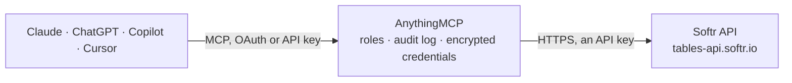

<!-- Generated by scripts/export-github-catalog.mjs in the anythingmcp-website repository. Do not edit by hand. -->

# Softr MCP connector

Let your AI work with Softr: browse Softr Databases, tables and fields, list, search and read records; with your confirmation create and update records, add users to a Softr app and create magic sign-in links. The AnythingMCP connector gives Claude, ChatGPT, Microsoft Copilot, Cursor and Gemini 13 MCP tools for Softr: 7 read and 6 can change data.

**Category:** [Databases](../database.md) · **Tools:** 13 · **Setup guide:** [anythingmcp.com](https://anythingmcp.com/guides/softr-to-mcp) · [Deutsch](https://anythingmcp.com/de/guides/softr-to-mcp) · [Italiano](https://anythingmcp.com/it/guides/softr-to-mcp) · [Español](https://anythingmcp.com/es/guides/softr-to-mcp) · [日本語](https://anythingmcp.com/ja/guides/softr-to-mcp) · [Русский](https://anythingmcp.com/ru/guides/softr-to-mcp) · [中文](https://anythingmcp.com/zh/guides/softr-to-mcp)

## Start without code

No installation and no terminal: AnythingMCP Cloud runs the Softr connector for you, operated by helpcode.ai in Frankfurt, Germany.

1. **Click the button above** and create an account or sign in. The Softr connector opens, ready to install.
2. **Paste the API key or token from your Softr account.** Every click is in the [step-by-step guide](https://anythingmcp.com/guides/softr-to-mcp).
3. **Click Install.** AnythingMCP shows the address of your MCP server.
4. **Add that address to your assistant:** [Claude](https://anythingmcp.com/guides/connect-softr-to-claude) · [ChatGPT](https://anythingmcp.com/guides/connect-softr-to-chatgpt) · [Microsoft Copilot](https://anythingmcp.com/guides/connect-softr-to-copilot) · [Cursor](https://anythingmcp.com/guides/connect-softr-to-cursor) · [Gemini CLI](https://anythingmcp.com/guides/connect-softr-to-gemini) · [Meta Muse](https://anythingmcp.com/guides/connect-softr-to-muse).
5. **Ask your first question**, for example: *Show the Softr record for customer 'Nordic Carpentry OÜ' in the Customers table, include email and account_status*

Prefer help with the setup? [Talk to us](https://anythingmcp.com/contact).

## How it works

- **The AI client** speaks MCP (Streamable HTTP) to AnythingMCP and only sees tool names, descriptions and results. It never gets the Softr credentials.
- **AnythingMCP** checks the client's role, builds the call from the tool definition, adds the credentials (an API key), calls Softr, logs the call and returns the result.
- **Softr** sees an ordinary API client with the rights of the account the credentials belong to.

## Tools

| Tool | What it does | Access |
|---|---|---|
| [`softr_list_databases`](#softr_list_databases) | List the Softr Databases the API token can reach, with id, name, description, workspace and number of tables. | read |
| [`softr_get_database`](#softr_get_database) | Read one Softr Database: name, description, workspace, number of tables and dates. | read |
| [`softr_list_tables`](#softr_list_tables) | List the tables of a Softr Database with their fields: id, name, type (SINGLE_LINE_TEXT, EMAIL, SELECT, NUMBER, DATE, LINKED_RECORD, ...), whether required… | read |
| [`softr_get_table`](#softr_get_table) | Read one table of a Softr Database with all its fields (id, name, type, options, required, read-only) and its default view. | read |
| [`softr_list_records`](#softr_list_records) | List the records of a table, page by page, optionally as one view shows them. | read |
| [`softr_search_records`](#softr_search_records) | Search the records of a table with a filter and sorting. | read |
| [`softr_get_record`](#softr_get_record) | Read one record of a table by its id: fields, creation and update dates. | read |
| [`softr_create_record`](#softr_create_record) | Create a record in a table. | write |
| [`softr_update_record`](#softr_update_record) | Change fields of a record; fields left out keep their value. | write |
| [`softr_delete_record`](#softr_delete_record) | Delete one record for good. | write |
| [`softr_create_app_user`](#softr_create_app_user) | Create a user of a Softr app (the app set in SOFTR_DOMAIN), optionally with a magic link to sign in without a password. | write |
| [`softr_generate_magic_link`](#softr_generate_magic_link) | Create a magic link for an existing user of the Softr app (SOFTR_DOMAIN). | write |
| [`softr_delete_app_user`](#softr_delete_app_user) | Delete a user from the Softr app (SOFTR_DOMAIN). | write |

## Tool reference

Every parameter as the AI client sees it in `tools/list`. Source: [`packages/backend/src/adapters/intl/softr.json`](../../../packages/backend/src/adapters/intl/softr.json).

### `softr_list_databases`

List the Softr Databases the API token can reach, with id, name, description, workspace and number of tables. Call this first. Free and read-only.

**Access:** read · **Call:** `GET /databases`

No parameters.

### `softr_get_database`

Read one Softr Database: name, description, workspace, number of tables and dates.

**Access:** read · **Call:** `GET /databases/{databaseId}`

| Parameter | Type | Required | Description |
|---|---|---|---|
| `databaseId` | string | yes | Database id from softr_list_databases. |

### `softr_list_tables`

List the tables of a Softr Database with their fields: id, name, type (SINGLE_LINE_TEXT, EMAIL, SELECT, NUMBER, DATE, LINKED_RECORD, ...), whether required or read-only, and the select options. Needed before writing records, which are keyed by field id.

**Access:** read · **Call:** `GET /databases/{databaseId}/tables`

| Parameter | Type | Required | Description |
|---|---|---|---|
| `databaseId` | string | yes | Database id from softr_list_databases. |

### `softr_get_table`

Read one table of a Softr Database with all its fields (id, name, type, options, required, read-only) and its default view.

**Access:** read · **Call:** `GET /databases/{databaseId}/tables/{tableId}`

| Parameter | Type | Required | Description |
|---|---|---|---|
| `databaseId` | string | yes | Database id from softr_list_databases. |
| `tableId` | string | yes | Table id from softr_list_tables. |

### `softr_list_records`

List the records of a table, page by page, optionally as one view shows them. Returns records (id, fields, dates), offset, limit and total. More: call again with offset raised by limit while offset + limit is below total. Records can hold personal data: show only what the user needs.

**Access:** read · **Call:** `GET /databases/{databaseId}/tables/{tableId}/records`

| Parameter | Type | Required | Description |
|---|---|---|---|
| `databaseId` | string | yes | Database id from softr_list_databases. |
| `tableId` | string | yes | Table id from softr_list_tables. |
| `offset` | integer | no | Records to skip, for the next page. |
| `limit` | integer | no | Records per page (default 20 here, at most 200). |
| `fieldNames` | boolean | no | true (default here) keys the fields of each record by field name; false keys them by field id. |
| `viewId` | string | no | Only the records of this view, with its filters (the table's defaultViewId or a view id from Softr). |

### `softr_search_records`

Search the records of a table with a filter and sorting. Read-only, although it is sent as POST. Returns records, offset, limit and total. Personal data: show only what the user needs.

**Access:** read · **Call:** `POST /databases/{databaseId}/tables/{tableId}/records/search`

| Parameter | Type | Required | Description |
|---|---|---|---|
| `databaseId` | string | yes | Database id from softr_list_databases. |
| `tableId` | string | yes | Table id from softr_list_tables. |
| `filter` | object | no | Optional filter: {"condition": {"operator": "IS", "leftSide": "<field id>", "rightSide": "open"}. Operators: IS, IS_NOT, CONTAINS, DOES_NOT_CONTAIN, STARTS_WITH, ENDS_WITH, GREATER_THAN, LESS_THAN (and _OR_EQUALS), IS_EMPTY, IS_NOT_EMPTY, IS_ONE_OF, IS_NOT_ONE_OF, HAS_ANY_OF, HAS_ALL_OF, HAS_NONE_OF, IS_BETWEEN (lowerBound, upperBound). Combine conditions with {"operator": "AND", "conditions": [...]} or OR. Text matching ignores case. |
| `sorting` | object[] | no | Sort by field ids, e.g. [{"sortingField": "<field id>", "sortType": "DESC"}]. |
| `offset` | integer | no | Records to skip, for the next page. |
| `limit` | integer | no | Records per page (default 20 here, at most 200). |
| `fieldNames` | boolean | no | true (default here) keys the fields of each record by field name; false keys them by field id. |

### `softr_get_record`

Read one record of a table by its id: fields, creation and update dates.

**Access:** read · **Call:** `GET /databases/{databaseId}/tables/{tableId}/records/{recordId}`

| Parameter | Type | Required | Description |
|---|---|---|---|
| `databaseId` | string | yes | Database id from softr_list_databases. |
| `tableId` | string | yes | Table id from softr_list_tables. |
| `recordId` | string | yes | Record id, from softr_list_records or softr_search_records. |
| `fieldNames` | boolean | no | true (default here) keys the fields of each record by field name; false keys them by field id. |

### `softr_create_record`

Create a record in a table. Confirm with the user first: show the table and every value, and wait for their yes. Values are keyed by field id (from softr_list_tables); Softr apps built on this table show the record at once. Returns the new record.

**Access:** write · **Call:** `POST /databases/{databaseId}/tables/{tableId}/records`

| Parameter | Type | Required | Description |
|---|---|---|---|
| `databaseId` | string | yes | Database id from softr_list_databases. |
| `tableId` | string | yes | Table id from softr_list_tables. |
| `fields` | object | yes | Values keyed by field id, e.g. {"<field id>": "Acme Ltd", "<field id>": 120}. A SELECT field takes the option's text or id, a LINKED_RECORD field a list of record ids. |
| `fieldNames` | boolean | no | true (default here) keys the fields of each record by field name; false keys them by field id. |

### `softr_update_record`

Change fields of a record; fields left out keep their value. Confirm with the user first: show the record and the exact changes, and wait for their yes. Values are keyed by field id.

**Access:** write · **Call:** `PATCH /databases/{databaseId}/tables/{tableId}/records/{recordId}`

| Parameter | Type | Required | Description |
|---|---|---|---|
| `databaseId` | string | yes | Database id from softr_list_databases. |
| `tableId` | string | yes | Table id from softr_list_tables. |
| `recordId` | string | yes | Record id, from softr_list_records or softr_search_records. |
| `fields` | object | yes | Fields to change, keyed by field id, e.g. {"<field id>": "Closed"}. |
| `fieldNames` | boolean | no | true (default here) keys the fields of each record by field name; false keys them by field id. |

### `softr_delete_record`

Delete one record for good. Installed switched off. Only when the user asks to delete that exact record: show it, confirm with the user first, and wait for their yes.

**Access:** write · **Call:** `DELETE /databases/{databaseId}/tables/{tableId}/records/{recordId}`

| Parameter | Type | Required | Description |
|---|---|---|---|
| `databaseId` | string | yes | Database id from softr_list_databases. |
| `tableId` | string | yes | Table id from softr_list_tables. |
| `recordId` | string | yes | Record id, from softr_list_records or softr_search_records. |

### `softr_create_app_user`

Create a user of a Softr app (the app set in SOFTR_DOMAIN), optionally with a magic link to sign in without a password. Confirm with the user first: show the name and email and wait for their yes. The new user can then sign in to the app and see what its user groups allow. Personal data.

**Access:** write · **Call:** `POST https://studio-api.softr.io/v1/api/users`

| Parameter | Type | Required | Description |
|---|---|---|---|
| `full_name` | string | yes | The user's full name, e.g. Jane Smith. |
| `email` | string | yes | The user's email address, e.g. jane@example.com. |
| `password` | string | no | Optional password; Softr generates one when left out. Never invent one without being asked. |
| `generate_magic_link` | boolean | no | true also creates a magic link the person can sign in with. |

### `softr_generate_magic_link`

Create a magic link for an existing user of the Softr app (SOFTR_DOMAIN). The link signs in as that user: confirm with the user first, and give it only to that person.

**Access:** write · **Call:** `POST https://studio-api.softr.io/v1/api/users/magic-link/generate/{email}`

| Parameter | Type | Required | Description |
|---|---|---|---|
| `email` | string | yes | The user's email address, e.g. jane@example.com. |

### `softr_delete_app_user`

Delete a user from the Softr app (SOFTR_DOMAIN). Installed switched off. Only when the user asks to remove that exact person: confirm with the user first and wait for their yes. Deactivating in Softr Studio is the gentler choice.

**Access:** write · **Call:** `DELETE https://studio-api.softr.io/v1/api/users/{email}`

| Parameter | Type | Required | Description |
|---|---|---|---|
| `email` | string | yes | The user's email address, e.g. jane@example.com. |

## Run it yourself

AnythingMCP is open source (AGPL-3.0). [Run it with Docker](../../../README.md#run-it-yourself), open **Connectors → Store**, pick **Softr** and enter `SOFTR_API_KEY`, then add your MCP server URL to the AI client.

[← Databases connectors](../database.md) · [All categories](../README.md)
