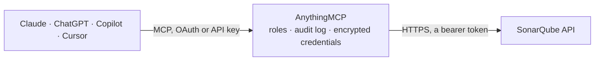

<!-- Generated by scripts/export-github-catalog.mjs in the anythingmcp-website repository. Do not edit by hand. -->

# SonarQube MCP connector

Let your AI read SonarQube: projects, quality gate status, measures such as coverage and their history, open issues by severity and software quality, analyses and branches. The AnythingMCP connector gives Claude, ChatGPT, Microsoft Copilot, Cursor and Gemini 7 MCP tools for SonarQube, all read-only.

**Category:** [Infrastructure](../infrastructure.md) · **Tools:** 7 · **Setup guide:** [anythingmcp.com](https://anythingmcp.com/guides/sonarqube-to-mcp) · [Deutsch](https://anythingmcp.com/de/guides/sonarqube-to-mcp) · [Italiano](https://anythingmcp.com/it/guides/sonarqube-to-mcp) · [Español](https://anythingmcp.com/es/guides/sonarqube-to-mcp) · [日本語](https://anythingmcp.com/ja/guides/sonarqube-to-mcp) · [Русский](https://anythingmcp.com/ru/guides/sonarqube-to-mcp) · [中文](https://anythingmcp.com/zh/guides/sonarqube-to-mcp)

## Start without code

No installation and no terminal: AnythingMCP Cloud runs the SonarQube connector for you, operated by helpcode.ai in Frankfurt, Germany.

1. **Click the button above** and create an account or sign in. The SonarQube connector opens, ready to install.
2. **Paste the API key or token from your SonarQube account.** Every click is in the [step-by-step guide](https://anythingmcp.com/guides/sonarqube-to-mcp).
3. **Click Install.** AnythingMCP shows the address of your MCP server.
4. **Add that address to your assistant:** [Claude](https://anythingmcp.com/guides/connect-sonarqube-to-claude) · [ChatGPT](https://anythingmcp.com/guides/connect-sonarqube-to-chatgpt) · [Microsoft Copilot](https://anythingmcp.com/guides/connect-sonarqube-to-copilot) · [Cursor](https://anythingmcp.com/guides/connect-sonarqube-to-cursor) · [Gemini CLI](https://anythingmcp.com/guides/connect-sonarqube-to-gemini) · [Meta Muse](https://anythingmcp.com/guides/connect-sonarqube-to-muse).
5. **Ask your first question**, for example: *What's the quality gate status for project key payments-api (main branch)?*

Prefer help with the setup? [Talk to us](https://anythingmcp.com/contact).

## How it works

- **The AI client** speaks MCP (Streamable HTTP) to AnythingMCP and only sees tool names, descriptions and results. It never gets the SonarQube credentials.
- **AnythingMCP** checks the client's role, builds the call from the tool definition, adds the credentials (a bearer token), calls SonarQube, logs the call and returns the result.
- **SonarQube** sees an ordinary API client with the rights of the account the credentials belong to.

## Tools

| Tool | What it does | Access |
|---|---|---|
| [`sonarqube_list_projects`](#sonarqube_list_projects) | List the SonarQube projects the token can browse, with their key and name. | read |
| [`sonarqube_get_quality_gate_status`](#sonarqube_get_quality_gate_status) | Read whether a project passed its quality gate: the overall status (OK or ERROR) and each condition with its metric, threshold and actual value. | read |
| [`sonarqube_get_measures`](#sonarqube_get_measures) | Read the current value of one or more metrics for a project, such as coverage, duplicated_lines_density, ncloc or software_quality_security_issues. | read |
| [`sonarqube_get_measures_history`](#sonarqube_get_measures_history) | Read how metrics changed over time for a project: one value per analysis, with its date. | read |
| [`sonarqube_search_issues`](#sonarqube_search_issues) | Search issues in one or more projects: rule, message, file and line, impacts (software quality and severity), status, assignee and creation date. | read |
| [`sonarqube_list_project_analyses`](#sonarqube_list_project_analyses) | List the analyses of a project, newest first, with their date, version and events such as quality gate changes or new versions. | read |
| [`sonarqube_list_branches`](#sonarqube_list_branches) | List the branches of a project with their type, whether one is the main branch, the date of its last analysis and its quality gate status. | read |

## Tool reference

Every parameter as the AI client sees it in `tools/list`. Source: [`packages/backend/src/adapters/intl/sonarqube.json`](../../../packages/backend/src/adapters/intl/sonarqube.json).

### `sonarqube_list_projects`

List the SonarQube projects the token can browse, with their key and name. Start here: the other tools take the project key it returns. Filter by name or exact key with q. Read-only.

**Access:** read · **Call:** `GET /components/search`

| Parameter | Type | Required | Description |
|---|---|---|---|
| `q` | string | no | Optional search text, at least 2 characters: matches part of a project name or a project key exactly. |
| `p` | integer | no | Page number, starting at 1. |
| `ps` | integer | no | Projects per page, up to 500. |

### `sonarqube_get_quality_gate_status`

Read whether a project passed its quality gate: the overall status (OK or ERROR) and each condition with its metric, threshold and actual value. Main branch by default; pass branch or pullRequest for another. Read-only.

**Access:** read · **Call:** `GET /qualitygates/project_status`

| Parameter | Type | Required | Description |
|---|---|---|---|
| `projectKey` | string | yes | Project key from sonarqube_list_projects, e.g. payments-api. |
| `branch` | string | no | Optional branch name from sonarqube_list_branches. Leave empty for the main branch. |
| `pullRequest` | string | no | Optional pull request id, e.g. 42. Do not combine with branch. |

### `sonarqube_get_measures`

Read the current value of one or more metrics for a project, such as coverage, duplicated_lines_density, ncloc or software_quality_security_issues. Also the quality gate fallback with alert_status,quality_gate_details. Read-only.

**Access:** read · **Call:** `GET /measures/component`

| Parameter | Type | Required | Description |
|---|---|---|---|
| `component` | string | yes | Project key from sonarqube_list_projects, e.g. payments-api. |
| `metricKeys` | string | yes | Comma-separated metric keys, e.g. coverage,duplicated_lines_density,ncloc,software_quality_reliability_issues. |
| `branch` | string | no | Optional branch name from sonarqube_list_branches. Leave empty for the main branch. |
| `pullRequest` | string | no | Optional pull request id, e.g. 42. Do not combine with branch. |

### `sonarqube_get_measures_history`

Read how metrics changed over time for a project: one value per analysis, with its date. Use it for questions like how coverage changed since June. Filter the period with from and to. Read-only.

**Access:** read · **Call:** `GET /measures/search_history`

| Parameter | Type | Required | Description |
|---|---|---|---|
| `component` | string | yes | Project key from sonarqube_list_projects, e.g. payments-api. |
| `metrics` | string | yes | Comma-separated metric keys, e.g. coverage,software_quality_security_issues. |
| `from` | string | no | Optional start date, e.g. 2026-06-01 or 2026-06-01T00:00:00+0000. |
| `to` | string | no | Optional end date, in the same format as from. |
| `branch` | string | no | Optional branch name from sonarqube_list_branches. Leave empty for the main branch. |
| `p` | integer | no | Page number, starting at 1. |
| `ps` | integer | no | Analyses per page, up to 1000. |

### `sonarqube_search_issues`

Search issues in one or more projects: rule, message, file and line, impacts (software quality and severity), status, assignee and creation date. Filter by impactSoftwareQualities, impactSeverities and issueStatuses, e.g. open high-severity security issues. Read-only.

**Access:** read · **Call:** `GET /issues/search`

| Parameter | Type | Required | Description |
|---|---|---|---|
| `componentKeys` | string | no | Comma-separated project keys from sonarqube_list_projects, e.g. payments-api. |
| `issueStatuses` | string | no | Optional comma-separated statuses: OPEN, CONFIRMED, ACCEPTED, FIXED, FALSE_POSITIVE. Use OPEN,CONFIRMED for issues still to fix. |
| `impactSeverities` | string | no | Optional comma-separated severities: BLOCKER, HIGH, MEDIUM, LOW, INFO. |
| `impactSoftwareQualities` | string | no | Optional comma-separated software qualities: SECURITY, RELIABILITY, MAINTAINABILITY. |
| `createdAfter` | string | no | Optional: only issues created on or after this date, e.g. 2026-06-01. |
| `assigned` | boolean | no | Optional: true for assigned issues only, false for unassigned issues only. |
| `branch` | string | no | Optional branch name from sonarqube_list_branches. Leave empty for the main branch. |
| `pullRequest` | string | no | Optional pull request id, e.g. 42. Do not combine with branch. |
| `p` | integer | no | Page number, starting at 1. At most 10,000 issues can be paged through. |
| `ps` | integer | no | Issues per page, up to 500. |

### `sonarqube_list_project_analyses`

List the analyses of a project, newest first, with their date, version and events such as quality gate changes or new versions. Use it to answer when a project was last scanned. Read-only.

**Access:** read · **Call:** `GET /project_analyses/search`

| Parameter | Type | Required | Description |
|---|---|---|---|
| `project` | string | yes | Project key from sonarqube_list_projects, e.g. payments-api. |
| `category` | string | no | Optional event category to keep only analyses with such an event: VERSION, QUALITY_GATE, QUALITY_PROFILE, DEFINITION_CHANGE, ISSUE_DETECTION, SQ_UPGRADE or OTHER. |
| `from` | string | no | Optional start date, e.g. 2026-06-01. |
| `to` | string | no | Optional end date, in the same format as from. |
| `p` | integer | no | Page number, starting at 1. |
| `ps` | integer | no | Analyses per page, up to 500. |

### `sonarqube_list_branches`

List the branches of a project with their type, whether one is the main branch, the date of its last analysis and its quality gate status. Use the names for the branch parameter of other tools. Read-only.

**Access:** read · **Call:** `GET /project_branches/list`

| Parameter | Type | Required | Description |
|---|---|---|---|
| `project` | string | yes | Project key from sonarqube_list_projects, e.g. payments-api. |

## Run it yourself

AnythingMCP is open source (AGPL-3.0). [Run it with Docker](../../../README.md#run-it-yourself), open **Connectors → Store**, pick **SonarQube** and enter `SONARQUBE_URL`, `SONARQUBE_TOKEN`, then add your MCP server URL to the AI client.

[← Infrastructure connectors](../infrastructure.md) · [All categories](../README.md)
