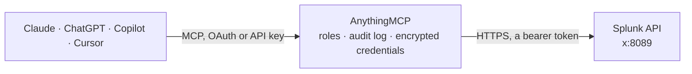

<!-- Generated by scripts/export-github-catalog.mjs in the anythingmcp-website repository. Do not edit by hand. -->

# Splunk MCP connector

Search Splunk logs and metrics from Claude, ChatGPT or Copilot through Splunk's official MCP Server: run SPL and saved searches, list indexes, hosts and sources, read knowledge objects, and draft SPL … The AnythingMCP connector gives Claude, ChatGPT, Microsoft Copilot, Cursor and Gemini 16 MCP tools for Splunk: 12 read and 4 can change data.

**Category:** [Monitoring](../monitoring.md) · **Tools:** 16 · **Setup guide:** [anythingmcp.com](https://anythingmcp.com/guides/splunk-to-mcp) · [Deutsch](https://anythingmcp.com/de/guides/splunk-to-mcp) · [Italiano](https://anythingmcp.com/it/guides/splunk-to-mcp) · [Español](https://anythingmcp.com/es/guides/splunk-to-mcp) · [日本語](https://anythingmcp.com/ja/guides/splunk-to-mcp) · [Русский](https://anythingmcp.com/ru/guides/splunk-to-mcp) · [中文](https://anythingmcp.com/zh/guides/splunk-to-mcp)

## Start without code

No installation and no terminal: AnythingMCP Cloud runs the Splunk connector for you, operated by helpcode.ai in Frankfurt, Germany.

1. **Click the button above** and create an account or sign in. The Splunk connector opens, ready to install.
2. **Paste the API key or token from your Splunk account.** Every click is in the [step-by-step guide](https://anythingmcp.com/guides/splunk-to-mcp).
3. **Click Install.** AnythingMCP shows the address of your MCP server.
4. **Add that address to your assistant:** [Claude](https://anythingmcp.com/guides/connect-splunk-to-claude) · [ChatGPT](https://anythingmcp.com/guides/connect-splunk-to-chatgpt) · [Microsoft Copilot](https://anythingmcp.com/guides/connect-splunk-to-copilot) · [Cursor](https://anythingmcp.com/guides/connect-splunk-to-cursor) · [Gemini CLI](https://anythingmcp.com/guides/connect-splunk-to-gemini) · [Meta Muse](https://anythingmcp.com/guides/connect-splunk-to-muse).
5. **Ask your first question**, for example: *Show me log events for invoice INV-2026-1123 in the invoices index between 2026-10-01 and 2026-10-15*

Prefer help with the setup? [Talk to us](https://anythingmcp.com/contact).

## How it works

- **The AI client** speaks MCP (Streamable HTTP) to AnythingMCP and only sees tool names, descriptions and results. It never gets the Splunk credentials.
- **AnythingMCP** checks the client's role, builds the call from the tool definition, adds the credentials (a bearer token), calls Splunk, logs the call and returns the result.
- **Splunk** sees an ordinary API client with the rights of the account the credentials belong to.

## Tools

| Tool | What it does | Access |
|---|---|---|
| [`saia_ask_splunk_question`](#saia_ask_splunk_question) | Ask natural language questions about Splunk using Splunk AI Assistant. | read |
| [`saia_explain_spl`](#saia_explain_spl) | Explain SPL queries in natural language using Splunk AI Assistant. | read |
| [`saia_generate_spl`](#saia_generate_spl) | Generate SPL from natural language queries using Splunk AI Assistant. | read |
| [`saia_optimize_spl`](#saia_optimize_spl) | Optimize SPL (Search Processing Language) queries using Splunk AI Assistant. | read |
| [`splunk_create_dashboard`](#splunk_create_dashboard) | Creates a new Splunk dashboard using Dashboard Studio JSON in the specified app namespace. | write |
| [`splunk_get_index_info`](#splunk_get_index_info) | Get detailed information about a specific Splunk index. | read |
| [`splunk_get_indexes`](#splunk_get_indexes) | Get a list of indexes from Splunk. | read |
| [`splunk_get_info`](#splunk_get_info) | Get comprehensive information about the Splunk instance. | read |
| [`splunk_get_knowledge_objects`](#splunk_get_knowledge_objects) | Retrieve Splunk knowledge objects by type. | read |
| [`splunk_get_kv_store_collections`](#splunk_get_kv_store_collections) | Get KV Store collection statistics including size, count, and storage information. | read |
| [`splunk_get_metadata`](#splunk_get_metadata) | Retrieve metadata about hosts or sources across one or more indexes in the selected time window. | read |
| [`splunk_get_user_info`](#splunk_get_user_info) | Retrieves detailed information about the currently authenticated user including roles and permissions. | read |
| [`splunk_get_user_list`](#splunk_get_user_list) | Get a list of users from Splunk. | read |
| [`splunk_run_query`](#splunk_run_query) | Execute a Splunk search query and return the results. | write |
| [`splunk_run_saved_search`](#splunk_run_saved_search) | Execute a Splunk saved search by name and return its results. | write |
| [`splunk_update_dashboard`](#splunk_update_dashboard) | Updates an existing Splunk dashboard's definition using Dashboard Studio JSON. | write |

## Tool reference

Every parameter as the AI client sees it in `tools/list`. Source: [`packages/backend/src/adapters/intl/splunk.json`](../../../packages/backend/src/adapters/intl/splunk.json).

### `saia_ask_splunk_question`

Ask natural language questions about Splunk using Splunk AI Assistant. Get explanations about Splunk commands, concepts, features, and best practices.

**Access:** read · **Call:** `saia_ask_splunk_question /mcp`

| Parameter | Type | Required | Description |
|---|---|---|---|
| `prompt` | string | yes | Natural language question about Splunk Validation: Prompt is required and must be between 1 and 10000 characters (submitted: {length}) |
| `chat_history` | string | no | Chat history for context Validation: Chat history is required and limited to 5000 characters |
| `additional_context` | string | no | Additional context to include in generated SPL |

### `saia_explain_spl`

Explain SPL queries in natural language using Splunk AI Assistant. Converts complex SPL commands into human-readable explanations.

**Access:** read · **Call:** `saia_explain_spl /mcp`

| Parameter | Type | Required | Description |
|---|---|---|---|
| `spl` | string | yes | SPL query to explain in natural language Validation: SPL query is required and must be between 1 and 10000 characters (submitted: {length}) |
| `chat_history` | string | no | Chat history for context Validation: Chat history is required and limited to 5000 characters |
| `additional_context` | string | no | Additional context to include in generated SPL |

### `saia_generate_spl`

Generate SPL from natural language queries using Splunk AI Assistant.

**Access:** read · **Call:** `saia_generate_spl /mcp`

| Parameter | Type | Required | Description |
|---|---|---|---|
| `prompt` | string | yes | Natural language query for generating SPL Validation: Prompt is required and must be between 1 and 10000 characters (submitted: {length}) |
| `spl_only` | boolean | no | If set to true, returns only generated SPL with no additional explanation |
| `chat_history` | string | no | Chat history for context Validation: Chat history is required and limited to 5000 characters |
| `additional_context` | string | no | Additional context to include in generated SPL |

### `saia_optimize_spl`

Optimize SPL (Search Processing Language) queries using Splunk AI Assistant. Improves query performance, efficiency, and follows best practices.

**Access:** read · **Call:** `saia_optimize_spl /mcp`

| Parameter | Type | Required | Description |
|---|---|---|---|
| `spl` | string | yes | SPL query to optimize for better performance Validation: SPL query is required and must be between 1 and 10000 characters (submitted: {length}) |
| `chat_history` | string | no | Chat history for context Validation: Chat history is required and limited to 5000 characters |
| `additional_context` | string | no | Additional context to include in generated SPL |

### `splunk_create_dashboard`

Creates a new Splunk dashboard using Dashboard Studio JSON in the specified app namespace.

**Access:** write · **Call:** `splunk_create_dashboard /mcp`

| Parameter | Type | Required | Description |
|---|---|---|---|
| `app` | string | no | App namespace to create the dashboard in |
| `eai_data` | string | yes | The full Dashboard Studio JSON definition |
| `dashboard_name` | string | yes | Internal name/ID for the dashboard |

### `splunk_get_index_info`

Get detailed information about a specific Splunk index. Returns comprehensive configuration and status information for the specified index.

**Access:** read · **Call:** `splunk_get_index_info /mcp`

| Parameter | Type | Required | Description |
|---|---|---|---|
| `index_name` | string | yes | Name of the index to get information about Validation: Index name can only contain alphanumeric characters, underscores (_), and hyphens (-) |

### `splunk_get_indexes`

Get a list of indexes from Splunk. Indexes are data repositories where machine data is stored and organized.

**Access:** read · **Call:** `splunk_get_indexes /mcp`

| Parameter | Type | Required | Description |
|---|---|---|---|
| `count` | integer | no | Maximum number of results to return in this page. Omit this argument to use the server's configured default row limit. If you provide a value greater than the server's configured maximum row limit, the server uses the maximum instead. |
| `offset` | integer | no | Zero-based index of the first result to return. Defaults to 0. |

### `splunk_get_info`

Get comprehensive information about the Splunk instance. Retrieves system information including version, hardware specs, and operational status.

**Access:** read · **Call:** `splunk_get_info /mcp`

No parameters.

### `splunk_get_knowledge_objects`

Retrieve Splunk knowledge objects by type. Supports various knowledge object types including saved searches, alerts, field extractions, lookups, macros, data models, and more.

**Access:** read · **Call:** `splunk_get_knowledge_objects /mcp`

| Parameter | Type | Required | Description |
|---|---|---|---|
| `type` | `saved_searches` \| `alerts` \| `field_extractions` \| `field_aliases` \| `calculated_fields` \| `lookups` \| `automatic_lookups` \| `lookup_transforms` \| `macros` \| `tags` \| `data_models` \| `workflow_actions` \| `views` \| `panels` \| `apps` \| `mltk_algorithms` \| `mltk_models` | yes | Type of knowledge object to retrieve |
| `row_limit` | integer | no | Maximum number of rows to return |

### `splunk_get_kv_store_collections`

Get KV Store collection statistics including size, count, and storage information. Retrieves comprehensive metrics about all KV Store collections in the Splunk instance.

**Access:** read · **Call:** `splunk_get_kv_store_collections /mcp`

| Parameter | Type | Required | Description |
|---|---|---|---|
| `row_limit` | integer | no | Maximum number of rows to return |

### `splunk_get_metadata`

Retrieve metadata about hosts or sources across one or more indexes in the selected time window.

**Access:** read · **Call:** `splunk_get_metadata /mcp`

| Parameter | Type | Required | Description |
|---|---|---|---|
| `type` | `hosts` \| `sources` | yes | Metadata category to list (hosts or sources). |
| `index` | string | no | Index name or wildcard pattern (e.g. main, app_*, *). Validation: Index pattern may contain letters, numbers, underscore, dash, and * wildcard |
| `row_limit` | integer | no | Maximum number of rows to return |
| `latest_time` | string | no | End time for search (e.g., now, -1h) |
| `earliest_time` | string | no | Start time for search (e.g., -24h, -1d) |

### `splunk_get_user_info`

Retrieves detailed information about the currently authenticated user including roles and permissions. Returns comprehensive user profile data for the current session.

**Access:** read · **Call:** `splunk_get_user_info /mcp`

No parameters.

### `splunk_get_user_list`

Get a list of users from Splunk. Retrieves information about all users including authentication details, roles, and account status.

**Access:** read · **Call:** `splunk_get_user_list /mcp`

| Parameter | Type | Required | Description |
|---|---|---|---|
| `row_limit` | integer | no | Maximum number of rows to return |

### `splunk_run_query`

Execute a Splunk search query and return the results. Use this to retrieve log data, perform aggregations, analyze events, and extract insights. Always set the 'app' parameter when the user specifies an app context — omitting it means app-scoped field extractions will not be applied.

**Access:** write · **Call:** `splunk_run_query /mcp`

| Parameter | Type | Required | Description |
|---|---|---|---|
| `app` | string | no | Splunk app context to run the SPL query in (e.g., 'search', 'enterprise_security'). Set this when the user specifies an app — omitting it means app-scoped field extractions and lookups will not be applied. Validation: App name may only contain letters, numbers, underscores, hyphens, and dots. |
| `query` | string | yes | Valid SPL query to execute Validation: SPL query must be between 1 and 10000 characters (submitted: {length}) |
| `row_limit` | integer | no | Maximum number of rows to return |
| `latest_time` | string | no | End time for search (e.g., now, -1h) |
| `earliest_time` | string | no | Start time for search (e.g., -6h, -1d) |
| `workload_pool` | string | no | Splunk workload pool to run this search in. Validation: Workload pool name may only contain letters, numbers, underscores, hyphens, and dots. |

### `splunk_run_saved_search`

Execute a Splunk saved search by name and return its results. Saved searches are pre-defined SPL queries stored in Splunk. Use get_knowledge_objects with type='saved_searches' to discover available saved searches and their app context. If the saved search name is unique across apps, the app is resolved automatically. If the same name exists in multiple apps, the alphabetically first app is used; pass the 'app' parameter to target a specific app. If the saved search contains placeholder tokens like $token_name$, pass replacement values as key=value pairs in the args parameter.

**Access:** write · **Call:** `splunk_run_saved_search /mcp`

| Parameter | Type | Required | Description |
|---|---|---|---|
| `app` | string | no | Splunk app context to run the saved search in (e.g., 'search', 'enterprise_security'). If omitted, the app is auto-resolved; when the name exists in multiple apps the alphabetically first app is used. Validation: App name may only contain letters, numbers, underscores, hyphens, and dots. |
| `args` | string | no | Optional replacement arguments for saved search tokens Validation: args must be space-separated key="value" token assignments only (e.g. host="web01" sourcetype="syslog"). Pipe operators, brackets, backticks, semicolons, and newlines are not allowed in values. |
| `row_limit` | integer | no | Maximum number of rows to return |
| `latest_time` | string | no | Override the saved search's default end time (e.g., now, -1h). If omitted, uses the time range configured in the saved search. |
| `earliest_time` | string | no | Override the saved search's default start time (e.g., -24h, -7d, 2024-01-01T00:00:00). If omitted, uses the time range configured in the saved search. |
| `saved_search_name` | string | yes | Name of the saved search to execute Validation: Saved search name is required, it cannot be blank and is limited to 500 characters. |

### `splunk_update_dashboard`

Updates an existing Splunk dashboard's definition using Dashboard Studio JSON.

**Access:** write · **Call:** `splunk_update_dashboard /mcp`

| Parameter | Type | Required | Description |
|---|---|---|---|
| `app` | string | no | App namespace the dashboard lives in |
| `eai_data` | string | yes | The new/updated Dashboard Studio JSON definition |
| `dashboard_name` | string | yes | The exact name/ID of the existing dashboard to update |

## Run it yourself

AnythingMCP is open source (AGPL-3.0). [Run it with Docker](../../../README.md#run-it-yourself), open **Connectors → Store**, pick **Splunk** and enter `SPLUNK_HOST`, `SPLUNK_MCP_TOKEN`, then add your MCP server URL to the AI client.

[← Monitoring connectors](../monitoring.md) · [All categories](../README.md)
