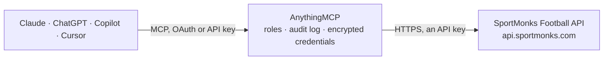

<!-- Generated by scripts/export-github-catalog.mjs in the anythingmcp-website repository. Do not edit by hand. -->

# SportMonks Football MCP connector

SportMonks Football API v3: leagues, seasons, fixtures and results, livescores, standings, top scorers, teams, squads, players, venues, pre-match odds and predictions, with SportMonks include and filter syntax. The AnythingMCP connector gives Claude, ChatGPT, Microsoft Copilot, Cursor and Gemini 32 MCP tools for SportMonks Football, all read-only.

**Category:** [Sports](../sports.md) · **Tools:** 32 · **Setup guide:** [anythingmcp.com](https://anythingmcp.com/guides/sportmonks-to-mcp) · [Deutsch](https://anythingmcp.com/de/guides/sportmonks-to-mcp) · [Italiano](https://anythingmcp.com/it/guides/sportmonks-to-mcp) · [Español](https://anythingmcp.com/es/guides/sportmonks-to-mcp) · [日本語](https://anythingmcp.com/ja/guides/sportmonks-to-mcp) · [Русский](https://anythingmcp.com/ru/guides/sportmonks-to-mcp) · [中文](https://anythingmcp.com/zh/guides/sportmonks-to-mcp)

## Start without code

No installation and no terminal: AnythingMCP Cloud runs the SportMonks Football connector for you, operated by helpcode.ai in Frankfurt, Germany.

1. **Click the button above** and create an account or sign in. The SportMonks Football connector opens, ready to install.
2. **Paste the API key or token from your SportMonks Football account.** Every click is in the [step-by-step guide](https://anythingmcp.com/guides/sportmonks-to-mcp).
3. **Click Install.** AnythingMCP shows the address of your MCP server.
4. **Add that address to your assistant:** [Claude](https://anythingmcp.com/guides/connect-sportmonks-to-claude) · [ChatGPT](https://anythingmcp.com/guides/connect-sportmonks-to-chatgpt) · [Microsoft Copilot](https://anythingmcp.com/guides/connect-sportmonks-to-copilot) · [Cursor](https://anythingmcp.com/guides/connect-sportmonks-to-cursor) · [Gemini CLI](https://anythingmcp.com/guides/connect-sportmonks-to-gemini) · [Meta Muse](https://anythingmcp.com/guides/connect-sportmonks-to-muse).
5. **Ask your first question**, for example: *What happened in fixture 672345 yesterday — final score and match status?*

Prefer help with the setup? [Talk to us](https://anythingmcp.com/contact).

## How it works

- **The AI client** speaks MCP (Streamable HTTP) to AnythingMCP and only sees tool names, descriptions and results. It never gets the SportMonks Football credentials.
- **AnythingMCP** checks the client's role, builds the call from the tool definition, adds the credentials (an API key), calls SportMonks Football, logs the call and returns the result.
- **SportMonks Football** sees an ordinary API client with the rights of the account the credentials belong to.

## Tools

| Tool | What it does | Access |
|---|---|---|
| [`sportmonks_list_my_leagues`](#sportmonks_list_my_leagues) | Leagues your SportMonks plan covers, with id, name, short code, country id, type and when they last played. | read |
| [`sportmonks_list_leagues`](#sportmonks_list_leagues) | Football leagues and cups with id, name, short code, country id, type (league, cup ...) and whether they are active. | read |
| [`sportmonks_search_leagues`](#sportmonks_search_leagues) | Find football leagues by name, e.g. Premier or Bundesliga, to get the league id. | read |
| [`sportmonks_get_league`](#sportmonks_get_league) | One league by id. | read |
| [`sportmonks_get_season`](#sportmonks_get_season) | One season by id: name, start and end date, whether it is current or finished. | read |
| [`sportmonks_get_fixture`](#sportmonks_get_fixture) | One match by id. | read |
| [`sportmonks_list_fixtures_by_date`](#sportmonks_list_fixtures_by_date) | All matches on one day in the leagues your plan covers. | read |
| [`sportmonks_list_fixtures_between`](#sportmonks_list_fixtures_between) | Matches between two dates (at most 100 days apart) in the leagues your plan covers. | read |
| [`sportmonks_list_team_fixtures_between`](#sportmonks_list_team_fixtures_between) | One team's matches between two dates (at most 100 days apart): past results and upcoming fixtures. | read |
| [`sportmonks_get_head_to_head`](#sportmonks_get_head_to_head) | Past meetings between two teams, newest first with include participants;scores. | read |
| [`sportmonks_list_livescores`](#sportmonks_list_livescores) | Matches of today that start within 15 minutes, are being played or ended in the last 15 minutes, in the leagues your plan covers. | read |
| [`sportmonks_list_inplay_livescores`](#sportmonks_list_inplay_livescores) | Only the matches being played right now, in the leagues your plan covers. | read |
| [`sportmonks_get_standings`](#sportmonks_get_standings) | League table of a season: position, points, form and the details of each team. | read |
| [`sportmonks_get_live_standings`](#sportmonks_get_live_standings) | Live league table of a league, updated while matches are being played. | read |
| [`sportmonks_get_topscorers`](#sportmonks_get_topscorers) | Top scorers of a season. | read |
| [`sportmonks_search_teams`](#sportmonks_search_teams) | Find teams by name: id, name, short code, country and founding year. | read |
| [`sportmonks_get_team`](#sportmonks_get_team) | One team by id: name, short code, founded, venue id and country id. | read |
| [`sportmonks_list_season_teams`](#sportmonks_list_season_teams) | All teams that play in a season, with id, name, short code and venue id. | read |
| [`sportmonks_get_team_squad`](#sportmonks_get_team_squad) | Current domestic squad of a team: player id, jersey number, position id, contract dates. | read |
| [`sportmonks_get_season_squad`](#sportmonks_get_season_squad) | Squad of a team in one season, including players who left during it. | read |
| [`sportmonks_search_players`](#sportmonks_search_players) | Find players by name: id, display name, birth date, height, weight and position id. | read |
| [`sportmonks_get_player`](#sportmonks_get_player) | One player by id: name, birth date, height, weight, position, nationality. | read |
| [`sportmonks_search_venues`](#sportmonks_search_venues) | Find stadiums by name: id, name, city, address, capacity and surface. | read |
| [`sportmonks_get_venue`](#sportmonks_get_venue) | One stadium by id: name, city, address, capacity, surface and coordinates. | read |
| [`sportmonks_get_prematch_odds`](#sportmonks_get_prematch_odds) | Pre-match odds of one fixture from the bookmakers in your plan. | read |
| [`sportmonks_get_prematch_odds_by_market`](#sportmonks_get_prematch_odds_by_market) | Pre-match odds of one fixture in one market (e.g. 1 match winner, 2 double chance, 14 both teams to score; ids from sportmonks_list_odds_markets), from… | read |
| [`sportmonks_get_prematch_odds_by_bookmaker`](#sportmonks_get_prematch_odds_by_bookmaker) | Pre-match odds of one fixture from one bookmaker (ids from sportmonks_list_bookmakers, e.g. 2 bet365), across all markets in your plan. | read |
| [`sportmonks_list_odds_markets`](#sportmonks_list_odds_markets) | Betting markets with id and name, e.g. 1 fulltime result, 2 double chance, 14 both teams to score, 80 goals over/under, for the markets filter of the odds tool. | read |
| [`sportmonks_list_bookmakers`](#sportmonks_list_bookmakers) | Bookmakers with id and name, for the bookmakers filter of the odds tool. | read |
| [`sportmonks_get_predictions`](#sportmonks_get_predictions) | SportMonks model probabilities for one fixture: fulltime result, both teams to score, over/under goals, correct score and more. | read |
| [`sportmonks_get_value_bets`](#sportmonks_get_value_bets) | Value bets SportMonks' model finds for one fixture: bet, bookmaker, odds and fair odds. | read |
| [`sportmonks_list_types`](#sportmonks_list_types) | Type ids and names used across the API (event types, statistic types, positions, standing details ...). | read |

## Tool reference

Every parameter as the AI client sees it in `tools/list`. Source: [`packages/backend/src/adapters/intl/sportmonks.json`](../../../packages/backend/src/adapters/intl/sportmonks.json).

### `sportmonks_list_my_leagues`

Leagues your SportMonks plan covers, with id, name, short code, country id, type and when they last played. Call this first: a league outside the plan answers with an empty result, not an error.

**Access:** read · **Call:** `GET /my/leagues`

No parameters.

### `sportmonks_list_leagues`

Football leagues and cups with id, name, short code, country id, type (league, cup ...) and whether they are active. Paged.

**Access:** read · **Call:** `GET /football/leagues`

| Parameter | Type | Required | Description |
|---|---|---|---|
| `include` | string | no | Related data to add, separated by semicolons; nested with dots. Useful: country;currentSeason. |
| `select` | string | no | Comma separated fields to return, e.g. name,starting_at. Cuts the response down. |
| `filters` | string | no | SportMonks filters, separated by semicolons, e.g. fixtureLeagues:9 or eventTypes:14,15. Leave out for none. |
| `page` | integer | no | Page number for paged lists (see pagination.has_more). |
| `per_page` | integer | no | Results per page, at most 50 (default 25). |

### `sportmonks_search_leagues`

Find football leagues by name, e.g. Premier or Bundesliga, to get the league id.

**Access:** read · **Call:** `GET /football/leagues/search/{name}`

| Parameter | Type | Required | Description |
|---|---|---|---|
| `name` | string | yes | Part of the league name. |
| `include` | string | no | Related data to add, separated by semicolons; nested with dots. Useful: country;currentSeason. |
| `select` | string | no | Comma separated fields to return, e.g. name,starting_at. Cuts the response down. |
| `filters` | string | no | SportMonks filters, separated by semicolons, e.g. fixtureLeagues:9 or eventTypes:14,15. Leave out for none. |
| `page` | integer | no | Page number for paged lists (see pagination.has_more). |
| `per_page` | integer | no | Results per page, at most 50 (default 25). |

### `sportmonks_get_league`

One league by id. Include currentSeason for the season id the standings, top scorer and squad tools need, or seasons for every season.

**Access:** read · **Call:** `GET /football/leagues/{league_id}`

| Parameter | Type | Required | Description |
|---|---|---|---|
| `league_id` | integer | yes | SportMonks league id, e.g. 8 (Premier League), 82 (Bundesliga), 384 (Serie A), 564 (LaLiga), 301 (Ligue 1), 9 (Championship). sportmonks_list_my_leagues shows the ones your plan covers. |
| `include` | string | no | Related data to add, separated by semicolons; nested with dots. Useful: currentSeason;seasons;country;stages. |
| `select` | string | no | Comma separated fields to return, e.g. name,starting_at. Cuts the response down. |

### `sportmonks_get_season`

One season by id: name, start and end date, whether it is current or finished. Include stages, rounds or league for structure.

**Access:** read · **Call:** `GET /football/seasons/{season_id}`

| Parameter | Type | Required | Description |
|---|---|---|---|
| `season_id` | integer | yes | SportMonks season id. Get the current one with sportmonks_get_league and include currentSeason, or past ones with include seasons. |
| `include` | string | no | Related data to add, separated by semicolons; nested with dots. Useful: league;stages;rounds;currentStage. |
| `select` | string | no | Comma separated fields to return, e.g. name,starting_at. Cuts the response down. |

### `sportmonks_get_fixture`

One match by id. Use include for detail: participants (teams), scores, state (status), events.type (goals, cards, subs), lineups.player, statistics.type, periods, referees, venue.

**Access:** read · **Call:** `GET /football/fixtures/{fixture_id}`

| Parameter | Type | Required | Description |
|---|---|---|---|
| `fixture_id` | integer | yes | SportMonks fixture id, from the fixture list tools. |
| `include` | string | no | Related data to add, separated by semicolons; nested with dots. Useful: participants;scores;state;league;venue;events.type;lineups.player;statistics.type;periods;referees;odds;predictions;weatherReport. |
| `select` | string | no | Comma separated fields to return, e.g. name,starting_at. Cuts the response down. |
| `timezone` | string | no | IANA time zone for the times in the answer, e.g. Europe/London. Default UTC. |

### `sportmonks_list_fixtures_by_date`

All matches on one day in the leagues your plan covers. Narrow with filters fixtureLeagues:<league ids>. Paged.

**Access:** read · **Call:** `GET /football/fixtures/date/{date}`

| Parameter | Type | Required | Description |
|---|---|---|---|
| `date` | string | yes | Day, YYYY-MM-DD. |
| `include` | string | no | Related data to add, separated by semicolons; nested with dots. Useful: participants;scores;state;league. Heavy includes on long lists make big answers. |
| `select` | string | no | Comma separated fields to return, e.g. name,starting_at. Cuts the response down. |
| `filters` | string | no | SportMonks filters, separated by semicolons, e.g. fixtureLeagues:9 or eventTypes:14,15. Leave out for none. |
| `page` | integer | no | Page number for paged lists (see pagination.has_more). |
| `per_page` | integer | no | Results per page, at most 50 (default 25). |
| `order` | `asc` \| `desc` | no | Sort order of the list. |
| `timezone` | string | no | IANA time zone for the times in the answer, e.g. Europe/London. Default UTC. |

### `sportmonks_list_fixtures_between`

Matches between two dates (at most 100 days apart) in the leagues your plan covers. Narrow with filters fixtureLeagues:<league ids>. Paged.

**Access:** read · **Call:** `GET /football/fixtures/between/{start_date}/{end_date}`

| Parameter | Type | Required | Description |
|---|---|---|---|
| `start_date` | string | yes | First day, YYYY-MM-DD. |
| `end_date` | string | yes | Last day, YYYY-MM-DD. |
| `include` | string | no | Related data to add, separated by semicolons; nested with dots. Useful: participants;scores;state;league. Heavy includes on long lists make big answers. |
| `select` | string | no | Comma separated fields to return, e.g. name,starting_at. Cuts the response down. |
| `filters` | string | no | SportMonks filters, separated by semicolons, e.g. fixtureLeagues:9 or eventTypes:14,15. Leave out for none. |
| `page` | integer | no | Page number for paged lists (see pagination.has_more). |
| `per_page` | integer | no | Results per page, at most 50 (default 25). |
| `order` | `asc` \| `desc` | no | Sort order of the list. |
| `timezone` | string | no | IANA time zone for the times in the answer, e.g. Europe/London. Default UTC. |

### `sportmonks_list_team_fixtures_between`

One team's matches between two dates (at most 100 days apart): past results and upcoming fixtures. Paged.

**Access:** read · **Call:** `GET /football/fixtures/between/{start_date}/{end_date}/{team_id}`

| Parameter | Type | Required | Description |
|---|---|---|---|
| `start_date` | string | yes | First day, YYYY-MM-DD. |
| `end_date` | string | yes | Last day, YYYY-MM-DD. |
| `team_id` | integer | yes | SportMonks team id, from sportmonks_search_teams or a fixture's participants. |
| `include` | string | no | Related data to add, separated by semicolons; nested with dots. Useful: participants;scores;state;league. Heavy includes on long lists make big answers. |
| `select` | string | no | Comma separated fields to return, e.g. name,starting_at. Cuts the response down. |
| `filters` | string | no | SportMonks filters, separated by semicolons, e.g. fixtureLeagues:9 or eventTypes:14,15. Leave out for none. |
| `page` | integer | no | Page number for paged lists (see pagination.has_more). |
| `per_page` | integer | no | Results per page, at most 50 (default 25). |
| `order` | `asc` \| `desc` | no | Sort order of the list. |
| `timezone` | string | no | IANA time zone for the times in the answer, e.g. Europe/London. Default UTC. |

### `sportmonks_get_head_to_head`

Past meetings between two teams, newest first with include participants;scores. Paged.

**Access:** read · **Call:** `GET /football/fixtures/head-to-head/{team_a_id}/{team_b_id}`

| Parameter | Type | Required | Description |
|---|---|---|---|
| `team_a_id` | integer | yes | SportMonks team id, from sportmonks_search_teams or a fixture's participants. |
| `team_b_id` | integer | yes | SportMonks id of the other team. |
| `include` | string | no | Related data to add, separated by semicolons; nested with dots. Useful: participants;scores;state;league. Heavy includes on long lists make big answers. |
| `select` | string | no | Comma separated fields to return, e.g. name,starting_at. Cuts the response down. |
| `filters` | string | no | SportMonks filters, separated by semicolons, e.g. fixtureLeagues:9 or eventTypes:14,15. Leave out for none. |
| `page` | integer | no | Page number for paged lists (see pagination.has_more). |
| `per_page` | integer | no | Results per page, at most 50 (default 25). |
| `timezone` | string | no | IANA time zone for the times in the answer, e.g. Europe/London. Default UTC. |

### `sportmonks_list_livescores`

Matches of today that start within 15 minutes, are being played or ended in the last 15 minutes, in the leagues your plan covers. Include participants;scores;state;events for the live picture.

**Access:** read · **Call:** `GET /football/livescores`

| Parameter | Type | Required | Description |
|---|---|---|---|
| `include` | string | no | Related data to add, separated by semicolons; nested with dots. Useful: participants;scores;state;periods;events.type. |
| `select` | string | no | Comma separated fields to return, e.g. name,starting_at. Cuts the response down. |
| `filters` | string | no | SportMonks filters, separated by semicolons, e.g. fixtureLeagues:9 or eventTypes:14,15. Leave out for none. |
| `timezone` | string | no | IANA time zone for the times in the answer, e.g. Europe/London. Default UTC. |

### `sportmonks_list_inplay_livescores`

Only the matches being played right now, in the leagues your plan covers.

**Access:** read · **Call:** `GET /football/livescores/inplay`

| Parameter | Type | Required | Description |
|---|---|---|---|
| `include` | string | no | Related data to add, separated by semicolons; nested with dots. Useful: participants;scores;state;periods;events.type. |
| `select` | string | no | Comma separated fields to return, e.g. name,starting_at. Cuts the response down. |
| `filters` | string | no | SportMonks filters, separated by semicolons, e.g. fixtureLeagues:9 or eventTypes:14,15. Leave out for none. |
| `timezone` | string | no | IANA time zone for the times in the answer, e.g. Europe/London. Default UTC. |

### `sportmonks_get_standings`

League table of a season: position, points, form and the details of each team. Include participant for team names and details.type for played, won, drawn, lost, goals.

**Access:** read · **Call:** `GET /football/standings/seasons/{season_id}`

| Parameter | Type | Required | Description |
|---|---|---|---|
| `season_id` | integer | yes | SportMonks season id. Get the current one with sportmonks_get_league and include currentSeason, or past ones with include seasons. |
| `include` | string | no | Related data to add, separated by semicolons; nested with dots. Useful: participant;details.type;form;rule.type;group. |
| `select` | string | no | Comma separated fields to return, e.g. name,starting_at. Cuts the response down. |
| `filters` | string | no | SportMonks filters, separated by semicolons, e.g. fixtureLeagues:9 or eventTypes:14,15. Leave out for none. |

### `sportmonks_get_live_standings`

Live league table of a league, updated while matches are being played.

**Access:** read · **Call:** `GET /football/standings/live/leagues/{league_id}`

| Parameter | Type | Required | Description |
|---|---|---|---|
| `league_id` | integer | yes | SportMonks league id, e.g. 8 (Premier League), 82 (Bundesliga), 384 (Serie A), 564 (LaLiga), 301 (Ligue 1), 9 (Championship). sportmonks_list_my_leagues shows the ones your plan covers. |
| `include` | string | no | Related data to add, separated by semicolons; nested with dots. Useful: participant;details.type;form. |
| `select` | string | no | Comma separated fields to return, e.g. name,starting_at. Cuts the response down. |
| `filters` | string | no | SportMonks filters, separated by semicolons, e.g. fixtureLeagues:9 or eventTypes:14,15. Leave out for none. |

### `sportmonks_get_topscorers`

Top scorers of a season. Filter the ranking with filters seasonTopscorerTypes:208 (goals), 209 (assists), 84 (yellow cards), 83 (red cards). Include player;participant for names.

**Access:** read · **Call:** `GET /football/topscorers/seasons/{season_id}`

| Parameter | Type | Required | Description |
|---|---|---|---|
| `season_id` | integer | yes | SportMonks season id. Get the current one with sportmonks_get_league and include currentSeason, or past ones with include seasons. |
| `include` | string | no | Related data to add, separated by semicolons; nested with dots. Useful: player;participant;type. |
| `select` | string | no | Comma separated fields to return, e.g. name,starting_at. Cuts the response down. |
| `filters` | string | no | SportMonks filters, separated by semicolons, e.g. fixtureLeagues:9 or eventTypes:14,15. Leave out for none. |
| `page` | integer | no | Page number for paged lists (see pagination.has_more). |
| `per_page` | integer | no | Results per page, at most 50 (default 25). |
| `order` | `asc` \| `desc` | no | Sort order of the list. |

### `sportmonks_search_teams`

Find teams by name: id, name, short code, country and founding year. Use the id for the team, squad and fixture tools.

**Access:** read · **Call:** `GET /football/teams/search/{name}`

| Parameter | Type | Required | Description |
|---|---|---|---|
| `name` | string | yes | Part of the team name, e.g. arsenal. |
| `include` | string | no | Related data to add, separated by semicolons; nested with dots. Useful: country;venue;activeSeasons. |
| `select` | string | no | Comma separated fields to return, e.g. name,starting_at. Cuts the response down. |
| `filters` | string | no | SportMonks filters, separated by semicolons, e.g. fixtureLeagues:9 or eventTypes:14,15. Leave out for none. |
| `page` | integer | no | Page number for paged lists (see pagination.has_more). |
| `per_page` | integer | no | Results per page, at most 50 (default 25). |

### `sportmonks_get_team`

One team by id: name, short code, founded, venue id and country id. Include venue, coaches, activeSeasons, latest or upcoming for more.

**Access:** read · **Call:** `GET /football/teams/{team_id}`

| Parameter | Type | Required | Description |
|---|---|---|---|
| `team_id` | integer | yes | SportMonks team id, from sportmonks_search_teams or a fixture's participants. |
| `include` | string | no | Related data to add, separated by semicolons; nested with dots. Useful: venue;country;coaches;activeSeasons;latest;upcoming;statistics.details.type. |
| `select` | string | no | Comma separated fields to return, e.g. name,starting_at. Cuts the response down. |

### `sportmonks_list_season_teams`

All teams that play in a season, with id, name, short code and venue id. Use it to get every team id of a league at once.

**Access:** read · **Call:** `GET /football/teams/seasons/{season_id}`

| Parameter | Type | Required | Description |
|---|---|---|---|
| `season_id` | integer | yes | SportMonks season id. Get the current one with sportmonks_get_league and include currentSeason, or past ones with include seasons. |
| `include` | string | no | Related data to add, separated by semicolons; nested with dots. Useful: venue;country. |
| `select` | string | no | Comma separated fields to return, e.g. name,starting_at. Cuts the response down. |
| `filters` | string | no | SportMonks filters, separated by semicolons, e.g. fixtureLeagues:9 or eventTypes:14,15. Leave out for none. |

### `sportmonks_get_team_squad`

Current domestic squad of a team: player id, jersey number, position id, contract dates. Include player for names and details.

**Access:** read · **Call:** `GET /football/squads/teams/{team_id}`

| Parameter | Type | Required | Description |
|---|---|---|---|
| `team_id` | integer | yes | SportMonks team id, from sportmonks_search_teams or a fixture's participants. |
| `include` | string | no | Related data to add, separated by semicolons; nested with dots. Useful: player;position;detailedPosition. |
| `select` | string | no | Comma separated fields to return, e.g. name,starting_at. Cuts the response down. |
| `filters` | string | no | SportMonks filters, separated by semicolons, e.g. fixtureLeagues:9 or eventTypes:14,15. Leave out for none. |

### `sportmonks_get_season_squad`

Squad of a team in one season, including players who left during it. Include player for names.

**Access:** read · **Call:** `GET /football/squads/seasons/{season_id}/teams/{team_id}`

| Parameter | Type | Required | Description |
|---|---|---|---|
| `season_id` | integer | yes | SportMonks season id. Get the current one with sportmonks_get_league and include currentSeason, or past ones with include seasons. |
| `team_id` | integer | yes | SportMonks team id, from sportmonks_search_teams or a fixture's participants. |
| `include` | string | no | Related data to add, separated by semicolons; nested with dots. Useful: player;position;details.type. |
| `select` | string | no | Comma separated fields to return, e.g. name,starting_at. Cuts the response down. |
| `filters` | string | no | SportMonks filters, separated by semicolons, e.g. fixtureLeagues:9 or eventTypes:14,15. Leave out for none. |

### `sportmonks_search_players`

Find players by name: id, display name, birth date, height, weight and position id. Use the id for sportmonks_get_player.

**Access:** read · **Call:** `GET /football/players/search/{name}`

| Parameter | Type | Required | Description |
|---|---|---|---|
| `name` | string | yes | Part of the player name, e.g. saka. |
| `include` | string | no | Related data to add, separated by semicolons; nested with dots. Useful: teams;position;nationality. |
| `select` | string | no | Comma separated fields to return, e.g. name,starting_at. Cuts the response down. |
| `filters` | string | no | SportMonks filters, separated by semicolons, e.g. fixtureLeagues:9 or eventTypes:14,15. Leave out for none. |
| `page` | integer | no | Page number for paged lists (see pagination.has_more). |
| `per_page` | integer | no | Results per page, at most 50 (default 25). |

### `sportmonks_get_player`

One player by id: name, birth date, height, weight, position, nationality. Include teams, statistics.details.type (filter playerStatisticSeasons:<season id>) or transfers for more.

**Access:** read · **Call:** `GET /football/players/{player_id}`

| Parameter | Type | Required | Description |
|---|---|---|---|
| `player_id` | integer | yes | SportMonks player id, from sportmonks_search_players or a squad. |
| `include` | string | no | Related data to add, separated by semicolons; nested with dots. Useful: teams;position;detailedPosition;nationality;statistics.details.type;transfers. |
| `select` | string | no | Comma separated fields to return, e.g. name,starting_at. Cuts the response down. |
| `filters` | string | no | SportMonks filters, separated by semicolons, e.g. fixtureLeagues:9 or eventTypes:14,15. Leave out for none. |

### `sportmonks_search_venues`

Find stadiums by name: id, name, city, address, capacity and surface. Use the id for sportmonks_get_venue.

**Access:** read · **Call:** `GET /football/venues/search/{name}`

| Parameter | Type | Required | Description |
|---|---|---|---|
| `name` | string | yes | Part of the stadium name. |
| `include` | string | no | Related data to add, separated by semicolons; nested with dots. Useful: country;city. |
| `select` | string | no | Comma separated fields to return, e.g. name,starting_at. Cuts the response down. |
| `filters` | string | no | SportMonks filters, separated by semicolons, e.g. fixtureLeagues:9 or eventTypes:14,15. Leave out for none. |
| `page` | integer | no | Page number for paged lists (see pagination.has_more). |
| `per_page` | integer | no | Results per page, at most 50 (default 25). |

### `sportmonks_get_venue`

One stadium by id: name, city, address, capacity, surface and coordinates.

**Access:** read · **Call:** `GET /football/venues/{venue_id}`

| Parameter | Type | Required | Description |
|---|---|---|---|
| `venue_id` | integer | yes | SportMonks venue id, from a fixture or team. |
| `include` | string | no | Related data to add, separated by semicolons; nested with dots. Useful: country;city. |
| `select` | string | no | Comma separated fields to return, e.g. name,starting_at. Cuts the response down. |

### `sportmonks_get_prematch_odds`

Pre-match odds of one fixture from the bookmakers in your plan. The full list can be very long: narrow it with filters markets:1 (match winner) and bookmakers:2 (bet365), e.g. markets:1;bookmakers:2. Include market;bookmaker for names.

**Access:** read · **Call:** `GET /football/odds/pre-match/fixtures/{fixture_id}`

| Parameter | Type | Required | Description |
|---|---|---|---|
| `fixture_id` | integer | yes | SportMonks fixture id, from the fixture list tools. |
| `include` | string | no | Related data to add, separated by semicolons; nested with dots. Useful: market;bookmaker. |
| `select` | string | no | Comma separated fields to return, e.g. name,starting_at. Cuts the response down. |
| `filters` | string | no | SportMonks filters, separated by semicolons, e.g. fixtureLeagues:9 or eventTypes:14,15. Leave out for none. |

### `sportmonks_get_prematch_odds_by_market`

Pre-match odds of one fixture in one market (e.g. 1 match winner, 2 double chance, 14 both teams to score; ids from sportmonks_list_odds_markets), from every bookmaker in your plan. Narrow to bookmakers with filters bookmakers:2,9. Not paged.

**Access:** read · **Call:** `GET /football/odds/pre-match/fixtures/{fixture_id}/markets/{market_id}`

| Parameter | Type | Required | Description |
|---|---|---|---|
| `fixture_id` | integer | yes | SportMonks fixture id, from the fixture list tools. |
| `market_id` | integer | yes | Odds market id, from sportmonks_list_odds_markets (1 = match winner). |
| `include` | string | no | Related data to add, separated by semicolons (one level only): market, bookmaker, fixture. |
| `select` | string | no | Comma separated fields to return, e.g. name,starting_at. Cuts the response down. |
| `filters` | string | no | Static filters: bookmakers:2,9 (bookmaker ids) or winningOdds. Leave out for none. |
| `locale` | string | no | Language code to translate name fields, e.g. es or de. Leave out for English. |

### `sportmonks_get_prematch_odds_by_bookmaker`

Pre-match odds of one fixture from one bookmaker (ids from sportmonks_list_bookmakers, e.g. 2 bet365), across all markets in your plan. Narrow to markets with filters markets:1,14. Not paged.

**Access:** read · **Call:** `GET /football/odds/pre-match/fixtures/{fixture_id}/bookmakers/{bookmaker_id}`

| Parameter | Type | Required | Description |
|---|---|---|---|
| `fixture_id` | integer | yes | SportMonks fixture id, from the fixture list tools. |
| `bookmaker_id` | integer | yes | Bookmaker id, from sportmonks_list_bookmakers (2 = bet365). |
| `include` | string | no | Related data to add, separated by semicolons (one level only): market, bookmaker, fixture. |
| `select` | string | no | Comma separated fields to return, e.g. name,starting_at. Cuts the response down. |
| `filters` | string | no | Static filters: markets:1,14 (market ids) or winningOdds. Leave out for none. |
| `locale` | string | no | Language code to translate name fields, e.g. es or de. Leave out for English. |

### `sportmonks_list_odds_markets`

Betting markets with id and name, e.g. 1 fulltime result, 2 double chance, 14 both teams to score, 80 goals over/under, for the markets filter of the odds tool.

**Access:** read · **Call:** `GET /odds/markets`

| Parameter | Type | Required | Description |
|---|---|---|---|
| `include` | string | no | Related data to add, separated by semicolons; nested with dots. |
| `select` | string | no | Comma separated fields to return, e.g. name,starting_at. Cuts the response down. |
| `page` | integer | no | Page number for paged lists (see pagination.has_more). |
| `per_page` | integer | no | Results per page, at most 50 (default 25). |

### `sportmonks_list_bookmakers`

Bookmakers with id and name, for the bookmakers filter of the odds tool.

**Access:** read · **Call:** `GET /odds/bookmakers`

| Parameter | Type | Required | Description |
|---|---|---|---|
| `include` | string | no | Related data to add, separated by semicolons; nested with dots. |
| `select` | string | no | Comma separated fields to return, e.g. name,starting_at. Cuts the response down. |
| `page` | integer | no | Page number for paged lists (see pagination.has_more). |
| `per_page` | integer | no | Results per page, at most 50 (default 25). |

### `sportmonks_get_predictions`

SportMonks model probabilities for one fixture: fulltime result, both teams to score, over/under goals, correct score and more. Needs the Predictions add-on in your plan. Include type for the market names.

**Access:** read · **Call:** `GET /football/predictions/probabilities/fixtures/{fixture_id}`

| Parameter | Type | Required | Description |
|---|---|---|---|
| `fixture_id` | integer | yes | SportMonks fixture id, from the fixture list tools. |
| `include` | string | no | Related data to add, separated by semicolons; nested with dots. Useful: type. |
| `select` | string | no | Comma separated fields to return, e.g. name,starting_at. Cuts the response down. |
| `filters` | string | no | SportMonks filters, separated by semicolons, e.g. fixtureLeagues:9 or eventTypes:14,15. Leave out for none. |

### `sportmonks_get_value_bets`

Value bets SportMonks' model finds for one fixture: bet, bookmaker, odds and fair odds. Needs the Predictions add-on. Information only, not betting advice.

**Access:** read · **Call:** `GET /football/predictions/value-bets/fixtures/{fixture_id}`

| Parameter | Type | Required | Description |
|---|---|---|---|
| `fixture_id` | integer | yes | SportMonks fixture id, from the fixture list tools. |
| `include` | string | no | Related data to add, separated by semicolons; nested with dots. Useful: type. |
| `select` | string | no | Comma separated fields to return, e.g. name,starting_at. Cuts the response down. |

### `sportmonks_list_types`

Type ids and names used across the API (event types, statistic types, positions, standing details ...). Use it to read a type_id, or add .type to an include instead.

**Access:** read · **Call:** `GET /core/types`

| Parameter | Type | Required | Description |
|---|---|---|---|
| `include` | string | no | Related data to add, separated by semicolons; nested with dots. |
| `select` | string | no | Comma separated fields to return, e.g. name,starting_at. Cuts the response down. |
| `page` | integer | no | Page number for paged lists (see pagination.has_more). |
| `per_page` | integer | no | Results per page, at most 50 (default 25). |

## Run it yourself

AnythingMCP is open source (AGPL-3.0). [Run it with Docker](../../../README.md#run-it-yourself), open **Connectors → Store**, pick **SportMonks Football** and enter `SPORTMONKS_API_TOKEN`, then add your MCP server URL to the AI client.

[← Sports connectors](../sports.md) · [All categories](../README.md)
