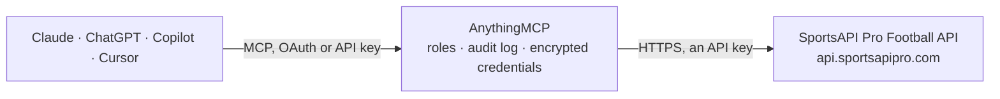

<!-- Generated by scripts/export-github-catalog.mjs in the anythingmcp-website repository. Do not edit by hand. -->

# SportsAPI Pro Football MCP connector

Football data from SportsAPI Pro: leagues and seasons, standings and season leaders, live scores and daily schedules, match lineups, incidents, statistics, head-to-head, shot maps and best players, … The AnythingMCP connector gives Claude, ChatGPT, Microsoft Copilot, Cursor and Gemini 25 MCP tools for SportsAPI Pro Football, all read-only.

**Category:** [Sports](../sports.md) · **Tools:** 25 · **Setup guide:** [anythingmcp.com](https://anythingmcp.com/guides/sportsapipro-to-mcp) · [Deutsch](https://anythingmcp.com/de/guides/sportsapipro-to-mcp) · [Italiano](https://anythingmcp.com/it/guides/sportsapipro-to-mcp) · [Español](https://anythingmcp.com/es/guides/sportsapipro-to-mcp) · [日本語](https://anythingmcp.com/ja/guides/sportsapipro-to-mcp) · [Русский](https://anythingmcp.com/ru/guides/sportsapipro-to-mcp) · [中文](https://anythingmcp.com/zh/guides/sportsapipro-to-mcp)

## Start without code

No installation and no terminal: AnythingMCP Cloud runs the SportsAPI Pro Football connector for you, operated by helpcode.ai in Frankfurt, Germany.

1. **Click the button above** and create an account or sign in. The SportsAPI Pro Football connector opens, ready to install.
2. **Paste the API key or token from your SportsAPI Pro Football account.** Every click is in the [step-by-step guide](https://anythingmcp.com/guides/sportsapipro-to-mcp).
3. **Click Install.** AnythingMCP shows the address of your MCP server.
4. **Add that address to your assistant:** [Claude](https://anythingmcp.com/guides/connect-sportsapipro-to-claude) · [ChatGPT](https://anythingmcp.com/guides/connect-sportsapipro-to-chatgpt) · [Microsoft Copilot](https://anythingmcp.com/guides/connect-sportsapipro-to-copilot) · [Cursor](https://anythingmcp.com/guides/connect-sportsapipro-to-cursor) · [Gemini CLI](https://anythingmcp.com/guides/connect-sportsapipro-to-gemini) · [Meta Muse](https://anythingmcp.com/guides/connect-sportsapipro-to-muse).
5. **Ask your first question.**

Prefer help with the setup? [Talk to us](https://anythingmcp.com/contact).

## How it works

- **The AI client** speaks MCP (Streamable HTTP) to AnythingMCP and only sees tool names, descriptions and results. It never gets the SportsAPI Pro Football credentials.
- **AnythingMCP** checks the client's role, builds the call from the tool definition, adds the credentials (an API key), calls SportsAPI Pro Football, logs the call and returns the result.
- **SportsAPI Pro Football** sees an ordinary API client with the rights of the account the credentials belong to.

## Tools

| Tool | What it does | Access |
|---|---|---|
| [`sportsapipro_get_account_status`](#sportsapipro_get_account_status) | Show the SportsAPI Pro account behind the key: plan, daily request limit, requests used today, remaining requests and when the quota resets (midnight UTC). | read |
| [`sportsapipro_search`](#sportsapipro_search) | Search football teams, players, managers and tournaments by name and get their ids. | read |
| [`sportsapipro_list_countries`](#sportsapipro_list_countries) | List the countries (football categories) with name, code and flag, to browse competitions by country. | read |
| [`sportsapipro_list_leagues`](#sportsapipro_list_leagues) | List football leagues and cups grouped by country with their tournament ids. | read |
| [`sportsapipro_list_tournament_seasons`](#sportsapipro_list_tournament_seasons) | List the seasons of a tournament, newest first, with their season ids (e.g. 76986 for one Premier League season). | read |
| [`sportsapipro_get_standings`](#sportsapipro_get_standings) | Get the league table of a tournament season: position, team, matches, wins, draws, losses, goals and points, with promotion and relegation markers. | read |
| [`sportsapipro_get_top_players`](#sportsapipro_get_top_players) | Get the season leaders of a tournament in one call, keyed by statistic: rating, goals, expected goals, assists, shots, key passes, dribbles, tackles, saves,… | read |
| [`sportsapipro_list_season_matches`](#sportsapipro_list_season_matches) | List the upcoming (next) or most recent finished (last) matches of a tournament season, a page at a time: teams, kick-off timestamp, status, score and round. | read |
| [`sportsapipro_list_live_matches`](#sportsapipro_list_live_matches) | List every football match being played right now with tournament, teams, score, status and minute. | read |
| [`sportsapipro_list_matches_by_date`](#sportsapipro_list_matches_by_date) | List the matches of the top 50 tournaments on one date (fixtures and results): tournament, teams, kick-off timestamp, status and score. | read |
| [`sportsapipro_get_match`](#sportsapipro_get_match) | Get one match: tournament, season and round, teams, status, score by period, kick-off timestamp, venue, referee and managers, with their ids. | read |
| [`sportsapipro_get_match_lineups`](#sportsapipro_get_match_lineups) | Get the lineups of a match: formation, starting XI and substitutes per team with shirt number, position, player ratings and statistics, and missing players. | read |
| [`sportsapipro_get_match_incidents`](#sportsapipro_get_match_incidents) | Get the incidents of a match in order: goals with scorer and assist, cards, substitutions, VAR decisions, injury time and period scores. | read |
| [`sportsapipro_get_match_statistics`](#sportsapipro_get_match_statistics) | Get the team statistics of a match per period (all, 1st half, 2nd half): possession, expected goals, shots, big chances, passes, duels, corners, fouls and more. | read |
| [`sportsapipro_get_match_h2h`](#sportsapipro_get_match_h2h) | Get the head-to-head record of the two teams (wins and draws) and of the two managers before this match. | read |
| [`sportsapipro_get_match_shotmap`](#sportsapipro_get_match_shotmap) | Get every shot of a match with player, minute, position on the pitch, body part, situation, expected goals (xG) and outcome. | read |
| [`sportsapipro_get_match_best_players`](#sportsapipro_get_match_best_players) | Get the best-rated players of each team in a match and the player of the match, with their ratings. | read |
| [`sportsapipro_get_match_average_positions`](#sportsapipro_get_match_average_positions) | Get the average positions of each team's players on the pitch during a match, with the substitutes who came on. | read |
| [`sportsapipro_get_team`](#sportsapipro_get_team) | Get one team: name, country, venue with capacity, manager, foundation date, colours, main tournament and recent form. | read |
| [`sportsapipro_get_team_squad`](#sportsapipro_get_team_squad) | Get a team's squad: players with position, nationality, shirt number, age, market value and contract expiry. | read |
| [`sportsapipro_list_team_matches`](#sportsapipro_list_team_matches) | List a team's upcoming (next) or most recent finished (last) matches in all competitions, a page at a time: tournament, opponent, kick-off timestamp, status… | read |
| [`sportsapipro_get_player`](#sportsapipro_get_player) | Get one player's profile: team, position, shirt number, country, date of birth, height, preferred foot, estimated market value and contract end. | read |
| [`sportsapipro_get_player_statistics`](#sportsapipro_get_player_statistics) | Get a player's statistics season by season across competitions: appearances, minutes, goals, assists, cards and rating. | read |
| [`sportsapipro_get_manager`](#sportsapipro_get_manager) | Get one manager: current team, nationality, date of birth, preferred formation and performance (matches, wins, draws, losses, goals scored and conceded). | read |
| [`sportsapipro_get_manager_career`](#sportsapipro_get_manager_career) | Get a manager's career history: the teams coached with start and end dates and the wins, draws and losses at each club. | read |

## Tool reference

Every parameter as the AI client sees it in `tools/list`. Source: [`packages/backend/src/adapters/intl/sportsapipro.json`](../../../packages/backend/src/adapters/intl/sportsapipro.json).

### `sportsapipro_get_account_status`

Show the SportsAPI Pro account behind the key: plan, daily request limit, requests used today, remaining requests and when the quota resets (midnight UTC). Use it to check the key or the remaining quota.

**Access:** read · **Call:** `GET /status`

No parameters.

### `sportsapipro_search`

Search football teams, players, managers and tournaments by name and get their ids. The main way to find an id you do not have yet.

**Access:** read · **Call:** `GET /search`

| Parameter | Type | Required | Description |
|---|---|---|---|
| `q` | string | yes | Search text, at least 2 characters, e.g. arsenal, messi, premier league. |

### `sportsapipro_list_countries`

List the countries (football categories) with name, code and flag, to browse competitions by country.

**Access:** read · **Call:** `GET /countries`

No parameters.

### `sportsapipro_list_leagues`

List football leagues and cups grouped by country with their tournament ids. Filter with a country slug.

**Access:** read · **Call:** `GET /leagues`

| Parameter | Type | Required | Description |
|---|---|---|---|
| `country` | string | no | Country slug in lower case, e.g. england, spain, italy, germany, brazil. |

### `sportsapipro_list_tournament_seasons`

List the seasons of a tournament, newest first, with their season ids (e.g. 76986 for one Premier League season). Every standings, top-players and season-match call needs one.

**Access:** read · **Call:** `GET /tournaments/{tournament_id}/seasons`

| Parameter | Type | Required | Description |
|---|---|---|---|
| `tournament_id` | integer | yes | Tournament (competition) id, e.g. 17 Premier League, 8 LaLiga, 35 Bundesliga, 23 Serie A, 34 Ligue 1, 7 Champions League. Find others with sportsapipro_search or sportsapipro_list_leagues. |

### `sportsapipro_get_standings`

Get the league table of a tournament season: position, team, matches, wins, draws, losses, goals and points, with promotion and relegation markers. Group stages answer one table per group.

**Access:** read · **Call:** `GET /tournament/{tournament_id}/season/{season_id}/standings`

| Parameter | Type | Required | Description |
|---|---|---|---|
| `tournament_id` | integer | yes | Tournament (competition) id, e.g. 17 Premier League, 8 LaLiga, 35 Bundesliga, 23 Serie A, 34 Ligue 1, 7 Champions League. Find others with sportsapipro_search or sportsapipro_list_leagues. |
| `season_id` | integer | yes | Season id of that tournament, from sportsapipro_list_tournament_seasons (not the year). |

### `sportsapipro_get_top_players`

Get the season leaders of a tournament in one call, keyed by statistic: rating, goals, expected goals, assists, shots, key passes, dribbles, tackles, saves, clean sheets, cards and more, up to 50 players each with appearances.

**Access:** read · **Call:** `GET /tournament/{tournament_id}/season/{season_id}/top-players`

| Parameter | Type | Required | Description |
|---|---|---|---|
| `tournament_id` | integer | yes | Tournament (competition) id, e.g. 17 Premier League, 8 LaLiga, 35 Bundesliga, 23 Serie A, 34 Ligue 1, 7 Champions League. Find others with sportsapipro_search or sportsapipro_list_leagues. |
| `season_id` | integer | yes | Season id of that tournament, from sportsapipro_list_tournament_seasons (not the year). |

### `sportsapipro_list_season_matches`

List the upcoming (next) or most recent finished (last) matches of a tournament season, a page at a time: teams, kick-off timestamp, status, score and round.

**Access:** read · **Call:** `GET /tournament/{tournament_id}/season/{season_id}/events/{direction}/{page}`

| Parameter | Type | Required | Description |
|---|---|---|---|
| `tournament_id` | integer | yes | Tournament (competition) id, e.g. 17 Premier League, 8 LaLiga, 35 Bundesliga, 23 Serie A, 34 Ligue 1, 7 Champions League. Find others with sportsapipro_search or sportsapipro_list_leagues. |
| `season_id` | integer | yes | Season id of that tournament, from sportsapipro_list_tournament_seasons (not the year). |
| `direction` | `last` \| `next` | no | next for upcoming matches (default), last for the most recent finished ones. |
| `page` | integer | no | Page number, 0-indexed (0 = closest to today). Ask for the next page while the answer says hasNextPage. |

### `sportsapipro_list_live_matches`

List every football match being played right now with tournament, teams, score, status and minute. Use a match id from here with the match tools.

**Access:** read · **Call:** `GET /live`

No parameters.

### `sportsapipro_list_matches_by_date`

List the matches of the top 50 tournaments on one date (fixtures and results): tournament, teams, kick-off timestamp, status and score. totalTournamentsOnDate says how many tournaments play that day in total.

**Access:** read · **Call:** `GET /schedule/{date}`

| Parameter | Type | Required | Description |
|---|---|---|---|
| `date` | string | yes | Date as YYYY-MM-DD, e.g. 2026-03-15. |

### `sportsapipro_get_match`

Get one match: tournament, season and round, teams, status, score by period, kick-off timestamp, venue, referee and managers, with their ids.

**Access:** read · **Call:** `GET /match/{match_id}`

| Parameter | Type | Required | Description |
|---|---|---|---|
| `match_id` | integer | yes | Match id from sportsapipro_list_live_matches, sportsapipro_list_matches_by_date, sportsapipro_list_season_matches, sportsapipro_list_team_matches or sportsapipro_search. |

### `sportsapipro_get_match_lineups`

Get the lineups of a match: formation, starting XI and substitutes per team with shirt number, position, player ratings and statistics, and missing players.

**Access:** read · **Call:** `GET /match/{match_id}/lineups`

| Parameter | Type | Required | Description |
|---|---|---|---|
| `match_id` | integer | yes | Match id from sportsapipro_list_live_matches, sportsapipro_list_matches_by_date, sportsapipro_list_season_matches, sportsapipro_list_team_matches or sportsapipro_search. |

### `sportsapipro_get_match_incidents`

Get the incidents of a match in order: goals with scorer and assist, cards, substitutions, VAR decisions, injury time and period scores.

**Access:** read · **Call:** `GET /match/{match_id}/incidents`

| Parameter | Type | Required | Description |
|---|---|---|---|
| `match_id` | integer | yes | Match id from sportsapipro_list_live_matches, sportsapipro_list_matches_by_date, sportsapipro_list_season_matches, sportsapipro_list_team_matches or sportsapipro_search. |

### `sportsapipro_get_match_statistics`

Get the team statistics of a match per period (all, 1st half, 2nd half): possession, expected goals, shots, big chances, passes, duels, corners, fouls and more.

**Access:** read · **Call:** `GET /match/{match_id}/statistics`

| Parameter | Type | Required | Description |
|---|---|---|---|
| `match_id` | integer | yes | Match id from sportsapipro_list_live_matches, sportsapipro_list_matches_by_date, sportsapipro_list_season_matches, sportsapipro_list_team_matches or sportsapipro_search. |

### `sportsapipro_get_match_h2h`

Get the head-to-head record of the two teams (wins and draws) and of the two managers before this match.

**Access:** read · **Call:** `GET /match/{match_id}/h2h`

| Parameter | Type | Required | Description |
|---|---|---|---|
| `match_id` | integer | yes | Match id from sportsapipro_list_live_matches, sportsapipro_list_matches_by_date, sportsapipro_list_season_matches, sportsapipro_list_team_matches or sportsapipro_search. |

### `sportsapipro_get_match_shotmap`

Get every shot of a match with player, minute, position on the pitch, body part, situation, expected goals (xG) and outcome.

**Access:** read · **Call:** `GET /match/{match_id}/shotmap`

| Parameter | Type | Required | Description |
|---|---|---|---|
| `match_id` | integer | yes | Match id from sportsapipro_list_live_matches, sportsapipro_list_matches_by_date, sportsapipro_list_season_matches, sportsapipro_list_team_matches or sportsapipro_search. |

### `sportsapipro_get_match_best_players`

Get the best-rated players of each team in a match and the player of the match, with their ratings.

**Access:** read · **Call:** `GET /match/{match_id}/best-players`

| Parameter | Type | Required | Description |
|---|---|---|---|
| `match_id` | integer | yes | Match id from sportsapipro_list_live_matches, sportsapipro_list_matches_by_date, sportsapipro_list_season_matches, sportsapipro_list_team_matches or sportsapipro_search. |

### `sportsapipro_get_match_average_positions`

Get the average positions of each team's players on the pitch during a match, with the substitutes who came on.

**Access:** read · **Call:** `GET /match/{match_id}/average-positions`

| Parameter | Type | Required | Description |
|---|---|---|---|
| `match_id` | integer | yes | Match id from sportsapipro_list_live_matches, sportsapipro_list_matches_by_date, sportsapipro_list_season_matches, sportsapipro_list_team_matches or sportsapipro_search. |

### `sportsapipro_get_team`

Get one team: name, country, venue with capacity, manager, foundation date, colours, main tournament and recent form.

**Access:** read · **Call:** `GET /teams/{team_id}`

| Parameter | Type | Required | Description |
|---|---|---|---|
| `team_id` | integer | yes | Team id from sportsapipro_search, a match or a standings row. |

### `sportsapipro_get_team_squad`

Get a team's squad: players with position, nationality, shirt number, age, market value and contract expiry.

**Access:** read · **Call:** `GET /teams/{team_id}/players`

| Parameter | Type | Required | Description |
|---|---|---|---|
| `team_id` | integer | yes | Team id from sportsapipro_search, a match or a standings row. |

### `sportsapipro_list_team_matches`

List a team's upcoming (next) or most recent finished (last) matches in all competitions, a page at a time: tournament, opponent, kick-off timestamp, status and score.

**Access:** read · **Call:** `GET /teams/{team_id}/events/{direction}/{page}`

| Parameter | Type | Required | Description |
|---|---|---|---|
| `team_id` | integer | yes | Team id from sportsapipro_search, a match or a standings row. |
| `direction` | `last` \| `next` | no | next for upcoming matches (default), last for the most recent finished ones. |
| `page` | integer | no | Page number, 0-indexed (0 = closest to today). Ask for the next page while the answer says hasNextPage. |

### `sportsapipro_get_player`

Get one player's profile: team, position, shirt number, country, date of birth, height, preferred foot, estimated market value and contract end.

**Access:** read · **Call:** `GET /players/{player_id}`

| Parameter | Type | Required | Description |
|---|---|---|---|
| `player_id` | integer | yes | Player id from sportsapipro_search or sportsapipro_get_team_squad. |

### `sportsapipro_get_player_statistics`

Get a player's statistics season by season across competitions: appearances, minutes, goals, assists, cards and rating.

**Access:** read · **Call:** `GET /players/{player_id}/statistics`

| Parameter | Type | Required | Description |
|---|---|---|---|
| `player_id` | integer | yes | Player id from sportsapipro_search or sportsapipro_get_team_squad. |

### `sportsapipro_get_manager`

Get one manager: current team, nationality, date of birth, preferred formation and performance (matches, wins, draws, losses, goals scored and conceded).

**Access:** read · **Call:** `GET /managers/{manager_id}`

| Parameter | Type | Required | Description |
|---|---|---|---|
| `manager_id` | integer | yes | Manager id from sportsapipro_search or a team or match. |

### `sportsapipro_get_manager_career`

Get a manager's career history: the teams coached with start and end dates and the wins, draws and losses at each club.

**Access:** read · **Call:** `GET /managers/{manager_id}/career-history`

| Parameter | Type | Required | Description |
|---|---|---|---|
| `manager_id` | integer | yes | Manager id from sportsapipro_search or a team or match. |

## Run it yourself

AnythingMCP is open source (AGPL-3.0). [Run it with Docker](../../../README.md#run-it-yourself), open **Connectors → Store**, pick **SportsAPI Pro Football** and enter `SPORTSAPIPRO_API_KEY`, then add your MCP server URL to the AI client.

[← Sports connectors](../sports.md) · [All categories](../README.md)
