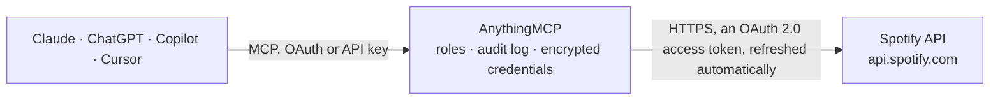

<!-- Generated by scripts/export-github-catalog.mjs in the anythingmcp-website repository. Do not edit by hand. -->

# Spotify MCP connector

Let your AI work with your Spotify account: search music and podcasts, read your playlists, Liked Songs, top artists and recently played tracks, see what is playing, create playlists and add or … The AnythingMCP connector gives Claude, ChatGPT, Microsoft Copilot, Cursor and Gemini 27 MCP tools for Spotify: 17 read and 10 can change data.

**Category:** [Social Media](../social.md) · **Tools:** 27 · **Setup guide:** [anythingmcp.com](https://anythingmcp.com/guides/spotify-to-mcp) · [Deutsch](https://anythingmcp.com/de/guides/spotify-to-mcp) · [Italiano](https://anythingmcp.com/it/guides/spotify-to-mcp) · [Español](https://anythingmcp.com/es/guides/spotify-to-mcp) · [日本語](https://anythingmcp.com/ja/guides/spotify-to-mcp) · [Русский](https://anythingmcp.com/ru/guides/spotify-to-mcp) · [中文](https://anythingmcp.com/zh/guides/spotify-to-mcp)

## Start without code

No installation and no terminal: AnythingMCP Cloud runs the Spotify connector for you, operated by helpcode.ai in Frankfurt, Germany.

1. **Click the button above** and create an account or sign in. The Spotify connector opens, ready to install.
2. **Sign in with your Spotify account** when AnythingMCP asks. The first time, an admin creates a small app in the Spotify developer console. Every click is in the [step-by-step guide](https://anythingmcp.com/guides/spotify-to-mcp).
3. **Click Install.** AnythingMCP shows the address of your MCP server.
4. **Add that address to your assistant:** [Claude](https://anythingmcp.com/guides/connect-spotify-to-claude) · [ChatGPT](https://anythingmcp.com/guides/connect-spotify-to-chatgpt) · [Microsoft Copilot](https://anythingmcp.com/guides/connect-spotify-to-copilot) · [Cursor](https://anythingmcp.com/guides/connect-spotify-to-cursor) · [Gemini CLI](https://anythingmcp.com/guides/connect-spotify-to-gemini) · [Meta Muse](https://anythingmcp.com/guides/connect-spotify-to-muse).
5. **Ask your first question**, for example: *Show me the playlist we made for customer Bergström AB last year, name or id and how many tracks it has.*

Prefer help with the setup? [Talk to us](https://anythingmcp.com/contact).

## How it works

- **The AI client** speaks MCP (Streamable HTTP) to AnythingMCP and only sees tool names, descriptions and results. It never gets the Spotify credentials.
- **AnythingMCP** checks the client's role, builds the call from the tool definition, adds the credentials (an OAuth 2.0 access token, refreshed automatically), calls Spotify, logs the call and returns the result.
- **Spotify** sees an ordinary API client with the rights of the account the credentials belong to.

## Tools

| Tool | What it does | Access |
|---|---|---|
| [`spotify_get_me`](#spotify_get_me) | Read the signed-in Spotify account: user id, account_id, display name, profile link and Spotify URI. | read |
| [`spotify_search`](#spotify_search) | Search the Spotify catalog for tracks, artists, albums, playlists, shows, episodes or audiobooks. | read |
| [`spotify_get_track`](#spotify_get_track) | Read one track by its Spotify id: name, artists, album, release date, duration, explicit flag, track and disc number, playability, ISRC (external_ids) and link. | read |
| [`spotify_get_album`](#spotify_get_album) | Read one album by its Spotify id: name, type, artists, release date, total tracks, copyrights, link, and its first tracks (up to 50; total and next tell… | read |
| [`spotify_get_artist`](#spotify_get_artist) | Read one artist by Spotify id: name, uri, link and image. | read |
| [`spotify_get_artist_albums`](#spotify_get_artist_albums) | List an artist's albums, singles and compilations: id, name, type, release date, track count and link. | read |
| [`spotify_get_playlist`](#spotify_get_playlist) | Read a playlist's details: name, description, owner, public and collaborative flags, snapshot_id, number of items and link. | read |
| [`spotify_get_playlist_items`](#spotify_get_playlist_items) | List the tracks and episodes of a playlist the user owns or collaborates on: when and by whom each was added, type, id, name, uri, artists, album or show,… | read |
| [`spotify_list_my_playlists`](#spotify_list_my_playlists) | List the playlists the signed-in user owns or follows: id, name, owner, public and collaborative flags, number of items, snapshot_id and link. | read |
| [`spotify_get_top_items`](#spotify_get_top_items) | List the signed-in user's most played artists or tracks over about 4 weeks (short_term), 6 months (medium_term, default) or about a year (long_term). | read |
| [`spotify_get_recently_played`](#spotify_get_recently_played) | List the tracks the signed-in user played most recently (up to 50; podcast episodes are not included): when, track, artists, album and the playlist or album… | read |
| [`spotify_get_playback_state`](#spotify_get_playback_state) | Read what is playing right now and where: playing or paused, progress, shuffle and repeat state, the device (name, type, volume) and the current track or… | read |
| [`spotify_get_currently_playing`](#spotify_get_currently_playing) | Read the track or episode currently playing on the user's account: playing or paused, progress, the item and the context it plays from. | read |
| [`spotify_list_devices`](#spotify_list_devices) | List the user's available Spotify Connect devices (phone, computer, speaker): id, name, type, whether active, volume. | read |
| [`spotify_get_queue`](#spotify_get_queue) | Read the user's playback queue: the item playing now and the items queued after it (name, uri, artists or show). | read |
| [`spotify_list_saved_tracks`](#spotify_list_saved_tracks) | List the songs saved in the user's library (Liked Songs), newest first: when saved, track, artists, album, duration. | read |
| [`spotify_check_library`](#spotify_check_library) | Check whether tracks, albums, episodes, shows, audiobooks, artists, users or playlists are saved or followed by the user. | read |
| [`spotify_create_playlist`](#spotify_create_playlist) | Create a new, empty playlist in the signed-in user's account. | write |
| [`spotify_add_playlist_items`](#spotify_add_playlist_items) | Add tracks or episodes to a playlist the user owns or collaborates on (up to 100 per call). | write |
| [`spotify_remove_playlist_items`](#spotify_remove_playlist_items) | Remove tracks or episodes from a playlist the user owns or collaborates on (every occurrence of each URI, up to 100 per call). | write |
| [`spotify_start_playback`](#spotify_start_playback) | Start or resume playback: without arguments it resumes; context_uri plays an album, artist or playlist; uris plays specific tracks. | write |
| [`spotify_pause_playback`](#spotify_pause_playback) | Pause playback on the user's active device (or the given device). | write |
| [`spotify_skip_to_next`](#spotify_skip_to_next) | Skip to the next item in the user's queue. | write |
| [`spotify_skip_to_previous`](#spotify_skip_to_previous) | Go back to the previous item in the user's queue. | write |
| [`spotify_add_to_queue`](#spotify_add_to_queue) | Add a track or episode to the end of the user's playback queue. | write |
| [`spotify_save_to_library`](#spotify_save_to_library) | Save items to the user's library or follow them: tracks, albums, episodes, shows and audiobooks are saved; users and playlists are followed (up to 40 URIs). | write |
| [`spotify_remove_from_library`](#spotify_remove_from_library) | Remove items from the user's library or unfollow them (up to 40 URIs): tracks, albums, episodes, shows, audiobooks, users and playlists. | write |

## Tool reference

Every parameter as the AI client sees it in `tools/list`. Source: [`packages/backend/src/adapters/intl/spotify.json`](../../../packages/backend/src/adapters/intl/spotify.json).

### `spotify_get_me`

Read the signed-in Spotify account: user id, account_id, display name, profile link and Spotify URI. Apps in development mode no longer receive email, country or subscription level. A cheap check that the sign-in works.

**Access:** read · **Call:** `GET /me`

No parameters.

### `spotify_search`

Search the Spotify catalog for tracks, artists, albums, playlists, shows, episodes or audiobooks. Returns per type: total, next and the items with id, name, uri and key details. Spotify returns at most 10 results per type per call for apps in development mode (default 5); page with offset.

**Access:** read · **Call:** `GET /search`

| Parameter | Type | Required | Description |
|---|---|---|---|
| `q` | string | yes | Search text. Field filters narrow it: artist:, album:, track:, year: (e.g. 1990-1999), genre:, isrc:, upc:, tag:new. Example: "track:Doxy artist:Miles Davis". |
| `type` | string | no | Comma-separated result types: album, artist, playlist, track, show, episode, audiobook (default track). |
| `limit` | integer | no | Results per type, 1 to 10 (default 5). |
| `offset` | integer | no | Index of the first result, 0 to 1000, for paging. |
| `market` | string | no | Optional ISO 3166-1 alpha-2 country code (e.g. DE). Leave empty to use the signed-in user's country. |
| `include_external` | `audio` | no | Set to audio to mark externally hosted audio (some podcasts) as playable. |

### `spotify_get_track`

Read one track by its Spotify id: name, artists, album, release date, duration, explicit flag, track and disc number, playability, ISRC (external_ids) and link.

**Access:** read · **Call:** `GET /tracks/{track_id}`

| Parameter | Type | Required | Description |
|---|---|---|---|
| `track_id` | string | yes | Spotify track id, e.g. 11dFghVXANMlKmJXsNCbNl (the part after spotify:track:). |
| `market` | string | no | Optional ISO 3166-1 alpha-2 country code (e.g. DE). Leave empty to use the signed-in user's country. |

### `spotify_get_album`

Read one album by its Spotify id: name, type, artists, release date, total tracks, copyrights, link, and its first tracks (up to 50; total and next tell whether more exist).

**Access:** read · **Call:** `GET /albums/{album_id}`

| Parameter | Type | Required | Description |
|---|---|---|---|
| `album_id` | string | yes | Spotify album id, e.g. 4aawyAB9vmqN3uQ7FjRGTy. |
| `market` | string | no | Optional ISO 3166-1 alpha-2 country code (e.g. DE). Leave empty to use the signed-in user's country. |

### `spotify_get_artist`

Read one artist by Spotify id: name, uri, link and image. Genres, followers and popularity are only returned to apps with extended quota.

**Access:** read · **Call:** `GET /artists/{artist_id}`

| Parameter | Type | Required | Description |
|---|---|---|---|
| `artist_id` | string | yes | Spotify artist id, e.g. 0TnOYISbd1XYRBk9myaseg. |

### `spotify_get_artist_albums`

List an artist's albums, singles and compilations: id, name, type, release date, track count and link. At most 10 per page for apps in development mode (default 5); page with offset.

**Access:** read · **Call:** `GET /artists/{artist_id}/albums`

| Parameter | Type | Required | Description |
|---|---|---|---|
| `artist_id` | string | yes | Spotify artist id. |
| `include_groups` | string | no | Comma-separated filter: album, single, appears_on, compilation. Leave empty for all. |
| `limit` | integer | no | Items per page, 1 to 10 (default 5). |
| `offset` | integer | no | Index of the first item to return, for paging (default 0). |
| `market` | string | no | Optional ISO 3166-1 alpha-2 country code (e.g. DE). Leave empty to use the signed-in user's country. |

### `spotify_get_playlist`

Read a playlist's details: name, description, owner, public and collaborative flags, snapshot_id, number of items and link. Use spotify_get_playlist_items for the tracks. Apps in development mode can read the items only of playlists the user owns or collaborates on, and cannot open Spotify's own editorial or algorithmic playlists.

**Access:** read · **Call:** `GET /playlists/{playlist_id}`

| Parameter | Type | Required | Description |
|---|---|---|---|
| `playlist_id` | string | yes | Spotify playlist id, e.g. 3cEYpjA9oz9GiPac4AsH4n. |
| `market` | string | no | Optional ISO 3166-1 alpha-2 country code (e.g. DE). Leave empty to use the signed-in user's country. |

### `spotify_get_playlist_items`

List the tracks and episodes of a playlist the user owns or collaborates on: when and by whom each was added, type, id, name, uri, artists, album or show, duration. Returns total and next; page with offset. Other people's playlists answer 403 for apps in development mode.

**Access:** read · **Call:** `GET /playlists/{playlist_id}/items`

| Parameter | Type | Required | Description |
|---|---|---|---|
| `playlist_id` | string | yes | Spotify playlist id. |
| `limit` | integer | no | Items per page, 1 to 50 (default 20). |
| `offset` | integer | no | Index of the first item to return, for paging (default 0). |
| `market` | string | no | Optional ISO 3166-1 alpha-2 country code (e.g. DE). Leave empty to use the signed-in user's country. |
| `additional_types` | string | no | Item types the client accepts besides tracks (default track,episode). |

### `spotify_list_my_playlists`

List the playlists the signed-in user owns or follows: id, name, owner, public and collaborative flags, number of items, snapshot_id and link. Returns total and next; page with offset.

**Access:** read · **Call:** `GET /me/playlists`

| Parameter | Type | Required | Description |
|---|---|---|---|
| `limit` | integer | no | Items per page, 1 to 50 (default 20). |
| `offset` | integer | no | Index of the first playlist, for paging (max 100000). |

### `spotify_get_top_items`

List the signed-in user's most played artists or tracks over about 4 weeks (short_term), 6 months (medium_term, default) or about a year (long_term).

**Access:** read · **Call:** `GET /me/top/{type}`

| Parameter | Type | Required | Description |
|---|---|---|---|
| `type` | `artists` \| `tracks` | yes | artists or tracks. |
| `time_range` | `short_term` \| `medium_term` \| `long_term` | no | short_term, medium_term (default) or long_term. |
| `limit` | integer | no | Items per page, 1 to 50 (default 20). |
| `offset` | integer | no | Index of the first item to return, for paging (default 0). |

### `spotify_get_recently_played`

List the tracks the signed-in user played most recently (up to 50; podcast episodes are not included): when, track, artists, album and the playlist or album it was played from. Page back with before = cursors.before.

**Access:** read · **Call:** `GET /me/player/recently-played`

| Parameter | Type | Required | Description |
|---|---|---|---|
| `limit` | integer | no | Items per page, 1 to 50 (default 20). |
| `before` | integer | no | Unix time in milliseconds: return plays before this moment. Do not combine with after. |
| `after` | integer | no | Unix time in milliseconds: return plays after this moment. Do not combine with before. |

### `spotify_get_playback_state`

Read what is playing right now and where: playing or paused, progress, shuffle and repeat state, the device (name, type, volume) and the current track or episode. Returns an empty answer when nothing is playing.

**Access:** read · **Call:** `GET /me/player`

| Parameter | Type | Required | Description |
|---|---|---|---|
| `market` | string | no | Optional ISO 3166-1 alpha-2 country code (e.g. DE). Leave empty to use the signed-in user's country. |
| `additional_types` | string | no | Item types the client accepts besides tracks (default track,episode). |

### `spotify_get_currently_playing`

Read the track or episode currently playing on the user's account: playing or paused, progress, the item and the context it plays from. Returns an empty answer when nothing is playing.

**Access:** read · **Call:** `GET /me/player/currently-playing`

| Parameter | Type | Required | Description |
|---|---|---|---|
| `market` | string | no | Optional ISO 3166-1 alpha-2 country code (e.g. DE). Leave empty to use the signed-in user's country. |
| `additional_types` | string | no | Item types the client accepts besides tracks (default track,episode). |

### `spotify_list_devices`

List the user's available Spotify Connect devices (phone, computer, speaker): id, name, type, whether active, volume. Use a device id to start playback on a specific device.

**Access:** read · **Call:** `GET /me/player/devices`

No parameters.

### `spotify_get_queue`

Read the user's playback queue: the item playing now and the items queued after it (name, uri, artists or show).

**Access:** read · **Call:** `GET /me/player/queue`

No parameters.

### `spotify_list_saved_tracks`

List the songs saved in the user's library (Liked Songs), newest first: when saved, track, artists, album, duration. Returns total and next; page with offset.

**Access:** read · **Call:** `GET /me/tracks`

| Parameter | Type | Required | Description |
|---|---|---|---|
| `limit` | integer | no | Items per page, 1 to 50 (default 20). |
| `offset` | integer | no | Index of the first item to return, for paging (default 0). |
| `market` | string | no | Optional ISO 3166-1 alpha-2 country code (e.g. DE). Leave empty to use the signed-in user's country. |

### `spotify_check_library`

Check whether tracks, albums, episodes, shows, audiobooks, artists, users or playlists are saved or followed by the user. Returns one true or false per URI, in the same order.

**Access:** read · **Call:** `GET /me/library/contains`

| Parameter | Type | Required | Description |
|---|---|---|---|
| `uris` | string | yes | Comma-separated Spotify URIs, at most 40, e.g. spotify:track:7a3LWj5xSFhFRYmztS8wgK,spotify:album:4aawyAB9vmqN3uQ7FjRGTy. |

### `spotify_create_playlist`

Create a new, empty playlist in the signed-in user's account. Before calling, tell the user exactly what will change and wait for their yes. Playlists are public unless public is false. Returns the new playlist id, uri and link; add tracks with spotify_add_playlist_items.

**Access:** write · **Call:** `POST /me/playlists`

| Parameter | Type | Required | Description |
|---|---|---|---|
| `name` | string | yes | Name of the new playlist. |
| `description` | string | no | Optional description shown in Spotify. |
| `public` | boolean | no | true (Spotify's default) shows it on the profile; false keeps it private. |
| `collaborative` | boolean | no | true lets others edit it; needs public false. |

### `spotify_add_playlist_items`

Add tracks or episodes to a playlist the user owns or collaborates on (up to 100 per call). Before calling, tell the user exactly what will change and wait for their yes. Returns the playlist's new snapshot_id.

**Access:** write · **Call:** `POST /playlists/{playlist_id}/items`

| Parameter | Type | Required | Description |
|---|---|---|---|
| `playlist_id` | string | yes | Spotify playlist id. |
| `uris` | string[] | yes | Spotify URIs to add, e.g. ["spotify:track:4iV5W9uYEdYUVa79Axb7Rh", "spotify:episode:512ojhOuo1ktJprKbVcKyQ"]. At most 100. |
| `position` | integer | no | Zero-based position to insert at; leave empty to append. |

### `spotify_remove_playlist_items`

Remove tracks or episodes from a playlist the user owns or collaborates on (every occurrence of each URI, up to 100 per call). Before calling, tell the user exactly what will change and wait for their yes. Returns the playlist's new snapshot_id.

**Access:** write · **Call:** `DELETE /playlists/{playlist_id}/items`

| Parameter | Type | Required | Description |
|---|---|---|---|
| `playlist_id` | string | yes | Spotify playlist id. |
| `items` | object[] | yes | Items to remove, each as {"uri": "spotify:track:..."}. At most 100. |
| `snapshot_id` | string | no | Optional snapshot_id the change applies to, from spotify_get_playlist. |

### `spotify_start_playback`

Start or resume playback: without arguments it resumes; context_uri plays an album, artist or playlist; uris plays specific tracks. Needs Spotify Premium on the signed-in account and an active Spotify app (phone, desktop, speaker); otherwise Spotify answers 403 PREMIUM_REQUIRED or 404 NO_ACTIVE_DEVICE. Before calling, tell the user exactly what will change and wait for their yes.

**Access:** write · **Call:** `PUT /me/player/play`

| Parameter | Type | Required | Description |
|---|---|---|---|
| `device_id` | string | no | Optional Spotify Connect device id from spotify_list_devices. Leave empty for the user's active device. |
| `context_uri` | string | no | Spotify URI of an album, artist or playlist to play, e.g. spotify:album:5ht7ItJgpBH7W6vJ5BqpPr. |
| `uris` | string[] | no | Track URIs to play instead of a context. |
| `offset` | object | no | Where to start in an album or playlist: {"position": 5} (zero-based) or {"uri": "spotify:track:..."}. |
| `position_ms` | integer | no | Start position in milliseconds within the first track. |

### `spotify_pause_playback`

Pause playback on the user's active device (or the given device). Needs Spotify Premium on the signed-in account and an active Spotify app (phone, desktop, speaker); otherwise Spotify answers 403 PREMIUM_REQUIRED or 404 NO_ACTIVE_DEVICE. Before calling, tell the user exactly what will change and wait for their yes.

**Access:** write · **Call:** `PUT /me/player/pause`

| Parameter | Type | Required | Description |
|---|---|---|---|
| `device_id` | string | no | Optional Spotify Connect device id from spotify_list_devices. Leave empty for the user's active device. |

### `spotify_skip_to_next`

Skip to the next item in the user's queue. Needs Spotify Premium on the signed-in account and an active Spotify app (phone, desktop, speaker); otherwise Spotify answers 403 PREMIUM_REQUIRED or 404 NO_ACTIVE_DEVICE. Before calling, tell the user exactly what will change and wait for their yes.

**Access:** write · **Call:** `POST /me/player/next`

| Parameter | Type | Required | Description |
|---|---|---|---|
| `device_id` | string | no | Optional Spotify Connect device id from spotify_list_devices. Leave empty for the user's active device. |

### `spotify_skip_to_previous`

Go back to the previous item in the user's queue. Needs Spotify Premium on the signed-in account and an active Spotify app (phone, desktop, speaker); otherwise Spotify answers 403 PREMIUM_REQUIRED or 404 NO_ACTIVE_DEVICE. Before calling, tell the user exactly what will change and wait for their yes.

**Access:** write · **Call:** `POST /me/player/previous`

| Parameter | Type | Required | Description |
|---|---|---|---|
| `device_id` | string | no | Optional Spotify Connect device id from spotify_list_devices. Leave empty for the user's active device. |

### `spotify_add_to_queue`

Add a track or episode to the end of the user's playback queue. Needs Spotify Premium on the signed-in account and an active Spotify app (phone, desktop, speaker); otherwise Spotify answers 403 PREMIUM_REQUIRED or 404 NO_ACTIVE_DEVICE. Before calling, tell the user exactly what will change and wait for their yes.

**Access:** write · **Call:** `POST /me/player/queue`

| Parameter | Type | Required | Description |
|---|---|---|---|
| `uri` | string | yes | Spotify URI of a track or episode, e.g. spotify:track:4iV5W9uYEdYUVa79Axb7Rh. |
| `device_id` | string | no | Optional Spotify Connect device id from spotify_list_devices. Leave empty for the user's active device. |

### `spotify_save_to_library`

Save items to the user's library or follow them: tracks, albums, episodes, shows and audiobooks are saved; users and playlists are followed (up to 40 URIs). Before calling, tell the user exactly what will change and wait for their yes. Installed switched off; needs the extra scopes user-library-modify and user-follow-modify.

**Access:** write · **Call:** `PUT /me/library`

| Parameter | Type | Required | Description |
|---|---|---|---|
| `uris` | string | yes | Comma-separated Spotify URIs, at most 40, e.g. spotify:track:7a3LWj5xSFhFRYmztS8wgK,spotify:playlist:3cEYpjA9oz9GiPac4AsH4n. |

### `spotify_remove_from_library`

Remove items from the user's library or unfollow them (up to 40 URIs): tracks, albums, episodes, shows, audiobooks, users and playlists. Before calling, tell the user exactly what will change and wait for their yes. Installed switched off; needs the extra scopes user-library-modify and user-follow-modify.

**Access:** write · **Call:** `DELETE /me/library`

| Parameter | Type | Required | Description |
|---|---|---|---|
| `uris` | string | yes | Comma-separated Spotify URIs, at most 40. |

## Run it yourself

AnythingMCP is open source (AGPL-3.0). [Run it with Docker](../../../README.md#run-it-yourself), open **Connectors → Store**, pick **Spotify** and enter `SPOTIFY_CLIENT_ID`, `SPOTIFY_CLIENT_SECRET`, then add your MCP server URL to the AI client.

[← Social Media connectors](../social.md) · [All categories](../README.md)
