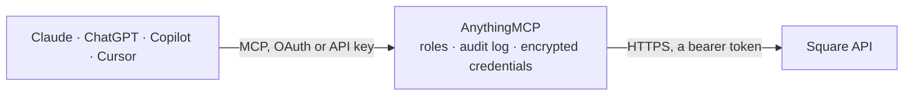

<!-- Generated by scripts/export-github-catalog.mjs in the anythingmcp-website repository. Do not edit by hand. -->

# Square MCP connector

Let your AI work with your Square business: look up payments, refunds and orders, manage customers, search and edit the item catalog, check inventory, create and send invoices, and see locations and team members. The AnythingMCP connector gives Claude, ChatGPT, Microsoft Copilot, Cursor and Gemini 34 MCP tools for Square: 23 read and 11 can change data.

**Category:** [Payments](../payments.md) · **Tools:** 34 · **Setup guide:** [anythingmcp.com](https://anythingmcp.com/guides/square-to-mcp) · [Deutsch](https://anythingmcp.com/de/guides/square-to-mcp) · [Italiano](https://anythingmcp.com/it/guides/square-to-mcp) · [Español](https://anythingmcp.com/es/guides/square-to-mcp) · [日本語](https://anythingmcp.com/ja/guides/square-to-mcp) · [Русский](https://anythingmcp.com/ru/guides/square-to-mcp) · [中文](https://anythingmcp.com/zh/guides/square-to-mcp)

## Start without code

No installation and no terminal: AnythingMCP Cloud runs the Square connector for you, operated by helpcode.ai in Frankfurt, Germany.

1. **Click the button above** and create an account or sign in. The Square connector opens, ready to install.
2. **Paste the API key or token from your Square account.** Every click is in the [step-by-step guide](https://anythingmcp.com/guides/square-to-mcp).
3. **Click Install.** AnythingMCP shows the address of your MCP server.
4. **Add that address to your assistant:** [Claude](https://anythingmcp.com/guides/connect-square-to-claude) · [ChatGPT](https://anythingmcp.com/guides/connect-square-to-chatgpt) · [Microsoft Copilot](https://anythingmcp.com/guides/connect-square-to-copilot) · [Cursor](https://anythingmcp.com/guides/connect-square-to-cursor) · [Gemini CLI](https://anythingmcp.com/guides/connect-square-to-gemini) · [Meta Muse](https://anythingmcp.com/guides/connect-square-to-muse).
5. **Ask your first question**, for example: *Show me payment PAY-2026-1009 details — I need amount, status, customer and receipt URL.*

Prefer help with the setup? [Talk to us](https://anythingmcp.com/contact).

## How it works

- **The AI client** speaks MCP (Streamable HTTP) to AnythingMCP and only sees tool names, descriptions and results. It never gets the Square credentials.
- **AnythingMCP** checks the client's role, builds the call from the tool definition, adds the credentials (a bearer token), calls Square, logs the call and returns the result.
- **Square** sees an ordinary API client with the rights of the account the credentials belong to.

## Tools

| Tool | What it does | Access |
|---|---|---|
| [`square_get_merchant`](#square_get_merchant) | Read the seller account behind the token: business name, country, currency, language, status and main_location_id. | read |
| [`square_list_locations`](#square_list_locations) | List the business locations: id, name, address, timezone, currency, status and capabilities. | read |
| [`square_get_location`](#square_get_location) | Read one location by id, or the main location with "main": address, hours, currency, capabilities. | read |
| [`square_list_payments`](#square_list_payments) | List payments (newest first by default) with amount, status, card details, order and customer ids, refunds and receipt URL. | read |
| [`square_get_payment`](#square_get_payment) | Read one payment: amounts (total, tip, app fee, refunded), status (APPROVED, PENDING, COMPLETED, CANCELED, FAILED), source and card details, order, customer… | read |
| [`square_list_refunds`](#square_list_refunds) | List refunds (newest first by default) across all locations unless one is given: amount, status, reason, payment id. | read |
| [`square_get_refund`](#square_get_refund) | Read one refund: amount, status, reason, payment and order ids. | read |
| [`square_refund_payment`](#square_refund_payment) | Refund a payment in full or in part. | write |
| [`square_search_orders`](#square_search_orders) | Search orders of 1 to 10 locations by state, dates, customers or source, with line items, totals, tenders and fulfillments. | read |
| [`square_get_order`](#square_get_order) | Read one order: state, line items with modifiers, taxes and discounts, totals, tenders (payments), refunds and fulfillments. | read |
| [`square_create_order`](#square_create_order) | Create an OPEN order, for example as the basis of an invoice. | write |
| [`square_list_customers`](#square_list_customers) | List customer profiles: id, names, company, email, phone, address, reference id, version. | read |
| [`square_search_customers`](#square_search_customers) | Search customer profiles by email, phone, reference id, creation or update time, or group. | read |
| [`square_get_customer`](#square_get_customer) | Read one customer profile with its current version, groups and preferences. | read |
| [`square_create_customer`](#square_create_customer) | Create a customer profile. | write |
| [`square_update_customer`](#square_update_customer) | Update a customer profile. | write |
| [`square_delete_customer`](#square_delete_customer) | Delete a customer profile for good. | write |
| [`square_list_catalog`](#square_list_catalog) | List catalog objects of the given types (100 per page): items with variations and prices, categories, taxes, discounts, modifier lists. | read |
| [`square_search_catalog_items`](#square_search_catalog_items) | Search items by text (name, description, SKU, UPC), category, location, stock level or product type. | read |
| [`square_search_catalog_objects`](#square_search_catalog_objects) | Search any catalog objects (items, variations, categories, taxes, discounts...) by keywords, exact or prefix attribute values, or change time. | read |
| [`square_get_catalog_object`](#square_get_catalog_object) | Read one catalog object by id with its version (needed to update it), optionally with the objects it references. | read |
| [`square_upsert_catalog_object`](#square_upsert_catalog_object) | Create a catalog object, or REPLACE an existing one as a whole: fields left out (variations included) are removed, so for an update send the full object… | write |
| [`square_delete_catalog_object`](#square_delete_catalog_object) | Delete a catalog object for good; deleting an item also deletes its variations. | write |
| [`square_get_inventory_counts`](#square_get_inventory_counts) | Read inventory counts for many item variations and locations at once: quantity (a string) per state such as IN_STOCK, newest first. | read |
| [`square_get_inventory_count`](#square_get_inventory_count) | Read the inventory count of one item variation, per location and state. | read |
| [`square_list_invoices`](#square_list_invoices) | List the invoices of one location: id, number, status (DRAFT, UNPAID, SCHEDULED, PARTIALLY_PAID, PAID, CANCELED, ...), recipient, payment requests with due… | read |
| [`square_search_invoices`](#square_search_invoices) | Search the invoices of one location, optionally of one customer, sorted by invoice date. | read |
| [`square_get_invoice`](#square_get_invoice) | Read one invoice: status, version (needed to publish or cancel), order, recipient, payment requests with computed amounts, public_url and timestamps. | read |
| [`square_create_invoice`](#square_create_invoice) | Create a DRAFT invoice for an OPEN order (make one with square_create_order). | write |
| [`square_publish_invoice`](#square_publish_invoice) | Publish a draft invoice: Square sends it to the customer (EMAIL delivery) or makes it payable at public_url, and it can no longer be edited freely. | write |
| [`square_cancel_invoice`](#square_cancel_invoice) | Cancel a published invoice so it can no longer be paid; the customer is notified. | write |
| [`square_delete_invoice`](#square_delete_invoice) | Delete a DRAFT invoice; its order is canceled too. | write |
| [`square_search_team_members`](#square_search_team_members) | Search team members by location, status or owner flag: id, names, email, phone, status, is_owner and assigned locations. | read |
| [`square_get_team_member`](#square_get_team_member) | Read one team member: names, email, phone, status, owner flag and location assignments. | read |

## Tool reference

Every parameter as the AI client sees it in `tools/list`. Source: [`packages/backend/src/adapters/intl/square.json`](../../../packages/backend/src/adapters/intl/square.json).

### `square_get_merchant`

Read the seller account behind the token: business name, country, currency, language, status and main_location_id. Call it first to confirm which business the connector reaches.

**Access:** read · **Call:** `GET /v2/merchants/me`

No parameters.

### `square_list_locations`

List the business locations: id, name, address, timezone, currency, status and capabilities. Most other tools need a location id from here.

**Access:** read · **Call:** `GET /v2/locations`

No parameters.

### `square_get_location`

Read one location by id, or the main location with "main": address, hours, currency, capabilities.

**Access:** read · **Call:** `GET /v2/locations/{location_id}`

| Parameter | Type | Required | Description |
|---|---|---|---|
| `location_id` | string | yes | Location id, or "main". |

### `square_list_payments`

List payments (newest first by default) with amount, status, card details, order and customer ids, refunds and receipt URL. Without location_id only the main location is listed; without dates the last year.

**Access:** read · **Call:** `GET /v2/payments`

| Parameter | Type | Required | Description |
|---|---|---|---|
| `begin_time` | string | no | From, RFC 3339 (default one year ago). |
| `end_time` | string | no | Until, RFC 3339 (default now). |
| `sort_order` | `ASC` \| `DESC` | no | DESC (default, newest first) or ASC. |
| `location_id` | string | no | Location id (default: the main location). |
| `total` | integer | no | Only payments with exactly this total, in the smallest currency unit. |
| `last_4` | string | no | Last 4 digits of the card. |
| `card_brand` | string | no | Card brand, e.g. VISA, MASTERCARD. |
| `limit` | integer | no | Payments per page, 1 to 100 (default 100). |
| `cursor` | string | no | cursor from the previous response, to fetch the next page. |

### `square_get_payment`

Read one payment: amounts (total, tip, app fee, refunded), status (APPROVED, PENDING, COMPLETED, CANCELED, FAILED), source and card details, order, customer and receipt.

**Access:** read · **Call:** `GET /v2/payments/{payment_id}`

| Parameter | Type | Required | Description |
|---|---|---|---|
| `payment_id` | string | yes | The payment id. |

### `square_list_refunds`

List refunds (newest first by default) across all locations unless one is given: amount, status, reason, payment id.

**Access:** read · **Call:** `GET /v2/refunds`

| Parameter | Type | Required | Description |
|---|---|---|---|
| `begin_time` | string | no | From, RFC 3339 (default one year ago). |
| `end_time` | string | no | Until, RFC 3339. |
| `sort_order` | `ASC` \| `DESC` | no | DESC (default) or ASC. |
| `location_id` | string | no | Only this location. |
| `status` | `PENDING` \| `COMPLETED` \| `REJECTED` \| `FAILED` | no | PENDING, COMPLETED, REJECTED or FAILED. |
| `source_type` | string | no | CARD, BANK_ACCOUNT, WALLET, CASH or EXTERNAL. |
| `limit` | integer | no | Refunds per page, 1 to 100. |
| `cursor` | string | no | cursor from the previous response, to fetch the next page. |

### `square_get_refund`

Read one refund: amount, status, reason, payment and order ids.

**Access:** read · **Call:** `GET /v2/refunds/{refund_id}`

| Parameter | Type | Required | Description |
|---|---|---|---|
| `refund_id` | string | yes | The refund id. |

### `square_refund_payment`

Refund a payment in full or in part. This sends money back to the customer and cannot be undone: confirm the payment, amount and reason with the user first. Returns the refund with status PENDING or COMPLETED.

**Access:** write · **Call:** `POST /v2/refunds`

| Parameter | Type | Required | Description |
|---|---|---|---|
| `payment_id` | string | yes | The payment to refund. |
| `amount_money` | object | yes | Money in the smallest currency unit, e.g. {"amount": 1999, "currency": "EUR"} for 19.99 EUR. At most what is left of the payment. |
| `reason` | string | no | Reason, up to 192 characters. |
| `idempotency_key` | string | yes | A unique key for this request, e.g. a fresh UUID. Retrying with the same key returns the first result instead of acting twice. |

### `square_search_orders`

Search orders of 1 to 10 locations by state, dates, customers or source, with line items, totals, tenders and fulfillments. Read-only, although it is a POST. Returns orders (or light order_entries) and a cursor.

**Access:** read · **Call:** `POST /v2/orders/search`

| Parameter | Type | Required | Description |
|---|---|---|---|
| `location_ids` | string[] | yes | 1 to 10 location ids. |
| `query` | object | no | Optional filter and sort, e.g. {"filter": {"state_filter": {"states": ["COMPLETED"]}, "date_time_filter": {"closed_at": {"start_at": "2026-10-01T00:00:00Z", "end_at": "2026-10-10T00:00:00Z"}}, "customer_filter": {"customer_ids": ["..."]}}, "sort": {"sort_field": "CLOSED_AT", "sort_order": "DESC"}}. Sort by the same field you filter dates on. |
| `limit` | integer | no | Orders per page, 1 to 1000 (default 500). |
| `return_entries` | boolean | no | true to return only order ids, versions and locations (order_entries). |
| `cursor` | string | no | cursor from the previous response, to fetch the next page. |

### `square_get_order`

Read one order: state, line items with modifiers, taxes and discounts, totals, tenders (payments), refunds and fulfillments.

**Access:** read · **Call:** `GET /v2/orders/{order_id}`

| Parameter | Type | Required | Description |
|---|---|---|---|
| `order_id` | string | yes | The order id. |

### `square_create_order`

Create an OPEN order, for example as the basis of an invoice. Nothing is charged. Returns the order with its id, version and computed totals.

**Access:** write · **Call:** `POST /v2/orders`

| Parameter | Type | Required | Description |
|---|---|---|---|
| `location_id` | string | yes | The location id. |
| `line_items` | object[] | yes | Line items: ad hoc {"name": "Repair", "quantity": "1", "base_price_money": {"amount": 4500, "currency": "EUR"}} or from the catalog {"catalog_object_id": "<variation id>", "quantity": "2"}. quantity is a string. |
| `customer_id` | string | no | Optional customer id. |
| `reference_id` | string | no | Optional own reference, e.g. a job number. |
| `idempotency_key` | string | yes | A unique key for this request, e.g. a fresh UUID. Retrying with the same key returns the first result instead of acting twice. |

### `square_list_customers`

List customer profiles: id, names, company, email, phone, address, reference id, version.

**Access:** read · **Call:** `GET /v2/customers`

| Parameter | Type | Required | Description |
|---|---|---|---|
| `limit` | integer | no | Customers per page, 1 to 100. |
| `sort_field` | `DEFAULT` \| `CREATED_AT` | no | DEFAULT (by name) or CREATED_AT. |
| `sort_order` | `ASC` \| `DESC` | no | ASC (default) or DESC. |
| `count` | boolean | no | true to also return the total count. |
| `cursor` | string | no | cursor from the previous response, to fetch the next page. |

### `square_search_customers`

Search customer profiles by email, phone, reference id, creation or update time, or group. Read-only, although it is a POST.

**Access:** read · **Call:** `POST /v2/customers/search`

| Parameter | Type | Required | Description |
|---|---|---|---|
| `query` | object | no | Filter and sort, e.g. {"filter": {"email_address": {"fuzzy": "acme"}}} or {"filter": {"phone_number": {"exact": "+4976112345"}}} or {"filter": {"created_at": {"start_at": "2026-09-01T00:00:00Z"}}, "sort": {"field": "CREATED_AT", "order": "DESC"}}. email_address, phone_number and reference_id take exact or fuzzy, not both. |
| `limit` | integer | no | Customers per page, 1 to 100. |
| `count` | boolean | no | true to also return the number of matches. |
| `cursor` | string | no | cursor from the previous response, to fetch the next page. |

### `square_get_customer`

Read one customer profile with its current version, groups and preferences.

**Access:** read · **Call:** `GET /v2/customers/{customer_id}`

| Parameter | Type | Required | Description |
|---|---|---|---|
| `customer_id` | string | yes | The customer id. |

### `square_create_customer`

Create a customer profile. At least one of given_name, family_name, company_name, email_address or phone_number is required. Returns the customer with its id.

**Access:** write · **Call:** `POST /v2/customers`

| Parameter | Type | Required | Description |
|---|---|---|---|
| `given_name` | string | no | First name. |
| `family_name` | string | no | Last name. |
| `company_name` | string | no | Company name. |
| `email_address` | string | no | Email address. |
| `phone_number` | string | no | Phone number, e.g. "+4976112345". |
| `address` | object | no | Address, e.g. {"address_line_1": "Hauptstr. 1", "locality": "Freiburg", "postal_code": "79098", "country": "DE"}. |
| `reference_id` | string | no | Your own id for this customer. |
| `note` | string | no | A note about the customer. |
| `idempotency_key` | string | no | Optional unique key, e.g. a UUID, so a retry does not create a duplicate. |

### `square_update_customer`

Update a customer profile. Only the fields you send change; send null to clear one. Pass the version from square_get_customer to refuse overwriting a newer change.

**Access:** write · **Call:** `PUT /v2/customers/{customer_id}`

| Parameter | Type | Required | Description |
|---|---|---|---|
| `customer_id` | string | yes | The customer id. |
| `given_name` | string | no | First name. |
| `family_name` | string | no | Last name. |
| `company_name` | string | no | Company name. |
| `email_address` | string | no | Email address. |
| `phone_number` | string | no | Phone number. |
| `address` | object | no | Address object. |
| `reference_id` | string | no | Your own id. |
| `note` | string | no | Note. |
| `version` | integer | no | The current version of the profile. |

### `square_delete_customer`

Delete a customer profile for good. Confirm with the user first.

**Access:** write · **Call:** `DELETE /v2/customers/{customer_id}`

| Parameter | Type | Required | Description |
|---|---|---|---|
| `customer_id` | string | yes | The customer id. |
| `version` | integer | no | Optional current version; the delete fails if the profile changed since. |

### `square_list_catalog`

List catalog objects of the given types (100 per page): items with variations and prices, categories, taxes, discounts, modifier lists.

**Access:** read · **Call:** `GET /v2/catalog/list`

| Parameter | Type | Required | Description |
|---|---|---|---|
| `types` | string | no | Comma-separated types, e.g. "ITEM" or "ITEM,CATEGORY,TAX". Others: ITEM_VARIATION, DISCOUNT, MODIFIER_LIST, IMAGE. |
| `cursor` | string | no | cursor from the previous response, to fetch the next page. |

### `square_search_catalog_items`

Search items by text (name, description, SKU, UPC), category, location, stock level or product type. Read-only, although it is a POST. Returns items and matched_variation_ids.

**Access:** read · **Call:** `POST /v2/catalog/search-catalog-items`

| Parameter | Type | Required | Description |
|---|---|---|---|
| `text_filter` | string | no | Text to look for, e.g. "espresso". |
| `category_ids` | string[] | no | Only these category ids. |
| `enabled_location_ids` | string[] | no | Only items enabled at these locations. |
| `stock_levels` | string[] | no | OUT or LOW. |
| `product_types` | string[] | no | e.g. ["REGULAR", "APPOINTMENTS_SERVICE"]. |
| `archived_state` | string | no | ARCHIVED_STATE_NOT_ARCHIVED (default), ARCHIVED_STATE_ARCHIVED or ARCHIVED_STATE_ALL. |
| `sort_order` | `ASC` \| `DESC` | no | ASC or DESC by name. |
| `limit` | integer | no | Items per page, 1 to 100. |
| `cursor` | string | no | cursor from the previous response, to fetch the next page. |

### `square_search_catalog_objects`

Search any catalog objects (items, variations, categories, taxes, discounts...) by keywords, exact or prefix attribute values, or change time. Read-only, although it is a POST.

**Access:** read · **Call:** `POST /v2/catalog/search`

| Parameter | Type | Required | Description |
|---|---|---|---|
| `object_types` | string[] | no | Types to search, e.g. ["ITEM_VARIATION"]. All top-level types when omitted. |
| `query` | object | no | e.g. {"text_query": {"keywords": ["latte"]}} (1 to 3 keywords of 3+ characters, all must match), {"exact_query": {"attribute_name": "sku", "attribute_value": "LAT-12"}} or {"prefix_query": {"attribute_name": "name", "attribute_prefix": "Lat"}}. |
| `include_related_objects` | boolean | no | true to also return referenced objects (categories, taxes, images). |
| `include_deleted_objects` | boolean | no | true to include deleted objects. |
| `begin_time` | string | no | Only objects changed after this RFC 3339 time. |
| `limit` | integer | no | Objects per page, up to 1000. |
| `cursor` | string | no | cursor from the previous response, to fetch the next page. |

### `square_get_catalog_object`

Read one catalog object by id with its version (needed to update it), optionally with the objects it references.

**Access:** read · **Call:** `GET /v2/catalog/object/{object_id}`

| Parameter | Type | Required | Description |
|---|---|---|---|
| `object_id` | string | yes | The catalog object id. |
| `include_related_objects` | boolean | no | true to also return categories, taxes, modifiers and images it references. |

### `square_upsert_catalog_object`

Create a catalog object, or REPLACE an existing one as a whole: fields left out (variations included) are removed, so for an update send the full object from square_get_catalog_object with its version. Confirm changes to existing items with the user first. Returns catalog_object and id_mappings (temporary #ids to real ids).

**Access:** write · **Call:** `POST /v2/catalog/object`

| Parameter | Type | Required | Description |
|---|---|---|---|
| `object` | object | yes | The object. New item: {"type": "ITEM", "id": "#coffee", "item_data": {"name": "Coffee", "variations": [{"type": "ITEM_VARIATION", "id": "#coffee-regular", "item_variation_data": {"item_id": "#coffee", "name": "Regular", "pricing_type": "FIXED_PRICING", "price_money": {"amount": 250, "currency": "EUR"}}}]}}. Existing objects keep their id and must carry their current version. |
| `idempotency_key` | string | yes | A unique key for this request, e.g. a fresh UUID. Retrying with the same key returns the first result instead of acting twice. |

### `square_delete_catalog_object`

Delete a catalog object for good; deleting an item also deletes its variations. Confirm with the user first. Returns deleted_object_ids.

**Access:** write · **Call:** `DELETE /v2/catalog/object/{object_id}`

| Parameter | Type | Required | Description |
|---|---|---|---|
| `object_id` | string | yes | The catalog object id. |

### `square_get_inventory_counts`

Read inventory counts for many item variations and locations at once: quantity (a string) per state such as IN_STOCK, newest first. Read-only, although it is a POST.

**Access:** read · **Call:** `POST /v2/inventory/counts/batch-retrieve`

| Parameter | Type | Required | Description |
|---|---|---|---|
| `catalog_object_ids` | string[] | no | Item variation ids (not item ids). |
| `location_ids` | string[] | no | Location ids; all when omitted. |
| `updated_after` | string | no | Only counts changed after this RFC 3339 time. |
| `states` | string[] | no | States, e.g. ["IN_STOCK"]; default IN_STOCK. |
| `limit` | integer | no | Counts per page, 1 to 1000. |
| `cursor` | string | no | cursor from the previous response, to fetch the next page. |

### `square_get_inventory_count`

Read the inventory count of one item variation, per location and state.

**Access:** read · **Call:** `GET /v2/inventory/{catalog_object_id}`

| Parameter | Type | Required | Description |
|---|---|---|---|
| `catalog_object_id` | string | yes | The item variation id. |
| `location_ids` | string | no | Comma-separated location ids; all when omitted. |
| `cursor` | string | no | cursor from the previous response, to fetch the next page. |

### `square_list_invoices`

List the invoices of one location: id, number, status (DRAFT, UNPAID, SCHEDULED, PARTIALLY_PAID, PAID, CANCELED, ...), recipient, payment requests with due dates and amounts, public_url.

**Access:** read · **Call:** `GET /v2/invoices`

| Parameter | Type | Required | Description |
|---|---|---|---|
| `location_id` | string | yes | The location id (required). |
| `limit` | integer | no | Invoices per page, 1 to 200. |
| `cursor` | string | no | cursor from the previous response, to fetch the next page. |

### `square_search_invoices`

Search the invoices of one location, optionally of one customer, sorted by invoice date. Read-only, although it is a POST.

**Access:** read · **Call:** `POST /v2/invoices/search`

| Parameter | Type | Required | Description |
|---|---|---|---|
| `location_id` | string | yes | The location id. |
| `customer_ids` | string[] | no | Only invoices of this customer: a list with at most one customer id. |
| `sort_order` | `ASC` \| `DESC` | no | DESC (newest first) or ASC. |
| `limit` | integer | no | Invoices per page, 1 to 200. |
| `cursor` | string | no | cursor from the previous response, to fetch the next page. |

### `square_get_invoice`

Read one invoice: status, version (needed to publish or cancel), order, recipient, payment requests with computed amounts, public_url and timestamps.

**Access:** read · **Call:** `GET /v2/invoices/{invoice_id}`

| Parameter | Type | Required | Description |
|---|---|---|---|
| `invoice_id` | string | yes | The invoice id. |

### `square_create_invoice`

Create a DRAFT invoice for an OPEN order (make one with square_create_order). Nothing is sent until square_publish_invoice. Returns the invoice with id and version.

**Access:** write · **Call:** `POST /v2/invoices`

| Parameter | Type | Required | Description |
|---|---|---|---|
| `location_id` | string | yes | The order's location id. |
| `order_id` | string | yes | An OPEN order at that location. |
| `customer_id` | string | yes | The customer to bill (needs an email for EMAIL delivery). |
| `payment_requests` | object[] | yes | 1 to 13 payment requests, usually [{"request_type": "BALANCE", "due_date": "2026-11-01"}]; with reminders: "reminders": [{"relative_scheduled_days": -1, "message": "Due tomorrow"}]. |
| `accepted_payment_methods` | object | no | At least one true, e.g. {"card": true, "bank_account": false, "square_gift_card": false}. |
| `delivery_method` | `EMAIL` \| `SHARE_MANUALLY` | no | EMAIL (Square emails the invoice) or SHARE_MANUALLY (you share public_url). |
| `title` | string | no | Title shown on the invoice. |
| `description` | string | no | Description or terms. |
| `invoice_number` | string | no | Own invoice number; generated when omitted. |
| `sale_or_service_date` | string | no | Date of the sale or service, YYYY-MM-DD. |
| `scheduled_at` | string | no | Optional RFC 3339 time to send it later. |
| `idempotency_key` | string | yes | A unique key for this request, e.g. a fresh UUID. Retrying with the same key returns the first result instead of acting twice. |

### `square_publish_invoice`

Publish a draft invoice: Square sends it to the customer (EMAIL delivery) or makes it payable at public_url, and it can no longer be edited freely. Confirm with the user first. Needs the invoice's current version.

**Access:** write · **Call:** `POST /v2/invoices/{invoice_id}/publish`

| Parameter | Type | Required | Description |
|---|---|---|---|
| `invoice_id` | string | yes | The draft invoice id. |
| `version` | integer | yes | The invoice's current version (from square_get_invoice). |
| `idempotency_key` | string | no | A unique key for this request, e.g. a fresh UUID. Retrying with the same key returns the first result instead of acting twice. |

### `square_cancel_invoice`

Cancel a published invoice so it can no longer be paid; the customer is notified. Not possible for drafts (delete those) or paid invoices. Cannot be undone: confirm with the user first.

**Access:** write · **Call:** `POST /v2/invoices/{invoice_id}/cancel`

| Parameter | Type | Required | Description |
|---|---|---|---|
| `invoice_id` | string | yes | The invoice id. |
| `version` | integer | yes | The invoice's current version. |

### `square_delete_invoice`

Delete a DRAFT invoice; its order is canceled too. Confirm with the user first.

**Access:** write · **Call:** `DELETE /v2/invoices/{invoice_id}`

| Parameter | Type | Required | Description |
|---|---|---|---|
| `invoice_id` | string | yes | The draft invoice id. |
| `version` | integer | no | Optional current version. |

### `square_search_team_members`

Search team members by location, status or owner flag: id, names, email, phone, status, is_owner and assigned locations. Read-only, although it is a POST.

**Access:** read · **Call:** `POST /v2/team-members/search`

| Parameter | Type | Required | Description |
|---|---|---|---|
| `location_ids` | string[] | no | Members assigned to any of these locations. |
| `status` | `ACTIVE` \| `INACTIVE` | no | ACTIVE or INACTIVE. |
| `is_owner` | boolean | no | true for the account owner only. |
| `limit` | integer | no | Members per page, 1 to 200. |
| `cursor` | string | no | cursor from the previous response, to fetch the next page. |

### `square_get_team_member`

Read one team member: names, email, phone, status, owner flag and location assignments.

**Access:** read · **Call:** `GET /v2/team-members/{team_member_id}`

| Parameter | Type | Required | Description |
|---|---|---|---|
| `team_member_id` | string | yes | The team member id. |

## Run it yourself

AnythingMCP is open source (AGPL-3.0). [Run it with Docker](../../../README.md#run-it-yourself), open **Connectors → Store**, pick **Square** and enter `SQUARE_ACCESS_TOKEN`, `SQUARE_API_URL`, then add your MCP server URL to the AI client.

[← Payments connectors](../payments.md) · [All categories](../README.md)
