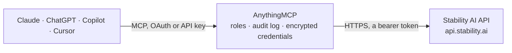

<!-- Generated by scripts/export-github-catalog.mjs in the anythingmcp-website repository. Do not edit by hand. -->

# Stability AI MCP connector

Create and edit pictures with Stability AI: generate images with Stable Image Ultra, Core and Stable Diffusion 3.5, upscale, remove or replace backgrounds, erase, inpaint, outpaint, search and … The AnythingMCP connector gives Claude, ChatGPT, Microsoft Copilot, Cursor and Gemini 23 MCP tools for Stability AI: 5 read and 18 can change data.

**Category:** [Public Data](../data.md) · **Tools:** 23 · **Setup guide:** [anythingmcp.com](https://anythingmcp.com/guides/stability-ai-to-mcp) · [Deutsch](https://anythingmcp.com/de/guides/stability-ai-to-mcp) · [Italiano](https://anythingmcp.com/it/guides/stability-ai-to-mcp) · [Español](https://anythingmcp.com/es/guides/stability-ai-to-mcp) · [日本語](https://anythingmcp.com/ja/guides/stability-ai-to-mcp) · [Русский](https://anythingmcp.com/ru/guides/stability-ai-to-mcp) · [中文](https://anythingmcp.com/zh/guides/stability-ai-to-mcp)

## Start without code

No installation and no terminal: AnythingMCP Cloud runs the Stability AI connector for you, operated by helpcode.ai in Frankfurt, Germany.

1. **Click the button above** and create an account or sign in. The Stability AI connector opens, ready to install.
2. **Paste the API key or token from your Stability AI account.** Every click is in the [step-by-step guide](https://anythingmcp.com/guides/stability-ai-to-mcp).
3. **Click Install.** AnythingMCP shows the address of your MCP server.
4. **Add that address to your assistant:** [Claude](https://anythingmcp.com/guides/connect-stability-ai-to-claude) · [ChatGPT](https://anythingmcp.com/guides/connect-stability-ai-to-chatgpt) · [Microsoft Copilot](https://anythingmcp.com/guides/connect-stability-ai-to-copilot) · [Cursor](https://anythingmcp.com/guides/connect-stability-ai-to-cursor) · [Gemini CLI](https://anythingmcp.com/guides/connect-stability-ai-to-gemini) · [Meta Muse](https://anythingmcp.com/guides/connect-stability-ai-to-muse).
5. **Ask your first question**, for example: *What organization name, id and my role does the API key belong to for my Stability AI account?*

Prefer help with the setup? [Talk to us](https://anythingmcp.com/contact).

## How it works

- **The AI client** speaks MCP (Streamable HTTP) to AnythingMCP and only sees tool names, descriptions and results. It never gets the Stability AI credentials.
- **AnythingMCP** checks the client's role, builds the call from the tool definition, adds the credentials (a bearer token), calls Stability AI, logs the call and returns the result.
- **Stability AI** sees an ordinary API client with the rights of the account the credentials belong to.

## Tools

| Tool | What it does | Access |
|---|---|---|
| [`stability_ai_get_balance`](#stability_ai_get_balance) | Credit balance of the Stability AI account or organization of the API key (1 credit = $0.01). | read |
| [`stability_ai_get_account`](#stability_ai_get_account) | The Stability AI user of the API key: id, email and the organizations it belongs to (id, name, role, default). | read |
| [`stability_ai_list_engines`](#stability_ai_list_engines) | List the legacy v1 engines (SDXL and older models) available to the account, with id, name, type and description. | read |
| [`stability_ai_get_result`](#stability_ai_get_result) | Fetch the result of an asynchronous image job (stability_ai_upscale_creative, stability_ai_replace_background_and_relight) by its id. | read |
| [`stability_ai_get_audio_result`](#stability_ai_get_audio_result) | Fetch the result of a stability_ai_generate_audio job by its id. | read |
| [`stability_ai_generate_image_core`](#stability_ai_generate_image_core) | Create a picture from a text description with Stable Image Core, the fast and cheap model, and return it as an image the user can see. | write |
| [`stability_ai_generate_image_ultra`](#stability_ai_generate_image_ultra) | Create a high-quality, photorealistic or detailed picture with Stable Image Ultra (the best model, about 1 megapixel), optionally starting from a picture,… | write |
| [`stability_ai_generate_image_sd3`](#stability_ai_generate_image_sd3) | Create a picture with Stable Diffusion 3.5 (Large, Large Turbo, Medium or Flash), from text or from a starting picture, and return it as an image. | write |
| [`stability_ai_upscale_fast`](#stability_ai_upscale_fast) | Enlarge a picture 4 times with the fast upscaler (sharper detail, no reinterpretation) and return it as an image. | write |
| [`stability_ai_upscale_conservative`](#stability_ai_upscale_conservative) | Upscale a picture to about 4 megapixels while keeping it faithful to the original (prompt describes the picture), and return it as an image. | write |
| [`stability_ai_upscale_creative`](#stability_ai_upscale_creative) | Upscale a low-resolution or poor picture to 4K with added detail guided by a prompt. | write |
| [`stability_ai_remove_background`](#stability_ai_remove_background) | Remove the background of a picture, keeping the subject on a transparent background, and return it as an image. | write |
| [`stability_ai_erase`](#stability_ai_erase) | Erase unwanted objects or blemishes from a picture using a mask, filling the area naturally, and return it as an image. | write |
| [`stability_ai_inpaint`](#stability_ai_inpaint) | Repaint the masked part of a picture following a prompt (inpainting) and return it as an image. | write |
| [`stability_ai_outpaint`](#stability_ai_outpaint) | Extend a picture beyond its borders (outpainting) in any direction and return it as an image. | write |
| [`stability_ai_search_and_replace`](#stability_ai_search_and_replace) | Find an object in a picture by description and replace it with something else, no mask needed, and return the picture as an image. | write |
| [`stability_ai_search_and_recolor`](#stability_ai_search_and_recolor) | Find an object in a picture by description and change its colour, no mask needed, and return the picture as an image. | write |
| [`stability_ai_replace_background_and_relight`](#stability_ai_replace_background_and_relight) | Put the subject of a picture on a new background and relight it to match (product shots, portraits). | write |
| [`stability_ai_control_sketch`](#stability_ai_control_sketch) | Turn a sketch or line drawing into a finished picture that follows its outlines, guided by a prompt, and return it as an image. | write |
| [`stability_ai_control_structure`](#stability_ai_control_structure) | Create a new picture that keeps the structure and composition of an input picture, guided by a prompt, and return it as an image. | write |
| [`stability_ai_control_style`](#stability_ai_control_style) | Create a new picture from a prompt in the visual style of a reference picture and return it as an image. | write |
| [`stability_ai_control_style_transfer`](#stability_ai_control_style_transfer) | Apply the style of one picture to the content of another (style transfer) and return the result as an image. | write |
| [`stability_ai_generate_audio`](#stability_ai_generate_audio) | Create music or sound effects from a text description with Stable Audio 3 (up to about 6 minutes). | write |

## Tool reference

Every parameter as the AI client sees it in `tools/list`. Source: [`packages/backend/src/adapters/intl/stability-ai.json`](../../../packages/backend/src/adapters/intl/stability-ai.json).

### `stability_ai_get_balance`

Credit balance of the Stability AI account or organization of the API key (1 credit = $0.01). Check it before paid generations. Free.

**Access:** read · **Call:** `GET /v1/user/balance`

No parameters.

### `stability_ai_get_account`

The Stability AI user of the API key: id, email and the organizations it belongs to (id, name, role, default). Free.

**Access:** read · **Call:** `GET /v1/user/account`

No parameters.

### `stability_ai_list_engines`

List the legacy v1 engines (SDXL and older models) available to the account, with id, name, type and description. The current services (Ultra, Core, SD 3.5, edit, upscale, control, audio) are not engines and are not listed. Free.

**Access:** read · **Call:** `GET /v1/engines/list`

No parameters.

### `stability_ai_get_result`

Fetch the result of an asynchronous image job (stability_ai_upscale_creative, stability_ai_replace_background_and_relight) by its id. While it runs the answer is status in-progress (HTTP 202): wait about 10 seconds and call again. When done the picture is attached as an image with finish_reason and seed. Results are kept 24 hours and only for the same API key. Free.

**Access:** read · **Call:** `GET /v2beta/results/{id}`

| Parameter | Type | Required | Description |
|---|---|---|---|
| `id` | string | yes | The 64-character id returned when the job was started. |

### `stability_ai_get_audio_result`

Fetch the result of a stability_ai_generate_audio job by its id. While it runs the answer is status in-progress (HTTP 202): wait about 10 seconds and call again. When done the audio file (MP3 or WAV) is attached to the result as an embedded resource. Results are kept 24 hours and only for the same API key. Free.

**Access:** read · **Call:** `GET /v2beta/audio/results/{id}`

| Parameter | Type | Required | Description |
|---|---|---|---|
| `id` | string | yes | The 64-character id returned by stability_ai_generate_audio. |

### `stability_ai_generate_image_core`

Create a picture from a text description with Stable Image Core, the fast and cheap model, and return it as an image the user can see. COSTS CREDITS, billed to the Stability AI account (1 credit = $0.01; failed generations are free): 3 credits per picture. Confirm with the user before calling.

**Access:** write · **Call:** `POST /v2beta/stable-image/generate/core`

| Parameter | Type | Required | Description |
|---|---|---|---|
| `prompt` | string | yes | What the picture should show: subject, setting, style, colours, lighting, in English (up to 10,000 characters). |
| `negative_prompt` | string | no | What the picture must not show, e.g. "blurry, text, watermark". |
| `aspect_ratio` | `21:9` \| `16:9` \| `3:2` \| `5:4` \| `1:1` \| `4:5` \| `2:3` \| `9:16` \| `9:21` | no | Aspect ratio, default 1:1. |
| `style_preset` | `enhance` \| `anime` \| `photographic` \| `digital-art` \| `comic-book` \| `fantasy-art` \| `line-art` \| `analog-film` \| `neon-punk` \| `isometric` \| `low-poly` \| `origami` \| `modeling-compound` \| `cinematic` \| `3d-model` \| `pixel-art` \| `tile-texture` | no | Optional style preset. |
| `seed` | integer | no | Seed for reproducible results; 0 or empty for a random one. The seed used is returned. |
| `output_format` | `jpeg` \| `png` \| `webp` | no | File format, default jpeg. png pictures are much larger. |

### `stability_ai_generate_image_ultra`

Create a high-quality, photorealistic or detailed picture with Stable Image Ultra (the best model, about 1 megapixel), optionally starting from a picture, and return it as an image. COSTS CREDITS, billed to the Stability AI account (1 credit = $0.01; failed generations are free): 8 credits per picture. Confirm with the user before calling.

**Access:** write · **Call:** `POST /v2beta/stable-image/generate/ultra`

| Parameter | Type | Required | Description |
|---|---|---|---|
| `prompt` | string | yes | What the picture should show: subject, setting, style, colours, lighting, in English (up to 10,000 characters). |
| `negative_prompt` | string | no | What the picture must not show, e.g. "blurry, text, watermark". |
| `aspect_ratio` | `21:9` \| `16:9` \| `3:2` \| `5:4` \| `1:1` \| `4:5` \| `2:3` \| `9:16` \| `9:21` | no | Aspect ratio, default 1:1. |
| `style_preset` | `enhance` \| `anime` \| `photographic` \| `digital-art` \| `comic-book` \| `fantasy-art` \| `line-art` \| `analog-film` \| `neon-punk` \| `isometric` \| `low-poly` \| `origami` \| `modeling-compound` \| `cinematic` \| `3d-model` \| `pixel-art` \| `tile-texture` | no | Optional style preset. |
| `seed` | integer | no | Seed for reproducible results; 0 or empty for a random one. The seed used is returned. |
| `output_format` | `jpeg` \| `png` \| `webp` | no | File format, default jpeg. png pictures are much larger. |
| `image_url` | string | no | Optional starting picture for image-to-image; then strength is required. Pass a public https link (JPEG, PNG or WebP, up to 10 MB); AnythingMCP downloads it and uploads it as a file. |
| `strength` | number | no | With image_url: how much the starting picture is changed, 0 keeps it, 1 ignores it. |

### `stability_ai_generate_image_sd3`

Create a picture with Stable Diffusion 3.5 (Large, Large Turbo, Medium or Flash), from text or from a starting picture, and return it as an image. COSTS CREDITS, billed to the Stability AI account (1 credit = $0.01; failed generations are free): 2.5 to 6.5 credits per picture depending on model. Confirm with the user before calling.

**Access:** write · **Call:** `POST /v2beta/stable-image/generate/sd3`

| Parameter | Type | Required | Description |
|---|---|---|---|
| `prompt` | string | yes | What the picture should show: subject, setting, style, colours, lighting, in English (up to 10,000 characters). |
| `negative_prompt` | string | no | What the picture must not show, e.g. "blurry, text, watermark". |
| `model` | `sd3.5-large` \| `sd3.5-large-turbo` \| `sd3.5-medium` \| `sd3.5-flash` | no | sd3.5-large (6.5 credits, best), sd3.5-large-turbo (4 credits, default here), sd3.5-medium (3.5 credits), sd3.5-flash (2.5 credits, fastest). |
| `mode` | `text-to-image` \| `image-to-image` | no | text-to-image (default) or image-to-image, which needs image_url and strength. |
| `aspect_ratio` | `21:9` \| `16:9` \| `3:2` \| `5:4` \| `1:1` \| `4:5` \| `2:3` \| `9:16` \| `9:21` | no | Aspect ratio for text-to-image, default 1:1. |
| `image_url` | string | no | Starting picture for mode image-to-image. Pass a public https link (JPEG, PNG or WebP, up to 10 MB); AnythingMCP downloads it and uploads it as a file. |
| `strength` | number | no | image-to-image only: how much the starting picture is changed, 0 keeps it, 1 ignores it. |
| `cfg_scale` | number | no | How strictly to follow the prompt, 1 to 10 (defaults 4 for Large and Medium, 1 for Turbo and Flash). |
| `style_preset` | `enhance` \| `anime` \| `photographic` \| `digital-art` \| `comic-book` \| `fantasy-art` \| `line-art` \| `analog-film` \| `neon-punk` \| `isometric` \| `low-poly` \| `origami` \| `modeling-compound` \| `cinematic` \| `3d-model` \| `pixel-art` \| `tile-texture` | no | Optional style preset. |
| `seed` | integer | no | Seed for reproducible results; 0 or empty for a random one. The seed used is returned. |
| `output_format` | `jpeg` \| `png` \| `webp` | no | File format, default jpeg. png pictures are much larger. |

### `stability_ai_upscale_fast`

Enlarge a picture 4 times with the fast upscaler (sharper detail, no reinterpretation) and return it as an image. COSTS CREDITS, billed to the Stability AI account (1 credit = $0.01; failed generations are free): 2 credits. Confirm with the user before calling.

**Access:** write · **Call:** `POST /v2beta/stable-image/upscale/fast`

| Parameter | Type | Required | Description |
|---|---|---|---|
| `image_url` | string | yes | The picture to enlarge, 32 to 1,536 pixels per side and 1,024 to 1,048,576 pixels in total. Pass a public https link (JPEG, PNG or WebP, up to 10 MB); AnythingMCP downloads it and uploads it as a file. |
| `output_format` | `jpeg` \| `png` \| `webp` | no | File format, default jpeg. png pictures are much larger. |

### `stability_ai_upscale_conservative`

Upscale a picture to about 4 megapixels while keeping it faithful to the original (prompt describes the picture), and return it as an image. COSTS CREDITS, billed to the Stability AI account (1 credit = $0.01; failed generations are free): 40 credits. Confirm with the user before calling.

**Access:** write · **Call:** `POST /v2beta/stable-image/upscale/conservative`

| Parameter | Type | Required | Description |
|---|---|---|---|
| `image_url` | string | yes | The picture to upscale, at least 64 pixels per side, up to 9,437,184 pixels. Pass a public https link (JPEG, PNG or WebP, up to 10 MB); AnythingMCP downloads it and uploads it as a file. |
| `prompt` | string | yes | What the picture should show: subject, setting, style, colours, lighting, in English (up to 10,000 characters). |
| `negative_prompt` | string | no | What the picture must not show, e.g. "blurry, text, watermark". |
| `creativity` | number | no | How much new detail may be added, 0.2 to 0.5, default 0.35. |
| `seed` | integer | no | Seed for reproducible results; 0 or empty for a random one. The seed used is returned. |
| `output_format` | `jpeg` \| `png` \| `webp` | no | File format, default jpeg. png pictures are much larger. |

### `stability_ai_upscale_creative`

Upscale a low-resolution or poor picture to 4K with added detail guided by a prompt. Runs in the background: returns an id; fetch the picture with stability_ai_get_result. COSTS CREDITS, billed to the Stability AI account (1 credit = $0.01; failed generations are free): 60 credits. Confirm with the user before calling.

**Access:** write · **Call:** `POST /v2beta/stable-image/upscale/creative`

| Parameter | Type | Required | Description |
|---|---|---|---|
| `image_url` | string | yes | The picture to upscale, at least 64 pixels per side, up to 1,048,576 pixels. Pass a public https link (JPEG, PNG or WebP, up to 10 MB); AnythingMCP downloads it and uploads it as a file. |
| `prompt` | string | yes | What the picture should show: subject, setting, style, colours, lighting, in English (up to 10,000 characters). |
| `negative_prompt` | string | no | What the picture must not show, e.g. "blurry, text, watermark". |
| `creativity` | number | no | How much new detail may be added, 0.1 to 0.5, default 0.3. |
| `style_preset` | `enhance` \| `anime` \| `photographic` \| `digital-art` \| `comic-book` \| `fantasy-art` \| `line-art` \| `analog-film` \| `neon-punk` \| `isometric` \| `low-poly` \| `origami` \| `modeling-compound` \| `cinematic` \| `3d-model` \| `pixel-art` \| `tile-texture` | no | Optional style preset. |
| `seed` | integer | no | Seed for reproducible results; 0 or empty for a random one. The seed used is returned. |
| `output_format` | `jpeg` \| `png` \| `webp` | no | File format, default jpeg. png pictures are much larger. |

### `stability_ai_remove_background`

Remove the background of a picture, keeping the subject on a transparent background, and return it as an image. COSTS CREDITS, billed to the Stability AI account (1 credit = $0.01; failed generations are free): 5 credits. Confirm with the user before calling.

**Access:** write · **Call:** `POST /v2beta/stable-image/edit/remove-background`

| Parameter | Type | Required | Description |
|---|---|---|---|
| `image_url` | string | yes | The picture whose background is removed. Pass a public https link (JPEG, PNG or WebP, up to 10 MB); AnythingMCP downloads it and uploads it as a file. |
| `output_format` | `png` \| `webp` | no | File format, default png (both keep transparency). |

### `stability_ai_erase`

Erase unwanted objects or blemishes from a picture using a mask, filling the area naturally, and return it as an image. COSTS CREDITS, billed to the Stability AI account (1 credit = $0.01; failed generations are free): 5 credits. Confirm with the user before calling.

**Access:** write · **Call:** `POST /v2beta/stable-image/edit/erase`

| Parameter | Type | Required | Description |
|---|---|---|---|
| `image_url` | string | yes | The picture to clean up. Pass a public https link (JPEG, PNG or WebP, up to 10 MB); AnythingMCP downloads it and uploads it as a file. |
| `mask_url` | string | no | Optional mask: white areas are erased. Without it the alpha channel of the picture is used. Pass a public https link (JPEG, PNG or WebP, up to 10 MB); AnythingMCP downloads it and uploads it as a file. |
| `grow_mask` | integer | no | Pixels to grow the mask edges by, default 5. |
| `seed` | integer | no | Seed for reproducible results; 0 or empty for a random one. The seed used is returned. |
| `output_format` | `jpeg` \| `png` \| `webp` | no | File format, default jpeg. png pictures are much larger. |

### `stability_ai_inpaint`

Repaint the masked part of a picture following a prompt (inpainting) and return it as an image. COSTS CREDITS, billed to the Stability AI account (1 credit = $0.01; failed generations are free): 5 credits. Confirm with the user before calling.

**Access:** write · **Call:** `POST /v2beta/stable-image/edit/inpaint`

| Parameter | Type | Required | Description |
|---|---|---|---|
| `image_url` | string | yes | The picture to change. Pass a public https link (JPEG, PNG or WebP, up to 10 MB); AnythingMCP downloads it and uploads it as a file. |
| `prompt` | string | yes | What the picture should show: subject, setting, style, colours, lighting, in English (up to 10,000 characters). |
| `mask_url` | string | no | Optional mask: white areas are repainted. Without it the alpha channel of the picture is used. Pass a public https link (JPEG, PNG or WebP, up to 10 MB); AnythingMCP downloads it and uploads it as a file. |
| `negative_prompt` | string | no | What the picture must not show, e.g. "blurry, text, watermark". |
| `grow_mask` | integer | no | Pixels to grow the mask edges by, default 5. |
| `style_preset` | `enhance` \| `anime` \| `photographic` \| `digital-art` \| `comic-book` \| `fantasy-art` \| `line-art` \| `analog-film` \| `neon-punk` \| `isometric` \| `low-poly` \| `origami` \| `modeling-compound` \| `cinematic` \| `3d-model` \| `pixel-art` \| `tile-texture` | no | Optional style preset. |
| `seed` | integer | no | Seed for reproducible results; 0 or empty for a random one. The seed used is returned. |
| `output_format` | `jpeg` \| `png` \| `webp` | no | File format, default jpeg. png pictures are much larger. |

### `stability_ai_outpaint`

Extend a picture beyond its borders (outpainting) in any direction and return it as an image. Set at least one of left, right, up, down. COSTS CREDITS, billed to the Stability AI account (1 credit = $0.01; failed generations are free): 4 credits. Confirm with the user before calling.

**Access:** write · **Call:** `POST /v2beta/stable-image/edit/outpaint`

| Parameter | Type | Required | Description |
|---|---|---|---|
| `image_url` | string | yes | The picture to extend. Pass a public https link (JPEG, PNG or WebP, up to 10 MB); AnythingMCP downloads it and uploads it as a file. |
| `left` | integer | no | Pixels to add on the left. |
| `right` | integer | no | Pixels to add on the right. |
| `up` | integer | no | Pixels to add at the top. |
| `down` | integer | no | Pixels to add at the bottom. |
| `prompt` | string | no | Optional description of what to add. |
| `creativity` | number | no | How creative the added area is, 0 to 1, default 0.5. |
| `style_preset` | `enhance` \| `anime` \| `photographic` \| `digital-art` \| `comic-book` \| `fantasy-art` \| `line-art` \| `analog-film` \| `neon-punk` \| `isometric` \| `low-poly` \| `origami` \| `modeling-compound` \| `cinematic` \| `3d-model` \| `pixel-art` \| `tile-texture` | no | Optional style preset. |
| `seed` | integer | no | Seed for reproducible results; 0 or empty for a random one. The seed used is returned. |
| `output_format` | `jpeg` \| `png` \| `webp` | no | File format, default jpeg. png pictures are much larger. |

### `stability_ai_search_and_replace`

Find an object in a picture by description and replace it with something else, no mask needed, and return the picture as an image. COSTS CREDITS, billed to the Stability AI account (1 credit = $0.01; failed generations are free): 5 credits. Confirm with the user before calling.

**Access:** write · **Call:** `POST /v2beta/stable-image/edit/search-and-replace`

| Parameter | Type | Required | Description |
|---|---|---|---|
| `image_url` | string | yes | The picture to change. Pass a public https link (JPEG, PNG or WebP, up to 10 MB); AnythingMCP downloads it and uploads it as a file. |
| `search_prompt` | string | yes | Short description of the object to replace, e.g. "the red car". |
| `prompt` | string | yes | What to put in its place, e.g. "a blue bicycle". |
| `negative_prompt` | string | no | What the picture must not show, e.g. "blurry, text, watermark". |
| `grow_mask` | integer | no | Pixels to grow the detected area by, default 3. |
| `style_preset` | `enhance` \| `anime` \| `photographic` \| `digital-art` \| `comic-book` \| `fantasy-art` \| `line-art` \| `analog-film` \| `neon-punk` \| `isometric` \| `low-poly` \| `origami` \| `modeling-compound` \| `cinematic` \| `3d-model` \| `pixel-art` \| `tile-texture` | no | Optional style preset. |
| `seed` | integer | no | Seed for reproducible results; 0 or empty for a random one. The seed used is returned. |
| `output_format` | `jpeg` \| `png` \| `webp` | no | File format, default jpeg. png pictures are much larger. |

### `stability_ai_search_and_recolor`

Find an object in a picture by description and change its colour, no mask needed, and return the picture as an image. COSTS CREDITS, billed to the Stability AI account (1 credit = $0.01; failed generations are free): 5 credits. Confirm with the user before calling.

**Access:** write · **Call:** `POST /v2beta/stable-image/edit/search-and-recolor`

| Parameter | Type | Required | Description |
|---|---|---|---|
| `image_url` | string | yes | The picture to change. Pass a public https link (JPEG, PNG or WebP, up to 10 MB); AnythingMCP downloads it and uploads it as a file. |
| `select_prompt` | string | yes | Short description of the object to recolour, e.g. "the jacket". |
| `prompt` | string | yes | The new look, e.g. "a bright yellow jacket". |
| `negative_prompt` | string | no | What the picture must not show, e.g. "blurry, text, watermark". |
| `grow_mask` | integer | no | Pixels to grow the detected area by, default 3. |
| `style_preset` | `enhance` \| `anime` \| `photographic` \| `digital-art` \| `comic-book` \| `fantasy-art` \| `line-art` \| `analog-film` \| `neon-punk` \| `isometric` \| `low-poly` \| `origami` \| `modeling-compound` \| `cinematic` \| `3d-model` \| `pixel-art` \| `tile-texture` | no | Optional style preset. |
| `seed` | integer | no | Seed for reproducible results; 0 or empty for a random one. The seed used is returned. |
| `output_format` | `jpeg` \| `png` \| `webp` | no | File format, default jpeg. png pictures are much larger. |

### `stability_ai_replace_background_and_relight`

Put the subject of a picture on a new background and relight it to match (product shots, portraits). Runs in the background: returns an id; fetch the picture with stability_ai_get_result. COSTS CREDITS, billed to the Stability AI account (1 credit = $0.01; failed generations are free): 8 credits. Confirm with the user before calling.

**Access:** write · **Call:** `POST /v2beta/stable-image/edit/replace-background-and-relight`

| Parameter | Type | Required | Description |
|---|---|---|---|
| `subject_image_url` | string | yes | Picture with the subject to keep. Pass a public https link (JPEG, PNG or WebP, up to 10 MB); AnythingMCP downloads it and uploads it as a file. |
| `background_prompt` | string | no | The new background or lighting, e.g. "a sunny beach at golden hour". background_prompt or background_reference_url is required. |
| `background_reference_url` | string | no | Optional picture whose style is used for the new background. Pass a public https link (JPEG, PNG or WebP, up to 10 MB); AnythingMCP downloads it and uploads it as a file. |
| `foreground_prompt` | string | no | Optional description of the subject, to keep background colours from bleeding into it. |
| `negative_prompt` | string | no | What the picture must not show, e.g. "blurry, text, watermark". |
| `preserve_original_subject` | number | no | 1 keeps the subject pixel-exact, 0 relights it fully; default 0.6. |
| `original_background_depth` | number | no | How closely the new background follows the original depth, default 0.5. |
| `keep_original_background` | `true` \| `false` | no | true keeps the original background and only relights it. |
| `light_source_direction` | `left` \| `right` \| `above` \| `below` | no | Direction of the light. |
| `light_reference_url` | string | no | Optional picture whose bright areas set the lighting. Pass a public https link (JPEG, PNG or WebP, up to 10 MB); AnythingMCP downloads it and uploads it as a file. |
| `light_source_strength` | number | no | Strength of the light with light_source_direction or light_reference_url, default 0.3. |
| `seed` | integer | no | Seed for reproducible results; 0 or empty for a random one. The seed used is returned. |
| `output_format` | `jpeg` \| `png` \| `webp` | no | File format, default jpeg. png pictures are much larger. |

### `stability_ai_control_sketch`

Turn a sketch or line drawing into a finished picture that follows its outlines, guided by a prompt, and return it as an image. COSTS CREDITS, billed to the Stability AI account (1 credit = $0.01; failed generations are free): 5 credits. Confirm with the user before calling.

**Access:** write · **Call:** `POST /v2beta/stable-image/control/sketch`

| Parameter | Type | Required | Description |
|---|---|---|---|
| `image_url` | string | yes | The sketch or picture that guides the composition. Pass a public https link (JPEG, PNG or WebP, up to 10 MB); AnythingMCP downloads it and uploads it as a file. |
| `prompt` | string | yes | What the picture should show: subject, setting, style, colours, lighting, in English (up to 10,000 characters). |
| `control_strength` | number | no | How strongly the input picture guides the result, 0 to 1, default 0.7. |
| `negative_prompt` | string | no | What the picture must not show, e.g. "blurry, text, watermark". |
| `style_preset` | `enhance` \| `anime` \| `photographic` \| `digital-art` \| `comic-book` \| `fantasy-art` \| `line-art` \| `analog-film` \| `neon-punk` \| `isometric` \| `low-poly` \| `origami` \| `modeling-compound` \| `cinematic` \| `3d-model` \| `pixel-art` \| `tile-texture` | no | Optional style preset. |
| `seed` | integer | no | Seed for reproducible results; 0 or empty for a random one. The seed used is returned. |
| `output_format` | `jpeg` \| `png` \| `webp` | no | File format, default jpeg. png pictures are much larger. |

### `stability_ai_control_structure`

Create a new picture that keeps the structure and composition of an input picture, guided by a prompt, and return it as an image. COSTS CREDITS, billed to the Stability AI account (1 credit = $0.01; failed generations are free): 5 credits. Confirm with the user before calling.

**Access:** write · **Call:** `POST /v2beta/stable-image/control/structure`

| Parameter | Type | Required | Description |
|---|---|---|---|
| `image_url` | string | yes | The sketch or picture that guides the composition. Pass a public https link (JPEG, PNG or WebP, up to 10 MB); AnythingMCP downloads it and uploads it as a file. |
| `prompt` | string | yes | What the picture should show: subject, setting, style, colours, lighting, in English (up to 10,000 characters). |
| `control_strength` | number | no | How strongly the input picture guides the result, 0 to 1, default 0.7. |
| `negative_prompt` | string | no | What the picture must not show, e.g. "blurry, text, watermark". |
| `style_preset` | `enhance` \| `anime` \| `photographic` \| `digital-art` \| `comic-book` \| `fantasy-art` \| `line-art` \| `analog-film` \| `neon-punk` \| `isometric` \| `low-poly` \| `origami` \| `modeling-compound` \| `cinematic` \| `3d-model` \| `pixel-art` \| `tile-texture` | no | Optional style preset. |
| `seed` | integer | no | Seed for reproducible results; 0 or empty for a random one. The seed used is returned. |
| `output_format` | `jpeg` \| `png` \| `webp` | no | File format, default jpeg. png pictures are much larger. |

### `stability_ai_control_style`

Create a new picture from a prompt in the visual style of a reference picture and return it as an image. COSTS CREDITS, billed to the Stability AI account (1 credit = $0.01; failed generations are free): 5 credits. Confirm with the user before calling.

**Access:** write · **Call:** `POST /v2beta/stable-image/control/style`

| Parameter | Type | Required | Description |
|---|---|---|---|
| `image_url` | string | yes | The picture whose style is copied. Pass a public https link (JPEG, PNG or WebP, up to 10 MB); AnythingMCP downloads it and uploads it as a file. |
| `prompt` | string | yes | What the picture should show: subject, setting, style, colours, lighting, in English (up to 10,000 characters). |
| `negative_prompt` | string | no | What the picture must not show, e.g. "blurry, text, watermark". |
| `aspect_ratio` | `21:9` \| `16:9` \| `3:2` \| `5:4` \| `1:1` \| `4:5` \| `2:3` \| `9:16` \| `9:21` | no | Aspect ratio, default 1:1. |
| `fidelity` | number | no | How closely the style follows the input picture, default 0.5. |
| `style_preset` | `enhance` \| `anime` \| `photographic` \| `digital-art` \| `comic-book` \| `fantasy-art` \| `line-art` \| `analog-film` \| `neon-punk` \| `isometric` \| `low-poly` \| `origami` \| `modeling-compound` \| `cinematic` \| `3d-model` \| `pixel-art` \| `tile-texture` | no | Optional style preset. |
| `seed` | integer | no | Seed for reproducible results; 0 or empty for a random one. The seed used is returned. |
| `output_format` | `jpeg` \| `png` \| `webp` | no | File format, default jpeg. png pictures are much larger. |

### `stability_ai_control_style_transfer`

Apply the style of one picture to the content of another (style transfer) and return the result as an image. COSTS CREDITS, billed to the Stability AI account (1 credit = $0.01; failed generations are free): 8 credits. Confirm with the user before calling.

**Access:** write · **Call:** `POST /v2beta/stable-image/control/style-transfer`

| Parameter | Type | Required | Description |
|---|---|---|---|
| `init_image_url` | string | yes | The picture with the subject to restyle. Pass a public https link (JPEG, PNG or WebP, up to 10 MB); AnythingMCP downloads it and uploads it as a file. |
| `style_image_url` | string | yes | The picture with the style to apply. Pass a public https link (JPEG, PNG or WebP, up to 10 MB); AnythingMCP downloads it and uploads it as a file. |
| `prompt` | string | no | Optional guidance for the result. |
| `negative_prompt` | string | no | What the picture must not show, e.g. "blurry, text, watermark". |
| `style_strength` | number | no | Influence of the style picture, default 1. |
| `composition_fidelity` | number | no | How closely the composition of the subject picture is kept, default 0.9. |
| `change_strength` | number | no | How much the subject picture may change, default 0.9. |
| `seed` | integer | no | Seed for reproducible results; 0 or empty for a random one. The seed used is returned. |
| `output_format` | `jpeg` \| `png` \| `webp` | no | File format, default jpeg. png pictures are much larger. |

### `stability_ai_generate_audio`

Create music or sound effects from a text description with Stable Audio 3 (up to about 6 minutes). Runs in the background: returns an id; fetch the audio file with stability_ai_get_audio_result. COSTS CREDITS, billed to the Stability AI account (1 credit = $0.01; failed generations are free): 8 credits. Confirm with the user before calling.

**Access:** write · **Call:** `POST /v2beta/audio/stable-audio/text-to-audio`

| Parameter | Type | Required | Description |
|---|---|---|---|
| `prompt` | string | yes | The music or sound to create: genre, instruments, mood, tempo (BPM), structure. |
| `duration` | number | no | Length in seconds, 1 to 380 (default 190). |
| `steps` | integer | no | Sampling steps, 4 to 8 (default 8). |
| `cfg_scale` | number | no | How strictly to follow the prompt, default 1. |
| `seed` | integer | no | Seed for reproducible results; 0 or empty for a random one. The seed used is returned. |
| `output_format` | `mp3` \| `wav` | no | mp3 (default, smaller) or wav. |

## Run it yourself

AnythingMCP is open source (AGPL-3.0). [Run it with Docker](../../../README.md#run-it-yourself), open **Connectors → Store**, pick **Stability AI** and enter `STABILITY_API_KEY`, then add your MCP server URL to the AI client.

[← Public Data connectors](../data.md) · [All categories](../README.md)
