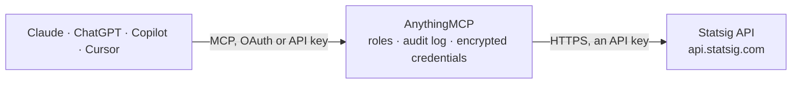

<!-- Generated by scripts/export-github-catalog.mjs in the anythingmcp-website repository. Do not edit by hand. -->

# Statsig MCP connector

Drive Statsig (feature flags + experiments + analytics) from any AI agent: evaluate gates/dynamic configs/experiments, log events, manage console-side gates and experiments. 10 tools, server-secret-key auth. The AnythingMCP connector gives Claude, ChatGPT, Microsoft Copilot, Cursor and Gemini 10 MCP tools for Statsig: 6 read and 4 can change data.

**Category:** [Analytics](../analytics.md) · **Tools:** 10 · **Setup guide:** [anythingmcp.com](https://anythingmcp.com/guides/statsig-to-mcp) · [Deutsch](https://anythingmcp.com/de/guides/statsig-to-mcp) · [Italiano](https://anythingmcp.com/it/guides/statsig-to-mcp) · [Español](https://anythingmcp.com/es/guides/statsig-to-mcp) · [日本語](https://anythingmcp.com/ja/guides/statsig-to-mcp) · [Русский](https://anythingmcp.com/ru/guides/statsig-to-mcp) · [中文](https://anythingmcp.com/zh/guides/statsig-to-mcp)

## Start without code

No installation and no terminal: AnythingMCP Cloud runs the Statsig connector for you, operated by helpcode.ai in Frankfurt, Germany.

1. **Click the button above** and create an account or sign in. The Statsig connector opens, ready to install.
2. **Paste the API key or token from your Statsig account.** Every click is in the [step-by-step guide](https://anythingmcp.com/guides/statsig-to-mcp).
3. **Click Install.** AnythingMCP shows the address of your MCP server.
4. **Add that address to your assistant:** [Claude](https://anythingmcp.com/guides/connect-statsig-to-claude) · [ChatGPT](https://anythingmcp.com/guides/connect-statsig-to-chatgpt) · [Microsoft Copilot](https://anythingmcp.com/guides/connect-statsig-to-copilot) · [Cursor](https://anythingmcp.com/guides/connect-statsig-to-cursor) · [Gemini CLI](https://anythingmcp.com/guides/connect-statsig-to-gemini) · [Meta Muse](https://anythingmcp.com/guides/connect-statsig-to-muse).
5. **Ask your first question**, for example: *For user user_4821, is the feature gate reco_ui_v2 ON right now?*

Prefer help with the setup? [Talk to us](https://anythingmcp.com/contact).

## How it works

- **The AI client** speaks MCP (Streamable HTTP) to AnythingMCP and only sees tool names, descriptions and results. It never gets the Statsig credentials.
- **AnythingMCP** checks the client's role, builds the call from the tool definition, adds the credentials (an API key), calls Statsig, logs the call and returns the result.
- **Statsig** sees an ordinary API client with the rights of the account the credentials belong to.

## Tools

| Tool | What it does | Access |
|---|---|---|
| [`statsig_check_gate`](#statsig_check_gate) | Evaluate a feature gate (boolean flag) for a user. | write |
| [`statsig_get_config`](#statsig_get_config) | Evaluate a Dynamic Config for a user. | read |
| [`statsig_get_experiment`](#statsig_get_experiment) | Evaluate an experiment for a user. | read |
| [`statsig_initialize`](#statsig_initialize) | Bulk evaluate ALL gates/configs/experiments for a user in one call. | write |
| [`statsig_log_event`](#statsig_log_event) | Log a custom event for analytics + experiment exposure tracking. | write |
| [`statsig_list_gates`](#statsig_list_gates) | Console: list feature gates defined in the project. | read |
| [`statsig_get_gate_config`](#statsig_get_gate_config) | Console: fetch a gate's definition (rules, targeting). | read |
| [`statsig_create_gate`](#statsig_create_gate) | Console: create a new feature gate. | write |
| [`statsig_list_experiments`](#statsig_list_experiments) | Console: list experiments. | read |
| [`statsig_get_experiment_results`](#statsig_get_experiment_results) | Console: fetch experiment metric results (pulse readout). | read |

## Tool reference

Every parameter as the AI client sees it in `tools/list`. Source: [`packages/backend/src/adapters/intl/statsig.json`](../../../packages/backend/src/adapters/intl/statsig.json).

### `statsig_check_gate`

Evaluate a feature gate (boolean flag) for a user. Returns {name, value:bool, rule_id, group_name, secondary_exposures}.

**Access:** write · **Call:** `POST /check_gate`

| Parameter | Type | Required | Description |
|---|---|---|---|
| `user` | object | yes | {userID, email?, country?, ip?, userAgent?, appVersion?, custom?:{}, customIDs?:{}, privateAttributes?:{}}. |
| `gateName` | string | yes | Gate name (case-sensitive). |

### `statsig_get_config`

Evaluate a Dynamic Config for a user. Returns {name, value:{...}, rule_id, group_name}.

**Access:** read · **Call:** `POST /get_config`

| Parameter | Type | Required | Description |
|---|---|---|---|
| `user` | object | yes | User object. |
| `configName` | string | yes | Dynamic Config name. |

### `statsig_get_experiment`

Evaluate an experiment for a user. Returns variant assignment + dynamic-config-like value object.

**Access:** read · **Call:** `POST /get_experiment`

| Parameter | Type | Required | Description |
|---|---|---|---|
| `user` | object | yes | User object. |
| `experimentName` | string | yes | Experiment name. |

### `statsig_initialize`

Bulk evaluate ALL gates/configs/experiments for a user in one call. Returns the complete state — useful for client bootstrap.

**Access:** write · **Call:** `POST /initialize`

| Parameter | Type | Required | Description |
|---|---|---|---|
| `user` | object | yes | User object. |
| `statsigMetadata` | object | no | {sdkType?, sdkVersion?, sessionID?} — optional SDK metadata. |

### `statsig_log_event`

Log a custom event for analytics + experiment exposure tracking. Events are async — Statsig buffers them.

**Access:** write · **Call:** `POST /log_event`

| Parameter | Type | Required | Description |
|---|---|---|---|
| `events` | any[] | yes | [{user, eventName, value?, metadata?, time? (Unix ms)}]. Batch many at once. |

### `statsig_list_gates`

Console: list feature gates defined in the project. Requires CONSOLE API key (set STATSIG_CONSOLE_API_KEY).

**Access:** read · **Call:** `GET https://statsigapi.net/console/v1/gates`

| Parameter | Type | Required | Description |
|---|---|---|---|
| `page` | integer | no | Page. |
| `limit` | integer | no | Per page. |

### `statsig_get_gate_config`

Console: fetch a gate's definition (rules, targeting). Requires CONSOLE key.

**Access:** read · **Call:** `GET https://statsigapi.net/console/v1/gates/{gateName}`

| Parameter | Type | Required | Description |
|---|---|---|---|
| `gateName` | string | yes | Gate name. |

### `statsig_create_gate`

Console: create a new feature gate. Requires CONSOLE key.

**Access:** write · **Call:** `POST https://statsigapi.net/console/v1/gates`

| Parameter | Type | Required | Description |
|---|---|---|---|
| `name` | string | yes | Gate name (unique). |
| `description` | string | no | Description. |
| `idType` | string | no | userID, stableID, or custom name. |
| `rules` | any[] | no | Targeting rules: [{name, conditions:[{type,operator,targetValue,field?}], passPercentage:0-100, returnValue?:bool}]. |

### `statsig_list_experiments`

Console: list experiments. Requires CONSOLE key.

**Access:** read · **Call:** `GET https://statsigapi.net/console/v1/experiments`

| Parameter | Type | Required | Description |
|---|---|---|---|
| `page` | integer | no | Page. |
| `limit` | integer | no | Per page. |

### `statsig_get_experiment_results`

Console: fetch experiment metric results (pulse readout). Requires CONSOLE key.

**Access:** read · **Call:** `GET https://statsigapi.net/console/v1/experiments/{experimentName}/results`

| Parameter | Type | Required | Description |
|---|---|---|---|
| `experimentName` | string | yes | Experiment name. |

## Run it yourself

AnythingMCP is open source (AGPL-3.0). [Run it with Docker](../../../README.md#run-it-yourself), open **Connectors → Store**, pick **Statsig** and enter `STATSIG_SERVER_SECRET_KEY`, then add your MCP server URL to the AI client.

[← Analytics connectors](../analytics.md) · [All categories](../README.md)
