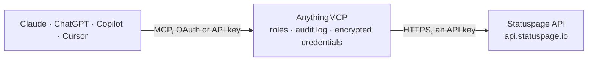

<!-- Generated by scripts/export-github-catalog.mjs in the anythingmcp-website repository. Do not edit by hand. -->

# Statuspage MCP connector

Atlassian Statuspage management API: status pages, components and groups with uptime, incidents and scheduled maintenances with their updates, incident templates, subscribers and system metrics. The AnythingMCP connector gives Claude, ChatGPT, Microsoft Copilot, Cursor and Gemini 38 MCP tools for Statuspage: 25 read and 13 can change data.

**Category:** [Monitoring](../monitoring.md) · **Tools:** 38 · **Setup guide:** [anythingmcp.com](https://anythingmcp.com/guides/statuspage-to-mcp) · [Deutsch](https://anythingmcp.com/de/guides/statuspage-to-mcp) · [Italiano](https://anythingmcp.com/it/guides/statuspage-to-mcp) · [Español](https://anythingmcp.com/es/guides/statuspage-to-mcp) · [日本語](https://anythingmcp.com/ja/guides/statuspage-to-mcp) · [Русский](https://anythingmcp.com/ru/guides/statuspage-to-mcp) · [中文](https://anythingmcp.com/zh/guides/statuspage-to-mcp)

## Start without code

No installation and no terminal: AnythingMCP Cloud runs the Statuspage connector for you, operated by helpcode.ai in Frankfurt, Germany.

1. **Click the button above** and create an account or sign in. The Statuspage connector opens, ready to install.
2. **Paste the API key or token from your Statuspage account.** Every click is in the [step-by-step guide](https://anythingmcp.com/guides/statuspage-to-mcp).
3. **Click Install.** AnythingMCP shows the address of your MCP server.
4. **Add that address to your assistant:** [Claude](https://anythingmcp.com/guides/connect-statuspage-to-claude) · [ChatGPT](https://anythingmcp.com/guides/connect-statuspage-to-chatgpt) · [Microsoft Copilot](https://anythingmcp.com/guides/connect-statuspage-to-copilot) · [Cursor](https://anythingmcp.com/guides/connect-statuspage-to-cursor) · [Gemini CLI](https://anythingmcp.com/guides/connect-statuspage-to-gemini) · [Meta Muse](https://anythingmcp.com/guides/connect-statuspage-to-muse).
5. **Ask your first question**, for example: *Which unresolved incident is affecting the API Service on cloudforge.statuspage.io right now?*

Prefer help with the setup? [Talk to us](https://anythingmcp.com/contact).

## How it works

- **The AI client** speaks MCP (Streamable HTTP) to AnythingMCP and only sees tool names, descriptions and results. It never gets the Statuspage credentials.
- **AnythingMCP** checks the client's role, builds the call from the tool definition, adds the credentials (an API key), calls Statuspage, logs the call and returns the result.
- **Statuspage** sees an ordinary API client with the rights of the account the credentials belong to.

## Tools

| Tool | What it does | Access |
|---|---|---|
| [`statuspage_list_pages`](#statuspage_list_pages) | List the status pages this API key can manage: id, name, subdomain and custom domain, public URL, time zone and which subscription types are allowed. | read |
| [`statuspage_get_page`](#statuspage_get_page) | Get one status page with its settings: name, headline, description, URL and domain, support URL, time zone, notification sender and the allowed subscriber… | read |
| [`statuspage_list_components`](#statuspage_list_components) | List the components of a page (the services shown on it) with id, name, description, current status, group id, position and start date. | read |
| [`statuspage_get_component`](#statuspage_get_component) | Get one component: name, description, current status (operational, under_maintenance, degraded_performance, partial_outage, major_outage), group, position,… | read |
| [`statuspage_create_component`](#statuspage_create_component) | Create a component on a page, optionally inside a group, with its initial status. | write |
| [`statuspage_update_component`](#statuspage_update_component) | Change a component: set its status (e.g. major_outage or back to operational) without opening an incident, or rename it, move it to another group or change… | write |
| [`statuspage_get_component_uptime`](#statuspage_get_component_uptime) | Get the uptime of one component over a date window: uptime percentage, major and partial outage seconds, and the related events (outages and incidents)… | read |
| [`statuspage_list_component_groups`](#statuspage_list_component_groups) | List the component groups of a page: id, name, description, position and the ids of the components in each group. | read |
| [`statuspage_get_component_group`](#statuspage_get_component_group) | Get one component group with its name, description, position and the ids of its components. | read |
| [`statuspage_create_component_group`](#statuspage_create_component_group) | Create a component group on a page from a name and the ids of the components it should contain. | write |
| [`statuspage_update_component_group`](#statuspage_update_component_group) | Rename a component group, change its description or replace the list of components it contains (the API needs the name and the full component list on every… | write |
| [`statuspage_get_component_group_uptime`](#statuspage_get_component_group_uptime) | Get the uptime of a component group over a date window: uptime percentage, outage seconds and related events, summed over its components. | read |
| [`statuspage_list_incidents`](#statuspage_list_incidents) | List or search a page's incidents and maintenances, newest first: id, name, status, impact, affected components, all updates with their text, scheduled… | read |
| [`statuspage_list_unresolved_incidents`](#statuspage_list_unresolved_incidents) | List the page's open incidents (investigating, identified or monitoring): what is currently shown as an ongoing problem. | read |
| [`statuspage_list_upcoming_incidents`](#statuspage_list_upcoming_incidents) | List the page's upcoming scheduled maintenances: planned and not started yet, with their scheduled window. | read |
| [`statuspage_list_active_maintenances`](#statuspage_list_active_maintenances) | List the scheduled maintenances that are in progress or being verified right now. | read |
| [`statuspage_list_scheduled_incidents`](#statuspage_list_scheduled_incidents) | List all scheduled maintenances of the page (upcoming, in progress and completed), with their windows and updates. | read |
| [`statuspage_get_incident`](#statuspage_get_incident) | Get one incident or maintenance with every update (id, status, body, display time, affected components), its impact, components, scheduled window,… | read |
| [`statuspage_create_incident`](#statuspage_create_incident) | Open a realtime incident on the public page: a name, a first message, its status (investigating by default) and the components affected, with their new status. | write |
| [`statuspage_create_scheduled_maintenance`](#statuspage_create_scheduled_maintenance) | Announce a scheduled maintenance: name, message, window (scheduled_for to scheduled_until) and affected components, with optional reminders and automatic… | write |
| [`statuspage_update_incident`](#statuspage_update_incident) | Post an update on an incident or maintenance: a new status (identified, monitoring, resolved; in_progress, verifying, completed for maintenances) with a… | write |
| [`statuspage_edit_incident_update`](#statuspage_edit_incident_update) | Correct a previous update of an incident: change its text or the time it is displayed at. | write |
| [`statuspage_delete_incident`](#statuspage_delete_incident) | Delete an incident or maintenance and all its updates from the page and its history. | write |
| [`statuspage_get_postmortem`](#statuspage_get_postmortem) | Get the postmortem of an incident: draft or published body, publish time and whether subscribers and Twitter were notified. | read |
| [`statuspage_list_incident_templates`](#statuspage_list_incident_templates) | List the incident and maintenance templates of a page: name, title, body, status to apply, affected components and the default notification and tweet choices. | read |
| [`statuspage_create_incident_template`](#statuspage_create_incident_template) | Create an incident or maintenance template with a name, title and message, the status to apply and the components it affects. | write |
| [`statuspage_list_subscribers`](#statuspage_list_subscribers) | List or search the page's subscribers: id, mode (email, sms, webhook, slack, teams), contact, the components they follow, quarantine state and creation time. | read |
| [`statuspage_get_subscriber`](#statuspage_get_subscriber) | Get one subscriber: mode, email, endpoint or phone number, the components they follow, quarantine and purge dates and creation time. | read |
| [`statuspage_count_subscribers`](#statuspage_count_subscribers) | Count the page's subscribers, optionally only of one type or state. | read |
| [`statuspage_get_subscriber_histogram`](#statuspage_get_subscriber_histogram) | Get the number of subscribers per type (email, sms, webhook, slack, teams) and state (active, unconfirmed, quarantined) in one call. | read |
| [`statuspage_list_unsubscribed_subscribers`](#statuspage_list_unsubscribed_subscribers) | List the subscribers who unsubscribed from the page, with their contact and when they left. | read |
| [`statuspage_list_incident_subscribers`](#statuspage_list_incident_subscribers) | List the people subscribed to one incident only (not to the whole page). | read |
| [`statuspage_create_subscriber`](#statuspage_create_subscriber) | Subscribe someone to the page by email, SMS (phone_number and phone_country) or webhook (endpoint and email), for the whole page or only some components. | write |
| [`statuspage_unsubscribe_subscriber`](#statuspage_unsubscribe_subscriber) | Unsubscribe a subscriber from the page. | write |
| [`statuspage_list_metrics`](#statuspage_list_metrics) | List the system metrics shown on the page (response time, error rate and so on): id, name, suffix, y-axis bounds, decimal places, display flag and the… | read |
| [`statuspage_get_metric`](#statuspage_get_metric) | Get one metric's settings: name, suffix, tooltip, y-axis range, decimals, display flag, most recent data time and provider. | read |
| [`statuspage_add_metric_data`](#statuspage_add_metric_data) | Add one data point to a custom metric (one whose data you submit yourself): a value at a Unix timestamp. | write |
| [`statuspage_list_metrics_providers`](#statuspage_list_metrics_providers) | List the metric providers connected to the page (Datadog, New Relic, Pingdom, Librato or self-submitted): id, type, state and when it last fetched data. | read |

## Tool reference

Every parameter as the AI client sees it in `tools/list`. Source: [`packages/backend/src/adapters/intl/statuspage.json`](../../../packages/backend/src/adapters/intl/statuspage.json).

### `statuspage_list_pages`

List the status pages this API key can manage: id, name, subdomain and custom domain, public URL, time zone and which subscription types are allowed. Start here to get the `page_id` every other tool needs.

**Access:** read · **Call:** `GET /pages`

No parameters.

### `statuspage_get_page`

Get one status page with its settings: name, headline, description, URL and domain, support URL, time zone, notification sender and the allowed subscriber types (email, SMS, webhook, RSS).

**Access:** read · **Call:** `GET /pages/{page_id}`

| Parameter | Type | Required | Description |
|---|---|---|---|
| `page_id` | string | yes | Page id (12 characters, e.g. `gytm4qzbx9t6`), from `statuspage_list_pages` (`id`). |

### `statuspage_list_components`

List the components of a page (the services shown on it) with id, name, description, current status, group id, position and start date. Group headers appear here too, with `group: true`.

**Access:** read · **Call:** `GET /pages/{page_id}/components`

| Parameter | Type | Required | Description |
|---|---|---|---|
| `page_id` | string | yes | Page id (12 characters, e.g. `gytm4qzbx9t6`), from `statuspage_list_pages` (`id`). |
| `page` | integer | no | Page number of the result list, starting at 1. |
| `per_page` | integer | no | Results per page, up to 100 (the default and maximum). |

### `statuspage_get_component`

Get one component: name, description, current status (operational, under_maintenance, degraded_performance, partial_outage, major_outage), group, position, showcase flag and start date.

**Access:** read · **Call:** `GET /pages/{page_id}/components/{component_id}`

| Parameter | Type | Required | Description |
|---|---|---|---|
| `page_id` | string | yes | Page id (12 characters, e.g. `gytm4qzbx9t6`), from `statuspage_list_pages` (`id`). |
| `component_id` | string | yes | Component id, from `statuspage_list_components`. |

### `statuspage_create_component`

Create a component on a page, optionally inside a group, with its initial status. The component appears on the public page.

**Access:** write · **Call:** `POST /pages/{page_id}/components`

| Parameter | Type | Required | Description |
|---|---|---|---|
| `page_id` | string | yes | Page id (12 characters, e.g. `gytm4qzbx9t6`), from `statuspage_list_pages` (`id`). |
| `name` | string | yes | Display name of the component. |
| `description` | string | no | Longer description shown on the page. |
| `status` | `operational` \| `under_maintenance` \| `degraded_performance` \| `partial_outage` \| `major_outage` | no | Current status of the component. |
| `group_id` | string | no | Id of the component group to place it in, from `statuspage_list_component_groups`. |
| `showcase` | boolean | no | Show the component on the page's main list (with its uptime bar when enabled). |
| `only_show_if_degraded` | boolean | no | Hide the component while it is operational (needs a feature enabled by Statuspage). |
| `start_date` | string | no | Date the component started being used, YYYY-MM-DD; uptime is counted from it. |

### `statuspage_update_component`

Change a component: set its status (e.g. major_outage or back to operational) without opening an incident, or rename it, move it to another group or change its description. A status change is visible on the public page at once.

**Access:** write · **Call:** `PATCH /pages/{page_id}/components/{component_id}`

| Parameter | Type | Required | Description |
|---|---|---|---|
| `page_id` | string | yes | Page id (12 characters, e.g. `gytm4qzbx9t6`), from `statuspage_list_pages` (`id`). |
| `component_id` | string | yes | Component id, from `statuspage_list_components`. |
| `name` | string | no | Display name of the component. |
| `description` | string | no | Longer description shown on the page. |
| `status` | `operational` \| `under_maintenance` \| `degraded_performance` \| `partial_outage` \| `major_outage` | no | Current status of the component. |
| `group_id` | string | no | Id of the component group to place it in, from `statuspage_list_component_groups`. |
| `showcase` | boolean | no | Show the component on the page's main list (with its uptime bar when enabled). |
| `only_show_if_degraded` | boolean | no | Hide the component while it is operational (needs a feature enabled by Statuspage). |
| `start_date` | string | no | Date the component started being used, YYYY-MM-DD; uptime is counted from it. |

### `statuspage_get_component_uptime`

Get the uptime of one component over a date window: uptime percentage, major and partial outage seconds, and the related events (outages and incidents) unless skipped. Needs the component's uptime display enabled.

**Access:** read · **Call:** `GET /pages/{page_id}/components/{component_id}/uptime`

| Parameter | Type | Required | Description |
|---|---|---|---|
| `page_id` | string | yes | Page id (12 characters, e.g. `gytm4qzbx9t6`), from `statuspage_list_pages` (`id`). |
| `component_id` | string | yes | Component id, from `statuspage_list_components`. |
| `start` | string | no | First day of the window, YYYY-MM-DD (or YYYY-MM, or YYYY). Default 90 days ago or the start date, whichever is later. At most six calendar months per call. |
| `end` | string | no | Last day of the window, YYYY-MM-DD (or YYYY-MM, or YYYY). Default today in the page's time zone. |
| `skip_related_events` | boolean | no | Leave out the list of outages and related incidents, returning only the percentages. |

### `statuspage_list_component_groups`

List the component groups of a page: id, name, description, position and the ids of the components in each group.

**Access:** read · **Call:** `GET /pages/{page_id}/component-groups`

| Parameter | Type | Required | Description |
|---|---|---|---|
| `page_id` | string | yes | Page id (12 characters, e.g. `gytm4qzbx9t6`), from `statuspage_list_pages` (`id`). |
| `page` | integer | no | Page number of the result list, starting at 1. |
| `per_page` | integer | no | Results per page, up to 100 (the default and maximum). |

### `statuspage_get_component_group`

Get one component group with its name, description, position and the ids of its components.

**Access:** read · **Call:** `GET /pages/{page_id}/component-groups/{group_id}`

| Parameter | Type | Required | Description |
|---|---|---|---|
| `page_id` | string | yes | Page id (12 characters, e.g. `gytm4qzbx9t6`), from `statuspage_list_pages` (`id`). |
| `group_id` | string | yes | Component group id, from `statuspage_list_component_groups`. |

### `statuspage_create_component_group`

Create a component group on a page from a name and the ids of the components it should contain.

**Access:** write · **Call:** `POST /pages/{page_id}/component-groups`

| Parameter | Type | Required | Description |
|---|---|---|---|
| `page_id` | string | yes | Page id (12 characters, e.g. `gytm4qzbx9t6`), from `statuspage_list_pages` (`id`). |
| `name` | string | yes | Display name of the group. |
| `components` | string[] | yes | Ids of the components that belong to the group, from `statuspage_list_components`. Replaces the current list on update. |
| `description` | string | no | Description of the group. |

### `statuspage_update_component_group`

Rename a component group, change its description or replace the list of components it contains (the API needs the name and the full component list on every update).

**Access:** write · **Call:** `PATCH /pages/{page_id}/component-groups/{group_id}`

| Parameter | Type | Required | Description |
|---|---|---|---|
| `page_id` | string | yes | Page id (12 characters, e.g. `gytm4qzbx9t6`), from `statuspage_list_pages` (`id`). |
| `group_id` | string | yes | Component group id, from `statuspage_list_component_groups`. |
| `name` | string | yes | Display name of the group. |
| `components` | string[] | yes | Ids of the components that belong to the group, from `statuspage_list_components`. Replaces the current list on update. |
| `description` | string | no | Description of the group. |

### `statuspage_get_component_group_uptime`

Get the uptime of a component group over a date window: uptime percentage, outage seconds and related events, summed over its components.

**Access:** read · **Call:** `GET /pages/{page_id}/component-groups/{group_id}/uptime`

| Parameter | Type | Required | Description |
|---|---|---|---|
| `page_id` | string | yes | Page id (12 characters, e.g. `gytm4qzbx9t6`), from `statuspage_list_pages` (`id`). |
| `group_id` | string | yes | Component group id, from `statuspage_list_component_groups`. |
| `start` | string | no | First day of the window, YYYY-MM-DD (or YYYY-MM, or YYYY). Default 90 days ago or the start date, whichever is later. At most six calendar months per call. |
| `end` | string | no | Last day of the window, YYYY-MM-DD (or YYYY-MM, or YYYY). Default today in the page's time zone. |
| `skip_related_events` | boolean | no | Leave out the list of outages and related incidents, returning only the percentages. |

### `statuspage_list_incidents`

List or search a page's incidents and maintenances, newest first: id, name, status, impact, affected components, all updates with their text, scheduled window, resolved time and shortlink. `q` searches names, statuses, postmortems and update texts.

**Access:** read · **Call:** `GET /pages/{page_id}/incidents`

| Parameter | Type | Required | Description |
|---|---|---|---|
| `page_id` | string | yes | Page id (12 characters, e.g. `gytm4qzbx9t6`), from `statuspage_list_pages` (`id`). |
| `q` | string | no | Text to search for in the incident name, status, postmortem and update texts. |
| `limit` | integer | no | Results per page, up to 100 (the default and maximum). |
| `page` | integer | no | Page number of the result list, starting at 1. |

### `statuspage_list_unresolved_incidents`

List the page's open incidents (investigating, identified or monitoring): what is currently shown as an ongoing problem.

**Access:** read · **Call:** `GET /pages/{page_id}/incidents/unresolved`

| Parameter | Type | Required | Description |
|---|---|---|---|
| `page_id` | string | yes | Page id (12 characters, e.g. `gytm4qzbx9t6`), from `statuspage_list_pages` (`id`). |
| `page` | integer | no | Page number of the result list, starting at 1. |
| `per_page` | integer | no | Results per page, up to 100 (the default and maximum). |

### `statuspage_list_upcoming_incidents`

List the page's upcoming scheduled maintenances: planned and not started yet, with their scheduled window.

**Access:** read · **Call:** `GET /pages/{page_id}/incidents/upcoming`

| Parameter | Type | Required | Description |
|---|---|---|---|
| `page_id` | string | yes | Page id (12 characters, e.g. `gytm4qzbx9t6`), from `statuspage_list_pages` (`id`). |
| `page` | integer | no | Page number of the result list, starting at 1. |
| `per_page` | integer | no | Results per page, up to 100 (the default and maximum). |

### `statuspage_list_active_maintenances`

List the scheduled maintenances that are in progress or being verified right now.

**Access:** read · **Call:** `GET /pages/{page_id}/incidents/active_maintenance`

| Parameter | Type | Required | Description |
|---|---|---|---|
| `page_id` | string | yes | Page id (12 characters, e.g. `gytm4qzbx9t6`), from `statuspage_list_pages` (`id`). |
| `page` | integer | no | Page number of the result list, starting at 1. |
| `per_page` | integer | no | Results per page, up to 100 (the default and maximum). |

### `statuspage_list_scheduled_incidents`

List all scheduled maintenances of the page (upcoming, in progress and completed), with their windows and updates.

**Access:** read · **Call:** `GET /pages/{page_id}/incidents/scheduled`

| Parameter | Type | Required | Description |
|---|---|---|---|
| `page_id` | string | yes | Page id (12 characters, e.g. `gytm4qzbx9t6`), from `statuspage_list_pages` (`id`). |
| `page` | integer | no | Page number of the result list, starting at 1. |
| `per_page` | integer | no | Results per page, up to 100 (the default and maximum). |

### `statuspage_get_incident`

Get one incident or maintenance with every update (id, status, body, display time, affected components), its impact, components, scheduled window, postmortem state and shortlink.

**Access:** read · **Call:** `GET /pages/{page_id}/incidents/{incident_id}`

| Parameter | Type | Required | Description |
|---|---|---|---|
| `page_id` | string | yes | Page id (12 characters, e.g. `gytm4qzbx9t6`), from `statuspage_list_pages` (`id`). |
| `incident_id` | string | yes | Incident id, from `statuspage_list_incidents` or one of the other incident lists. |

### `statuspage_create_incident`

Open a realtime incident on the public page: a name, a first message, its status (investigating by default) and the components affected, with their new status. Subscribers are notified unless deliver_notifications is false.

**Access:** write · **Call:** `POST /pages/{page_id}/incidents`

| Parameter | Type | Required | Description |
|---|---|---|---|
| `page_id` | string | yes | Page id (12 characters, e.g. `gytm4qzbx9t6`), from `statuspage_list_pages` (`id`). |
| `name` | string | yes | Incident title shown on the page, up to 255 characters. |
| `status` | `investigating` \| `identified` \| `monitoring` \| `resolved` | no | Starting status (default investigating). |
| `body` | string | no | First update shown under the incident, up to 25000 characters. |
| `impact_override` | `none` \| `maintenance` \| `minor` \| `major` \| `critical` | no | Impact to show instead of the one computed from the component statuses. |
| `components` | object | no | Component statuses to set with this change, as a map of component id to status, e.g. {"8kbf7d35c070": "major_outage"}. Values: operational, under_maintenance, degraded_performance, partial_outage, major_outage. Component ids from `statuspage_list_components`. |
| `component_ids` | string[] | no | Ids of the components affected by the incident (listed on it). Use `components` to also change their status. |
| `deliver_notifications` | boolean | no | Notify the page's subscribers (email, SMS, webhooks, Slack) about this change. Default true; set false to change the page quietly. |
| `metadata` | object | no | Your own data attached to the incident; every top-level value must itself be an object, e.g. {"jira": {"issue": "OPS-12"}}. |

### `statuspage_create_scheduled_maintenance`

Announce a scheduled maintenance: name, message, window (scheduled_for to scheduled_until) and affected components, with optional reminders and automatic start and completion that move the components to under_maintenance and back.

**Access:** write · **Call:** `POST /pages/{page_id}/incidents`

| Parameter | Type | Required | Description |
|---|---|---|---|
| `page_id` | string | yes | Page id (12 characters, e.g. `gytm4qzbx9t6`), from `statuspage_list_pages` (`id`). |
| `name` | string | yes | Maintenance title shown on the page, up to 255 characters. |
| `body` | string | no | Description of the maintenance, the first update. |
| `scheduled_for` | string | yes | Start of the window, ISO 8601 with time zone, e.g. 2026-11-05T22:00:00Z. |
| `scheduled_until` | string | yes | End of the window, ISO 8601 with time zone. |
| `component_ids` | string[] | no | Ids of the components under maintenance, from `statuspage_list_components`. |
| `components` | object | no | Component statuses to set with this change, as a map of component id to status, e.g. {"8kbf7d35c070": "major_outage"}. Values: operational, under_maintenance, degraded_performance, partial_outage, major_outage. Component ids from `statuspage_list_components`. |
| `scheduled_remind_prior` | boolean | no | Remind subscribers before the maintenance starts. |
| `scheduled_auto_in_progress` | boolean | no | Switch the maintenance to in_progress automatically at scheduled_for. |
| `scheduled_auto_completed` | boolean | no | Switch the maintenance to completed automatically at scheduled_until. |
| `auto_transition_to_maintenance_state` | boolean | no | Set the affected components to under_maintenance when it starts. |
| `auto_transition_to_operational_state` | boolean | no | Set the affected components back to operational when it completes. |
| `auto_transition_deliver_notifications_at_start` | boolean | no | Notify subscribers when the automatic start happens. |
| `auto_transition_deliver_notifications_at_end` | boolean | no | Notify subscribers when the automatic completion happens. |
| `deliver_notifications` | boolean | no | Notify the page's subscribers (email, SMS, webhooks, Slack) about this change. Default true; set false to change the page quietly. |

### `statuspage_update_incident`

Post an update on an incident or maintenance: a new status (identified, monitoring, resolved; in_progress, verifying, completed for maintenances) with a message in `body`, and component status changes. Can also rename it, change its impact or reschedule a maintenance.

**Access:** write · **Call:** `PATCH /pages/{page_id}/incidents/{incident_id}`

| Parameter | Type | Required | Description |
|---|---|---|---|
| `page_id` | string | yes | Page id (12 characters, e.g. `gytm4qzbx9t6`), from `statuspage_list_pages` (`id`). |
| `incident_id` | string | yes | Incident id, from `statuspage_list_incidents` or one of the other incident lists. |
| `status` | `investigating` \| `identified` \| `monitoring` \| `resolved` \| `scheduled` \| `in_progress` \| `verifying` \| `completed` | no | New status. Realtime incidents: investigating, identified, monitoring, resolved. Maintenances: scheduled, in_progress, verifying, completed. |
| `body` | string | no | Text of the new update shown under the incident, up to 25000 characters. |
| `name` | string | no | New title of the incident. |
| `impact_override` | `none` \| `maintenance` \| `minor` \| `major` \| `critical` | no | Impact to show instead of the computed one. |
| `components` | object | no | Component statuses to set with this change, as a map of component id to status, e.g. {"8kbf7d35c070": "major_outage"}. Values: operational, under_maintenance, degraded_performance, partial_outage, major_outage. Component ids from `statuspage_list_components`. |
| `component_ids` | string[] | no | Ids of the components affected by the incident (listed on it). Use `components` to also change their status. |
| `scheduled_for` | string | no | New start of a maintenance window, ISO 8601. |
| `scheduled_until` | string | no | New end of a maintenance window, ISO 8601. |
| `deliver_notifications` | boolean | no | Notify the page's subscribers (email, SMS, webhooks, Slack) about this change. Default true; set false to change the page quietly. |

### `statuspage_edit_incident_update`

Correct a previous update of an incident: change its text or the time it is displayed at. Does not change the incident's status.

**Access:** write · **Call:** `PATCH /pages/{page_id}/incidents/{incident_id}/incident_updates/{incident_update_id}`

| Parameter | Type | Required | Description |
|---|---|---|---|
| `page_id` | string | yes | Page id (12 characters, e.g. `gytm4qzbx9t6`), from `statuspage_list_pages` (`id`). |
| `incident_id` | string | yes | Incident id, from `statuspage_list_incidents` or one of the other incident lists. |
| `incident_update_id` | string | yes | Update id, from `incident_updates[].id` in `statuspage_get_incident`. |
| `body` | string | no | Corrected text of the update. |
| `display_at` | string | no | Time the update is shown as posted, ISO 8601. |
| `deliver_notifications` | boolean | no | Send the corrected update to subscribers again. |
| `wants_twitter_update` | boolean | no | Also post the change to the connected Twitter (X) account. |

### `statuspage_delete_incident`

Delete an incident or maintenance and all its updates from the page and its history. Cannot be undone; resolve the incident instead unless it was opened by mistake. Switched off by default.

**Access:** write · **Call:** `DELETE /pages/{page_id}/incidents/{incident_id}`

| Parameter | Type | Required | Description |
|---|---|---|---|
| `page_id` | string | yes | Page id (12 characters, e.g. `gytm4qzbx9t6`), from `statuspage_list_pages` (`id`). |
| `incident_id` | string | yes | Incident id, from `statuspage_list_incidents` or one of the other incident lists. |

### `statuspage_get_postmortem`

Get the postmortem of an incident: draft or published body, publish time and whether subscribers and Twitter were notified.

**Access:** read · **Call:** `GET /pages/{page_id}/incidents/{incident_id}/postmortem`

| Parameter | Type | Required | Description |
|---|---|---|---|
| `page_id` | string | yes | Page id (12 characters, e.g. `gytm4qzbx9t6`), from `statuspage_list_pages` (`id`). |
| `incident_id` | string | yes | Incident id, from `statuspage_list_incidents` or one of the other incident lists. |

### `statuspage_list_incident_templates`

List the incident and maintenance templates of a page: name, title, body, status to apply, affected components and the default notification and tweet choices. Use one to fill `statuspage_create_incident` with consistent wording.

**Access:** read · **Call:** `GET /pages/{page_id}/incident_templates`

| Parameter | Type | Required | Description |
|---|---|---|---|
| `page_id` | string | yes | Page id (12 characters, e.g. `gytm4qzbx9t6`), from `statuspage_list_pages` (`id`). |
| `page` | integer | no | Page number of the result list, starting at 1. |
| `per_page` | integer | no | Results per page, up to 100 (the default and maximum). |

### `statuspage_create_incident_template`

Create an incident or maintenance template with a name, title and message, the status to apply and the components it affects.

**Access:** write · **Call:** `POST /pages/{page_id}/incident_templates`

| Parameter | Type | Required | Description |
|---|---|---|---|
| `page_id` | string | yes | Page id (12 characters, e.g. `gytm4qzbx9t6`), from `statuspage_list_pages` (`id`). |
| `name` | string | yes | Template name, as shown in the Templates list. |
| `title` | string | yes | Incident or maintenance title the template fills in. |
| `body` | string | yes | Message the template fills in as the first update. |
| `update_status` | `investigating` \| `identified` \| `monitoring` \| `resolved` \| `scheduled` \| `in_progress` \| `verifying` \| `completed` | no | Status the incident moves to when the template is used. |
| `group_id` | string | no | Id of the template group it belongs to. |
| `component_ids` | string[] | no | Ids of the components the template marks as affected. |
| `should_send_notifications` | boolean | no | Tick deliver notifications by default when the template is used. |
| `should_tweet` | boolean | no | Tick tweet update by default when the template is used. |

### `statuspage_list_subscribers`

List or search the page's subscribers: id, mode (email, sms, webhook, slack, teams), contact, the components they follow, quarantine state and creation time. Contact details are personal data; only fetch them when needed.

**Access:** read · **Call:** `GET /pages/{page_id}/subscribers`

| Parameter | Type | Required | Description |
|---|---|---|---|
| `page_id` | string | yes | Page id (12 characters, e.g. `gytm4qzbx9t6`), from `statuspage_list_pages` (`id`). |
| `q` | string | no | Search the email address, webhook endpoint or phone number (not Slack subscribers). |
| `type` | `email` \| `sms` \| `webhook` \| `slack` \| `teams` \| `integration_partner` | no | Only subscribers of this type. |
| `state` | `active` \| `unconfirmed` \| `quarantined` \| `all` | no | Only subscribers in this state (default active); all for every state. |
| `limit` | integer | no | Results per page. With `q` at most 100; without `q` there is no limit, so set one (e.g. 100) on large pages. |
| `page` | integer | no | Page offset, starting at 0 (not 1): skips page x limit subscribers. |
| `sort_field` | `primary` \| `created_at` \| `quarantined_at` \| `relevance` | no | Sort by the contact (primary), creation time, quarantine time or search relevance. |
| `sort_direction` | `asc` \| `desc` | no | Sort direction. |

### `statuspage_get_subscriber`

Get one subscriber: mode, email, endpoint or phone number, the components they follow, quarantine and purge dates and creation time.

**Access:** read · **Call:** `GET /pages/{page_id}/subscribers/{subscriber_id}`

| Parameter | Type | Required | Description |
|---|---|---|---|
| `page_id` | string | yes | Page id (12 characters, e.g. `gytm4qzbx9t6`), from `statuspage_list_pages` (`id`). |
| `subscriber_id` | string | yes | Subscriber id, from `statuspage_list_subscribers`. |

### `statuspage_count_subscribers`

Count the page's subscribers, optionally only of one type or state. Cheaper than listing when only the number matters.

**Access:** read · **Call:** `GET /pages/{page_id}/subscribers/count`

| Parameter | Type | Required | Description |
|---|---|---|---|
| `page_id` | string | yes | Page id (12 characters, e.g. `gytm4qzbx9t6`), from `statuspage_list_pages` (`id`). |
| `type` | `email` \| `sms` \| `webhook` \| `slack` \| `teams` \| `integration_partner` | no | Only count subscribers of this type. |
| `state` | `active` \| `unconfirmed` \| `quarantined` \| `all` | no | Only count subscribers in this state (default active). |

### `statuspage_get_subscriber_histogram`

Get the number of subscribers per type (email, sms, webhook, slack, teams) and state (active, unconfirmed, quarantined) in one call.

**Access:** read · **Call:** `GET /pages/{page_id}/subscribers/histogram_by_state`

| Parameter | Type | Required | Description |
|---|---|---|---|
| `page_id` | string | yes | Page id (12 characters, e.g. `gytm4qzbx9t6`), from `statuspage_list_pages` (`id`). |

### `statuspage_list_unsubscribed_subscribers`

List the subscribers who unsubscribed from the page, with their contact and when they left.

**Access:** read · **Call:** `GET /pages/{page_id}/subscribers/unsubscribed`

| Parameter | Type | Required | Description |
|---|---|---|---|
| `page_id` | string | yes | Page id (12 characters, e.g. `gytm4qzbx9t6`), from `statuspage_list_pages` (`id`). |
| `page` | integer | no | Page number of the result list, starting at 1. |
| `per_page` | integer | no | Results per page, up to 100 (the default and maximum). |

### `statuspage_list_incident_subscribers`

List the people subscribed to one incident only (not to the whole page).

**Access:** read · **Call:** `GET /pages/{page_id}/incidents/{incident_id}/subscribers`

| Parameter | Type | Required | Description |
|---|---|---|---|
| `page_id` | string | yes | Page id (12 characters, e.g. `gytm4qzbx9t6`), from `statuspage_list_pages` (`id`). |
| `incident_id` | string | yes | Incident id, from `statuspage_list_incidents` or one of the other incident lists. |
| `page` | integer | no | Page number of the result list, starting at 1. |
| `per_page` | integer | no | Results per page, up to 100 (the default and maximum). |

### `statuspage_create_subscriber`

Subscribe someone to the page by email, SMS (phone_number and phone_country) or webhook (endpoint and email), for the whole page or only some components. Sends a confirmation unless skipped.

**Access:** write · **Call:** `POST /pages/{page_id}/subscribers`

| Parameter | Type | Required | Description |
|---|---|---|---|
| `page_id` | string | yes | Page id (12 characters, e.g. `gytm4qzbx9t6`), from `statuspage_list_pages` (`id`). |
| `email` | string | no | Email address, for an email subscriber (and the contact of a webhook subscriber). |
| `endpoint` | string | no | Webhook URL, for a webhook subscriber (send `email` with it). |
| `phone_number` | string | no | Phone number as dialled inside `phone_country`, for an SMS subscriber. |
| `phone_country` | string | no | Two-letter country code of the phone number, e.g. US or DE. |
| `component_ids` | string[] | no | Ids of the components the subscriber follows; leave out for the whole page. At least one id when given. |
| `skip_confirmation_notification` | boolean | no | Do not send the confirmation message; an email subscriber is then confirmed at once. Only with the person's consent. |

### `statuspage_unsubscribe_subscriber`

Unsubscribe a subscriber from the page. They stop receiving notifications and are told so unless skip_unsubscription_notification is true.

**Access:** write · **Call:** `DELETE /pages/{page_id}/subscribers/{subscriber_id}`

| Parameter | Type | Required | Description |
|---|---|---|---|
| `page_id` | string | yes | Page id (12 characters, e.g. `gytm4qzbx9t6`), from `statuspage_list_pages` (`id`). |
| `subscriber_id` | string | yes | Subscriber id, from `statuspage_list_subscribers`. |
| `skip_unsubscription_notification` | boolean | no | Do not tell the subscriber they were unsubscribed. |

### `statuspage_list_metrics`

List the system metrics shown on the page (response time, error rate and so on): id, name, suffix, y-axis bounds, decimal places, display flag and the provider it comes from.

**Access:** read · **Call:** `GET /pages/{page_id}/metrics`

| Parameter | Type | Required | Description |
|---|---|---|---|
| `page_id` | string | yes | Page id (12 characters, e.g. `gytm4qzbx9t6`), from `statuspage_list_pages` (`id`). |
| `page` | integer | no | Page number of the result list, starting at 1. |
| `per_page` | integer | no | Results per page, up to 100 (the default and maximum). |

### `statuspage_get_metric`

Get one metric's settings: name, suffix, tooltip, y-axis range, decimals, display flag, most recent data time and provider.

**Access:** read · **Call:** `GET /pages/{page_id}/metrics/{metric_id}`

| Parameter | Type | Required | Description |
|---|---|---|---|
| `page_id` | string | yes | Page id (12 characters, e.g. `gytm4qzbx9t6`), from `statuspage_list_pages` (`id`). |
| `metric_id` | string | yes | Metric id, from `statuspage_list_metrics`. |

### `statuspage_add_metric_data`

Add one data point to a custom metric (one whose data you submit yourself): a value at a Unix timestamp.

**Access:** write · **Call:** `POST /pages/{page_id}/metrics/{metric_id}/data`

| Parameter | Type | Required | Description |
|---|---|---|---|
| `page_id` | string | yes | Page id (12 characters, e.g. `gytm4qzbx9t6`), from `statuspage_list_pages` (`id`). |
| `metric_id` | string | yes | Metric id, from `statuspage_list_metrics`. |
| `timestamp` | integer | yes | Time of the data point, Unix seconds. |
| `value` | number | yes | Value of the data point, in the metric's unit. |

### `statuspage_list_metrics_providers`

List the metric providers connected to the page (Datadog, New Relic, Pingdom, Librato or self-submitted): id, type, state and when it last fetched data.

**Access:** read · **Call:** `GET /pages/{page_id}/metrics_providers`

| Parameter | Type | Required | Description |
|---|---|---|---|
| `page_id` | string | yes | Page id (12 characters, e.g. `gytm4qzbx9t6`), from `statuspage_list_pages` (`id`). |

## Run it yourself

AnythingMCP is open source (AGPL-3.0). [Run it with Docker](../../../README.md#run-it-yourself), open **Connectors → Store**, pick **Statuspage** and enter `STATUSPAGE_API_KEY`, then add your MCP server URL to the AI client.

[← Monitoring connectors](../monitoring.md) · [All categories](../README.md)
