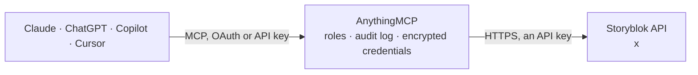

<!-- Generated by scripts/export-github-catalog.mjs in the anythingmcp-website repository. Do not edit by hand. -->

# Storyblok MCP connector

Storyblok headless CMS through the Management API: stories and folders with their block content, create, update, publish and unpublish, component schemas, asset metadata, datasources, workflow stages … The AnythingMCP connector gives Claude, ChatGPT, Microsoft Copilot, Cursor and Gemini 30 MCP tools for Storyblok: 18 read and 12 can change data.

**Category:** [CMS](../cms.md) · **Tools:** 30 · **Setup guide:** [anythingmcp.com](https://anythingmcp.com/guides/storyblok-to-mcp) · [Deutsch](https://anythingmcp.com/de/guides/storyblok-to-mcp) · [Italiano](https://anythingmcp.com/it/guides/storyblok-to-mcp) · [Español](https://anythingmcp.com/es/guides/storyblok-to-mcp) · [日本語](https://anythingmcp.com/ja/guides/storyblok-to-mcp) · [Русский](https://anythingmcp.com/ru/guides/storyblok-to-mcp) · [中文](https://anythingmcp.com/zh/guides/storyblok-to-mcp)

## Start without code

No installation and no terminal: AnythingMCP Cloud runs the Storyblok connector for you, operated by helpcode.ai in Frankfurt, Germany.

1. **Click the button above** and create an account or sign in. The Storyblok connector opens, ready to install.
2. **Paste the API key or token from your Storyblok account.** Every click is in the [step-by-step guide](https://anythingmcp.com/guides/storyblok-to-mcp).
3. **Click Install.** AnythingMCP shows the address of your MCP server.
4. **Add that address to your assistant:** [Claude](https://anythingmcp.com/guides/connect-storyblok-to-claude) · [ChatGPT](https://anythingmcp.com/guides/connect-storyblok-to-chatgpt) · [Microsoft Copilot](https://anythingmcp.com/guides/connect-storyblok-to-copilot) · [Cursor](https://anythingmcp.com/guides/connect-storyblok-to-cursor) · [Gemini CLI](https://anythingmcp.com/guides/connect-storyblok-to-gemini) · [Meta Muse](https://anythingmcp.com/guides/connect-storyblok-to-muse).
5. **Ask your first question**, for example: *Show me the story for product page slug furniture/sofa-astrid and its published state and last edited date*

Prefer help with the setup? [Talk to us](https://anythingmcp.com/contact).

## How it works

- **The AI client** speaks MCP (Streamable HTTP) to AnythingMCP and only sees tool names, descriptions and results. It never gets the Storyblok credentials.
- **AnythingMCP** checks the client's role, builds the call from the tool definition, adds the credentials (an API key), calls Storyblok, logs the call and returns the result.
- **Storyblok** sees an ordinary API client with the rights of the account the credentials belong to.

## Tools

| Tool | What it does | Access |
|---|---|---|
| [`storyblok_get_space`](#storyblok_get_space) | The connected space: name, id, plan, default domain, languages, the release and workflow features in use and the story count. | read |
| [`storyblok_list_stories`](#storyblok_list_stories) | List stories (content entries and folders) of the space without their content: id, uuid, name, slug, full_slug, content_type, published,… | read |
| [`storyblok_get_story`](#storyblok_get_story) | One story with its full content (the block tree under content, each block with component and _uid), slug, published state, translations, alternates, tags,… | read |
| [`storyblok_list_story_versions`](#storyblok_list_story_versions) | Version history of a story, newest first: version id, event (published, saved, ...), author and time, and whether the version is a draft. | read |
| [`storyblok_create_story`](#storyblok_create_story) | Create a story or a folder. | write |
| [`storyblok_update_story`](#storyblok_update_story) | Update a story. | write |
| [`storyblok_publish_story`](#storyblok_publish_story) | Publish a story so the Content Delivery API serves the current version. | write |
| [`storyblok_unpublish_story`](#storyblok_unpublish_story) | Unpublish a story: it disappears from the published content until it is published again. | write |
| [`storyblok_delete_story`](#storyblok_delete_story) | Delete a story, or a folder with its stories, by id. | write |
| [`storyblok_list_components`](#storyblok_list_components) | The block schemas (components) of the space: name, display_name, is_root (content type) or nestable, the schema with every field and its type, and the… | read |
| [`storyblok_get_component`](#storyblok_get_component) | One block schema by id with all fields (type, required, options, allowed blocks), preview field and folder. | read |
| [`storyblok_list_component_folders`](#storyblok_list_component_folders) | Component folders (groups) with id, uuid, name and parent folder, used by in_group. | read |
| [`storyblok_list_assets`](#storyblok_list_assets) | List assets (images, videos, files) with id, filename (the URL), title, alt, copyright, focus, folder, tags, size and private flag. | read |
| [`storyblok_get_asset`](#storyblok_get_asset) | One asset's metadata by id: filename URL, title, alt, copyright, source, focus point, folder, internal tags and size. | read |
| [`storyblok_update_asset`](#storyblok_update_asset) | Update an asset's metadata: alt text, title, copyright and source (meta_data), folder, internal tags, private or locked flag. | write |
| [`storyblok_delete_asset`](#storyblok_delete_asset) | Delete an asset by id. | write |
| [`storyblok_list_asset_folders`](#storyblok_list_asset_folders) | Asset folders with id, uuid, name and parent_id, for in_folder and asset_folder_id. | read |
| [`storyblok_list_internal_tags`](#storyblok_list_internal_tags) | Internal tags used to organise assets and components, with id, name and object type. | read |
| [`storyblok_list_datasources`](#storyblok_list_datasources) | Datasources (key-value lists used for options and translations) with id, name, slug and dimensions. | read |
| [`storyblok_list_datasource_entries`](#storyblok_list_datasource_entries) | Entries of a datasource (name is the key, value the value), optionally with the dimension_value of one dimension (e.g. a language). | read |
| [`storyblok_create_datasource_entry`](#storyblok_create_datasource_entry) | Add a key-value entry (name is the key, value the value) to a datasource. | write |
| [`storyblok_update_datasource_entry`](#storyblok_update_datasource_entry) | Change a datasource entry's key or value, or its value for one dimension (dimension_id and dimension_value). | write |
| [`storyblok_list_workflows`](#storyblok_list_workflows) | Workflows that apply to a content type, with their stages. | read |
| [`storyblok_list_workflow_stages`](#storyblok_list_workflow_stages) | Workflow stages with id, name, color, the next allowed stages, who may publish and the workflow they belong to. | read |
| [`storyblok_list_workflow_stage_changes`](#storyblok_list_workflow_stage_changes) | History of workflow stage changes of one story: stage, user and time. | read |
| [`storyblok_change_workflow_stage`](#storyblok_change_workflow_stage) | Move a story to another workflow stage, optionally assigning users or roles and notifying them with a comment. | write |
| [`storyblok_list_releases`](#storyblok_list_releases) | Releases (bundles of story changes published together): id, name, scheduled release_at, released flag and branches to deploy. | read |
| [`storyblok_get_release`](#storyblok_get_release) | One release by id: name, release_at, released state, owner and branches to deploy. | read |
| [`storyblok_create_release`](#storyblok_create_release) | Create a release to collect story changes, optionally scheduled for a time. | write |
| [`storyblok_update_release`](#storyblok_update_release) | Rename or reschedule a release, or deploy it now with do_release true, which publishes every story change it holds. | write |

## Tool reference

Every parameter as the AI client sees it in `tools/list`. Source: [`packages/backend/src/adapters/intl/storyblok.json`](../../../packages/backend/src/adapters/intl/storyblok.json).

### `storyblok_get_space`

The connected space: name, id, plan, default domain, languages, the release and workflow features in use and the story count. Use it to check the token and the region host.

**Access:** read · **Call:** `GET /`

No parameters.

### `storyblok_list_stories`

List stories (content entries and folders) of the space without their content: id, uuid, name, slug, full_slug, content_type, published, unpublished_changes, parent_id, tag_list, timestamps. Filter by slug, folder, tag, content type field values, workflow stage, release or a text search. The total count is in _headers.total.

**Access:** read · **Call:** `GET /stories`

| Parameter | Type | Required | Description |
|---|---|---|---|
| `search` | string | no | Search in name, slug and full slug. |
| `text_search` | string | no | Full-text search in name, slug and the whole content. |
| `starts_with` | string | no | Only stories whose full slug starts with this, e.g. blog/. |
| `by_slugs` | string | no | Comma-separated full slugs; wildcards allowed, e.g. blog/*. |
| `with_slug` | string | no | Only the story with this exact full slug. |
| `by_ids` | string | no | Comma-separated story ids. |
| `by_uuids` | string | no | Comma-separated story uuids. |
| `with_parent` | integer | no | Only direct children of this folder id. |
| `with_tag` | string | no | Comma-separated tags. |
| `contain_component` | string | no | Comma-separated block names the content must contain. |
| `filter_query` | object | no | Filter on content fields, e.g. {"category": {"in": "news"}, "date": {"gt_date": "2026-01-01 00:00"}}. Operations: is, in, not_in, like, not_like, in_array, all_in_array, gt_date, lt_date, gt_int, lt_int, gt_float, lt_float. |
| `is_published` | boolean | no | true for published stories only, false for drafts only. |
| `story_only` | boolean | no | Leave folders out. |
| `folder_only` | boolean | no | Only folders. |
| `in_workflow_stages` | string | no | Comma-separated workflow stage ids. |
| `in_release` | integer | no | Only stories in this release id. |
| `in_trash` | boolean | no | Only deleted stories in the trash. |
| `with_summary` | boolean | no | Add a content_summary of the content fields. |
| `sort_by` | string | no | Sort, e.g. created_at:desc, updated_at:desc, name:asc or content.FIELD:asc (append :int or :float for numbers). |
| `page` | integer | no | Page number, starting at 1. |
| `per_page` | integer | no | Items per page (default 25, max 100). |

### `storyblok_get_story`

One story with its full content (the block tree under content, each block with component and _uid), slug, published state, translations, alternates, tags, workflow stage and release info.

**Access:** read · **Call:** `GET /stories/{story_id}`

| Parameter | Type | Required | Description |
|---|---|---|---|
| `story_id` | string | yes | Numeric story id. |

### `storyblok_list_story_versions`

Version history of a story, newest first: version id, event (published, saved, ...), author and time, and whether the version is a draft.

**Access:** read · **Call:** `GET /stories/{story_id}/versions`

| Parameter | Type | Required | Description |
|---|---|---|---|
| `story_id` | string | yes | Numeric story id. |
| `page` | integer | no | Page number, starting at 1. |
| `per_page` | integer | no | Items per page (default 25, max 100). |

### `storyblok_create_story`

Create a story or a folder. Stories are saved as drafts unless publish is true. The content root needs "component" set to a content type block; nested blocks sit in arrays and need a _uid.

**Access:** write · **Call:** `POST /stories`

| Parameter | Type | Required | Description |
|---|---|---|---|
| `story` | object | yes | The story, e.g. {"name": "Summer sale", "slug": "summer-sale", "parent_id": 123, "content": {"component": "page", "body": []}, "tag_list": ["promo"]}. A folder: {"name": "Blog", "slug": "blog", "is_folder": true}. |
| `publish` | boolean | no | Publish right away (default false: draft). |
| `release_id` | integer | no | Save it into this release instead of the main version. |

### `storyblok_update_story`

Update a story. Send the story object with the fields to change; content is replaced as a whole, so read it with storyblok_get_story first and send the full block tree back. publish true also publishes.

**Access:** write · **Call:** `PUT /stories/{story_id}`

| Parameter | Type | Required | Description |
|---|---|---|---|
| `story_id` | string | yes | Numeric story id. |
| `story` | object | yes | Story fields to set, e.g. {"name": "New title", "content": {...the whole content...}}. |
| `publish` | boolean | no | Publish after saving. |
| `lang` | string | no | Language code to publish individually (needs Publish translations individually). |
| `release_id` | integer | no | Save the change into this release. |
| `group_id` | string | no | Group UUID shared with the stories that are alternates of this one. |
| `force_update` | `1` | no | 1 to overwrite a story another user is editing (causes a content conflict). |

### `storyblok_publish_story`

Publish a story so the Content Delivery API serves the current version. Optionally only some languages, or into a release. Storyblok does this with a GET request, but it changes the live site.

**Access:** write · **Call:** `GET /stories/{story_id}/publish`

| Parameter | Type | Required | Description |
|---|---|---|---|
| `story_id` | string | yes | Numeric story id. |
| `lang` | string | no | Comma-separated language codes to publish, e.g. es,pt-br,[default]. |

### `storyblok_unpublish_story`

Unpublish a story: it disappears from the published content until it is published again. Optionally only some languages. Storyblok does this with a GET request.

**Access:** write · **Call:** `GET /stories/{story_id}/unpublish`

| Parameter | Type | Required | Description |
|---|---|---|---|
| `story_id` | string | yes | Numeric story id. |
| `lang` | string | no | Comma-separated language codes to unpublish. |

### `storyblok_delete_story`

Delete a story, or a folder with its stories, by id. Gone from the delivery API at once.

**Access:** write · **Call:** `DELETE /stories/{story_id}`

| Parameter | Type | Required | Description |
|---|---|---|---|
| `story_id` | string | yes | Numeric story id. |

### `storyblok_list_components`

The block schemas (components) of the space: name, display_name, is_root (content type) or nestable, the schema with every field and its type, and the component folders in component_groups.

**Access:** read · **Call:** `GET /components`

| Parameter | Type | Required | Description |
|---|---|---|---|
| `search` | string | no | Search in name or display name. |
| `is_root` | boolean | no | true for content types only, false for nestable blocks only. |
| `in_group` | string | no | Only components in the folder with this UUID. |
| `by_ids` | string | no | Comma-separated component ids. |
| `sort_by` | string | no | Sort, e.g. name:asc, updated_at:desc or is_nestable:asc,is_root:desc. |

### `storyblok_get_component`

One block schema by id with all fields (type, required, options, allowed blocks), preview field and folder.

**Access:** read · **Call:** `GET /components/{component_id}`

| Parameter | Type | Required | Description |
|---|---|---|---|
| `component_id` | integer | yes | Numeric component id. |

### `storyblok_list_component_folders`

Component folders (groups) with id, uuid, name and parent folder, used by in_group.

**Access:** read · **Call:** `GET /component_groups`

| Parameter | Type | Required | Description |
|---|---|---|---|
| `search` | string | no | Search in folder names. |

### `storyblok_list_assets`

List assets (images, videos, files) with id, filename (the URL), title, alt, copyright, focus, folder, tags, size and private flag. Paged; the total count is in _headers.total.

**Access:** read · **Call:** `GET /assets`

| Parameter | Type | Required | Description |
|---|---|---|---|
| `search` | string | no | Search in file names. |
| `in_folder` | integer | no | Only assets in this folder id; -1 for deleted assets. |
| `by_title` | string | no | Filter by title. |
| `by_alt` | string | no | Filter by alt text. |
| `by_copyright` | string | no | Filter by copyright. |
| `with_tags` | string | no | Comma-separated internal tags (any of them). |
| `is_private` | boolean | no | Only private assets. |
| `sort_by` | `created_at:asc` \| `created_at:desc` \| `updated_at:asc` \| `updated_at:desc` \| `short_filename:asc` \| `short_filename:desc` \| `content_length:asc` \| `content_length:desc` | no | Sort order. |
| `page` | integer | no | Page number, starting at 1. |
| `per_page` | integer | no | Items per page (default 25, max 100). |

### `storyblok_get_asset`

One asset's metadata by id: filename URL, title, alt, copyright, source, focus point, folder, internal tags and size.

**Access:** read · **Call:** `GET /assets/{asset_id}`

| Parameter | Type | Required | Description |
|---|---|---|---|
| `asset_id` | integer | yes | Numeric asset id. |

### `storyblok_update_asset`

Update an asset's metadata: alt text, title, copyright and source (meta_data), folder, internal tags, private or locked flag. The file itself is not changed.

**Access:** write · **Call:** `PUT /assets/{asset_id}`

| Parameter | Type | Required | Description |
|---|---|---|---|
| `asset_id` | integer | yes | Numeric asset id. |
| `asset` | object | yes | Fields to set, e.g. {"meta_data": {"alt": "Red bike", "title": "Bike", "copyright": "Studio X"}, "asset_folder_id": 12, "internal_tag_ids": [3], "is_private": false}. |

### `storyblok_delete_asset`

Delete an asset by id. Stories that still point to its URL show a broken file.

**Access:** write · **Call:** `DELETE /assets/{asset_id}`

| Parameter | Type | Required | Description |
|---|---|---|---|
| `asset_id` | integer | yes | Numeric asset id. |

### `storyblok_list_asset_folders`

Asset folders with id, uuid, name and parent_id, for in_folder and asset_folder_id.

**Access:** read · **Call:** `GET /asset_folders`

| Parameter | Type | Required | Description |
|---|---|---|---|
| `search` | string | no | Search in folder names. |
| `with_parent` | string | no | Only folders under this parent folder id. |
| `by_ids` | string | no | Comma-separated folder ids. |

### `storyblok_list_internal_tags`

Internal tags used to organise assets and components, with id, name and object type.

**Access:** read · **Call:** `GET /internal_tags`

| Parameter | Type | Required | Description |
|---|---|---|---|
| `search` | string | no | Search in tag names. |
| `by_object_type` | `asset` \| `component` | no | Only tags of assets or of components. |

### `storyblok_list_datasources`

Datasources (key-value lists used for options and translations) with id, name, slug and dimensions. Paged.

**Access:** read · **Call:** `GET /datasources`

| Parameter | Type | Required | Description |
|---|---|---|---|
| `search` | string | no | Search in datasource names. |
| `by_ids` | string | no | Comma-separated datasource ids. |
| `page` | integer | no | Page number, starting at 1. |
| `per_page` | integer | no | Items per page (default 25, max 100). |

### `storyblok_list_datasource_entries`

Entries of a datasource (name is the key, value the value), optionally with the dimension_value of one dimension (e.g. a language). Pass datasource_id or datasource_slug. Paged up to 1,000 per page.

**Access:** read · **Call:** `GET /datasource_entries`

| Parameter | Type | Required | Description |
|---|---|---|---|
| `datasource_id` | integer | no | Numeric datasource id. |
| `datasource_slug` | string | no | Datasource slug. |
| `dimension` | integer | no | Numeric dimension id, to get dimension_value. |
| `search` | string | no | Search in entry names. |
| `page` | integer | no | Page number, starting at 1. |
| `per_page` | integer | no | Entries per page (default 25, max 1000). |

### `storyblok_create_datasource_entry`

Add a key-value entry (name is the key, value the value) to a datasource.

**Access:** write · **Call:** `POST /datasource_entries`

| Parameter | Type | Required | Description |
|---|---|---|---|
| `datasource_id` | integer | yes | Numeric datasource id. |
| `name` | string | yes | The entry key. |
| `value` | string | yes | The entry value. |

### `storyblok_update_datasource_entry`

Change a datasource entry's key or value, or its value for one dimension (dimension_id and dimension_value).

**Access:** write · **Call:** `PUT /datasource_entries/{datasource_entry_id}`

| Parameter | Type | Required | Description |
|---|---|---|---|
| `datasource_entry_id` | integer | yes | Numeric datasource entry id. |
| `datasource_entry` | object | yes | Fields to set, e.g. {"name": "red", "value": "Red"} or {"dimension_value": "Rot"}. |
| `dimension_id` | integer | no | Dimension id; required when setting a dimension_value. |

### `storyblok_list_workflows`

Workflows that apply to a content type, with their stages. Pass the content type block name, e.g. page or article.

**Access:** read · **Call:** `GET /workflows`

| Parameter | Type | Required | Description |
|---|---|---|---|
| `content_type` | string | yes | Content type block name, e.g. page. |

### `storyblok_list_workflow_stages`

Workflow stages with id, name, color, the next allowed stages, who may publish and the workflow they belong to.

**Access:** read · **Call:** `GET /workflow_stages`

| Parameter | Type | Required | Description |
|---|---|---|---|
| `in_workflow` | integer | no | Only stages of this workflow id. |
| `search` | string | no | Search in stage names. |
| `by_ids` | string | no | Comma-separated stage ids. |
| `exclude_id` | integer | no | Leave this stage id out. |

### `storyblok_list_workflow_stage_changes`

History of workflow stage changes of one story: stage, user and time.

**Access:** read · **Call:** `GET /workflow_stage_changes`

| Parameter | Type | Required | Description |
|---|---|---|---|
| `with_story` | string | yes | Numeric story id. |

### `storyblok_change_workflow_stage`

Move a story to another workflow stage, optionally assigning users or roles and notifying them with a comment.

**Access:** write · **Call:** `POST /workflow_stage_changes`

| Parameter | Type | Required | Description |
|---|---|---|---|
| `story_id` | string | yes | Numeric story id. |
| `workflow_stage_id` | integer | yes | Target workflow stage id. |
| `notify` | boolean | no | Notify the assigned users (default false). |
| `comment` | object | no | Comment for the notification, e.g. {"message": "Ready for review"}. |
| `assign` | object | no | Assignees, e.g. {"user_ids": [123], "space_role_ids": [45]}. |
| `release_id` | integer | no | Release id when the story is edited in a release. |

### `storyblok_list_releases`

Releases (bundles of story changes published together): id, name, scheduled release_at, released flag and branches to deploy.

**Access:** read · **Call:** `GET /releases`

| Parameter | Type | Required | Description |
|---|---|---|---|
| `branch_id` | integer | no | Only releases deploying to this pipeline branch id. |

### `storyblok_get_release`

One release by id: name, release_at, released state, owner and branches to deploy.

**Access:** read · **Call:** `GET /releases/{release_id}`

| Parameter | Type | Required | Description |
|---|---|---|---|
| `release_id` | integer | yes | Numeric release id. |

### `storyblok_create_release`

Create a release to collect story changes, optionally scheduled for a time.

**Access:** write · **Call:** `POST /releases`

| Parameter | Type | Required | Description |
|---|---|---|---|
| `release` | object | yes | The release, e.g. {"name": "Summer campaign", "release_at": "2027-06-01 08:00", "branches_to_deploy": [123]}. |

### `storyblok_update_release`

Rename or reschedule a release, or deploy it now with do_release true, which publishes every story change it holds.

**Access:** write · **Call:** `PUT /releases/{release_id}`

| Parameter | Type | Required | Description |
|---|---|---|---|
| `release_id` | integer | yes | Numeric release id. |
| `release` | object | no | Fields to set, e.g. {"name": "New name", "release_at": "2027-06-02 08:00"}. |
| `do_release` | boolean | no | true deploys the release now. |

## Run it yourself

AnythingMCP is open source (AGPL-3.0). [Run it with Docker](../../../README.md#run-it-yourself), open **Connectors → Store**, pick **Storyblok** and enter `STORYBLOK_PERSONAL_ACCESS_TOKEN`, `STORYBLOK_SPACE_ID`, `STORYBLOK_API_HOST`, then add your MCP server URL to the AI client.

[← CMS connectors](../cms.md) · [All categories](../README.md)
