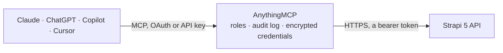

<!-- Generated by scripts/export-github-catalog.mjs in the anythingmcp-website repository. Do not edit by hand. -->

# Strapi 5 MCP connector

Connect to a Strapi 5 instance to check its availability, query documents from collection types, and retrieve individual documents through the read-only REST Content API. The AnythingMCP connector gives Claude, ChatGPT, Microsoft Copilot, Cursor and Gemini 3 MCP tools for Strapi 5, all read-only.

**Category:** [CMS](../cms.md) · **Tools:** 3 · **Setup guide:** [anythingmcp.com](https://anythingmcp.com/guides/strapi-to-mcp) · [Deutsch](https://anythingmcp.com/de/guides/strapi-to-mcp) · [Italiano](https://anythingmcp.com/it/guides/strapi-to-mcp) · [Español](https://anythingmcp.com/es/guides/strapi-to-mcp) · [日本語](https://anythingmcp.com/ja/guides/strapi-to-mcp) · [Русский](https://anythingmcp.com/ru/guides/strapi-to-mcp) · [中文](https://anythingmcp.com/zh/guides/strapi-to-mcp)

## Start without code

No installation and no terminal: AnythingMCP Cloud runs the Strapi 5 connector for you, operated by helpcode.ai in Frankfurt, Germany.

1. **Click the button above** and create an account or sign in. The Strapi 5 connector opens, ready to install.
2. **Paste the API key or token from your Strapi 5 account.** Every click is in the [step-by-step guide](https://anythingmcp.com/guides/strapi-to-mcp).
3. **Click Install.** AnythingMCP shows the address of your MCP server.
4. **Add that address to your assistant:** [Claude](https://anythingmcp.com/guides/connect-strapi-to-claude) · [ChatGPT](https://anythingmcp.com/guides/connect-strapi-to-chatgpt) · [Microsoft Copilot](https://anythingmcp.com/guides/connect-strapi-to-copilot) · [Cursor](https://anythingmcp.com/guides/connect-strapi-to-cursor) · [Gemini CLI](https://anythingmcp.com/guides/connect-strapi-to-gemini) · [Meta Muse](https://anythingmcp.com/guides/connect-strapi-to-muse).
5. **Ask your first question**, for example: *Show me invoice INV-2026-042: status, amount and customer name.*

Prefer help with the setup? [Talk to us](https://anythingmcp.com/contact).

## How it works

- **The AI client** speaks MCP (Streamable HTTP) to AnythingMCP and only sees tool names, descriptions and results. It never gets the Strapi 5 credentials.
- **AnythingMCP** checks the client's role, builds the call from the tool definition, adds the credentials (a bearer token), calls Strapi 5, logs the call and returns the result.
- **Strapi 5** sees an ordinary API client with the rights of the account the credentials belong to.

## Tools

| Tool | What it does | Access |
|---|---|---|
| [`strapi_health`](#strapi_health) | Check whether the configured Strapi 5 process is reachable. | read |
| [`strapi_list_documents`](#strapi_list_documents) | List documents from one Strapi 5 collection type, with field selection, deep filters, sorting, page-based pagination, relation population, locale, and… | read |
| [`strapi_get_document`](#strapi_get_document) | Retrieve one document from a Strapi 5 collection type by its documentId, optionally selecting scalar fields, populating relations or media, and choosing a… | read |

## Tool reference

Every parameter as the AI client sees it in `tools/list`. Source: [`packages/backend/src/adapters/intl/strapi.json`](../../../packages/backend/src/adapters/intl/strapi.json).

### `strapi_health`

Check whether the configured Strapi 5 process is reachable. A successful response confirms availability only and does not validate the API token or collection permissions.

**Access:** read · **Call:** `GET /_health`

No parameters.

### `strapi_list_documents`

List documents from one Strapi 5 collection type, with field selection, deep filters, sorting, page-based pagination, relation population, locale, and publication status while preserving pagination metadata.

**Access:** read · **Call:** `GET /api/{contentType}`

| Parameter | Type | Required | Description |
|---|---|---|---|
| `contentType` | string | yes | Plural API ID of the Strapi collection type, as configured in the Content-Type Builder. Example: articles. This is not the display name. |
| `fields` | string[] | no | Scalar field names to return. Strapi includes system fields such as documentId automatically. Relations and media require populate instead. |
| `filters` | object | no | Strapi filter object using Content API field names and operators. Example: {"title":{"$containsi":"release"}}. |
| `sort` | string[] | no | Sort expressions in priority order, each written as field:asc or field:desc. Example: ["publishedAt:desc","title:asc"]. |
| `pagination` | object | no | Page-based Strapi pagination settings. page and pageSize start at 1; withCount controls whether total counts are calculated. |
| `populate` | any | no | Relations, media, components, or dynamic zones to populate. Use * for all first-level relations or a Strapi populate object for precise nested selection. |
| `locale` | string | no | Locale code for a localized collection type, such as en or de. Omit it for the collection type's default locale. |
| `status` | `published` \| `draft` | no | Publication status to query. Use published for published documents or draft for the latest draft versions when the token permits them. |

### `strapi_get_document`

Retrieve one document from a Strapi 5 collection type by its documentId, optionally selecting scalar fields, populating relations or media, and choosing a locale.

**Access:** read · **Call:** `GET /api/{contentType}/{documentId}`

| Parameter | Type | Required | Description |
|---|---|---|---|
| `contentType` | string | yes | Plural API ID of the Strapi collection type, as configured in the Content-Type Builder. Example: articles. |
| `documentId` | string | yes | Stable Strapi 5 documentId returned by the Content API. This is the document identifier, not the legacy numeric database id. |
| `fields` | string[] | no | Scalar field names to return for the document. Relations and media require populate instead. |
| `populate` | any | no | Relations, media, components, or dynamic zones to populate. Use * for all first-level relations or a Strapi populate object for precise nested selection. |
| `locale` | string | no | Locale code for a localized document, such as en or de. Omit it for the collection type's default locale. |

## Run it yourself

AnythingMCP is open source (AGPL-3.0). [Run it with Docker](../../../README.md#run-it-yourself), open **Connectors → Store**, pick **Strapi 5** and enter `STRAPI_URL`, `STRAPI_API_TOKEN`, then add your MCP server URL to the AI client.

[← CMS connectors](../cms.md) · [All categories](../README.md)
