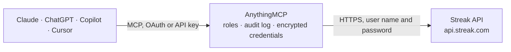

<!-- Generated by scripts/export-github-catalog.mjs in the anythingmcp-website repository. Do not edit by hand. -->

# Streak MCP connector

Manage Streak (CRM inside Gmail) pipelines, boxes, contacts, fields from any AI agent. 9 tools, basic-auth with API key. The AnythingMCP connector gives Claude, ChatGPT, Microsoft Copilot, Cursor and Gemini 9 MCP tools for Streak: 6 read and 3 can change data.

**Category:** [CRM](../crm.md) · **Tools:** 9 · **Setup guide:** [anythingmcp.com](https://anythingmcp.com/guides/streak-to-mcp) · [Deutsch](https://anythingmcp.com/de/guides/streak-to-mcp) · [Italiano](https://anythingmcp.com/it/guides/streak-to-mcp) · [Español](https://anythingmcp.com/es/guides/streak-to-mcp) · [日本語](https://anythingmcp.com/ja/guides/streak-to-mcp) · [Русский](https://anythingmcp.com/ru/guides/streak-to-mcp) · [中文](https://anythingmcp.com/zh/guides/streak-to-mcp)

## Start without code

No installation and no terminal: AnythingMCP Cloud runs the Streak connector for you, operated by helpcode.ai in Frankfurt, Germany.

1. **Click the button above** and create an account or sign in. The Streak connector opens, ready to install.
2. **Paste the API key or token from your Streak account.** Every click is in the [step-by-step guide](https://anythingmcp.com/guides/streak-to-mcp).
3. **Click Install.** AnythingMCP shows the address of your MCP server.
4. **Add that address to your assistant:** [Claude](https://anythingmcp.com/guides/connect-streak-to-claude) · [ChatGPT](https://anythingmcp.com/guides/connect-streak-to-chatgpt) · [Microsoft Copilot](https://anythingmcp.com/guides/connect-streak-to-copilot) · [Cursor](https://anythingmcp.com/guides/connect-streak-to-cursor) · [Gemini CLI](https://anythingmcp.com/guides/connect-streak-to-gemini) · [Meta Muse](https://anythingmcp.com/guides/connect-streak-to-muse).
5. **Ask your first question**, for example: *Show me the box for invoice INV-2026-045 for customer Nordfjord AS in Sales pipeline.*

Prefer help with the setup? [Talk to us](https://anythingmcp.com/contact).

## How it works

- **The AI client** speaks MCP (Streamable HTTP) to AnythingMCP and only sees tool names, descriptions and results. It never gets the Streak credentials.
- **AnythingMCP** checks the client's role, builds the call from the tool definition, adds the credentials (user name and password), calls Streak, logs the call and returns the result.
- **Streak** sees an ordinary API client with the rights of the account the credentials belong to.

## Tools

| Tool | What it does | Access |
|---|---|---|
| [`streak_current_user`](#streak_current_user) | Returns the authenticated user: userKey, displayName, email, isOauth, lastSeenTimestamp. | read |
| [`streak_list_pipelines`](#streak_list_pipelines) | List all pipelines the user has access to. | read |
| [`streak_get_pipeline`](#streak_get_pipeline) | Get one pipeline with stages and field definitions. | read |
| [`streak_list_boxes`](#streak_list_boxes) | List boxes (records) in a pipeline. | read |
| [`streak_get_box`](#streak_get_box) | Get one box with full custom-field values, assigned users, linked contacts, and Gmail thread refs. | read |
| [`streak_create_box`](#streak_create_box) | Create a new box in a pipeline. | write |
| [`streak_update_box`](#streak_update_box) | Update a box: rename, move stage, set custom field values. | write |
| [`streak_list_box_notes`](#streak_list_box_notes) | List notes attached to a box. | read |
| [`streak_add_box_note`](#streak_add_box_note) | Add a text note to a box. | write |

## Tool reference

Every parameter as the AI client sees it in `tools/list`. Source: [`packages/backend/src/adapters/intl/streak.json`](../../../packages/backend/src/adapters/intl/streak.json).

### `streak_current_user`

Returns the authenticated user: userKey, displayName, email, isOauth, lastSeenTimestamp.

**Access:** read · **Call:** `GET /v1/users/me`

No parameters.

### `streak_list_pipelines`

List all pipelines the user has access to. Each has pipelineKey, name, description, stages[], fields[], creatorKey, teamKey.

**Access:** read · **Call:** `GET /v1/pipelines`

No parameters.

### `streak_get_pipeline`

Get one pipeline with stages and field definitions.

**Access:** read · **Call:** `GET /v1/pipelines/{pipeline_key}`

| Parameter | Type | Required | Description |
|---|---|---|---|
| `pipeline_key` | string | yes | Pipeline key. |

### `streak_list_boxes`

List boxes (records) in a pipeline. Each has boxKey, name, stageKey, fields (custom field values), notes count, files count.

**Access:** read · **Call:** `GET /v1/pipelines/{pipeline_key}/boxes`

| Parameter | Type | Required | Description |
|---|---|---|---|
| `pipeline_key` | string | yes | Pipeline key. |
| `limit` | integer | no | Max per page. |
| `sortBy` | string | no | creationTimestamp, lastUpdatedTimestamp. |
| `sortDirection` | string | no | ASC or DESC. |

### `streak_get_box`

Get one box with full custom-field values, assigned users, linked contacts, and Gmail thread refs.

**Access:** read · **Call:** `GET /v1/boxes/{box_key}`

| Parameter | Type | Required | Description |
|---|---|---|---|
| `box_key` | string | yes | Box key. |

### `streak_create_box`

Create a new box in a pipeline.

**Access:** write · **Call:** `PUT /v1/pipelines/{pipeline_key}/boxes`

| Parameter | Type | Required | Description |
|---|---|---|---|
| `pipeline_key` | string | yes | Pipeline key. |
| `name` | string | yes | Box name (deal title). |
| `stageKey` | string | no | Initial stage key. |
| `assignedToSharingEntries` | any[] | no | Array of {sharedEntity} user keys to assign. |

### `streak_update_box`

Update a box: rename, move stage, set custom field values.

**Access:** write · **Call:** `POST /v1/boxes/{box_key}`

| Parameter | Type | Required | Description |
|---|---|---|---|
| `box_key` | string | yes | Box key. |
| `name` | string | no | New name. |
| `stageKey` | string | no | New stage. |
| `fields` | object | no | Custom-field-key → value map. |

### `streak_list_box_notes`

List notes attached to a box.

**Access:** read · **Call:** `GET /v1/boxes/{box_key}/notes`

| Parameter | Type | Required | Description |
|---|---|---|---|
| `box_key` | string | yes | Box key. |

### `streak_add_box_note`

Add a text note to a box.

**Access:** write · **Call:** `PUT /v1/boxes/{box_key}/notes`

| Parameter | Type | Required | Description |
|---|---|---|---|
| `box_key` | string | yes | Box key. |
| `message` | string | yes | Note body. |

## Run it yourself

AnythingMCP is open source (AGPL-3.0). [Run it with Docker](../../../README.md#run-it-yourself), open **Connectors → Store**, pick **Streak** and enter `STREAK_API_KEY`, then add your MCP server URL to the AI client.

[← CRM connectors](../crm.md) · [All categories](../README.md)
