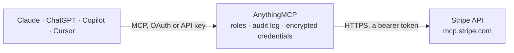

<!-- Generated by scripts/export-github-catalog.mjs in the anythingmcp-website repository. Do not edit by hand. -->

# Stripe MCP connector

Look up customers, payments, invoices and subscriptions, ask for MRR and churn, and (when you allow it) create invoices, payment links or refunds in Stripe from Claude, ChatGPT or Copilot through … The AnythingMCP connector gives Claude, ChatGPT, Microsoft Copilot, Cursor and Gemini 9 MCP tools for Stripe: 6 read and 3 can change data.

**Category:** [Payments](../payments.md) · **Tools:** 9 · **Setup guide:** [anythingmcp.com](https://anythingmcp.com/guides/stripe-to-mcp) · [Deutsch](https://anythingmcp.com/de/guides/stripe-to-mcp) · [Italiano](https://anythingmcp.com/it/guides/stripe-to-mcp) · [Español](https://anythingmcp.com/es/guides/stripe-to-mcp) · [日本語](https://anythingmcp.com/ja/guides/stripe-to-mcp) · [Русский](https://anythingmcp.com/ru/guides/stripe-to-mcp) · [中文](https://anythingmcp.com/zh/guides/stripe-to-mcp)

## Start without code

No installation and no terminal: AnythingMCP Cloud runs the Stripe connector for you, operated by helpcode.ai in Frankfurt, Germany.

1. **Click the button above** and create an account or sign in. The Stripe connector opens, ready to install.
2. **Paste the API key or token from your Stripe account.** Every click is in the [step-by-step guide](https://anythingmcp.com/guides/stripe-to-mcp).
3. **Click Install.** AnythingMCP shows the address of your MCP server.
4. **Add that address to your assistant:** [Claude](https://anythingmcp.com/guides/connect-stripe-to-claude) · [ChatGPT](https://anythingmcp.com/guides/connect-stripe-to-chatgpt) · [Microsoft Copilot](https://anythingmcp.com/guides/connect-stripe-to-copilot) · [Cursor](https://anythingmcp.com/guides/connect-stripe-to-cursor) · [Gemini CLI](https://anythingmcp.com/guides/connect-stripe-to-gemini) · [Meta Muse](https://anythingmcp.com/guides/connect-stripe-to-muse).
5. **Ask your first question**, for example: *Show the Stripe customer record for henrik@solarlab.no (Henrik Larsen)*

Prefer help with the setup? [Talk to us](https://anythingmcp.com/contact).

## How it works

- **The AI client** speaks MCP (Streamable HTTP) to AnythingMCP and only sees tool names, descriptions and results. It never gets the Stripe credentials.
- **AnythingMCP** checks the client's role, builds the call from the tool definition, adds the credentials (a bearer token), calls Stripe, logs the call and returns the result.
- **Stripe** sees an ordinary API client with the rights of the account the credentials belong to.

## Tools

| Tool | What it does | Access |
|---|---|---|
| [`stripe_implementation_planner`](#stripe_implementation_planner) | Stripe integration planner. | write |
| [`stripe_send_stripe_feedback`](#stripe_send_stripe_feedback) | Share feedback about Stripe's products. | write |
| [`stripe_search_stripe_documentation`](#stripe_search_stripe_documentation) | Search the Stripe documentation for the given question and language. | read |
| [`stripe_get_stripe_account_info`](#stripe_get_stripe_account_info) | This will get the account info for the logged in Stripe account. | read |
| [`stripe_api_search`](#stripe_api_search) | Search for Stripe API operations by providing an intent and a resource to operate on. | read |
| [`stripe_api_details`](#stripe_api_details) | Get detailed parameter information for a specific Stripe API operation. | read |
| [`stripe_api_read`](#stripe_api_read) | Read data from any Stripe API GET operation: 1. | read |
| [`stripe_api_write`](#stripe_api_write) | Write data via any Stripe API POST/PATCH/PUT/DELETE operation: 1. | write |
| [`stripe_analytics`](#stripe_analytics) | This tool is for analyzing Stripe Sigma and Metrics data (e.g. about revenue, charges, products, invoices, subscriptions, disputes, transactions, tax… | read |

## Tool reference

Every parameter as the AI client sees it in `tools/list`. Source: [`packages/backend/src/adapters/intl/stripe.json`](../../../packages/backend/src/adapters/intl/stripe.json).

### `stripe_implementation_planner`

Stripe integration planner. Use this tool to help users accept payments, sell products online, set up billing, set up a marketplace or platform, or build any Stripe integration. Call this BEFORE writing code when the user wants to charge customers, add a checkout flow, handle subscriptions, create invoices, or monetize their app. WHEN TO USE: Call this tool when the user wants to: - Accept payments, take payments, or charge customers (credit cards, bank transfers, wallets) - Sell online, build e-commerce, add a shopping cart, or create a checkout page - Set up subscriptions, recurring billing, metered billing, or usage-based pricing - Send invoices or collect one-time payments - Add Stripe to their app, integrate Stripe, or build a payment flow - Understand which Stripe products to use (Checkout, Elements, Payment Intents, Connect, Billing) - Plan an integration architecture before writing code - Monetize an app, add billing, or start charging users FIRST CALL GUIDANCE: Ask the user about their business and payment requirements before choosing a use case: - What do they sell? (physical goods, digital products, SaaS, services, marketplace) - Payment model? (one-time, subscriptions, invoices, usage-based) - Platform? (web, mobile app, in-person, payment links) - Complexity? (simple payment link vs. custom integration in existing tech stack) Then pass their full description as the message parameter. Returns JSON with use cases, decision trees, documentation links, and a guide_id for follow-up calls. RULES: - Do NOT pass a guide_id unless you received it from this tool in this conversation. - Do NOT retry with different guide_ids if one fails , omit guide_id to start fresh.

**Access:** write · **Call:** `stripe_implementation_planner /`

| Parameter | Type | Required | Description |
|---|---|---|---|
| `guide_id` | string | no | ONLY pass a guide_id that was returned by a previous call to this tool in this conversation. Never fabricate, guess, or reuse guide_ids from other sessions. If you do not have a guide_id from a prior response, omit this field entirely. Invalid guide_ids will be rejected. |
| `message` | string | no | For new guides: describe the use case or business requirements. |
| `accept` | boolean | no | Set to true when returning the completed decision trees with your chosen options. Include selected_leaf_nodes with the IDs of all terminal leaves reached. |
| `selected_leaf_nodes` | string[] | no | The IDs of all terminal leaves reached while traversing the guide's decision tree. |

### `stripe_send_stripe_feedback`

Share feedback about Stripe's products. Submit when the user gives product feedback or you observe something concrete that worked or failed. Do not report model behavior, the user's local environment, an unclear prompt, or a recovered tool error. Use actor "human" for the user's own words; "agent" for your observations. Not a support channel , no ticket or reply.

**Access:** write · **Call:** `send_stripe_feedback /`

| Parameter | Type | Required | Description |
|---|---|---|---|
| `sentiment` | `positive` \| `negative` \| `neutral` | yes | positive, negative, or neutral |
| `message` | string | yes | What broke or worked, concrete and specific. At least 5 words. |
| `context` | string | yes | What the user was trying to accomplish. Do not include sensitive business information. |
| `feature_area` | `payments` \| `connect` \| `subscriptions` \| `billing` \| `payouts` \| `reporting` \| `invoicing` \| `invoices` \| `checkout` \| `tax` \| `radar` \| `issuing` \| `terminal` \| `treasury` \| `capital` \| `docs` \| `webhooks` \| `cli` \| `dashboard` \| `crypto` \| `stablecoins` \| `managed-payments` \| `mcp` \| `identity` \| `skills` \| `apps` \| `other` | no | Product area this feedback is about. |
| `actor` | `human` \| `agent` | no | Who decided to submit: human or agent. Defaults to agent. |

### `stripe_search_stripe_documentation`

Search the Stripe documentation for the given question and language. It takes two arguments: - question (str): The user question to search an answer for in the Stripe documentation. - language (str, optional): The programming language to search for in the documentation.

**Access:** read · **Call:** `search_stripe_documentation /`

| Parameter | Type | Required | Description |
|---|---|---|---|
| `question` | string | yes | The user question about integrating with Stripe will be used to search the documentation. |
| `language` | `dotnet` \| `go` \| `java` \| `node` \| `php` \| `ruby` \| `python` \| `curl` | no | The programming language to search for in the documentation. |
| `search_only_api_ref` | boolean | no | When set to true, search only in the Stripe API reference documentation instead of the full documentation set. Use true when users need specific API implementation details, code examples, or parameter references. Use false (default) for conceptual explanations, best practices, integration guides, or troubleshooting help. |

### `stripe_get_stripe_account_info`

This will get the account info for the logged in Stripe account.

**Access:** read · **Call:** `get_stripe_account_info /`

No parameters.

### `stripe_api_search`

Search for Stripe API operations by providing an intent and a resource to operate on. For the resource, use a specific, descriptive phrase (e.g. "issuing card transactions", "payout methods", "outbound payments") rather than a single generic noun , Stripe has many similar resources, and the extra qualifiers help disambiguate between them rather than causing a miss. Only fall back to the bare core noun (e.g. "transactions") if a specific multi-word search returns no results. Returns matching operations with their HTTP method, path, summary, and top-level parameter names with types. Does not include parameter descriptions, enum values, or nested object fields , use stripe_api_details to get those before calling the relevant Stripe API execution tool.

**Access:** read · **Call:** `stripe_api_search /`

| Parameter | Type | Required | Description |
|---|---|---|---|
| `intent` | string | yes | The intent of the operation |
| `resource` | string | yes | Target resource the operation is looking to manipulate |
| `limit` | integer | no | Maximum number of results to return |

### `stripe_api_details`

Get detailed parameter information for a specific Stripe API operation. Provide the stripe_api_operation_id from stripe_api_search results to see all path, query, and body parameters with their types, descriptions, and whether they are required. Use before calling the relevant Stripe API execution tool for operations with nested object fields. The response may include an "LLM Context" section with usage guidance specific to the operation , follow any instructions there.

**Access:** read · **Call:** `stripe_api_details /`

| Parameter | Type | Required | Description |
|---|---|---|---|
| `stripe_api_operation_id` | string | yes | The operation ID to get details for (e.g. 'PostCustomers', 'GetPaymentIntents') |

### `stripe_api_read`

Read data from any Stripe API GET operation: 1. Use stripe_api_search to find the operation ID. 2. Use stripe_api_details to understand its parameters (required for operations with nested object fields like address, metadata, or restrictions). 3. Call this tool with the stripe_api_operation_id and a parameters object containing path and query parameters. For mutations (POST/PATCH/PUT/DELETE), use stripe_api_write instead. Monetary values in responses are in the smallest currency unit (e.g. 1000 = $10.00 USD for most currencies).

**Access:** read · **Call:** `stripe_api_read /`

| Parameter | Type | Required | Description |
|---|---|---|---|
| `stripe_api_operation_id` | string | yes | The operation ID to execute |
| `parameters` | object | no | All path, query, and request-body values for the API call. Include path parameters (e.g. 'customer' for /v1/customers/{customer}) here. Array fields (e.g. line_items) must be passed as a JSON array value, not as a plain string. |

### `stripe_api_write`

Write data via any Stripe API POST/PATCH/PUT/DELETE operation: 1. Use stripe_api_search to find the operation ID. 2. Use stripe_api_details to understand its parameters (required for operations with nested object fields like address, metadata, or restrictions). 3. Call this tool with the stripe_api_operation_id and a parameters object containing path, query, and body parameters. For read-only lookups (GET), use stripe_api_read instead. All monetary amounts must be in the smallest currency unit (e.g. 1000 = $10.00 USD for most currencies).

**Access:** write · **Call:** `stripe_api_write /`

| Parameter | Type | Required | Description |
|---|---|---|---|
| `stripe_api_operation_id` | string | yes | The operation ID to execute |
| `parameters` | object | no | All path, query, and request-body values for the API call. Include path parameters (e.g. 'customer' for /v1/customers/{customer}) here. Array fields (e.g. line_items) must be passed as a JSON array value, not as a plain string. |
| `human_confirmation` | object | no | This tool might require human confirmation. To run it, first invoke it with the desired parameters, ignoring the `approval_token` parameter. If it requires human confirmation, the response will include an approval request ID and a URL to an approval page for the human to approve the tool call. You, as the LLM agent, should: 1. Present this URL to the human as a clickable markdown link. Tell them that they have to approve this tool call at that URL, and that they should tell you when they have approved the operation. 2. The human will approve that call. 3. After the human tells you they have approved the operation, you must call the tool again with the `approval_token` parameter and the exact same parameters. The operation will then go through. |

### `stripe_analytics`

This tool is for analyzing Stripe Sigma and Metrics data (e.g. about revenue, charges, products, invoices, subscriptions, disputes, transactions, tax tables, payments etc) and running SQL-based reporting queries. Use it for historical analytics, aggregations, and business intelligence questions (e.g. MRR, churn, cohorts, revenue trends). Prefer this tool over making multiple Stripe API calls that would need to be joined or aggregated client-side. ## SQL Query Runs **execute_query_run**: Runs a SQL query (Trino) against reporting tables. Requires `sql`. Returns a QueryRun object; use retrieve_query_run to poll. **retrieve_query_run**: Retrieves a QueryRun's status and results. Requires `query_run_id`. **search_query_tables**: Searches available reporting tables by keyword. Requires `search_string`. **retrieve_query_table**: Gets full schema for a specific table. Requires `table_name`, which is the `name` parameter in each table. **execute_query_template**: Starts a pre-built query template for subscription/billing metrics (Trino, async). Requires `metric`. Optional: `dimensions`, `grains`, `metric_filters`. Returns a `query_run_id`; use retrieve_query_template to poll for results. **retrieve_query_template**: Retrieves the status/results of a template run started by execute_query_template. Requires `query_run_id`. ### workflow (custom SQL): 1. search_query_tables: find relevant tables 2. retrieve_query_table: get column names and types 3. execute_query_run: run SQL 4. retrieve_query_run: poll status, get download link ### workflow (query templates): 1. execute_query_template: start a template-based metric query (returns a query_run_id) 2. retrieve_query_template: poll with query_run_id (exponential backoff) until status is 'succeeded', then get download link ## Return types All monetary values returned by this tool are expressed in the smallest currency unit. For example: - 1000 is 10 USD (most two-decimal currencies like GBP, EUR, AUD, CAD, divide by 100 to get the major unit value) - 10 is 10 JPY (zero-decimal currency) - 10000 is 10 BHD (three-decimal currency) - 1000000 is 1 USDC If you don't know how many decimals are in a currency's minor units, use the search_stripe_documentation tool to look it up in https://docs.stripe.com/currencies#minor-units

**Access:** read · **Call:** `stripe_analytics /`

| Parameter | Type | Required | Description |
|---|---|---|---|
| `intent` | `execute_query_run` \| `retrieve_query_run` \| `search_query_tables` \| `retrieve_query_table` \| `execute_query_template` \| `retrieve_query_template` | yes | The intent of the tool call. |
| `params` | object | no | The parameters for the tool call. Required parameters depend on the intent. |

## Run it yourself

AnythingMCP is open source (AGPL-3.0). [Run it with Docker](../../../README.md#run-it-yourself), open **Connectors → Store**, pick **Stripe** and enter `STRIPE_AGENT_KEY`, then add your MCP server URL to the AI client.

[← Payments connectors](../payments.md) · [All categories](../README.md)
