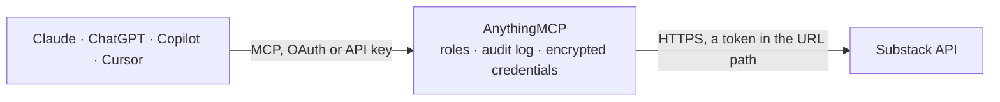

<!-- Generated by scripts/export-github-catalog.mjs in the anythingmcp-website repository. Do not edit by hand. -->

# Substack MCP connector

Read a Substack publication: list, search and open posts, read comments and the RSS feed, and find a writer's publication from their @handle. 7 read-only tools, no API key. The AnythingMCP connector gives Claude, ChatGPT, Microsoft Copilot, Cursor and Gemini 7 MCP tools for Substack, all read-only.

**Category:** [Publishing](../publishing.md) · **Tools:** 7 · **Setup guide:** [anythingmcp.com](https://anythingmcp.com/guides/substack-to-mcp) · [Deutsch](https://anythingmcp.com/de/guides/substack-to-mcp) · [Italiano](https://anythingmcp.com/it/guides/substack-to-mcp) · [Español](https://anythingmcp.com/es/guides/substack-to-mcp) · [日本語](https://anythingmcp.com/ja/guides/substack-to-mcp) · [Русский](https://anythingmcp.com/ru/guides/substack-to-mcp) · [中文](https://anythingmcp.com/zh/guides/substack-to-mcp)

## Start without code

No installation and no terminal: AnythingMCP Cloud runs the Substack connector for you, operated by helpcode.ai in Frankfurt, Germany.

1. **Click the button above** and create an account or sign in. The Substack connector opens, ready to install.
2. **Paste the API key or token from your Substack account.** Every click is in the [step-by-step guide](https://anythingmcp.com/guides/substack-to-mcp).
3. **Click Install.** AnythingMCP shows the address of your MCP server.
4. **Add that address to your assistant:** [Claude](https://anythingmcp.com/guides/connect-substack-to-claude) · [ChatGPT](https://anythingmcp.com/guides/connect-substack-to-chatgpt) · [Microsoft Copilot](https://anythingmcp.com/guides/connect-substack-to-copilot) · [Cursor](https://anythingmcp.com/guides/connect-substack-to-cursor) · [Gemini CLI](https://anythingmcp.com/guides/connect-substack-to-gemini) · [Meta Muse](https://anythingmcp.com/guides/connect-substack-to-muse).
5. **Ask your first question**, for example: *Show the latest post titled 'Q3 customer shipping delays' from the Portside Insights publication and its id*

Prefer help with the setup? [Talk to us](https://anythingmcp.com/contact).

## How it works

- **The AI client** speaks MCP (Streamable HTTP) to AnythingMCP and only sees tool names, descriptions and results. It never gets the Substack credentials.
- **AnythingMCP** checks the client's role, builds the call from the tool definition, adds the credentials (a token in the URL path), calls Substack, logs the call and returns the result.
- **Substack** sees an ordinary API client with the rights of the account the credentials belong to.

## Tools

| Tool | What it does | Access |
|---|---|---|
| [`substack_list_posts`](#substack_list_posts) | List the publication's posts, newest first or most liked first. | read |
| [`substack_search_posts`](#substack_search_posts) | Full-text search the publication's post archive. | read |
| [`substack_get_post_by_id`](#substack_get_post_by_id) | Fetch one post by its numeric id, with the full body_html (a preview only for paid posts), subtitle, post_date, audience, comment_count and podcast_url for… | read |
| [`substack_get_post_by_slug`](#substack_get_post_by_slug) | Fetch one post by its slug, the part after /p/ in a post link (for https://name.substack.com/p/my-first-post the slug is my-first-post). | read |
| [`substack_get_comments`](#substack_get_comments) | Get the comments on a post, as threads: each comment has id, name, handle, date, body, reaction_count and its replies under children. | read |
| [`substack_get_rss_feed`](#substack_get_rss_feed) | Fetch the publication's RSS 2.0 feed (/feed): the most recent posts with title, link, publication date and HTML content. | read |
| [`substack_find_publication_by_handle`](#substack_find_publication_by_handle) | Look up a Substack writer by @handle (from a profile link substack.com/@handle) and return their name, bio and the publications they write for, with… | read |

## Tool reference

Every parameter as the AI client sees it in `tools/list`. Source: [`packages/backend/src/adapters/intl/substack.json`](../../../packages/backend/src/adapters/intl/substack.json).

### `substack_list_posts`

List the publication's posts, newest first or most liked first. Each post has id, title, subtitle, slug, post_date, audience (everyone/only_paid/founding/only_free), type (newsletter/podcast/thread), wordcount, reaction_count, comment_count, canonical_url and a short truncated_body_text. Use substack_get_post_by_id for the full text.

**Access:** read · **Call:** `GET /api/v1/archive`

| Parameter | Type | Required | Description |
|---|---|---|---|
| `limit` | integer | no | Posts per page, 1 to 50 (Substack rejects more). Default 12. |
| `offset` | integer | no | Number of posts to skip, for the next page: previous offset + limit. |
| `sort` | `new` \| `top` | no | new = most recent first (default), top = most liked first. |

### `substack_search_posts`

Full-text search the publication's post archive. Returns matching posts newest first, same fields as substack_list_posts (id, title, slug, post_date, audience, type). An empty array means nothing matched.

**Access:** read · **Call:** `GET /api/v1/archive`

| Parameter | Type | Required | Description |
|---|---|---|---|
| `query` | string | yes | Words to search for in post titles and text. |
| `limit` | integer | no | Results per page, 1 to 50. Default 12. |
| `offset` | integer | no | Number of results to skip, for the next page. |

### `substack_get_post_by_id`

Fetch one post by its numeric id, with the full body_html (a preview only for paid posts), subtitle, post_date, audience, comment_count and podcast_url for audio posts. The answer has the post under `post` and the publication's name and settings under `publication`.

**Access:** read · **Call:** `GET /api/v1/posts/by-id/{postId}`

| Parameter | Type | Required | Description |
|---|---|---|---|
| `postId` | integer | yes | Numeric post id from substack_list_posts or substack_search_posts. |

### `substack_get_post_by_slug`

Fetch one post by its slug, the part after /p/ in a post link (for https://name.substack.com/p/my-first-post the slug is my-first-post). Returns the post with id, title, post_date, audience and the full body_html (a preview only for paid posts).

**Access:** read · **Call:** `GET /api/v1/posts/{slug}`

| Parameter | Type | Required | Description |
|---|---|---|---|
| `slug` | string | yes | Post slug, e.g. my-first-post. Only the part after /p/, without the domain or query string. |

### `substack_get_comments`

Get the comments on a post, as threads: each comment has id, name, handle, date, body, reaction_count and its replies under children. Best comments first by default.

**Access:** read · **Call:** `GET /api/v1/post/{postId}/comments`

| Parameter | Type | Required | Description |
|---|---|---|---|
| `postId` | integer | yes | Numeric post id. |
| `sort` | `best_first` \| `most_recent_first` | no | best_first (default) or most_recent_first. |

### `substack_get_rss_feed`

Fetch the publication's RSS 2.0 feed (/feed): the most recent posts with title, link, publication date and HTML content. Paid posts carry only a preview.

**Access:** read · **Call:** `GET /feed`

No parameters.

### `substack_find_publication_by_handle`

Look up a Substack writer by @handle (from a profile link substack.com/@handle) and return their name, bio and the publications they write for, with subdomain and custom_domain. The publication address is https://<custom_domain> when set, otherwise https://<subdomain>.substack.com. Works for any writer, not only the configured publication.

**Access:** read · **Call:** `GET https://substack.com/api/v1/user/{handle}/public_profile`

| Parameter | Type | Required | Description |
|---|---|---|---|
| `handle` | string | yes | The handle without @, e.g. lenny for substack.com/@lenny. |

## Run it yourself

AnythingMCP is open source (AGPL-3.0). [Run it with Docker](../../../README.md#run-it-yourself), open **Connectors → Store**, pick **Substack** and enter `SUBSTACK_PUBLICATION_URL`, then add your MCP server URL to the AI client.

[← Publishing connectors](../publishing.md) · [All categories](../README.md)
