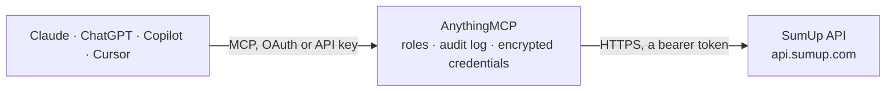

<!-- Generated by scripts/export-github-catalog.mjs in the anythingmcp-website repository. Do not edit by hand. -->

# SumUp MCP connector

Manage SumUp merchant accounts, transactions, payouts, checkouts, receipts, readers, team members and subaccounts from any AI agent, read-only. The AnythingMCP connector gives Claude, ChatGPT, Microsoft Copilot, Cursor and Gemini 26 MCP tools for SumUp, all read-only.

**Category:** [Payments](../payments.md) · **Tools:** 26 · **Setup guide:** [anythingmcp.com](https://anythingmcp.com/guides/sumup-to-mcp) · [Deutsch](https://anythingmcp.com/de/guides/sumup-to-mcp) · [Italiano](https://anythingmcp.com/it/guides/sumup-to-mcp) · [Español](https://anythingmcp.com/es/guides/sumup-to-mcp) · [日本語](https://anythingmcp.com/ja/guides/sumup-to-mcp) · [Русский](https://anythingmcp.com/ru/guides/sumup-to-mcp) · [中文](https://anythingmcp.com/zh/guides/sumup-to-mcp)

## Start without code

No installation and no terminal: AnythingMCP Cloud runs the SumUp connector for you, operated by helpcode.ai in Frankfurt, Germany.

1. **Click the button above** and create an account or sign in. The SumUp connector opens, ready to install.
2. **Paste the API key or token from your SumUp account.** Every click is in the [step-by-step guide](https://anythingmcp.com/guides/sumup-to-mcp).
3. **Click Install.** AnythingMCP shows the address of your MCP server.
4. **Add that address to your assistant:** [Claude](https://anythingmcp.com/guides/connect-sumup-to-claude) · [ChatGPT](https://anythingmcp.com/guides/connect-sumup-to-chatgpt) · [Microsoft Copilot](https://anythingmcp.com/guides/connect-sumup-to-copilot) · [Cursor](https://anythingmcp.com/guides/connect-sumup-to-cursor) · [Gemini CLI](https://anythingmcp.com/guides/connect-sumup-to-gemini) · [Meta Muse](https://anythingmcp.com/guides/connect-sumup-to-muse).
5. **Ask your first question**, for example: *What amount and status does card transaction TAQ7K2M9XB have? A customer of Bäckerei Hofmann says the refund from 12 March never arrived.*

Prefer help with the setup? [Talk to us](https://anythingmcp.com/contact).

## How it works

- **The AI client** speaks MCP (Streamable HTTP) to AnythingMCP and only sees tool names, descriptions and results. It never gets the SumUp credentials.
- **AnythingMCP** checks the client's role, builds the call from the tool definition, adds the credentials (a bearer token), calls SumUp, logs the call and returns the result.
- **SumUp** sees an ordinary API client with the rights of the account the credentials belong to.

## Tools

| Tool | What it does | Access |
|---|---|---|
| [`sumup_get_merchant_profile`](#sumup_get_merchant_profile) | Retrieve the merchant profile and account information associated with the authenticated API key, including merchant code, company name, currency, and country. | read |
| [`sumup_list_transactions`](#sumup_list_transactions) | List transaction history for the authenticated merchant account with filtering by date range, payment status, and pagination. | read |
| [`sumup_get_transaction`](#sumup_get_transaction) | Retrieve detailed information for a specific transaction by transaction ID or transaction code. | read |
| [`sumup_list_payouts`](#sumup_list_payouts) | Retrieve payout history and settlement reports transferred to the merchant bank account, filtered by date range. | read |
| [`sumup_list_checkouts`](#sumup_list_checkouts) | List online checkouts and payment links generated for customers, with optional status and checkout reference filters. | read |
| [`sumup_list_subaccounts`](#sumup_list_subaccounts) | Retrieve operator subaccounts configured under the main merchant account. | read |
| [`sumup_list_memberships`](#sumup_list_memberships) | List the merchant accounts (and organizations) the API key's user belongs to, with the merchant code as resource.id, the account name, the user's roles and… | read |
| [`sumup_get_merchant`](#sumup_get_merchant) | Get a merchant account by merchant code: company name and legal details, business type and profile, country, default currency and locale, and whether it is… | read |
| [`sumup_list_merchant_payouts`](#sumup_list_merchant_payouts) | List payouts to the merchant's bank account between two dates (current v1.0 API): payout date, amount, fee, currency, status, reference and the transaction… | read |
| [`sumup_list_merchant_transactions`](#sumup_list_merchant_transactions) | List the merchant's transactions (current v2.1 API): card, cash and online payments, refunds and chargebacks with amount, currency, status, payment type,… | read |
| [`sumup_get_merchant_transaction`](#sumup_get_merchant_transaction) | Get the full details of one transaction (current v2.1 API): amount, VAT, tip, fee, status, card and entry mode, products, payout plan and payout status,… | read |
| [`sumup_get_receipt`](#sumup_get_receipt) | Get the structured receipt of a transaction: merchant details, transaction data with products and VAT, card (EMV) and acquirer data. | read |
| [`sumup_get_checkout`](#sumup_get_checkout) | Get one online checkout by its id: amount, currency, status (PENDING, PAID, FAILED, EXPIRED), checkout reference, description, and the transactions made… | read |
| [`sumup_get_customer`](#sumup_get_customer) | Get a saved customer (used for recurring or tokenized online payments) by the customer id you assigned: personal details such as name, e-mail, phone and… | read |
| [`sumup_list_payment_instruments`](#sumup_list_payment_instruments) | List the saved payment instruments of a customer: the card token, card type and masked details, mandate, creation date and whether it is active. | read |
| [`sumup_list_payment_methods`](#sumup_list_payment_methods) | List the payment methods available to the merchant for online checkouts (cards, Apple Pay, Google Pay, iDEAL, Bancontact and others), optionally only those… | read |
| [`sumup_list_members`](#sumup_list_members) | List the members (users) of a merchant account with e-mail, roles, status (accepted, pending...) and permissions. | read |
| [`sumup_get_member`](#sumup_get_member) | Get one member of a merchant account: user, e-mail, roles, permissions, status and timestamps. | read |
| [`sumup_list_roles`](#sumup_list_roles) | List the custom roles of a merchant account with their names and permissions, to explain what a member's role allows. | read |
| [`sumup_get_role`](#sumup_get_role) | Get one custom role of a merchant account with its permissions. | read |
| [`sumup_list_persons`](#sumup_list_persons) | List the persons registered for a merchant account (legal representatives, owners and other people of the business, as collected during onboarding), with… | read |
| [`sumup_get_person`](#sumup_get_person) | Get one person registered for a merchant account. | read |
| [`sumup_list_readers`](#sumup_list_readers) | List the card readers (e.g. SumUp Solo) paired with the merchant account: id, name, status, device model and identifier. | read |
| [`sumup_get_reader`](#sumup_get_reader) | Get one paired card reader: name, status, device model and identifier, metadata and timestamps. | read |
| [`sumup_get_reader_status`](#sumup_get_reader_status) | Get the live status of a card reader: online or offline, battery level, connection type, firmware and the state of the current checkout. | read |
| [`sumup_get_reader_checkout`](#sumup_get_reader_checkout) | Get a checkout that was sent to a card reader: amount, status and the resulting transaction. | read |

## Tool reference

Every parameter as the AI client sees it in `tools/list`. Source: [`packages/backend/src/adapters/intl/sumup.json`](../../../packages/backend/src/adapters/intl/sumup.json).

### `sumup_get_merchant_profile`

Retrieve the merchant profile and account information associated with the authenticated API key, including merchant code, company name, currency, and country.

**Access:** read · **Call:** `GET /v0.1/me`

No parameters.

### `sumup_list_transactions`

List transaction history for the authenticated merchant account with filtering by date range, payment status, and pagination.

**Access:** read · **Call:** `GET /v0.1/me/transactions/history`

| Parameter | Type | Required | Description |
|---|---|---|---|
| `changes_since` | string | no | Retrieve transactions changed since the given timestamp (ISO 8601 format). |
| `limit` | integer | no | Number of transactions to return per page (default 20, max 100). |
| `order` | `ascending` \| `descending` | no | Order of transactions by timestamp (default descending). |
| `statuses` | string[] | no | Filter transactions by statuses (e.g. ['SUCCESSFUL', 'CANCELLED', 'FAILED']). |

### `sumup_get_transaction`

Retrieve detailed information for a specific transaction by transaction ID or transaction code.

**Access:** read · **Call:** `GET /v0.1/me/transactions`

| Parameter | Type | Required | Description |
|---|---|---|---|
| `id` | string | no | The unique internal ID of the transaction. |
| `transaction_code` | string | no | The transaction code (e.g. TD6Q7P2). |

### `sumup_list_payouts`

Retrieve payout history and settlement reports transferred to the merchant bank account, filtered by date range.

**Access:** read · **Call:** `GET /v0.1/me/financials/payouts`

| Parameter | Type | Required | Description |
|---|---|---|---|
| `start_date` | string | no | Start date for payouts filter in YYYY-MM-DD format. |
| `end_date` | string | no | End date for payouts filter in YYYY-MM-DD format. |
| `limit` | integer | no | Number of payout records to return (default 20, max 100). |

### `sumup_list_checkouts`

List online checkouts and payment links generated for customers, with optional status and checkout reference filters.

**Access:** read · **Call:** `GET /v0.1/checkouts`

| Parameter | Type | Required | Description |
|---|---|---|---|
| `checkout_reference` | string | no | Filter by custom merchant checkout reference string. |

### `sumup_list_subaccounts`

Retrieve operator subaccounts configured under the main merchant account.

**Access:** read · **Call:** `GET /v0.1/me/accounts`

No parameters.

### `sumup_list_memberships`

List the merchant accounts (and organizations) the API key's user belongs to, with the merchant code as resource.id, the account name, the user's roles and the membership status. Start here to find the merchant_code the merchant tools take when the key has access to several accounts.

**Access:** read · **Call:** `GET /v0.1/memberships`

| Parameter | Type | Required | Description |
|---|---|---|---|
| `kind` | string | no | Only memberships of this resource kind, e.g. merchant. |
| `status` | `accepted` \| `pending` \| `expired` \| `disabled` \| `unknown` | no | Only memberships with this status. |
| `resource_name` | string | no | Only memberships of accounts with this name. |
| `offset` | integer | no | Offset of the first membership (default 0). |
| `limit` | integer | no | Memberships per page, 1 to 25 (default 10). |

### `sumup_get_merchant`

Get a merchant account by merchant code: company name and legal details, business type and profile, country, default currency and locale, and whether it is a sandbox account.

**Access:** read · **Call:** `GET /v1/merchants/{merchant_code}`

| Parameter | Type | Required | Description |
|---|---|---|---|
| `merchant_code` | string | yes | Merchant code, e.g. MH4H92C7: merchant_profile.merchant_code from sumup_get_merchant_profile, or resource.id from sumup_list_memberships. |

### `sumup_list_merchant_payouts`

List payouts to the merchant's bank account between two dates (current v1.0 API): payout date, amount, fee, currency, status, reference and the transaction behind each line. Besides regular payouts (type PAYOUT) the list holds deductions for refunds, chargebacks, direct debit returns and balance adjustments. Read-only.

**Access:** read · **Call:** `GET /v1.0/merchants/{merchant_code}/payouts`

| Parameter | Type | Required | Description |
|---|---|---|---|
| `merchant_code` | string | yes | Merchant code, e.g. MH4H92C7: merchant_profile.merchant_code from sumup_get_merchant_profile, or resource.id from sumup_list_memberships. |
| `start_date` | string | yes | First payout date, YYYY-MM-DD (inclusive). |
| `end_date` | string | yes | Last payout date, YYYY-MM-DD (inclusive), not before start_date. |
| `order` | `asc` \| `desc` | no | Sort by payout date; asc by default. |
| `limit` | integer | no | Maximum records to return. |

### `sumup_list_merchant_transactions`

List the merchant's transactions (current v2.1 API): card, cash and online payments, refunds and chargebacks with amount, currency, status, payment type, entry mode, card type, user and time. Filter by time range, status, type or user. The answer has items and links: for the next page pass the oldest_ref or newest_ref value found in the link href. Read-only.

**Access:** read · **Call:** `GET /v2.1/merchants/{merchant_code}/transactions/history`

| Parameter | Type | Required | Description |
|---|---|---|---|
| `merchant_code` | string | yes | Merchant code, e.g. MH4H92C7: merchant_profile.merchant_code from sumup_get_merchant_profile, or resource.id from sumup_list_memberships. |
| `oldest_time` | string | no | Only transactions created at or after this time, ISO 8601 (e.g. 2026-10-01T00:00:00Z). |
| `newest_time` | string | no | Only transactions created before this time, ISO 8601. |
| `changes_since` | string | no | Only transactions modified at or after this time, ISO 8601, for incremental syncs. |
| `statuses` | `SUCCESSFUL` \| `CANCELLED` \| `FAILED` \| `REFUNDED` \| `CHARGE_BACK`[] | no | Only these final statuses. |
| `types` | `PAYMENT` \| `REFUND` \| `CHARGE_BACK`[] | no | Only these transaction types. |
| `payment_types` | `CASH` \| `POS` \| `ECOM` \| `RECURRING` \| `BITCOIN` \| `BALANCE` \| `MOTO` \| `BOLETO` \| `DIRECT_DEBIT` \| `APM` \| `UNKNOWN`[] | no | Only these payment types, e.g. POS for card reader payments, ECOM for online. |
| `users` | string[] | no | Only transactions taken by these users (e-mail addresses). |
| `transaction_code` | string | no | Only the transaction with this code, e.g. TEENSK4W2K. |
| `order` | `ascending` \| `descending` | no | Sort by time; ascending by default, descending for the latest first. |
| `limit` | integer | no | Transactions per page (default 10). |
| `oldest_ref` | string | no | Paging reference from a returned link: results after it. |
| `newest_ref` | string | no | Paging reference from a returned link: results before it. |

### `sumup_get_merchant_transaction`

Get the full details of one transaction (current v2.1 API): amount, VAT, tip, fee, status, card and entry mode, products, payout plan and payout status, events such as refunds, and location. Pass exactly one of id, transaction_code, foreign_transaction_id or client_transaction_id. Read-only.

**Access:** read · **Call:** `GET /v2.1/merchants/{merchant_code}/transactions`

| Parameter | Type | Required | Description |
|---|---|---|---|
| `merchant_code` | string | yes | Merchant code, e.g. MH4H92C7: merchant_profile.merchant_code from sumup_get_merchant_profile, or resource.id from sumup_list_memberships. |
| `id` | string | no | Transaction id. |
| `transaction_code` | string | no | Transaction code as on the receipt, e.g. TEENSK4W2K. |
| `foreign_transaction_id` | string | no | External id your system passed with the payment. |
| `client_transaction_id` | string | no | Client transaction id from the SumUp SDK or reader. |

### `sumup_get_receipt`

Get the structured receipt of a transaction: merchant details, transaction data with products and VAT, card (EMV) and acquirer data. Pass tx_event_id to show a specific event, such as a refund, on the receipt. Read-only.

**Access:** read · **Call:** `GET /v1.1/receipts/{transaction_id}`

| Parameter | Type | Required | Description |
|---|---|---|---|
| `transaction_id` | string | yes | Transaction id or transaction code, e.g. TS7HDYLSKD. |
| `merchant_code` | string | yes | Merchant code, e.g. MH4H92C7: merchant_profile.merchant_code from sumup_get_merchant_profile, or resource.id from sumup_list_memberships. |
| `tx_event_id` | string | no | Id of a transaction event (e.g. a refund) to include. |

### `sumup_get_checkout`

Get one online checkout by its id: amount, currency, status (PENDING, PAID, FAILED, EXPIRED), checkout reference, description, and the transactions made against it. Read-only.

**Access:** read · **Call:** `GET /v0.1/checkouts/{checkout_id}`

| Parameter | Type | Required | Description |
|---|---|---|---|
| `checkout_id` | string | yes | Checkout id from sumup_list_checkouts. |

### `sumup_get_customer`

Get a saved customer (used for recurring or tokenized online payments) by the customer id you assigned: personal details such as name, e-mail, phone and address. Read-only.

**Access:** read · **Call:** `GET /v0.1/customers/{customer_id}`

| Parameter | Type | Required | Description |
|---|---|---|---|
| `customer_id` | string | yes | Your customer id as stored in SumUp. |

### `sumup_list_payment_instruments`

List the saved payment instruments of a customer: the card token, card type and masked details, mandate, creation date and whether it is active. No full card numbers are returned. Read-only.

**Access:** read · **Call:** `GET /v0.1/customers/{customer_id}/payment-instruments`

| Parameter | Type | Required | Description |
|---|---|---|---|
| `customer_id` | string | yes | Your customer id as stored in SumUp. |

### `sumup_list_payment_methods`

List the payment methods available to the merchant for online checkouts (cards, Apple Pay, Google Pay, iDEAL, Bancontact and others), optionally only those eligible for a given amount and currency. Read-only.

**Access:** read · **Call:** `GET /v0.1/merchants/{merchant_code}/payment-methods`

| Parameter | Type | Required | Description |
|---|---|---|---|
| `merchant_code` | string | yes | Merchant code, e.g. MH4H92C7: merchant_profile.merchant_code from sumup_get_merchant_profile, or resource.id from sumup_list_memberships. |
| `amount` | number | no | Amount in major units, e.g. 9.99, to check eligibility for that payment. |
| `currency` | string | no | ISO 4217 currency, e.g. EUR. Use with amount. |

### `sumup_list_members`

List the members (users) of a merchant account with e-mail, roles, status (accepted, pending...) and permissions. Filter by e-mail prefix, status or role. Read-only.

**Access:** read · **Call:** `GET /v0.1/merchants/{merchant_code}/members`

| Parameter | Type | Required | Description |
|---|---|---|---|
| `merchant_code` | string | yes | Merchant code, e.g. MH4H92C7: merchant_profile.merchant_code from sumup_get_merchant_profile, or resource.id from sumup_list_memberships. |
| `email` | string | no | Only members whose e-mail starts with this. |
| `status` | `accepted` \| `pending` \| `expired` \| `disabled` \| `unknown` | no | Only members with this status. |
| `roles` | string[] | no | Only members with these roles. |
| `offset` | integer | no | Offset of the first member (default 0). |
| `limit` | integer | no | Members per page. |

### `sumup_get_member`

Get one member of a merchant account: user, e-mail, roles, permissions, status and timestamps. Read-only.

**Access:** read · **Call:** `GET /v0.1/merchants/{merchant_code}/members/{member_id}`

| Parameter | Type | Required | Description |
|---|---|---|---|
| `merchant_code` | string | yes | Merchant code, e.g. MH4H92C7: merchant_profile.merchant_code from sumup_get_merchant_profile, or resource.id from sumup_list_memberships. |
| `member_id` | string | yes | Member id from sumup_list_members. |

### `sumup_list_roles`

List the custom roles of a merchant account with their names and permissions, to explain what a member's role allows. Read-only.

**Access:** read · **Call:** `GET /v0.1/merchants/{merchant_code}/roles`

| Parameter | Type | Required | Description |
|---|---|---|---|
| `merchant_code` | string | yes | Merchant code, e.g. MH4H92C7: merchant_profile.merchant_code from sumup_get_merchant_profile, or resource.id from sumup_list_memberships. |

### `sumup_get_role`

Get one custom role of a merchant account with its permissions. Read-only.

**Access:** read · **Call:** `GET /v0.1/merchants/{merchant_code}/roles/{role_id}`

| Parameter | Type | Required | Description |
|---|---|---|---|
| `merchant_code` | string | yes | Merchant code, e.g. MH4H92C7: merchant_profile.merchant_code from sumup_get_merchant_profile, or resource.id from sumup_list_memberships. |
| `role_id` | string | yes | Role id from sumup_list_roles. |

### `sumup_list_persons`

List the persons registered for a merchant account (legal representatives, owners and other people of the business, as collected during onboarding), with name, relationships and contact details. Read-only.

**Access:** read · **Call:** `GET /v1/merchants/{merchant_code}/persons`

| Parameter | Type | Required | Description |
|---|---|---|---|
| `merchant_code` | string | yes | Merchant code, e.g. MH4H92C7: merchant_profile.merchant_code from sumup_get_merchant_profile, or resource.id from sumup_list_memberships. |

### `sumup_get_person`

Get one person registered for a merchant account. Read-only.

**Access:** read · **Call:** `GET /v1/merchants/{merchant_code}/persons/{person_id}`

| Parameter | Type | Required | Description |
|---|---|---|---|
| `merchant_code` | string | yes | Merchant code, e.g. MH4H92C7: merchant_profile.merchant_code from sumup_get_merchant_profile, or resource.id from sumup_list_memberships. |
| `person_id` | string | yes | Person id from sumup_list_persons. |

### `sumup_list_readers`

List the card readers (e.g. SumUp Solo) paired with the merchant account: id, name, status, device model and identifier. Read-only.

**Access:** read · **Call:** `GET /v0.1/merchants/{merchant_code}/readers`

| Parameter | Type | Required | Description |
|---|---|---|---|
| `merchant_code` | string | yes | Merchant code, e.g. MH4H92C7: merchant_profile.merchant_code from sumup_get_merchant_profile, or resource.id from sumup_list_memberships. |

### `sumup_get_reader`

Get one paired card reader: name, status, device model and identifier, metadata and timestamps. Read-only.

**Access:** read · **Call:** `GET /v0.1/merchants/{merchant_code}/readers/{reader_id}`

| Parameter | Type | Required | Description |
|---|---|---|---|
| `merchant_code` | string | yes | Merchant code, e.g. MH4H92C7: merchant_profile.merchant_code from sumup_get_merchant_profile, or resource.id from sumup_list_memberships. |
| `reader_id` | string | yes | Reader id from sumup_list_readers. |

### `sumup_get_reader_status`

Get the live status of a card reader: online or offline, battery level, connection type, firmware and the state of the current checkout. Use it to troubleshoot a reader. Read-only.

**Access:** read · **Call:** `GET /v0.1/merchants/{merchant_code}/readers/{reader_id}/status`

| Parameter | Type | Required | Description |
|---|---|---|---|
| `merchant_code` | string | yes | Merchant code, e.g. MH4H92C7: merchant_profile.merchant_code from sumup_get_merchant_profile, or resource.id from sumup_list_memberships. |
| `reader_id` | string | yes | Reader id from sumup_list_readers. |

### `sumup_get_reader_checkout`

Get a checkout that was sent to a card reader: amount, status and the resulting transaction. Read-only; this connector does not start reader payments.

**Access:** read · **Call:** `GET /v0.1/merchants/{merchant_code}/readers/{reader_id}/checkout/{checkout_id}`

| Parameter | Type | Required | Description |
|---|---|---|---|
| `merchant_code` | string | yes | Merchant code, e.g. MH4H92C7: merchant_profile.merchant_code from sumup_get_merchant_profile, or resource.id from sumup_list_memberships. |
| `reader_id` | string | yes | Reader id from sumup_list_readers. |
| `checkout_id` | string | yes | Id of the reader checkout. |

## Run it yourself

AnythingMCP is open source (AGPL-3.0). [Run it with Docker](../../../README.md#run-it-yourself), open **Connectors → Store**, pick **SumUp** and enter `SUMUP_API_KEY`, then add your MCP server URL to the AI client.

[← Payments connectors](../payments.md) · [All categories](../README.md)
