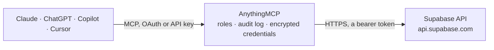

<!-- Generated by scripts/export-github-catalog.mjs in the anythingmcp-website repository. Do not edit by hand. -->

# Supabase MCP connector

Let your AI look after your Supabase projects: list projects and check their health, explore schemas and tables, run read-only SQL, read logs, security and performance advisors, Edge Functions, … The AnythingMCP connector gives Claude, ChatGPT, Microsoft Copilot, Cursor and Gemini 24 MCP tools for Supabase: 23 read and 1 can change data.

**Category:** [Databases](../database.md) · **Tools:** 24 · **Setup guide:** [anythingmcp.com](https://anythingmcp.com/guides/supabase-to-mcp) · [Deutsch](https://anythingmcp.com/de/guides/supabase-to-mcp) · [Italiano](https://anythingmcp.com/it/guides/supabase-to-mcp) · [Español](https://anythingmcp.com/es/guides/supabase-to-mcp) · [日本語](https://anythingmcp.com/ja/guides/supabase-to-mcp) · [Русский](https://anythingmcp.com/ru/guides/supabase-to-mcp) · [中文](https://anythingmcp.com/zh/guides/supabase-to-mcp)

## Start without code

No installation and no terminal: AnythingMCP Cloud runs the Supabase connector for you, operated by helpcode.ai in Frankfurt, Germany.

1. **Click the button above** and create an account or sign in. The Supabase connector opens, ready to install.
2. **Paste the API key or token from your Supabase account.** Every click is in the [step-by-step guide](https://anythingmcp.com/guides/supabase-to-mcp).
3. **Click Install.** AnythingMCP shows the address of your MCP server.
4. **Add that address to your assistant:** [Claude](https://anythingmcp.com/guides/connect-supabase-to-claude) · [ChatGPT](https://anythingmcp.com/guides/connect-supabase-to-chatgpt) · [Microsoft Copilot](https://anythingmcp.com/guides/connect-supabase-to-copilot) · [Cursor](https://anythingmcp.com/guides/connect-supabase-to-cursor) · [Gemini CLI](https://anythingmcp.com/guides/connect-supabase-to-gemini) · [Meta Muse](https://anythingmcp.com/guides/connect-supabase-to-muse).
5. **Ask your first question**, for example: *Show project details for ref solarproject2026, I need Postgres host, version and status.*

Prefer help with the setup? [Talk to us](https://anythingmcp.com/contact).

## How it works

- **The AI client** speaks MCP (Streamable HTTP) to AnythingMCP and only sees tool names, descriptions and results. It never gets the Supabase credentials.
- **AnythingMCP** checks the client's role, builds the call from the tool definition, adds the credentials (a bearer token), calls Supabase, logs the call and returns the result.
- **Supabase** sees an ordinary API client with the rights of the account the credentials belong to.

## Tools

| Tool | What it does | Access |
|---|---|---|
| [`supabase_list_projects`](#supabase_list_projects) | List every project the token can reach: ref, name, organization_slug, region, status (ACTIVE_HEALTHY, INACTIVE when paused, COMING_UP, RESTORING...),… | read |
| [`supabase_list_organizations`](#supabase_list_organizations) | List the organizations the token can reach, with their slug and name. | read |
| [`supabase_get_organization`](#supabase_get_organization) | Get one organization by slug, including its plan (free, pro, team, enterprise). | read |
| [`supabase_get_project`](#supabase_get_project) | Get one project: name, ref, organization, region, status, created_at and database host and Postgres version. | read |
| [`supabase_get_project_health`](#supabase_get_project_health) | Check the health of a project's services: for each one name, status (ACTIVE_HEALTHY, COMING_UP, UNHEALTHY) and error or info. | read |
| [`supabase_run_read_only_sql`](#supabase_run_read_only_sql) | Run one SQL statement as the read-only database user and return the rows as JSON objects. | read |
| [`supabase_execute_sql`](#supabase_execute_sql) | Run SQL with full rights (as postgres): DDL, inserts, updates, deletes, grants. | write |
| [`supabase_list_schemas`](#supabase_list_schemas) | List the database's schemas with their owner and number of tables, leaving out Postgres' own (pg_*, information_schema). | read |
| [`supabase_list_tables`](#supabase_list_tables) | List the tables, views and materialized views of one or more schemas: schema, name, kind, whether row level security is on, estimated row count, total size… | read |
| [`supabase_describe_table`](#supabase_describe_table) | Describe one table or view: columns (name, type, nullable, default, comment), constraints (primary key, foreign keys, unique, check, with their definition),… | read |
| [`supabase_list_extensions`](#supabase_list_extensions) | List the Postgres extensions installed in the database: name, version and schema (on Supabase usually extensions). | read |
| [`supabase_list_migrations`](#supabase_list_migrations) | List the migrations recorded for the database (by the Supabase CLI or the dashboard): version (timestamp) and name, oldest first. | read |
| [`supabase_list_backups`](#supabase_list_backups) | List the project's database backups: whether point-in-time recovery is on, and each backup's status and time. | read |
| [`supabase_generate_typescript_types`](#supabase_generate_typescript_types) | Generate TypeScript types for the database schema, as the Supabase CLI does: one string with a Database type covering tables, views, functions and enums. | read |
| [`supabase_list_edge_functions`](#supabase_list_edge_functions) | List the project's Edge Functions: slug, name, status, version, verify_jwt, entrypoint path and when they were created and updated (epoch milliseconds). | read |
| [`supabase_get_edge_function`](#supabase_get_edge_function) | Get one Edge Function by slug: status, version, verify_jwt, entrypoint and import map paths, created and updated times. | read |
| [`supabase_list_api_keys`](#supabase_list_api_keys) | List the project's API keys: id, name, type (publishable, secret or legacy), prefix and description. | read |
| [`supabase_query_logs`](#supabase_query_logs) | Query the project's logs with SQL (ClickHouse dialect) over one unified logs table: filter on source (edge_logs, postgres_logs, auth_logs, function_logs,… | read |
| [`supabase_get_api_usage`](#supabase_get_api_usage) | Get request counts per time bucket for the project's REST, Auth, Storage and Realtime APIs over a recent interval. | read |
| [`supabase_get_security_advisors`](#supabase_get_security_advisors) | Run the security advisor (database linter) on the project: findings such as tables without row level security, exposed auth.users, mutable function search… | read |
| [`supabase_get_performance_advisors`](#supabase_get_performance_advisors) | Run the performance advisor on the project: findings such as unindexed foreign keys, unused or duplicate indexes, RLS policies that re-evaluate auth… | read |
| [`supabase_list_branches`](#supabase_list_branches) | List the project's preview branches (branching, a paid feature): id, name, project_ref of the branch, git_branch, pr_number, is_default, persistent and status. | read |
| [`supabase_get_branch`](#supabase_get_branch) | Get one preview branch of a project by its name: its own project ref, git branch, pull request number, status and whether it is persistent. | read |
| [`supabase_list_storage_buckets`](#supabase_list_storage_buckets) | List the project's Storage buckets: id, name, owner, whether public, and created and updated times. | read |

## Tool reference

Every parameter as the AI client sees it in `tools/list`. Source: [`packages/backend/src/adapters/intl/supabase.json`](../../../packages/backend/src/adapters/intl/supabase.json).

### `supabase_list_projects`

List every project the token can reach: ref, name, organization_slug, region, status (ACTIVE_HEALTHY, INACTIVE when paused, COMING_UP, RESTORING...), created_at and the Postgres host and version. The ref is what every other tool takes.

**Access:** read · **Call:** `GET /v1/projects`

No parameters.

### `supabase_list_organizations`

List the organizations the token can reach, with their slug and name.

**Access:** read · **Call:** `GET /v1/organizations`

No parameters.

### `supabase_get_organization`

Get one organization by slug, including its plan (free, pro, team, enterprise).

**Access:** read · **Call:** `GET /v1/organizations/{organization_slug}`

| Parameter | Type | Required | Description |
|---|---|---|---|
| `organization_slug` | string | yes | Organization slug, from supabase_list_organizations or supabase_list_projects. |

### `supabase_get_project`

Get one project: name, ref, organization, region, status, created_at and database host and Postgres version. A paused free project shows status INACTIVE; restore it in the dashboard before querying it.

**Access:** read · **Call:** `GET /v1/projects/{project_ref}`

| Parameter | Type | Required | Description |
|---|---|---|---|
| `project_ref` | string | yes | Project ref, the 20 lowercase letters in the project's URL (https://<ref>.supabase.co) and in supabase_list_projects. |

### `supabase_get_project_health`

Check the health of a project's services: for each one name, status (ACTIVE_HEALTHY, COMING_UP, UNHEALTHY) and error or info. Use it when an app reports errors or right after a restore.

**Access:** read · **Call:** `GET /v1/projects/{project_ref}/health`

| Parameter | Type | Required | Description |
|---|---|---|---|
| `project_ref` | string | yes | Project ref, the 20 lowercase letters in the project's URL (https://<ref>.supabase.co) and in supabase_list_projects. |
| `services` | `auth` \| `db` \| `db_postgres_user` \| `pooler` \| `realtime` \| `rest` \| `storage` \| `pg_bouncer`[] | yes | Services to check. |
| `timeout_ms` | integer | no | How long to wait for each check, 0 to 10000 milliseconds. |

### `supabase_run_read_only_sql`

Run one SQL statement as the read-only database user and return the rows as JSON objects. Writes are refused. Qualify every table with its schema (public.orders, not orders). Use $1, $2 placeholders with parameters for values instead of pasting them into the text. Add a LIMIT: large results are cut at 200 KB.

**Access:** read · **Call:** `POST /v1/projects/{project_ref}/database/query/read-only`

| Parameter | Type | Required | Description |
|---|---|---|---|
| `project_ref` | string | yes | Project ref, the 20 lowercase letters in the project's URL (https://<ref>.supabase.co) and in supabase_list_projects. |
| `query` | string | yes | One SQL statement, e.g. select id, status from public.orders where created_at > $1 order by created_at desc limit 50. |
| `parameters` | string[] | no | Values for $1, $2 ... in order. |

### `supabase_execute_sql`

Run SQL with full rights (as postgres): DDL, inserts, updates, deletes, grants. Changes take effect at once and cannot be undone. Show the user the exact statement and wait for explicit confirmation; for schema changes prefer a migration in the user's own workflow. Switched off at install.

**Access:** write · **Call:** `POST /v1/projects/{project_ref}/database/query`

| Parameter | Type | Required | Description |
|---|---|---|---|
| `project_ref` | string | yes | Project ref, the 20 lowercase letters in the project's URL (https://<ref>.supabase.co) and in supabase_list_projects. |
| `query` | string | yes | SQL to run; several statements separated by semicolons are run together. |
| `parameters` | string[] | no | Values for $1, $2 ... in order. |
| `read_only` | boolean | no | true to run it read-only after all. |

### `supabase_list_schemas`

List the database's schemas with their owner and number of tables, leaving out Postgres' own (pg_*, information_schema). Supabase keeps app data in public and its own services in auth, storage, realtime, graphql, extensions and vault.

**Access:** read · **Call:** `POST /v1/projects/{project_ref}/database/query/read-only`

| Parameter | Type | Required | Description |
|---|---|---|---|
| `project_ref` | string | yes | Project ref, the 20 lowercase letters in the project's URL (https://<ref>.supabase.co) and in supabase_list_projects. |

### `supabase_list_tables`

List the tables, views and materialized views of one or more schemas: schema, name, kind, whether row level security is on, estimated row count, total size and comment. Tables in public without RLS are readable by anyone with the anon key.

**Access:** read · **Call:** `POST /v1/projects/{project_ref}/database/query/read-only`

| Parameter | Type | Required | Description |
|---|---|---|---|
| `project_ref` | string | yes | Project ref, the 20 lowercase letters in the project's URL (https://<ref>.supabase.co) and in supabase_list_projects. |
| `schemas` | string | yes | Comma-separated schemas, e.g. public or public,auth (default public). |

### `supabase_describe_table`

Describe one table or view: columns (name, type, nullable, default, comment), constraints (primary key, foreign keys, unique, check, with their definition), indexes and row level security policies.

**Access:** read · **Call:** `POST /v1/projects/{project_ref}/database/query/read-only`

| Parameter | Type | Required | Description |
|---|---|---|---|
| `project_ref` | string | yes | Project ref, the 20 lowercase letters in the project's URL (https://<ref>.supabase.co) and in supabase_list_projects. |
| `schema` | string | yes | Schema of the table (default public). |
| `table` | string | yes | Table or view name, exactly as stored (case-sensitive). |

### `supabase_list_extensions`

List the Postgres extensions installed in the database: name, version and schema (on Supabase usually extensions).

**Access:** read · **Call:** `POST /v1/projects/{project_ref}/database/query/read-only`

| Parameter | Type | Required | Description |
|---|---|---|---|
| `project_ref` | string | yes | Project ref, the 20 lowercase letters in the project's URL (https://<ref>.supabase.co) and in supabase_list_projects. |

### `supabase_list_migrations`

List the migrations recorded for the database (by the Supabase CLI or the dashboard): version (timestamp) and name, oldest first.

**Access:** read · **Call:** `GET /v1/projects/{project_ref}/database/migrations`

| Parameter | Type | Required | Description |
|---|---|---|---|
| `project_ref` | string | yes | Project ref, the 20 lowercase letters in the project's URL (https://<ref>.supabase.co) and in supabase_list_projects. |

### `supabase_list_backups`

List the project's database backups: whether point-in-time recovery is on, and each backup's status and time. Free projects have no downloadable backups.

**Access:** read · **Call:** `GET /v1/projects/{project_ref}/database/backups`

| Parameter | Type | Required | Description |
|---|---|---|---|
| `project_ref` | string | yes | Project ref, the 20 lowercase letters in the project's URL (https://<ref>.supabase.co) and in supabase_list_projects. |

### `supabase_generate_typescript_types`

Generate TypeScript types for the database schema, as the Supabase CLI does: one string with a Database type covering tables, views, functions and enums. Large schemas are cut at 200 KB.

**Access:** read · **Call:** `GET /v1/projects/{project_ref}/types/typescript`

| Parameter | Type | Required | Description |
|---|---|---|---|
| `project_ref` | string | yes | Project ref, the 20 lowercase letters in the project's URL (https://<ref>.supabase.co) and in supabase_list_projects. |
| `included_schemas` | string | no | Comma-separated schemas to include (default public). |

### `supabase_list_edge_functions`

List the project's Edge Functions: slug, name, status, version, verify_jwt, entrypoint path and when they were created and updated (epoch milliseconds).

**Access:** read · **Call:** `GET /v1/projects/{project_ref}/functions`

| Parameter | Type | Required | Description |
|---|---|---|---|
| `project_ref` | string | yes | Project ref, the 20 lowercase letters in the project's URL (https://<ref>.supabase.co) and in supabase_list_projects. |

### `supabase_get_edge_function`

Get one Edge Function by slug: status, version, verify_jwt, entrypoint and import map paths, created and updated times. The function's code is not returned.

**Access:** read · **Call:** `GET /v1/projects/{project_ref}/functions/{function_slug}`

| Parameter | Type | Required | Description |
|---|---|---|---|
| `project_ref` | string | yes | Project ref, the 20 lowercase letters in the project's URL (https://<ref>.supabase.co) and in supabase_list_projects. |
| `function_slug` | string | yes | Function slug, e.g. send-welcome-email. |

### `supabase_list_api_keys`

List the project's API keys: id, name, type (publishable, secret or legacy), prefix and description. Only public keys (publishable and the legacy anon key) carry their value; secret and service_role keys are listed without it, on purpose.

**Access:** read · **Call:** `GET /v1/projects/{project_ref}/api-keys`

| Parameter | Type | Required | Description |
|---|---|---|---|
| `project_ref` | string | yes | Project ref, the 20 lowercase letters in the project's URL (https://<ref>.supabase.co) and in supabase_list_projects. |

### `supabase_query_logs`

Query the project's logs with SQL (ClickHouse dialect) over one unified logs table: filter on source (edge_logs, postgres_logs, auth_logs, function_logs, function_edge_logs, storage_logs, realtime_logs), read nested fields with log_attributes['request.path']. Without a time range only the last minute is searched; the range may span at most 24 hours. Returns result rows and, on a bad query, error.

**Access:** read · **Call:** `GET /v1/projects/{project_ref}/analytics/endpoints/logs`

| Parameter | Type | Required | Description |
|---|---|---|---|
| `project_ref` | string | yes | Project ref, the 20 lowercase letters in the project's URL (https://<ref>.supabase.co) and in supabase_list_projects. |
| `sql` | string | yes | SQL over the logs table, e.g. select timestamp, event_message, log_attributes['response.status_code'] as status from logs where source = 'edge_logs' order by timestamp desc limit 50. |
| `iso_timestamp_start` | string | no | Start of the range, UTC ISO 8601 ending in Z, e.g. 2026-10-10T08:00:00Z. |
| `iso_timestamp_end` | string | no | End of the range, UTC ISO 8601 ending in Z; at most 24 hours after the start. |

### `supabase_get_api_usage`

Get request counts per time bucket for the project's REST, Auth, Storage and Realtime APIs over a recent interval.

**Access:** read · **Call:** `GET /v1/projects/{project_ref}/analytics/endpoints/usage.api-counts`

| Parameter | Type | Required | Description |
|---|---|---|---|
| `project_ref` | string | yes | Project ref, the 20 lowercase letters in the project's URL (https://<ref>.supabase.co) and in supabase_list_projects. |
| `interval` | `15min` \| `30min` \| `1hr` \| `3hr` \| `1day` \| `3day` \| `7day` | no | Time window, e.g. 1day (default) or 7day. |

### `supabase_get_security_advisors`

Run the security advisor (database linter) on the project: findings such as tables without row level security, exposed auth.users, mutable function search paths or insecure extensions, each with level (ERROR, WARN, INFO), detail and a remediation link.

**Access:** read · **Call:** `GET /v1/projects/{project_ref}/advisors/security`

| Parameter | Type | Required | Description |
|---|---|---|---|
| `project_ref` | string | yes | Project ref, the 20 lowercase letters in the project's URL (https://<ref>.supabase.co) and in supabase_list_projects. |

### `supabase_get_performance_advisors`

Run the performance advisor on the project: findings such as unindexed foreign keys, unused or duplicate indexes, RLS policies that re-evaluate auth functions per row, each with level, detail and a remediation link.

**Access:** read · **Call:** `GET /v1/projects/{project_ref}/advisors/performance`

| Parameter | Type | Required | Description |
|---|---|---|---|
| `project_ref` | string | yes | Project ref, the 20 lowercase letters in the project's URL (https://<ref>.supabase.co) and in supabase_list_projects. |

### `supabase_list_branches`

List the project's preview branches (branching, a paid feature): id, name, project_ref of the branch, git_branch, pr_number, is_default, persistent and status. A project without branching answers with an error or an empty list.

**Access:** read · **Call:** `GET /v1/projects/{project_ref}/branches`

| Parameter | Type | Required | Description |
|---|---|---|---|
| `project_ref` | string | yes | Project ref, the 20 lowercase letters in the project's URL (https://<ref>.supabase.co) and in supabase_list_projects. |

### `supabase_get_branch`

Get one preview branch of a project by its name: its own project ref, git branch, pull request number, status and whether it is persistent.

**Access:** read · **Call:** `GET /v1/projects/{project_ref}/branches/{branch_name}`

| Parameter | Type | Required | Description |
|---|---|---|---|
| `project_ref` | string | yes | Project ref, the 20 lowercase letters in the project's URL (https://<ref>.supabase.co) and in supabase_list_projects. |
| `branch_name` | string | yes | Branch name, from supabase_list_branches. |

### `supabase_list_storage_buckets`

List the project's Storage buckets: id, name, owner, whether public, and created and updated times.

**Access:** read · **Call:** `GET /v1/projects/{project_ref}/storage/buckets`

| Parameter | Type | Required | Description |
|---|---|---|---|
| `project_ref` | string | yes | Project ref, the 20 lowercase letters in the project's URL (https://<ref>.supabase.co) and in supabase_list_projects. |

## Run it yourself

AnythingMCP is open source (AGPL-3.0). [Run it with Docker](../../../README.md#run-it-yourself), open **Connectors → Store**, pick **Supabase** and enter `SUPABASE_ACCESS_TOKEN`, then add your MCP server URL to the AI client.

[← Databases connectors](../database.md) · [All categories](../README.md)
