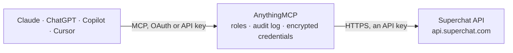

<!-- Generated by scripts/export-github-catalog.mjs in the anythingmcp-website repository. Do not edit by hand. -->

# Superchat MCP connector

Superchat shared inbox for WhatsApp, Instagram, Facebook, SMS, Telegram, live chat and e-mail: conversations and their messages, contacts, templates, files, labels and users, plus sending messages and WhatsApp templates. The AnythingMCP connector gives Claude, ChatGPT, Microsoft Copilot, Cursor and Gemini 28 MCP tools for Superchat: 21 read and 7 can change data.

**Category:** [Messaging](../messaging.md) · **Tools:** 28 · **Setup guide:** [anythingmcp.com](https://anythingmcp.com/guides/superchat-to-mcp) · [Deutsch](https://anythingmcp.com/de/guides/superchat-to-mcp) · [Italiano](https://anythingmcp.com/it/guides/superchat-to-mcp) · [Español](https://anythingmcp.com/es/guides/superchat-to-mcp) · [日本語](https://anythingmcp.com/ja/guides/superchat-to-mcp) · [Русский](https://anythingmcp.com/ru/guides/superchat-to-mcp) · [中文](https://anythingmcp.com/zh/guides/superchat-to-mcp)

## Start without code

No installation and no terminal: AnythingMCP Cloud runs the Superchat connector for you, operated by helpcode.ai in Frankfurt, Germany.

1. **Click the button above** and create an account or sign in. The Superchat connector opens, ready to install.
2. **Paste the API key or token from your Superchat account.** Every click is in the [step-by-step guide](https://anythingmcp.com/guides/superchat-to-mcp).
3. **Click Install.** AnythingMCP shows the address of your MCP server.
4. **Add that address to your assistant:** [Claude](https://anythingmcp.com/guides/connect-superchat-to-claude) · [ChatGPT](https://anythingmcp.com/guides/connect-superchat-to-chatgpt) · [Microsoft Copilot](https://anythingmcp.com/guides/connect-superchat-to-copilot) · [Cursor](https://anythingmcp.com/guides/connect-superchat-to-cursor) · [Gemini CLI](https://anythingmcp.com/guides/connect-superchat-to-gemini) · [Meta Muse](https://anythingmcp.com/guides/connect-superchat-to-muse).
5. **Ask your first question**, for example: *Find contact by phone +491701234567 and show their conversations and last message*

Prefer help with the setup? [Talk to us](https://anythingmcp.com/contact).

## How it works

- **The AI client** speaks MCP (Streamable HTTP) to AnythingMCP and only sees tool names, descriptions and results. It never gets the Superchat credentials.
- **AnythingMCP** checks the client's role, builds the call from the tool definition, adds the credentials (an API key), calls Superchat, logs the call and returns the result.
- **Superchat** sees an ordinary API client with the rights of the account the credentials belong to.

## Tools

| Tool | What it does | Access |
|---|---|---|
| [`superchat_get_me`](#superchat_get_me) | Return the Superchat user the API key belongs to and the workspace name. | read |
| [`superchat_list_channels`](#superchat_list_channels) | List the workspace's message channels (WhatsApp numbers, Instagram and Facebook pages, e-mail, SMS, Telegram, live chat) with id, type and name. | read |
| [`superchat_get_channel`](#superchat_get_channel) | Return one message channel by id: type, name and configuration. | read |
| [`superchat_list_inboxes`](#superchat_list_inboxes) | List the inboxes of the workspace (teams or queues conversations are routed to), with id and name. | read |
| [`superchat_list_users`](#superchat_list_users) | List the users of the workspace with id, name, e-mail, phone and role. | read |
| [`superchat_list_labels`](#superchat_list_labels) | List the conversation labels of the workspace with id and name. | read |
| [`superchat_list_conversations`](#superchat_list_conversations) | List conversations with status (open, done, snoozed, archived, spam), channel, inbox, labels, assigned users, contacts and the messaging time window. | read |
| [`superchat_get_conversation`](#superchat_get_conversation) | Return one conversation by id: status, channel, inbox, labels, assigned users, contacts and whether the WhatsApp or Instagram time window is still open. | read |
| [`superchat_list_conversation_messages`](#superchat_list_conversation_messages) | List the messages of one conversation, inbound and outbound, with content, sender, status and time. | read |
| [`superchat_get_message`](#superchat_get_message) | Return one message by id with its content, channel, sender, recipient and delivery status. | read |
| [`superchat_list_conversation_notes`](#superchat_list_conversation_notes) | List the internal notes on one conversation (visible to the team only, never sent to the contact), with author and time. | read |
| [`superchat_list_contacts`](#superchat_list_contacts) | List contacts with name, gender, handles (phone numbers, e-mail addresses, Instagram) and custom attributes. | read |
| [`superchat_get_contact`](#superchat_get_contact) | Return one contact by id with name, gender, all handles and custom attribute values. | read |
| [`superchat_search_contacts`](#superchat_search_contacts) | Find contacts by e-mail address, phone number or Instagram username (exact match). | read |
| [`superchat_list_contact_conversations`](#superchat_list_contact_conversations) | List all conversations of one contact across channels, with status and channel. | read |
| [`superchat_list_custom_attributes`](#superchat_list_custom_attributes) | List the custom contact attributes defined in the workspace, with id, name and type. | read |
| [`superchat_list_contact_lists`](#superchat_list_contact_lists) | List the contact lists of the workspace (segments used for campaigns), with id and name. | read |
| [`superchat_list_templates`](#superchat_list_templates) | List message templates: WhatsApp templates (pre-approved by Meta, needed outside the 24-hour window) and generic templates, with id, name, status, content… | read |
| [`superchat_get_template`](#superchat_get_template) | Return one template by id with its content, approval status and the positions of its variables. | read |
| [`superchat_list_files`](#superchat_list_files) | List files uploaded to the workspace (attachments and media) with id, name and MIME type. | read |
| [`superchat_get_file`](#superchat_get_file) | Return one file by id with name, MIME type and a temporary download link (link.url, valid until link.valid_until). | read |
| [`superchat_send_message`](#superchat_send_message) | Send a text message to a contact from one channel (WhatsApp, SMS, Instagram, Facebook, Telegram, live chat). | write |
| [`superchat_send_template`](#superchat_send_template) | Send an approved WhatsApp template to a contact. | write |
| [`superchat_send_email`](#superchat_send_email) | Send a plain-text e-mail to a contact from one of the workspace's e-mail channels, with subject, body and optional attachments by file id. | write |
| [`superchat_create_contact`](#superchat_create_contact) | Create a contact with name, gender and at least one phone number or e-mail address, plus optional custom attributes. | write |
| [`superchat_update_contact`](#superchat_update_contact) | Update a contact's name, gender, handles or custom attributes. | write |
| [`superchat_update_conversation`](#superchat_update_conversation) | Change a conversation: set its status (open, done, snoozed, archived, spam), move it to an inbox, assign users, set labels or snooze it until a time. | write |
| [`superchat_create_note`](#superchat_create_note) | Add an internal note to a conversation. | write |

## Tool reference

Every parameter as the AI client sees it in `tools/list`. Source: [`packages/backend/src/adapters/de/superchat.json`](../../../packages/backend/src/adapters/de/superchat.json).

### `superchat_get_me`

Return the Superchat user the API key belongs to and the workspace name. No parameters; use it to check that the key works.

**Access:** read · **Call:** `GET /me`

No parameters.

### `superchat_list_channels`

List the workspace's message channels (WhatsApp numbers, Instagram and Facebook pages, e-mail, SMS, Telegram, live chat) with id, type and name. The channel id is the sender for every message.

**Access:** read · **Call:** `GET /channels`

| Parameter | Type | Required | Description |
|---|---|---|---|
| `limit` | integer | no | Maximum number of items to return, 1 to 100. |
| `after` | string | no | Cursor for the next page: pagination.next_cursor from the previous answer. |
| `before` | string | no | Cursor for the previous page: pagination.previous_cursor from the previous answer. |

### `superchat_get_channel`

Return one message channel by id: type, name and configuration. Use it to confirm which number or address a channel sends from.

**Access:** read · **Call:** `GET /channels/{channel_id}`

| Parameter | Type | Required | Description |
|---|---|---|---|
| `channel_id` | string | yes | Channel id, from superchat_list_channels. |

### `superchat_list_inboxes`

List the inboxes of the workspace (teams or queues conversations are routed to), with id and name. Use the id to assign a conversation.

**Access:** read · **Call:** `GET /inboxes`

| Parameter | Type | Required | Description |
|---|---|---|---|
| `limit` | integer | no | Maximum number of items to return, 1 to 100. |
| `after` | string | no | Cursor for the next page: pagination.next_cursor from the previous answer. |
| `before` | string | no | Cursor for the previous page: pagination.previous_cursor from the previous answer. |

### `superchat_list_users`

List the users of the workspace with id, name, e-mail, phone and role. Use the id to assign a conversation to someone.

**Access:** read · **Call:** `GET /users`

| Parameter | Type | Required | Description |
|---|---|---|---|
| `limit` | integer | no | Maximum number of items to return, 1 to 100. |
| `after` | string | no | Cursor for the next page: pagination.next_cursor from the previous answer. |
| `before` | string | no | Cursor for the previous page: pagination.previous_cursor from the previous answer. |

### `superchat_list_labels`

List the conversation labels of the workspace with id and name. Use the id to label a conversation.

**Access:** read · **Call:** `GET /labels`

| Parameter | Type | Required | Description |
|---|---|---|---|
| `limit` | integer | no | Maximum number of items to return, 1 to 100. |
| `after` | string | no | Cursor for the next page: pagination.next_cursor from the previous answer. |
| `before` | string | no | Cursor for the previous page: pagination.previous_cursor from the previous answer. |

### `superchat_list_conversations`

List conversations with status (open, done, snoozed, archived, spam), channel, inbox, labels, assigned users, contacts and the messaging time window. Newest first, paged with cursors.

**Access:** read · **Call:** `GET /conversations`

| Parameter | Type | Required | Description |
|---|---|---|---|
| `limit` | integer | no | Maximum number of items to return, 1 to 100. |
| `after` | string | no | Cursor for the next page: pagination.next_cursor from the previous answer. |
| `before` | string | no | Cursor for the previous page: pagination.previous_cursor from the previous answer. |

### `superchat_get_conversation`

Return one conversation by id: status, channel, inbox, labels, assigned users, contacts and whether the WhatsApp or Instagram time window is still open.

**Access:** read · **Call:** `GET /conversations/{conversation_id}`

| Parameter | Type | Required | Description |
|---|---|---|---|
| `conversation_id` | string | yes | Conversation id, from superchat_list_conversations or superchat_list_contact_conversations. |

### `superchat_list_conversation_messages`

List the messages of one conversation, inbound and outbound, with content, sender, status and time. Filter by direction or time to read only the recent part of a thread.

**Access:** read · **Call:** `GET /conversations/{conversation_id}/messages`

| Parameter | Type | Required | Description |
|---|---|---|---|
| `conversation_id` | string | yes | Conversation id, from superchat_list_conversations. |
| `direction` | `INBOUND` \| `OUTBOUND` | no | Only messages received (INBOUND) or sent (OUTBOUND). |
| `created_after` | string | no | Only messages created after this ISO 8601 time, e.g. 2026-10-01T00:00:00Z. |
| `created_before` | string | no | Only messages created before this ISO 8601 time. |
| `limit` | integer | no | Maximum number of items to return, 1 to 100. |
| `after` | string | no | Cursor for the next page: pagination.next_cursor from the previous answer. |
| `before` | string | no | Cursor for the previous page: pagination.previous_cursor from the previous answer. |

### `superchat_get_message`

Return one message by id with its content, channel, sender, recipient and delivery status. Use it to check whether a sent message was delivered or failed.

**Access:** read · **Call:** `GET /messages/{message_id}`

| Parameter | Type | Required | Description |
|---|---|---|---|
| `message_id` | string | yes | Message id, from superchat_list_conversation_messages or the answer of a send tool. |

### `superchat_list_conversation_notes`

List the internal notes on one conversation (visible to the team only, never sent to the contact), with author and time.

**Access:** read · **Call:** `GET /conversations/{conversation_id}/notes`

| Parameter | Type | Required | Description |
|---|---|---|---|
| `conversation_id` | string | yes | Conversation id, from superchat_list_conversations. |
| `limit` | integer | no | Maximum number of items to return, 1 to 100. |
| `after` | string | no | Cursor for the next page: pagination.next_cursor from the previous answer. |
| `before` | string | no | Cursor for the previous page: pagination.previous_cursor from the previous answer. |

### `superchat_list_contacts`

List contacts with name, gender, handles (phone numbers, e-mail addresses, Instagram) and custom attributes. Paged with cursors; to find one person use superchat_search_contacts.

**Access:** read · **Call:** `GET /contacts`

| Parameter | Type | Required | Description |
|---|---|---|---|
| `limit` | integer | no | Maximum number of items to return, 1 to 100. |
| `after` | string | no | Cursor for the next page: pagination.next_cursor from the previous answer. |
| `before` | string | no | Cursor for the previous page: pagination.previous_cursor from the previous answer. |

### `superchat_get_contact`

Return one contact by id with name, gender, all handles and custom attribute values.

**Access:** read · **Call:** `GET /contacts/{contact_id}`

| Parameter | Type | Required | Description |
|---|---|---|---|
| `contact_id` | string | yes | Contact id, from superchat_list_contacts or superchat_search_contacts. |

### `superchat_search_contacts`

Find contacts by e-mail address, phone number or Instagram username (exact match). Returns the matching contacts with their ids. Use it before sending to or updating a known person.

**Access:** read · **Call:** `POST /contacts/search`

| Parameter | Type | Required | Description |
|---|---|---|---|
| `field` | `mail` \| `phone` \| `instagram` | yes | Which handle to match: mail, phone or instagram. |
| `value` | string | yes | The value to match exactly: an e-mail address, a phone number in E.164 format (+491701234567) or an Instagram username. |
| `limit` | integer | no | Maximum number of items to return, 1 to 100. |
| `after` | string | no | Cursor for the next page: pagination.next_cursor from the previous answer. |
| `before` | string | no | Cursor for the previous page: pagination.previous_cursor from the previous answer. |

### `superchat_list_contact_conversations`

List all conversations of one contact across channels, with status and channel. Use it to find the conversation to read or reply in.

**Access:** read · **Call:** `GET /contacts/{contact_id}/conversations`

| Parameter | Type | Required | Description |
|---|---|---|---|
| `contact_id` | string | yes | Contact id, from superchat_search_contacts. |
| `limit` | integer | no | Maximum number of items to return, 1 to 100. |
| `after` | string | no | Cursor for the next page: pagination.next_cursor from the previous answer. |
| `before` | string | no | Cursor for the previous page: pagination.previous_cursor from the previous answer. |

### `superchat_list_custom_attributes`

List the custom contact attributes defined in the workspace, with id, name and type. Needed to set custom attributes when creating or updating a contact.

**Access:** read · **Call:** `GET /custom-attributes`

| Parameter | Type | Required | Description |
|---|---|---|---|
| `limit` | integer | no | Maximum number of items to return, 1 to 100. |
| `after` | string | no | Cursor for the next page: pagination.next_cursor from the previous answer. |
| `before` | string | no | Cursor for the previous page: pagination.previous_cursor from the previous answer. |

### `superchat_list_contact_lists`

List the contact lists of the workspace (segments used for campaigns), with id and name.

**Access:** read · **Call:** `GET /contact-lists`

| Parameter | Type | Required | Description |
|---|---|---|---|
| `limit` | integer | no | Maximum number of items to return, 1 to 100. |
| `after` | string | no | Cursor for the next page: pagination.next_cursor from the previous answer. |
| `before` | string | no | Cursor for the previous page: pagination.previous_cursor from the previous answer. |

### `superchat_list_templates`

List message templates: WhatsApp templates (pre-approved by Meta, needed outside the 24-hour window) and generic templates, with id, name, status, content and variables.

**Access:** read · **Call:** `GET /templates`

| Parameter | Type | Required | Description |
|---|---|---|---|
| `channel_id` | string | no | Only templates usable on this channel id. |
| `folder_id` | string | no | Only templates in this template folder. |
| `type` | `whats_app_template` \| `generic_template` | no | Only WhatsApp templates or only generic templates. |
| `limit` | integer | no | Maximum number of items to return, 1 to 100. |
| `after` | string | no | Cursor for the next page: pagination.next_cursor from the previous answer. |
| `before` | string | no | Cursor for the previous page: pagination.previous_cursor from the previous answer. |

### `superchat_get_template`

Return one template by id with its content, approval status and the positions of its variables. Read it before sending a template.

**Access:** read · **Call:** `GET /templates/{template_id}`

| Parameter | Type | Required | Description |
|---|---|---|---|
| `template_id` | string | yes | Template id, from superchat_list_templates. |

### `superchat_list_files`

List files uploaded to the workspace (attachments and media) with id, name and MIME type.

**Access:** read · **Call:** `GET /files`

| Parameter | Type | Required | Description |
|---|---|---|---|
| `limit` | integer | no | Maximum number of items to return, 1 to 100. |
| `after` | string | no | Cursor for the next page: pagination.next_cursor from the previous answer. |
| `before` | string | no | Cursor for the previous page: pagination.previous_cursor from the previous answer. |

### `superchat_get_file`

Return one file by id with name, MIME type and a temporary download link (link.url, valid until link.valid_until).

**Access:** read · **Call:** `GET /files/{file_id}`

| Parameter | Type | Required | Description |
|---|---|---|---|
| `file_id` | string | yes | File id, from superchat_list_files or a message's content. |

### `superchat_send_message`

Send a text message to a contact from one channel (WhatsApp, SMS, Instagram, Facebook, Telegram, live chat). WhatsApp only delivers free text within 24 hours of the contact's last message; otherwise use superchat_send_template.

**Access:** write · **Call:** `POST /messages`

| Parameter | Type | Required | Description |
|---|---|---|---|
| `channel_id` | string | yes | Channel to send from, from superchat_list_channels. Its type decides the medium (WhatsApp, SMS, e-mail, Instagram...). |
| `to` | string | yes | Recipient: a phone number in E.164 format (+491701234567), an e-mail address, or an existing contact id. A new number or address creates a contact. |
| `sender_name` | string | no | Display name of the sender, where the channel shows one. Optional. |
| `in_reply_to` | string | no | Id of the message this one answers. Optional. |
| `body` | string | yes | The message text. |

### `superchat_send_template`

Send an approved WhatsApp template to a contact. This is the only way to start a WhatsApp conversation or write after the 24-hour window has closed. Meta charges per template sent.

**Access:** write · **Call:** `POST /messages`

| Parameter | Type | Required | Description |
|---|---|---|---|
| `channel_id` | string | yes | Channel to send from, from superchat_list_channels. Its type decides the medium (WhatsApp, SMS, e-mail, Instagram...). |
| `to` | string | yes | Recipient: a phone number in E.164 format (+491701234567), an e-mail address, or an existing contact id. A new number or address creates a contact. |
| `sender_name` | string | no | Display name of the sender, where the channel shows one. Optional. |
| `in_reply_to` | string | no | Id of the message this one answers. Optional. |
| `template_id` | string | yes | WhatsApp template id from superchat_list_templates; the template must be approved. |
| `variables` | object[] | no | Values for the template placeholders, e.g. [{"position":1,"value":"Anna"}]. Positions start at 1. |

### `superchat_send_email`

Send a plain-text e-mail to a contact from one of the workspace's e-mail channels, with subject, body and optional attachments by file id.

**Access:** write · **Call:** `POST /messages`

| Parameter | Type | Required | Description |
|---|---|---|---|
| `channel_id` | string | yes | Channel to send from, from superchat_list_channels. Its type decides the medium (WhatsApp, SMS, e-mail, Instagram...). |
| `to` | string | yes | Recipient e-mail address or an existing contact id. |
| `sender_name` | string | no | Display name of the sender, where the channel shows one. Optional. |
| `in_reply_to` | string | no | Id of the message this one answers. Optional. |
| `subject` | string | yes | Subject line. |
| `text` | string | yes | Plain text body of the e-mail. |
| `attachments` | object[] | no | Files to attach, as [{"id":"<file id>"}] with ids from superchat_list_files. Optional. |

### `superchat_create_contact`

Create a contact with name, gender and at least one phone number or e-mail address, plus optional custom attributes. Search first to avoid duplicates.

**Access:** write · **Call:** `POST /contacts`

| Parameter | Type | Required | Description |
|---|---|---|---|
| `first_name` | string | yes | First name. |
| `last_name` | string | yes | Last name. |
| `gender` | `male` \| `female` \| `diverse` \| `unknown` | yes | Gender: male, female, diverse or unknown. |
| `handles` | object[] | yes | Phone numbers and e-mail addresses, e.g. [{"id":null,"type":"phone","value":"+491701234567"}]. Use id null for a new handle, the existing handle id to keep one. |
| `custom_attributes` | object[] | no | Custom attribute values, e.g. [{"id":"<attribute id>","value":"Premium"}]. Attribute ids come from superchat_list_custom_attributes. |

### `superchat_update_contact`

Update a contact's name, gender, handles or custom attributes. Name and gender are always written, so read the contact first and pass the current values for fields you do not change.

**Access:** write · **Call:** `PATCH /contacts/{contact_id}`

| Parameter | Type | Required | Description |
|---|---|---|---|
| `contact_id` | string | yes | Contact id, from superchat_search_contacts. |
| `first_name` | string | yes | First name. |
| `last_name` | string | yes | Last name. |
| `gender` | `male` \| `female` \| `diverse` \| `unknown` | yes | Gender: male, female, diverse or unknown. |
| `handles` | object[] | no | The full list of handles the contact keeps; handles left out are removed. Omit to leave handles unchanged. |
| `custom_attributes` | object[] | no | The full list of custom attribute values the contact keeps. Omit to leave them unchanged. |

### `superchat_update_conversation`

Change a conversation: set its status (open, done, snoozed, archived, spam), move it to an inbox, assign users, set labels or snooze it until a time.

**Access:** write · **Call:** `PATCH /conversations/{conversation_id}`

| Parameter | Type | Required | Description |
|---|---|---|---|
| `conversation_id` | string | yes | Conversation id, from superchat_list_conversations. |
| `status` | `open` \| `done` \| `snoozed` \| `archived` \| `spam` | no | New status. |
| `inbox_id` | string | no | Inbox to move the conversation to, from superchat_list_inboxes. |
| `assigned_users` | string[] | no | User ids to assign, from superchat_list_users. Replaces the current assignment. |
| `labels` | string[] | no | Label ids to set, from superchat_list_labels. Replaces the current labels. |
| `snoozed_until` | string | no | ISO 8601 time until which the conversation is snoozed, with status snoozed. |

### `superchat_create_note`

Add an internal note to a conversation. Notes are visible to the team only and are never sent to the contact.

**Access:** write · **Call:** `POST /conversations/{conversation_id}/notes`

| Parameter | Type | Required | Description |
|---|---|---|---|
| `conversation_id` | string | yes | Conversation id, from superchat_list_conversations. |
| `content` | string | yes | Text of the note. |

## Run it yourself

AnythingMCP is open source (AGPL-3.0). [Run it with Docker](../../../README.md#run-it-yourself), open **Connectors → Store**, pick **Superchat** and enter `SUPERCHAT_API_KEY`, then add your MCP server URL to the AI client.

[← Messaging connectors](../messaging.md) · [All categories](../README.md)
