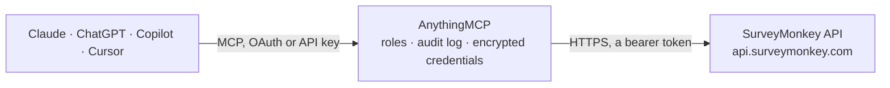

<!-- Generated by scripts/export-github-catalog.mjs in the anythingmcp-website repository. Do not edit by hand. -->

# SurveyMonkey MCP connector

Drive SurveyMonkey from any AI agent: surveys, responses, collectors, contacts. 8 tools, OAuth2 Bearer auth. The AnythingMCP connector gives Claude, ChatGPT, Microsoft Copilot, Cursor and Gemini 8 MCP tools for SurveyMonkey: 7 read and 1 can change data.

**Category:** [Forms & Surveys](../forms.md) · **Tools:** 8 · **Setup guide:** [anythingmcp.com](https://anythingmcp.com/guides/surveymonkey-to-mcp) · [Deutsch](https://anythingmcp.com/de/guides/surveymonkey-to-mcp) · [Italiano](https://anythingmcp.com/it/guides/surveymonkey-to-mcp) · [Español](https://anythingmcp.com/es/guides/surveymonkey-to-mcp) · [日本語](https://anythingmcp.com/ja/guides/surveymonkey-to-mcp) · [Русский](https://anythingmcp.com/ru/guides/surveymonkey-to-mcp) · [中文](https://anythingmcp.com/zh/guides/surveymonkey-to-mcp)

## Start without code

No installation and no terminal: AnythingMCP Cloud runs the SurveyMonkey connector for you, operated by helpcode.ai in Frankfurt, Germany.

1. **Click the button above** and create an account or sign in. The SurveyMonkey connector opens, ready to install.
2. **Paste the API key or token from your SurveyMonkey account.** Every click is in the [step-by-step guide](https://anythingmcp.com/guides/surveymonkey-to-mcp).
3. **Click Install.** AnythingMCP shows the address of your MCP server.
4. **Add that address to your assistant:** [Claude](https://anythingmcp.com/guides/connect-surveymonkey-to-claude) · [ChatGPT](https://anythingmcp.com/guides/connect-surveymonkey-to-chatgpt) · [Microsoft Copilot](https://anythingmcp.com/guides/connect-surveymonkey-to-copilot) · [Cursor](https://anythingmcp.com/guides/connect-surveymonkey-to-cursor) · [Gemini CLI](https://anythingmcp.com/guides/connect-surveymonkey-to-gemini) · [Meta Muse](https://anythingmcp.com/guides/connect-surveymonkey-to-muse).
5. **Ask your first question**, for example: *Show me the response from email eva.keller@greenleaf.de to our 'Post-purchase NPS' survey last week.*

Prefer help with the setup? [Talk to us](https://anythingmcp.com/contact).

## How it works

- **The AI client** speaks MCP (Streamable HTTP) to AnythingMCP and only sees tool names, descriptions and results. It never gets the SurveyMonkey credentials.
- **AnythingMCP** checks the client's role, builds the call from the tool definition, adds the credentials (a bearer token), calls SurveyMonkey, logs the call and returns the result.
- **SurveyMonkey** sees an ordinary API client with the rights of the account the credentials belong to.

## Tools

| Tool | What it does | Access |
|---|---|---|
| [`surveymonkey_get_user`](#surveymonkey_get_user) | Return the user the token belongs to. | read |
| [`surveymonkey_list_surveys`](#surveymonkey_list_surveys) | List surveys. | read |
| [`surveymonkey_get_survey_details`](#surveymonkey_get_survey_details) | Fetch a survey's full structure with pages[].questions[].answers (choice IDs → display text). | read |
| [`surveymonkey_list_survey_responses`](#surveymonkey_list_survey_responses) | List responses to a survey (bulk endpoint includes full answer data). | read |
| [`surveymonkey_get_response`](#surveymonkey_get_response) | Fetch one response in full detail. | read |
| [`surveymonkey_list_collectors`](#surveymonkey_list_collectors) | List collectors (distribution channels) attached to a survey. | read |
| [`surveymonkey_list_contact_lists`](#surveymonkey_list_contact_lists) | List contact lists in the account (used for email distribution collectors). | read |
| [`surveymonkey_add_contact_to_list`](#surveymonkey_add_contact_to_list) | Add a contact to a contact list. | write |

## Tool reference

Every parameter as the AI client sees it in `tools/list`. Source: [`packages/backend/src/adapters/intl/surveymonkey.json`](../../../packages/backend/src/adapters/intl/surveymonkey.json).

### `surveymonkey_get_user`

Return the user the token belongs to.

**Access:** read · **Call:** `GET /users/me`

No parameters.

### `surveymonkey_list_surveys`

List surveys. Each returns id, title, nickname, href, question_count, response_count, date_created, date_modified.

**Access:** read · **Call:** `GET /surveys`

| Parameter | Type | Required | Description |
|---|---|---|---|
| `page` | integer | no | Page. |
| `per_page` | integer | no | Per page (max 1000). |
| `sort_by` | string | no | title or date_modified. |
| `sort_order` | string | no | ASC or DESC. |
| `start_modified_at` | string | no | ISO 8601 filter. |

### `surveymonkey_get_survey_details`

Fetch a survey's full structure with pages[].questions[].answers (choice IDs → display text). Required to interpret responses.

**Access:** read · **Call:** `GET /surveys/{surveyId}/details`

| Parameter | Type | Required | Description |
|---|---|---|---|
| `surveyId` | string | yes | Survey ID. |

### `surveymonkey_list_survey_responses`

List responses to a survey (bulk endpoint includes full answer data). Filter by date range, collector, status.

**Access:** read · **Call:** `GET /surveys/{surveyId}/responses/bulk`

| Parameter | Type | Required | Description |
|---|---|---|---|
| `surveyId` | string | yes | Survey ID. |
| `page` | integer | no | Page. |
| `per_page` | integer | no | Per page (max 100 for bulk). |
| `sort_by` | string | no | date_modified. |
| `sort_order` | string | no | ASC or DESC. |
| `start_created_at` | string | no | ISO 8601. |
| `end_created_at` | string | no | ISO 8601. |
| `collector_ids` | string | no | Comma-separated collector IDs to filter. |
| `status` | string | no | completed, partial, disqualified, overquota. |

### `surveymonkey_get_response`

Fetch one response in full detail.

**Access:** read · **Call:** `GET /surveys/{surveyId}/responses/{responseId}`

| Parameter | Type | Required | Description |
|---|---|---|---|
| `surveyId` | string | yes | Survey ID. |
| `responseId` | string | yes | Response ID. |

### `surveymonkey_list_collectors`

List collectors (distribution channels) attached to a survey.

**Access:** read · **Call:** `GET /surveys/{surveyId}/collectors`

| Parameter | Type | Required | Description |
|---|---|---|---|
| `surveyId` | string | yes | Survey ID. |

### `surveymonkey_list_contact_lists`

List contact lists in the account (used for email distribution collectors).

**Access:** read · **Call:** `GET /contact_lists`

No parameters.

### `surveymonkey_add_contact_to_list`

Add a contact to a contact list. Required: email.

**Access:** write · **Call:** `POST /contact_lists/{listId}/contacts`

| Parameter | Type | Required | Description |
|---|---|---|---|
| `listId` | string | yes | Contact list ID. |
| `first_name` | string | no | First name. |
| `last_name` | string | no | Last name. |
| `email` | string | yes | Email (required). |
| `custom_fields` | object | no | Custom field map (defined in UI). |

## Run it yourself

AnythingMCP is open source (AGPL-3.0). [Run it with Docker](../../../README.md#run-it-yourself), open **Connectors → Store**, pick **SurveyMonkey** and enter `SURVEYMONKEY_ACCESS_TOKEN`, then add your MCP server URL to the AI client.

[← Forms & Surveys connectors](../forms.md) · [All categories](../README.md)
