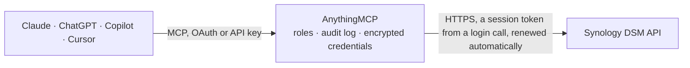

<!-- Generated by scripts/export-github-catalog.mjs in the anythingmcp-website repository. Do not edit by hand. -->

# Synology DSM MCP connector

Synology DiskStation Manager: system and storage health, shared folders, running tasks, Download Station queue and the file station tree. The AnythingMCP connector gives Claude, ChatGPT, Microsoft Copilot, Cursor and Gemini 10 MCP tools for Synology DSM, all read-only.

**Category:** [File Storage](../storage.md) · **Tools:** 10 · **Setup guide:** [anythingmcp.com](https://anythingmcp.com/guides/synology-to-mcp) · [Deutsch](https://anythingmcp.com/de/guides/synology-to-mcp) · [Italiano](https://anythingmcp.com/it/guides/synology-to-mcp) · [Español](https://anythingmcp.com/es/guides/synology-to-mcp) · [日本語](https://anythingmcp.com/ja/guides/synology-to-mcp) · [Русский](https://anythingmcp.com/ru/guides/synology-to-mcp) · [中文](https://anythingmcp.com/zh/guides/synology-to-mcp)

## Start without code

No installation and no terminal: AnythingMCP Cloud runs the Synology DSM connector for you, operated by helpcode.ai in Frankfurt, Germany.

1. **Click the button above** and create an account or sign in. The Synology DSM connector opens, ready to install.
2. **Paste the API key or token from your Synology DSM account.** Every click is in the [step-by-step guide](https://anythingmcp.com/guides/synology-to-mcp).
3. **Click Install.** AnythingMCP shows the address of your MCP server.
4. **Add that address to your assistant:** [Claude](https://anythingmcp.com/guides/connect-synology-to-claude) · [ChatGPT](https://anythingmcp.com/guides/connect-synology-to-chatgpt) · [Microsoft Copilot](https://anythingmcp.com/guides/connect-synology-to-copilot) · [Cursor](https://anythingmcp.com/guides/connect-synology-to-cursor) · [Gemini CLI](https://anythingmcp.com/guides/connect-synology-to-gemini) · [Meta Muse](https://anythingmcp.com/guides/connect-synology-to-muse).
5. **Ask your first question**, for example: *Show the DSM user record for integration_user, is it disabled or expired and what's the e-mail?*

Prefer help with the setup? [Talk to us](https://anythingmcp.com/contact).

## How it works

- **The AI client** speaks MCP (Streamable HTTP) to AnythingMCP and only sees tool names, descriptions and results. It never gets the Synology DSM credentials.
- **AnythingMCP** checks the client's role, builds the call from the tool definition, adds the credentials (a session token from a login call, renewed automatically), calls Synology DSM, logs the call and returns the result.
- **Synology DSM** sees an ordinary API client with the rights of the account the credentials belong to.

## Tools

| Tool | What it does | Access |
|---|---|---|
| [`synology_list_apis`](#synology_list_apis) | List the Web APIs this DSM publishes, with the version range and CGI path of each. | read |
| [`synology_get_system_info`](#synology_get_system_info) | Read the NAS's system information: model, serial number, DSM version, uptime, CPU and total memory. | read |
| [`synology_get_system_utilization`](#synology_get_system_utilization) | Read live utilisation: CPU load, memory in use, disk throughput and network throughput right now. | read |
| [`synology_list_storage`](#synology_list_storage) | Read the storage overview: every volume and disk with its size, used space, filesystem and SMART health status. | read |
| [`synology_list_shares`](#synology_list_shares) | List the shared folders with their name, path, description and whether each is encrypted — the map of what is on the NAS. | read |
| [`synology_list_files`](#synology_list_files) | List the files and folders under one path in File Station, with their size, type and modification time. | read |
| [`synology_search_files`](#synology_search_files) | Start a File Station search under one path for a filename pattern. | read |
| [`synology_get_search_results`](#synology_get_search_results) | Read the files matched by a search started with synology_search_files: name, real path, size and times. | read |
| [`synology_list_download_tasks`](#synology_list_download_tasks) | List the Download Station queue with each task's title, status, size, progress and speed — what the NAS is currently fetching. | read |
| [`synology_list_users`](#synology_list_users) | List the DSM user accounts with their name, description, e-mail and whether each is expired or disabled. | read |

## Tool reference

Every parameter as the AI client sees it in `tools/list`. Source: [`packages/backend/src/adapters/intl/synology.json`](../../../packages/backend/src/adapters/intl/synology.json).

### `synology_list_apis`

List the Web APIs this DSM publishes, with the version range and CGI path of each. Start here — DSM versions differ in what they expose, and this is the authority.

**Access:** read · **Call:** `GET /query.cgi`

No parameters.

### `synology_get_system_info`

Read the NAS's system information: model, serial number, DSM version, uptime, CPU and total memory.

**Access:** read · **Call:** `GET /entry.cgi`

No parameters.

### `synology_get_system_utilization`

Read live utilisation: CPU load, memory in use, disk throughput and network throughput right now.

**Access:** read · **Call:** `GET /entry.cgi`

No parameters.

### `synology_list_storage`

Read the storage overview: every volume and disk with its size, used space, filesystem and SMART health status. Where a failing disk shows up.

**Access:** read · **Call:** `GET /entry.cgi`

No parameters.

### `synology_list_shares`

List the shared folders with their name, path, description and whether each is encrypted — the map of what is on the NAS.

**Access:** read · **Call:** `GET /entry.cgi`

| Parameter | Type | Required | Description |
|---|---|---|---|
| `limit` | number | no | Maximum shares to return. |
| `offset` | number | no | Shares to skip, for paging. |

### `synology_list_files`

List the files and folders under one path in File Station, with their size, type and modification time.

**Access:** read · **Call:** `GET /entry.cgi`

| Parameter | Type | Required | Description |
|---|---|---|---|
| `folder_path` | string | yes | Folder path starting with the shared folder name, e.g. /documents or /documents/invoices. Not a volume path: /volume1/... answers error 408. |
| `limit` | number | no | Maximum entries to return. |
| `offset` | number | no | Entries to skip, for paging. |
| `sort_by` | string | no | Sort field: name, size, user, group, mtime, atime, ctime or type. |

### `synology_search_files`

Start a File Station search under one path for a filename pattern. Returns only a task id: DSM's search is asynchronous, so read the matches with synology_get_search_results.

**Access:** read · **Call:** `GET /entry.cgi`

| Parameter | Type | Required | Description |
|---|---|---|---|
| `folder_path` | string | yes | Folder to search under, starting with the shared folder name, e.g. /documents. Not a volume path (/volume1/...). |
| `pattern` | string | yes | Filename pattern, e.g. *.pdf or invoice*. |
| `recursive` | boolean | no | When true, search subfolders too. |

### `synology_get_search_results`

Read the files matched by a search started with synology_search_files: name, real path, size and times. While `finished` is false the search is still running; call again for more results.

**Access:** read · **Call:** `GET /entry.cgi`

| Parameter | Type | Required | Description |
|---|---|---|---|
| `taskid` | string | yes | Task id returned by synology_search_files. |
| `limit` | number | no | Maximum matches to return. |
| `offset` | number | no | Matches to skip, for paging. |

### `synology_list_download_tasks`

List the Download Station queue with each task's title, status, size, progress and speed — what the NAS is currently fetching.

**Access:** read · **Call:** `GET /DownloadStation/task.cgi`

| Parameter | Type | Required | Description |
|---|---|---|---|
| `limit` | number | no | Maximum tasks to return. |
| `offset` | number | no | Tasks to skip, for paging. |

### `synology_list_users`

List the DSM user accounts with their name, description, e-mail and whether each is expired or disabled. Requires an administrator account.

**Access:** read · **Call:** `GET /entry.cgi`

| Parameter | Type | Required | Description |
|---|---|---|---|
| `limit` | number | no | Maximum users to return. |
| `offset` | number | no | Users to skip, for paging. |

## Run it yourself

AnythingMCP is open source (AGPL-3.0). [Run it with Docker](../../../README.md#run-it-yourself), open **Connectors → Store**, pick **Synology DSM** and enter `SYNOLOGY_URL`, `SYNOLOGY_USERNAME`, `SYNOLOGY_PASSWORD`, then add your MCP server URL to the AI client.

[← File Storage connectors](../storage.md) · [All categories](../README.md)
