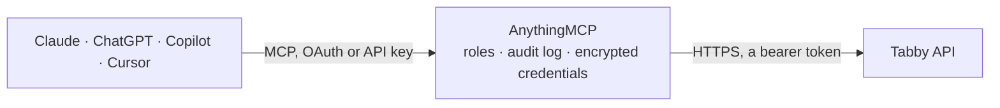

<!-- Generated by scripts/export-github-catalog.mjs in the anythingmcp-website repository. Do not edit by hand. -->

# Tabby MCP connector

Tabby buy now, pay later (UAE, Saudi Arabia, Kuwait): look up payments with their captures and refunds, checkout sessions, customer disputes and webhooks. The AnythingMCP connector gives Claude, ChatGPT, Microsoft Copilot, Cursor and Gemini 9 MCP tools for Tabby: 6 read and 3 can change data.

**Category:** [Payments](../payments.md) · **Tools:** 9 · **Setup guide:** [anythingmcp.com](https://anythingmcp.com/guides/tabby-to-mcp) · [Deutsch](https://anythingmcp.com/de/guides/tabby-to-mcp) · [Italiano](https://anythingmcp.com/it/guides/tabby-to-mcp) · [Español](https://anythingmcp.com/es/guides/tabby-to-mcp) · [日本語](https://anythingmcp.com/ja/guides/tabby-to-mcp) · [Русский](https://anythingmcp.com/ru/guides/tabby-to-mcp) · [中文](https://anythingmcp.com/zh/guides/tabby-to-mcp)

## Start without code

No installation and no terminal: AnythingMCP Cloud runs the Tabby connector for you, operated by helpcode.ai in Frankfurt, Germany.

1. **Click the button above** and create an account or sign in. The Tabby connector opens, ready to install.
2. **Paste the API key or token from your Tabby account.** Every click is in the [step-by-step guide](https://anythingmcp.com/guides/tabby-to-mcp).
3. **Click Install.** AnythingMCP shows the address of your MCP server.
4. **Add that address to your assistant:** [Claude](https://anythingmcp.com/guides/connect-tabby-to-claude) · [ChatGPT](https://anythingmcp.com/guides/connect-tabby-to-chatgpt) · [Microsoft Copilot](https://anythingmcp.com/guides/connect-tabby-to-copilot) · [Cursor](https://anythingmcp.com/guides/connect-tabby-to-cursor) · [Gemini CLI](https://anythingmcp.com/guides/connect-tabby-to-gemini) · [Meta Muse](https://anythingmcp.com/guides/connect-tabby-to-muse).
5. **Ask your first question**, for example: *Find Tabby payment for order ORD-2026-0421-57 between 2026-04-21 and 2026-04-22*

Prefer help with the setup? [Talk to us](https://anythingmcp.com/contact).

## How it works

- **The AI client** speaks MCP (Streamable HTTP) to AnythingMCP and only sees tool names, descriptions and results. It never gets the Tabby credentials.
- **AnythingMCP** checks the client's role, builds the call from the tool definition, adds the credentials (a bearer token), calls Tabby, logs the call and returns the result.
- **Tabby** sees an ordinary API client with the rights of the account the credentials belong to.

## Tools

| Tool | What it does | Access |
|---|---|---|
| [`tabby_search_payments`](#tabby_search_payments) | List Tabby payments, newest first: id, created_at, status, amount and currency, buyer (name, email, phone), order reference_id and items, captures and refunds. | read |
| [`tabby_get_payment_details`](#tabby_get_payment_details) | Get one Tabby payment by its id: status (CREATED, AUTHORIZED, CLOSED, REJECTED, EXPIRED), amount, currency, is_test, buyer, shipping address, order… | read |
| [`tabby_get_checkout_session`](#tabby_get_checkout_session) | Get a checkout session by its id: session status (created, approved, rejected, expired), the payment it created (id, status, amount, order reference) and… | read |
| [`tabby_list_disputes`](#tabby_list_disputes) | List the 100 most recent disputes customers opened on your payments: id, payment_id, order_number, amount, currency, status, reason (unreceived_refund,… | read |
| [`tabby_get_dispute`](#tabby_get_dispute) | Get one dispute by its id with the customer reason, comment, attachments, disputed items, amount, status and the days left before it is approved automatically. | read |
| [`tabby_list_webhooks`](#tabby_list_webhooks) | List the webhooks registered for one merchant code: id, url, is_test and the header Tabby sends with each notification (its value is not returned). | read |
| [`tabby_create_capture`](#tabby_create_capture) | Capture an AUTHORIZED payment in full or in part when the order ships. | write |
| [`tabby_create_refund`](#tabby_create_refund) | Refund a CLOSED (captured) payment in full or in part. | write |
| [`tabby_close_payment`](#tabby_close_payment) | Close an AUTHORIZED payment. | write |

## Tool reference

Every parameter as the AI client sees it in `tools/list`. Source: [`packages/backend/src/adapters/intl/tabby.json`](../../../packages/backend/src/adapters/intl/tabby.json).

### `tabby_search_payments`

List Tabby payments, newest first: id, created_at, status, amount and currency, buyer (name, email, phone), order reference_id and items, captures and refunds. Without status only AUTHORIZED and CLOSED payments are returned. At most 20 per call; page with offset and read pagination.total_count.

**Access:** read · **Call:** `GET /api/v2/payments`

| Parameter | Type | Required | Description |
|---|---|---|---|
| `limit` | integer | no | Payments per call, at most 20. |
| `offset` | integer | no | Number of payments to skip (0-based), for paging. |
| `status` | `authorized` \| `closed` \| `rejected` \| `new` \| `captured` \| `refunded` \| `cancelled` | no | Filter: authorized, closed or rejected (API statuses), or new, captured, refunded, cancelled (Merchant Dashboard statuses). |
| `created_from` | string | no | Only payments created on or after this date, YYYY-MM-DD (UTC). |
| `created_to` | string | no | Only payments created on or before this date, YYYY-MM-DD (UTC). |

### `tabby_get_payment_details`

Get one Tabby payment by its id: status (CREATED, AUTHORIZED, CLOSED, REJECTED, EXPIRED), amount, currency, is_test, buyer, shipping address, order (reference_id = your order number, items, tax, shipping, discount), every capture and refund with amounts and dates, and meta.

**Access:** read · **Call:** `GET /api/v2/payments/{payment_id}`

| Parameter | Type | Required | Description |
|---|---|---|---|
| `payment_id` | string | yes | Tabby payment id (UUID), from tabby_search_payments or your order record, e.g. 3c3bd0c4-2b6e-4d2b-8a4e-6c1d9f0e5a11. |

### `tabby_get_checkout_session`

Get a checkout session by its id: session status (created, approved, rejected, expired), the payment it created (id, status, amount, order reference) and the merchant. Use it when a customer reports a checkout that did not finish.

**Access:** read · **Call:** `GET /api/v2/checkout/{session_id}`

| Parameter | Type | Required | Description |
|---|---|---|---|
| `session_id` | string | yes | Checkout session id returned when the session was created. |

### `tabby_list_disputes`

List the 100 most recent disputes customers opened on your payments: id, payment_id, order_number, amount, currency, status, reason (unreceived_refund, identity_theft, product_issue, not_delivered), days_left before automatic approval, comment and items. Page with page_token = next_page_token until it is empty.

**Access:** read · **Call:** `GET /api/v1/disputes`

| Parameter | Type | Required | Description |
|---|---|---|---|
| `statuses` | `new` \| `declined` \| `cancelled` \| `refunded` \| `in_progress` \| `evidence_merchant` \| `evidence_customer`[] | no | Only these statuses: new, declined, cancelled, refunded, in_progress, evidence_merchant, evidence_customer. |
| `created_from` | string | no | Only disputes created at or after this ISO 8601 date-time. |
| `created_to` | string | no | Only disputes created at or before this ISO 8601 date-time. |
| `page_token` | string | no | next_page_token from the previous answer. |

### `tabby_get_dispute`

Get one dispute by its id with the customer reason, comment, attachments, disputed items, amount, status and the days left before it is approved automatically.

**Access:** read · **Call:** `GET /api/v1/disputes/{dispute_id}`

| Parameter | Type | Required | Description |
|---|---|---|---|
| `dispute_id` | string | yes | Dispute id (UUID) from tabby_list_disputes. |

### `tabby_list_webhooks`

List the webhooks registered for one merchant code: id, url, is_test and the header Tabby sends with each notification (its value is not returned).

**Access:** read · **Call:** `GET /api/v1/webhooks`

| Parameter | Type | Required | Description |
|---|---|---|---|
| `merchant_code` | string | yes | Your Tabby merchant code (store code given by Tabby, e.g. one per country). |

### `tabby_create_capture`

Capture an AUTHORIZED payment in full or in part when the order ships. This settles money: show the payment, amount and currency to the user and wait for a yes. A full capture closes the payment. Installed switched off.

**Access:** write · **Call:** `POST /api/v2/payments/{payment_id}/captures`

| Parameter | Type | Required | Description |
|---|---|---|---|
| `payment_id` | string | yes | Tabby payment id (UUID), from tabby_search_payments or your order record, e.g. 3c3bd0c4-2b6e-4d2b-8a4e-6c1d9f0e5a11. |
| `amount` | string | yes | Amount to capture including tax and shipping, e.g. "250.00" (up to 2 decimals for AED and SAR, 3 for KWD). |
| `reference_id` | string | no | Your idempotency key for this capture, e.g. the shipment number. A retry with the same key is not captured twice. |
| `tax_amount` | string | no | Tax included in the amount. |
| `shipping_amount` | string | no | Shipping included in the amount. |
| `discount_amount` | string | no | Discount applied. |
| `items` | object[] | no | Items being captured. |

### `tabby_create_refund`

Refund a CLOSED (captured) payment in full or in part. The money goes back to the customer at once and cannot be taken back: show the payment, amount and reason to the user and wait for a yes. Installed switched off.

**Access:** write · **Call:** `POST /api/v2/payments/{payment_id}/refunds`

| Parameter | Type | Required | Description |
|---|---|---|---|
| `payment_id` | string | yes | Tabby payment id (UUID), from tabby_search_payments or your order record, e.g. 3c3bd0c4-2b6e-4d2b-8a4e-6c1d9f0e5a11. |
| `amount` | string | yes | Amount to refund, e.g. "100.00". |
| `reference_id` | string | no | Your idempotency key for this refund, e.g. the credit note number. |
| `reason` | string | no | Reason for the refund. |
| `items` | object[] | no | Items being refunded. |

### `tabby_close_payment`

Close an AUTHORIZED payment. Any amount not captured yet is released to the customer and can no longer be captured; use it for a cancelled order or after a partial capture. Ask the user before calling. Installed switched off.

**Access:** write · **Call:** `POST /api/v2/payments/{payment_id}/close`

| Parameter | Type | Required | Description |
|---|---|---|---|
| `payment_id` | string | yes | Tabby payment id (UUID), from tabby_search_payments or your order record, e.g. 3c3bd0c4-2b6e-4d2b-8a4e-6c1d9f0e5a11. |

## Run it yourself

AnythingMCP is open source (AGPL-3.0). [Run it with Docker](../../../README.md#run-it-yourself), open **Connectors → Store**, pick **Tabby** and enter `TABBY_API_URL`, `TABBY_SECRET_KEY`, then add your MCP server URL to the AI client.

[← Payments connectors](../payments.md) · [All categories](../README.md)
