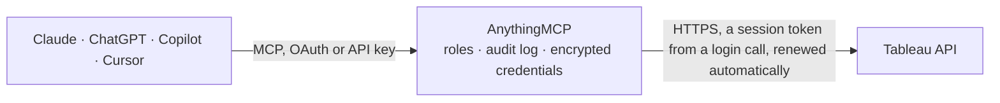

<!-- Generated by scripts/export-github-catalog.mjs in the anythingmcp-website repository. Do not edit by hand. -->

# Tableau MCP connector

Tableau Cloud and Server: find workbooks, views and data sources, read view data as CSV, images and PDFs, query published data sources, trace lineage, manage projects, tags, group members and extract refreshes. The AnythingMCP connector gives Claude, ChatGPT, Microsoft Copilot, Cursor and Gemini 42 MCP tools for Tableau: 31 read and 11 can change data.

**Category:** [Analytics](../analytics.md) · **Tools:** 42 · **Setup guide:** [anythingmcp.com](https://anythingmcp.com/guides/tableau-to-mcp) · [Deutsch](https://anythingmcp.com/de/guides/tableau-to-mcp) · [Italiano](https://anythingmcp.com/it/guides/tableau-to-mcp) · [Español](https://anythingmcp.com/es/guides/tableau-to-mcp) · [日本語](https://anythingmcp.com/ja/guides/tableau-to-mcp) · [Русский](https://anythingmcp.com/ru/guides/tableau-to-mcp) · [中文](https://anythingmcp.com/zh/guides/tableau-to-mcp)

## Start without code

No installation and no terminal: AnythingMCP Cloud runs the Tableau connector for you, operated by helpcode.ai in Frankfurt, Germany.

1. **Click the button above** and create an account or sign in. The Tableau connector opens, ready to install.
2. **Paste the API key or token from your Tableau account.** Every click is in the [step-by-step guide](https://anythingmcp.com/guides/tableau-to-mcp).
3. **Click Install.** AnythingMCP shows the address of your MCP server.
4. **Add that address to your assistant:** [Claude](https://anythingmcp.com/guides/connect-tableau-to-claude) · [ChatGPT](https://anythingmcp.com/guides/connect-tableau-to-chatgpt) · [Microsoft Copilot](https://anythingmcp.com/guides/connect-tableau-to-copilot) · [Cursor](https://anythingmcp.com/guides/connect-tableau-to-cursor) · [Gemini CLI](https://anythingmcp.com/guides/connect-tableau-to-gemini) · [Meta Muse](https://anythingmcp.com/guides/connect-tableau-to-muse).
5. **Ask your first question**, for example: *What is the owner, project and last modified date for workbook 'Q1 Sales BY REGION'?*

Prefer help with the setup? [Talk to us](https://anythingmcp.com/contact).

## How it works

- **The AI client** speaks MCP (Streamable HTTP) to AnythingMCP and only sees tool names, descriptions and results. It never gets the Tableau credentials.
- **AnythingMCP** checks the client's role, builds the call from the tool definition, adds the credentials (a session token from a login call, renewed automatically), calls Tableau, logs the call and returns the result.
- **Tableau** sees an ordinary API client with the rights of the account the credentials belong to.

## Tools

| Tool | What it does | Access |
|---|---|---|
| [`tableau_get_current_session`](#tableau_get_current_session) | The signed-in session: site (id, name, contentUrl) and user (id, name, site role). | read |
| [`tableau_get_server_info`](#tableau_get_server_info) | Product version, build and the newest REST API version of the Tableau Server or Tableau Cloud pod. | read |
| [`tableau_list_sites`](#tableau_list_sites) | Sites the signed-in user can reach (on Tableau Cloud usually only the signed-in one): id, name, contentUrl, state, admin mode. | read |
| [`tableau_get_site`](#tableau_get_site) | Settings of a site: name, contentUrl, state, storage quota, user quota, and which features (subscriptions, flows, Ask Data, ...) are on. | read |
| [`tableau_search_content`](#tableau_search_content) | Search the site's content by words: workbooks, views, data sources, projects, flows, metrics, tables, databases. | read |
| [`tableau_list_projects`](#tableau_list_projects) | Projects (folders) of the site: id, name, description, parent project id, owner, content permissions mode. | read |
| [`tableau_list_workbooks`](#tableau_list_workbooks) | Workbooks of the site: id, name, contentUrl, project, owner, size, tags, created and updated time, webpageUrl. | read |
| [`tableau_get_workbook`](#tableau_get_workbook) | One workbook: name, description, project, owner, tags, views, data acceleration and freshness settings, webpageUrl. | read |
| [`tableau_list_workbook_views`](#tableau_list_workbook_views) | Views (sheets and dashboards) of a workbook: id, name, contentUrl, and with include_usage_statistics the total view count. | read |
| [`tableau_list_workbook_connections`](#tableau_list_workbook_connections) | Data connections of a workbook: type, server address, port, user name, and the published data source behind each. | read |
| [`tableau_list_views`](#tableau_list_views) | Views of the whole site: id, name, contentUrl, workbook, owner, project, tags, and with include_usage_statistics the view count. | read |
| [`tableau_get_view`](#tableau_get_view) | One view: name, contentUrl, workbook, owner, project, tags, and with include_usage_statistics the view count. | read |
| [`tableau_get_view_data`](#tableau_get_view_data) | The data behind a view as CSV text (the summary data of its marks), optionally filtered with vf_ filters. | read |
| [`tableau_get_view_image`](#tableau_get_view_image) | A PNG image of a view, returned as an image the model can look at, optionally filtered with vf_ filters. | read |
| [`tableau_get_view_pdf`](#tableau_get_view_pdf) | A PDF of one view, returned as a file, with paper size and orientation, optionally filtered with vf_ filters. | read |
| [`tableau_download_view_crosstab_excel`](#tableau_download_view_crosstab_excel) | The crosstab of a view as an Excel file (.xlsx), returned as a file, optionally filtered with vf_ filters. | read |
| [`tableau_get_workbook_pdf`](#tableau_get_workbook_pdf) | A PDF of all views of a workbook, returned as a file, with paper size and orientation. | read |
| [`tableau_list_datasources`](#tableau_list_datasources) | Published data sources of the site: id, name, type (database type), project, owner, tags, certification, whether it has an extract, created and updated time. | read |
| [`tableau_get_datasource`](#tableau_get_datasource) | One published data source: name, description, type, project, owner, certification note, extract and refresh information. | read |
| [`tableau_list_datasource_connections`](#tableau_list_datasource_connections) | Connections of a published data source: type, server address, port, user name. | read |
| [`tableau_read_datasource_metadata`](#tableau_read_datasource_metadata) | Fields of a published data source through the VizQL Data Service: fieldCaption (the name to use in queries), dataType, role (dimension or measure), default… | read |
| [`tableau_query_datasource`](#tableau_query_datasource) | Query a published data source through the VizQL Data Service: pick fields (dimensions and aggregated measures), filters and sorting, get rows back as objects. | read |
| [`tableau_metadata_query`](#tableau_metadata_query) | Run a GraphQL query on the Tableau Metadata API for lineage: which workbooks use a data source, upstream databases and tables, columns, calculated fields,… | read |
| [`tableau_list_users`](#tableau_list_users) | Users of the site: id, name, full name, e-mail, site role (Creator, Explorer, Viewer, SiteAdministratorCreator, Unlicensed, ...), last login, auth setting. | read |
| [`tableau_get_user`](#tableau_get_user) | One user: name, full name, e-mail, site role, last login, external auth id. | read |
| [`tableau_list_user_groups`](#tableau_list_user_groups) | Groups a user belongs to: group id, name, domain and minimum site role. | read |
| [`tableau_list_groups`](#tableau_list_groups) | Groups of the site: id, name, domain, minimum site role and user count. | read |
| [`tableau_list_group_users`](#tableau_list_group_users) | Members of a group: user id, name, full name, site role and last login. | read |
| [`tableau_list_jobs`](#tableau_list_jobs) | Background jobs of the site (extract refreshes, subscriptions, flows): id, type, status, progress, created, started and ended time. | read |
| [`tableau_get_job`](#tableau_get_job) | Status of one job: progress (0 to 100), finishCode (0 success, 1 failed, 2 cancelled), notes with the error text, and the workbook or data source it works on. | read |
| [`tableau_list_extract_refresh_tasks`](#tableau_list_extract_refresh_tasks) | Scheduled extract refresh tasks of the site: task id, priority, type (full or incremental), schedule (frequency and next run time), and the workbook or data… | read |
| [`tableau_refresh_workbook`](#tableau_refresh_workbook) | Refresh the extracts of a workbook now. | write |
| [`tableau_refresh_datasource`](#tableau_refresh_datasource) | Refresh the extract of a published data source now. | write |
| [`tableau_run_extract_refresh_task`](#tableau_run_extract_refresh_task) | Run a scheduled extract refresh task now instead of waiting for its schedule. | write |
| [`tableau_cancel_job`](#tableau_cancel_job) | Cancel a running or queued job (an extract refresh, a subscription or a flow run). | write |
| [`tableau_create_project`](#tableau_create_project) | Create a project, at the top level or inside a parent project. | write |
| [`tableau_update_project`](#tableau_update_project) | Rename a project, change its description or content permissions, or move it under another parent. | write |
| [`tableau_update_workbook`](#tableau_update_workbook) | Rename a workbook or switch its tabs on or off. | write |
| [`tableau_move_workbook`](#tableau_move_workbook) | Move a workbook to another project (its permissions may follow the target project's settings). | write |
| [`tableau_add_workbook_tags`](#tableau_add_workbook_tags) | Add tags to a workbook; existing tags stay, the answer lists all tags of the workbook. | write |
| [`tableau_add_datasource_tags`](#tableau_add_datasource_tags) | Add tags to a published data source; existing tags stay, the answer lists all of them. | write |
| [`tableau_add_user_to_group`](#tableau_add_user_to_group) | Add a user of the site to a group (local groups only; Active Directory groups sync from the directory). | write |

## Tool reference

Every parameter as the AI client sees it in `tools/list`. Source: [`packages/backend/src/adapters/intl/tableau.json`](../../../packages/backend/src/adapters/intl/tableau.json).

### `tableau_get_current_session`

The signed-in session: site (id, name, contentUrl) and user (id, name, site role). The site.id is the site_id every other tool needs; call this first.

**Access:** read · **Call:** `GET /api/3.23/sessions/current`

No parameters.

### `tableau_get_server_info`

Product version, build and the newest REST API version of the Tableau Server or Tableau Cloud pod.

**Access:** read · **Call:** `GET /api/3.23/serverinfo`

No parameters.

### `tableau_list_sites`

Sites the signed-in user can reach (on Tableau Cloud usually only the signed-in one): id, name, contentUrl, state, admin mode.

**Access:** read · **Call:** `GET /api/3.23/sites`

| Parameter | Type | Required | Description |
|---|---|---|---|
| `page_size` | integer | no | Items per page, 1 to 1000 (default 100). |
| `page_number` | integer | no | Page to return, starting at 1. |

### `tableau_get_site`

Settings of a site: name, contentUrl, state, storage quota, user quota, and which features (subscriptions, flows, Ask Data, ...) are on.

**Access:** read · **Call:** `GET /api/3.23/sites/{site_id}`

| Parameter | Type | Required | Description |
|---|---|---|---|
| `site_id` | string | yes | Site id (LUID) from tableau_get_current_session (site.id). |

### `tableau_search_content`

Search the site's content by words: workbooks, views, data sources, projects, flows, metrics, tables, databases. Returns hits.items with type, the content (luid, title, ownerName, projectName, modifiedTime) and usage counts (hitsTotal).

**Access:** read · **Call:** `GET /api/-/search`

| Parameter | Type | Required | Description |
|---|---|---|---|
| `terms` | string | no | Search words. |
| `filter` | string | no | Restrict the hits, e.g. type:eq:workbook, type:in:[workbook,datasource], ownerId:in:[luid1,luid2]. |
| `order_by` | string | no | Sort, e.g. hitsTotal:desc or hitsSmallSpanTotal:desc (views in the last two weeks). |
| `limit` | integer | no | Hits per page (default 10). |
| `page` | integer | no | Page of hits to return, for the next page after the first. |

### `tableau_list_projects`

Projects (folders) of the site: id, name, description, parent project id, owner, content permissions mode.

**Access:** read · **Call:** `GET /api/3.23/sites/{site_id}/projects`

| Parameter | Type | Required | Description |
|---|---|---|---|
| `site_id` | string | yes | Site id (LUID) from tableau_get_current_session (site.id). |
| `filter` | string | no | Filter expression field:operator:value, several joined by commas (all must match). Operators: eq, in, gt, gte, lt, lte, has. Fields: name, ownerName, parentProjectId, topLevelProject, createdAt, updatedAt. |
| `sort` | string | no | Sort expression field:asc or field:desc, e.g. name:asc or updatedAt:desc. |
| `fields` | string | no | Fields to return, e.g. _default_ or _all_, or a list such as id,name,updatedAt. |
| `page_size` | integer | no | Items per page, 1 to 1000 (default 100). |
| `page_number` | integer | no | Page to return, starting at 1. |

### `tableau_list_workbooks`

Workbooks of the site: id, name, contentUrl, project, owner, size, tags, created and updated time, webpageUrl.

**Access:** read · **Call:** `GET /api/3.23/sites/{site_id}/workbooks`

| Parameter | Type | Required | Description |
|---|---|---|---|
| `site_id` | string | yes | Site id (LUID) from tableau_get_current_session (site.id). |
| `filter` | string | no | Filter expression field:operator:value, several joined by commas (all must match). Operators: eq, in, gt, gte, lt, lte, has. Fields: name, projectName, ownerName, tags, createdAt, updatedAt, contentUrl, favoritesTotal. |
| `sort` | string | no | Sort expression field:asc or field:desc, e.g. name:asc or updatedAt:desc. |
| `fields` | string | no | Fields to return, e.g. _default_ or _all_, or a list such as id,name,updatedAt. |
| `page_size` | integer | no | Items per page, 1 to 1000 (default 100). |
| `page_number` | integer | no | Page to return, starting at 1. |

### `tableau_get_workbook`

One workbook: name, description, project, owner, tags, views, data acceleration and freshness settings, webpageUrl.

**Access:** read · **Call:** `GET /api/3.23/sites/{site_id}/workbooks/{workbook_id}`

| Parameter | Type | Required | Description |
|---|---|---|---|
| `site_id` | string | yes | Site id (LUID) from tableau_get_current_session (site.id). |
| `workbook_id` | string | yes | Workbook id (LUID) from tableau_list_workbooks or tableau_search_content. |

### `tableau_list_workbook_views`

Views (sheets and dashboards) of a workbook: id, name, contentUrl, and with include_usage_statistics the total view count.

**Access:** read · **Call:** `GET /api/3.23/sites/{site_id}/workbooks/{workbook_id}/views`

| Parameter | Type | Required | Description |
|---|---|---|---|
| `site_id` | string | yes | Site id (LUID) from tableau_get_current_session (site.id). |
| `workbook_id` | string | yes | Workbook id (LUID) from tableau_list_workbooks or tableau_search_content. |
| `include_usage_statistics` | boolean | no | true adds usage.totalViewCount. |

### `tableau_list_workbook_connections`

Data connections of a workbook: type, server address, port, user name, and the published data source behind each.

**Access:** read · **Call:** `GET /api/3.23/sites/{site_id}/workbooks/{workbook_id}/connections`

| Parameter | Type | Required | Description |
|---|---|---|---|
| `site_id` | string | yes | Site id (LUID) from tableau_get_current_session (site.id). |
| `workbook_id` | string | yes | Workbook id (LUID) from tableau_list_workbooks or tableau_search_content. |

### `tableau_list_views`

Views of the whole site: id, name, contentUrl, workbook, owner, project, tags, and with include_usage_statistics the view count.

**Access:** read · **Call:** `GET /api/3.23/sites/{site_id}/views`

| Parameter | Type | Required | Description |
|---|---|---|---|
| `site_id` | string | yes | Site id (LUID) from tableau_get_current_session (site.id). |
| `include_usage_statistics` | boolean | no | true adds usage.totalViewCount. |
| `filter` | string | no | Filter expression field:operator:value, several joined by commas (all must match). Operators: eq, in, gt, gte, lt, lte, has. Fields: name, workbookName, projectName, ownerName, tags, viewUrlName, createdAt, updatedAt. |
| `sort` | string | no | Sort expression field:asc or field:desc, e.g. name:asc or updatedAt:desc. |
| `fields` | string | no | Fields to return, e.g. _default_ or _all_, or a list such as id,name,updatedAt. |
| `page_size` | integer | no | Items per page, 1 to 1000 (default 100). |
| `page_number` | integer | no | Page to return, starting at 1. |

### `tableau_get_view`

One view: name, contentUrl, workbook, owner, project, tags, and with include_usage_statistics the view count.

**Access:** read · **Call:** `GET /api/3.23/sites/{site_id}/views/{view_id}`

| Parameter | Type | Required | Description |
|---|---|---|---|
| `site_id` | string | yes | Site id (LUID) from tableau_get_current_session (site.id). |
| `view_id` | string | yes | View id (LUID) from tableau_list_views or tableau_list_workbook_views. |
| `include_usage_statistics` | boolean | no | true adds usage.totalViewCount. |

### `tableau_get_view_data`

The data behind a view as CSV text (the summary data of its marks), optionally filtered with vf_ filters. The best way to read the numbers a dashboard sheet shows.

**Access:** read · **Call:** `GET /api/3.23/sites/{site_id}/views/{view_id}/data`

| Parameter | Type | Required | Description |
|---|---|---|---|
| `site_id` | string | yes | Site id (LUID) from tableau_get_current_session (site.id). |
| `view_id` | string | yes | View id (LUID) from tableau_list_views or tableau_list_workbook_views. |
| `max_age` | integer | no | Accept a cached rendering up to this many minutes old (minimum 1). Leave out for Tableau's default. |
| `filters` | object | no | View filters as query keys with the vf_ prefix and the field name as shown in the view, e.g. {"vf_Region": "West", "vf_Order Date (Years)": "2026"}. Several values for one field: comma-separated. |

### `tableau_get_view_image`

A PNG image of a view, returned as an image the model can look at, optionally filtered with vf_ filters.

**Access:** read · **Call:** `GET /api/3.23/sites/{site_id}/views/{view_id}/image`

| Parameter | Type | Required | Description |
|---|---|---|---|
| `site_id` | string | yes | Site id (LUID) from tableau_get_current_session (site.id). |
| `view_id` | string | yes | View id (LUID) from tableau_list_views or tableau_list_workbook_views. |
| `resolution` | `high` | no | high for maximum pixel density. |
| `viz_width` | integer | no | Width in pixels; with viz_height sets size and aspect ratio. |
| `viz_height` | integer | no | Height in pixels. |
| `max_age` | integer | no | Accept a cached rendering up to this many minutes old (minimum 1). Leave out for Tableau's default. |
| `filters` | object | no | View filters as query keys with the vf_ prefix and the field name as shown in the view, e.g. {"vf_Region": "West", "vf_Order Date (Years)": "2026"}. Several values for one field: comma-separated. |

### `tableau_get_view_pdf`

A PDF of one view, returned as a file, with paper size and orientation, optionally filtered with vf_ filters.

**Access:** read · **Call:** `GET /api/3.23/sites/{site_id}/views/{view_id}/pdf`

| Parameter | Type | Required | Description |
|---|---|---|---|
| `site_id` | string | yes | Site id (LUID) from tableau_get_current_session (site.id). |
| `view_id` | string | yes | View id (LUID) from tableau_list_views or tableau_list_workbook_views. |
| `type` | `A3` \| `A4` \| `A5` \| `B5` \| `Executive` \| `Folio` \| `Ledger` \| `Legal` \| `Letter` \| `Note` \| `Quarto` \| `Tabloid` | no | Paper size: A3, A4, A5, B5, Executive, Folio, Ledger, Legal (default), Letter, Note, Quarto, Tabloid. |
| `orientation` | `Portrait` \| `Landscape` | no | Portrait (default) or Landscape. |
| `max_age` | integer | no | Accept a cached rendering up to this many minutes old (minimum 1). Leave out for Tableau's default. |
| `filters` | object | no | View filters as query keys with the vf_ prefix and the field name as shown in the view, e.g. {"vf_Region": "West", "vf_Order Date (Years)": "2026"}. Several values for one field: comma-separated. |

### `tableau_download_view_crosstab_excel`

The crosstab of a view as an Excel file (.xlsx), returned as a file, optionally filtered with vf_ filters.

**Access:** read · **Call:** `GET /api/3.23/sites/{site_id}/views/{view_id}/crosstab/excel`

| Parameter | Type | Required | Description |
|---|---|---|---|
| `site_id` | string | yes | Site id (LUID) from tableau_get_current_session (site.id). |
| `view_id` | string | yes | View id (LUID) from tableau_list_views or tableau_list_workbook_views. |
| `max_age` | integer | no | Accept a cached rendering up to this many minutes old (minimum 1). Leave out for Tableau's default. |
| `filters` | object | no | View filters as query keys with the vf_ prefix and the field name as shown in the view, e.g. {"vf_Region": "West", "vf_Order Date (Years)": "2026"}. Several values for one field: comma-separated. |

### `tableau_get_workbook_pdf`

A PDF of all views of a workbook, returned as a file, with paper size and orientation.

**Access:** read · **Call:** `GET /api/3.23/sites/{site_id}/workbooks/{workbook_id}/pdf`

| Parameter | Type | Required | Description |
|---|---|---|---|
| `site_id` | string | yes | Site id (LUID) from tableau_get_current_session (site.id). |
| `workbook_id` | string | yes | Workbook id (LUID) from tableau_list_workbooks or tableau_search_content. |
| `type` | `A3` \| `A4` \| `A5` \| `B5` \| `Executive` \| `Folio` \| `Ledger` \| `Legal` \| `Letter` \| `Note` \| `Quarto` \| `Tabloid` | no | Paper size: A3, A4, A5, B5, Executive, Folio, Ledger, Legal (default), Letter, Note, Quarto, Tabloid. |
| `orientation` | `Portrait` \| `Landscape` | no | Portrait (default) or Landscape. |
| `max_age` | integer | no | Accept a cached rendering up to this many minutes old (minimum 1). Leave out for Tableau's default. |

### `tableau_list_datasources`

Published data sources of the site: id, name, type (database type), project, owner, tags, certification, whether it has an extract, created and updated time.

**Access:** read · **Call:** `GET /api/3.23/sites/{site_id}/datasources`

| Parameter | Type | Required | Description |
|---|---|---|---|
| `site_id` | string | yes | Site id (LUID) from tableau_get_current_session (site.id). |
| `filter` | string | no | Filter expression field:operator:value, several joined by commas (all must match). Operators: eq, in, gt, gte, lt, lte, has. Fields: name, projectName, ownerName, type, isCertified, hasExtracts, tags, updatedAt. |
| `sort` | string | no | Sort expression field:asc or field:desc, e.g. name:asc or updatedAt:desc. |
| `fields` | string | no | Fields to return, e.g. _default_ or _all_, or a list such as id,name,updatedAt. |
| `page_size` | integer | no | Items per page, 1 to 1000 (default 100). |
| `page_number` | integer | no | Page to return, starting at 1. |

### `tableau_get_datasource`

One published data source: name, description, type, project, owner, certification note, extract and refresh information.

**Access:** read · **Call:** `GET /api/3.23/sites/{site_id}/datasources/{datasource_id}`

| Parameter | Type | Required | Description |
|---|---|---|---|
| `site_id` | string | yes | Site id (LUID) from tableau_get_current_session (site.id). |
| `datasource_id` | string | yes | Published data source id (LUID) from tableau_list_datasources or tableau_search_content. |

### `tableau_list_datasource_connections`

Connections of a published data source: type, server address, port, user name.

**Access:** read · **Call:** `GET /api/3.23/sites/{site_id}/datasources/{datasource_id}/connections`

| Parameter | Type | Required | Description |
|---|---|---|---|
| `site_id` | string | yes | Site id (LUID) from tableau_get_current_session (site.id). |
| `datasource_id` | string | yes | Published data source id (LUID) from tableau_list_datasources or tableau_search_content. |

### `tableau_read_datasource_metadata`

Fields of a published data source through the VizQL Data Service: fieldCaption (the name to use in queries), dataType, role (dimension or measure), default aggregation, description. Call it before tableau_query_datasource.

**Access:** read · **Call:** `POST /api/v1/vizql-data-service/read-metadata`

| Parameter | Type | Required | Description |
|---|---|---|---|
| `datasource_id` | string | yes | Published data source id (LUID) from tableau_list_datasources or tableau_search_content. |

### `tableau_query_datasource`

Query a published data source through the VizQL Data Service: pick fields (dimensions and aggregated measures), filters and sorting, get rows back as objects. Tableau Cloud or Tableau Server 2025.1 and later.

**Access:** read · **Call:** `POST /api/v1/vizql-data-service/query-datasource`

| Parameter | Type | Required | Description |
|---|---|---|---|
| `datasource_id` | string | yes | Published data source id (LUID) from tableau_list_datasources or tableau_search_content. |
| `query` | object | yes | The query: {"fields": [{"fieldCaption": "Region"}, {"fieldCaption": "Sales", "function": "SUM", "sortDirection": "DESC", "sortPriority": 1}], "filters": [{"field": {"fieldCaption": "Order Date"}, "filterType": "QUANTITATIVE_DATE", "quantitativeFilterType": "RANGE", "minDate": "2026-01-01", "maxDate": "2026-06-30"}]}. Functions: SUM, AVG, MIN, MAX, COUNT, COUNTD, MEDIAN, YEAR, QUARTER, MONTH, WEEK, DAY, TRUNC_MONTH, ... Filter types: SET, MATCH, QUANTITATIVE_NUMERICAL, QUANTITATIVE_DATE, DATE (relative), TOP. |
| `options` | object | no | Optional: {"returnFormat": "OBJECTS", "disaggregate": false, "debug": false}. |

### `tableau_metadata_query`

Run a GraphQL query on the Tableau Metadata API for lineage: which workbooks use a data source, upstream databases and tables, columns, calculated fields, owners, data quality warnings. Read-only.

**Access:** read · **Call:** `POST /api/metadata/graphql`

| Parameter | Type | Required | Description |
|---|---|---|---|
| `query` | string | yes | GraphQL query, e.g. { publishedDatasources(filter: {luid: "..."}) { name downstreamWorkbooks { name luid } upstreamTables { name schema database { name } } } }. |
| `variables` | object | no | GraphQL variables, if the query declares any. |

### `tableau_list_users`

Users of the site: id, name, full name, e-mail, site role (Creator, Explorer, Viewer, SiteAdministratorCreator, Unlicensed, ...), last login, auth setting.

**Access:** read · **Call:** `GET /api/3.23/sites/{site_id}/users`

| Parameter | Type | Required | Description |
|---|---|---|---|
| `site_id` | string | yes | Site id (LUID) from tableau_get_current_session (site.id). |
| `filter` | string | no | Filter expression field:operator:value, several joined by commas (all must match). Operators: eq, in, gt, gte, lt, lte, has. Fields: name, friendlyName, siteRole, lastLogin, email, domainName. |
| `sort` | string | no | Sort expression field:asc or field:desc, e.g. name:asc or updatedAt:desc. |
| `fields` | string | no | Fields to return, e.g. _default_ or _all_, or a list such as id,name,updatedAt. |
| `page_size` | integer | no | Items per page, 1 to 1000 (default 100). |
| `page_number` | integer | no | Page to return, starting at 1. |

### `tableau_get_user`

One user: name, full name, e-mail, site role, last login, external auth id.

**Access:** read · **Call:** `GET /api/3.23/sites/{site_id}/users/{user_id}`

| Parameter | Type | Required | Description |
|---|---|---|---|
| `site_id` | string | yes | Site id (LUID) from tableau_get_current_session (site.id). |
| `user_id` | string | yes | User id (LUID) from tableau_list_users. |

### `tableau_list_user_groups`

Groups a user belongs to: group id, name, domain and minimum site role.

**Access:** read · **Call:** `GET /api/3.23/sites/{site_id}/users/{user_id}/groups`

| Parameter | Type | Required | Description |
|---|---|---|---|
| `site_id` | string | yes | Site id (LUID) from tableau_get_current_session (site.id). |
| `user_id` | string | yes | User id (LUID) from tableau_list_users. |
| `page_size` | integer | no | Items per page, 1 to 1000 (default 100). |
| `page_number` | integer | no | Page to return, starting at 1. |

### `tableau_list_groups`

Groups of the site: id, name, domain, minimum site role and user count.

**Access:** read · **Call:** `GET /api/3.23/sites/{site_id}/groups`

| Parameter | Type | Required | Description |
|---|---|---|---|
| `site_id` | string | yes | Site id (LUID) from tableau_get_current_session (site.id). |
| `filter` | string | no | Filter expression field:operator:value, several joined by commas (all must match). Operators: eq, in, gt, gte, lt, lte, has. Fields: name, domainName, minimumSiteRole, isLocal, userCount. |
| `sort` | string | no | Sort expression field:asc or field:desc, e.g. name:asc or updatedAt:desc. |
| `fields` | string | no | Fields to return, e.g. _default_ or _all_, or a list such as id,name,updatedAt. |
| `page_size` | integer | no | Items per page, 1 to 1000 (default 100). |
| `page_number` | integer | no | Page to return, starting at 1. |

### `tableau_list_group_users`

Members of a group: user id, name, full name, site role and last login.

**Access:** read · **Call:** `GET /api/3.23/sites/{site_id}/groups/{group_id}/users`

| Parameter | Type | Required | Description |
|---|---|---|---|
| `site_id` | string | yes | Site id (LUID) from tableau_get_current_session (site.id). |
| `group_id` | string | yes | Group id (LUID) from tableau_list_groups. |
| `page_size` | integer | no | Items per page, 1 to 1000 (default 100). |
| `page_number` | integer | no | Page to return, starting at 1. |

### `tableau_list_jobs`

Background jobs of the site (extract refreshes, subscriptions, flows): id, type, status, progress, created, started and ended time.

**Access:** read · **Call:** `GET /api/3.23/sites/{site_id}/jobs`

| Parameter | Type | Required | Description |
|---|---|---|---|
| `site_id` | string | yes | Site id (LUID) from tableau_get_current_session (site.id). |
| `filter` | string | no | Filter, e.g. jobType:eq:refresh_extracts, progress:lt:100, status:eq:Failed, createdAt:gt:2026-10-01T00:00:00Z. |
| `sort` | string | no | Sort, e.g. createdAt:desc. |
| `fields` | string | no | Fields to return, e.g. _default_ or _all_. |
| `page_size` | integer | no | Items per page, 1 to 1000 (default 100). |
| `page_number` | integer | no | Page to return, starting at 1. |

### `tableau_get_job`

Status of one job: progress (0 to 100), finishCode (0 success, 1 failed, 2 cancelled), notes with the error text, and the workbook or data source it works on.

**Access:** read · **Call:** `GET /api/3.23/sites/{site_id}/jobs/{job_id}`

| Parameter | Type | Required | Description |
|---|---|---|---|
| `site_id` | string | yes | Site id (LUID) from tableau_get_current_session (site.id). |
| `job_id` | string | yes | Job id from tableau_list_jobs or from a refresh answer (job.id). |

### `tableau_list_extract_refresh_tasks`

Scheduled extract refresh tasks of the site: task id, priority, type (full or incremental), schedule (frequency and next run time), and the workbook or data source refreshed.

**Access:** read · **Call:** `GET /api/3.23/sites/{site_id}/tasks/extractRefreshes`

| Parameter | Type | Required | Description |
|---|---|---|---|
| `site_id` | string | yes | Site id (LUID) from tableau_get_current_session (site.id). |

### `tableau_refresh_workbook`

Refresh the extracts of a workbook now. Returns a job; follow it with tableau_get_job.

**Access:** write · **Call:** `POST /api/3.23/sites/{site_id}/workbooks/{workbook_id}/refresh`

| Parameter | Type | Required | Description |
|---|---|---|---|
| `site_id` | string | yes | Site id (LUID) from tableau_get_current_session (site.id). |
| `workbook_id` | string | yes | Workbook id (LUID) from tableau_list_workbooks or tableau_search_content. |

### `tableau_refresh_datasource`

Refresh the extract of a published data source now. Returns a job; follow it with tableau_get_job.

**Access:** write · **Call:** `POST /api/3.23/sites/{site_id}/datasources/{datasource_id}/refresh`

| Parameter | Type | Required | Description |
|---|---|---|---|
| `site_id` | string | yes | Site id (LUID) from tableau_get_current_session (site.id). |
| `datasource_id` | string | yes | Published data source id (LUID) from tableau_list_datasources or tableau_search_content. |

### `tableau_run_extract_refresh_task`

Run a scheduled extract refresh task now instead of waiting for its schedule. Returns a job; follow it with tableau_get_job.

**Access:** write · **Call:** `POST /api/3.23/sites/{site_id}/tasks/extractRefreshes/{task_id}/runNow`

| Parameter | Type | Required | Description |
|---|---|---|---|
| `site_id` | string | yes | Site id (LUID) from tableau_get_current_session (site.id). |
| `task_id` | string | yes | Task id from tableau_list_extract_refresh_tasks. |

### `tableau_cancel_job`

Cancel a running or queued job (an extract refresh, a subscription or a flow run). A cancelled job cannot be resumed; it has to be started again.

**Access:** write · **Call:** `PUT /api/3.23/sites/{site_id}/jobs/{job_id}`

| Parameter | Type | Required | Description |
|---|---|---|---|
| `site_id` | string | yes | Site id (LUID) from tableau_get_current_session (site.id). |
| `job_id` | string | yes | Job id from tableau_list_jobs or from a refresh answer (job.id). |

### `tableau_create_project`

Create a project, at the top level or inside a parent project.

**Access:** write · **Call:** `POST /api/3.23/sites/{site_id}/projects`

| Parameter | Type | Required | Description |
|---|---|---|---|
| `site_id` | string | yes | Site id (LUID) from tableau_get_current_session (site.id). |
| `name` | string | yes | Project name. |
| `description` | string | no | Description. |
| `parent_project_id` | string | no | Parent project id; leave out for a top-level project. |
| `content_permissions` | `LockedToProject` \| `ManagedByOwner` \| `LockedToProjectWithoutNested` | no | LockedToProject, ManagedByOwner (default) or LockedToProjectWithoutNested. |

### `tableau_update_project`

Rename a project, change its description or content permissions, or move it under another parent. Only the fields you pass change.

**Access:** write · **Call:** `PUT /api/3.23/sites/{site_id}/projects/{project_id}`

| Parameter | Type | Required | Description |
|---|---|---|---|
| `site_id` | string | yes | Site id (LUID) from tableau_get_current_session (site.id). |
| `project_id` | string | yes | Project id (LUID) from tableau_list_projects. |
| `name` | string | no | New name. |
| `description` | string | no | New description. |
| `parent_project_id` | string | no | New parent project id. |
| `content_permissions` | `LockedToProject` \| `ManagedByOwner` \| `LockedToProjectWithoutNested` | no | LockedToProject, ManagedByOwner or LockedToProjectWithoutNested. |

### `tableau_update_workbook`

Rename a workbook or switch its tabs on or off. Only the fields you pass change; tableau_move_workbook moves it to another project.

**Access:** write · **Call:** `PUT /api/3.23/sites/{site_id}/workbooks/{workbook_id}`

| Parameter | Type | Required | Description |
|---|---|---|---|
| `site_id` | string | yes | Site id (LUID) from tableau_get_current_session (site.id). |
| `workbook_id` | string | yes | Workbook id (LUID) from tableau_list_workbooks or tableau_search_content. |
| `name` | string | no | New name. |
| `show_tabs` | boolean | no | true shows the views as tabs. |

### `tableau_move_workbook`

Move a workbook to another project (its permissions may follow the target project's settings).

**Access:** write · **Call:** `PUT /api/3.23/sites/{site_id}/workbooks/{workbook_id}`

| Parameter | Type | Required | Description |
|---|---|---|---|
| `site_id` | string | yes | Site id (LUID) from tableau_get_current_session (site.id). |
| `workbook_id` | string | yes | Workbook id (LUID) from tableau_list_workbooks or tableau_search_content. |
| `project_id` | string | yes | Target project id from tableau_list_projects. |

### `tableau_add_workbook_tags`

Add tags to a workbook; existing tags stay, the answer lists all tags of the workbook.

**Access:** write · **Call:** `PUT /api/3.23/sites/{site_id}/workbooks/{workbook_id}/tags`

| Parameter | Type | Required | Description |
|---|---|---|---|
| `site_id` | string | yes | Site id (LUID) from tableau_get_current_session (site.id). |
| `workbook_id` | string | yes | Workbook id (LUID) from tableau_list_workbooks or tableau_search_content. |
| `tags` | object[] | yes | Tags to add: [{"label": "finance"}, {"label": "certified"}]. |

### `tableau_add_datasource_tags`

Add tags to a published data source; existing tags stay, the answer lists all of them.

**Access:** write · **Call:** `PUT /api/3.23/sites/{site_id}/datasources/{datasource_id}/tags`

| Parameter | Type | Required | Description |
|---|---|---|---|
| `site_id` | string | yes | Site id (LUID) from tableau_get_current_session (site.id). |
| `datasource_id` | string | yes | Published data source id (LUID) from tableau_list_datasources or tableau_search_content. |
| `tags` | object[] | yes | Tags to add: [{"label": "finance"}]. |

### `tableau_add_user_to_group`

Add a user of the site to a group (local groups only; Active Directory groups sync from the directory).

**Access:** write · **Call:** `POST /api/3.23/sites/{site_id}/groups/{group_id}/users`

| Parameter | Type | Required | Description |
|---|---|---|---|
| `site_id` | string | yes | Site id (LUID) from tableau_get_current_session (site.id). |
| `group_id` | string | yes | Group id (LUID) from tableau_list_groups. |
| `user_id` | string | yes | User id (LUID) from tableau_list_users. |

## Run it yourself

AnythingMCP is open source (AGPL-3.0). [Run it with Docker](../../../README.md#run-it-yourself), open **Connectors → Store**, pick **Tableau** and enter `TABLEAU_SERVER_URL`, `TABLEAU_PAT_NAME`, `TABLEAU_PAT_SECRET`, then add your MCP server URL to the AI client.

[← Analytics connectors](../analytics.md) · [All categories](../README.md)
