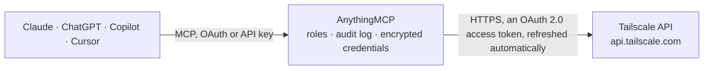

<!-- Generated by scripts/export-github-catalog.mjs in the anythingmcp-website repository. Do not edit by hand. -->

# Tailscale MCP connector

Tailscale tailnet administration through the API v2: devices with routes, tags, approval and posture attributes, users and roles, auth keys, the policy file (read, validate, preview, replace), DNS … The AnythingMCP connector gives Claude, ChatGPT, Microsoft Copilot, Cursor and Gemini 46 MCP tools for Tailscale: 25 read and 21 can change data.

**Category:** [Infrastructure](../infrastructure.md) · **Tools:** 46 · **Setup guide:** [anythingmcp.com](https://anythingmcp.com/guides/tailscale-to-mcp) · [Deutsch](https://anythingmcp.com/de/guides/tailscale-to-mcp) · [Italiano](https://anythingmcp.com/it/guides/tailscale-to-mcp) · [Español](https://anythingmcp.com/es/guides/tailscale-to-mcp) · [日本語](https://anythingmcp.com/ja/guides/tailscale-to-mcp) · [Русский](https://anythingmcp.com/ru/guides/tailscale-to-mcp) · [中文](https://anythingmcp.com/zh/guides/tailscale-to-mcp)

## Start without code

No installation and no terminal: AnythingMCP Cloud runs the Tailscale connector for you, operated by helpcode.ai in Frankfurt, Germany.

1. **Click the button above** and create an account or sign in. The Tailscale connector opens, ready to install.
2. **Sign in with your Tailscale account** when AnythingMCP asks. The first time, an admin creates a small app in the Tailscale developer console. Every click is in the [step-by-step guide](https://anythingmcp.com/guides/tailscale-to-mcp).
3. **Click Install.** AnythingMCP shows the address of your MCP server.
4. **Add that address to your assistant:** [Claude](https://anythingmcp.com/guides/connect-tailscale-to-claude) · [ChatGPT](https://anythingmcp.com/guides/connect-tailscale-to-chatgpt) · [Microsoft Copilot](https://anythingmcp.com/guides/connect-tailscale-to-copilot) · [Cursor](https://anythingmcp.com/guides/connect-tailscale-to-cursor) · [Gemini CLI](https://anythingmcp.com/guides/connect-tailscale-to-gemini) · [Meta Muse](https://anythingmcp.com/guides/connect-tailscale-to-muse).
5. **Ask your first question**, for example: *Which device record is hostname frontend-02 and is it currently authorized and connected?*

Prefer help with the setup? [Talk to us](https://anythingmcp.com/contact).

## How it works

- **The AI client** speaks MCP (Streamable HTTP) to AnythingMCP and only sees tool names, descriptions and results. It never gets the Tailscale credentials.
- **AnythingMCP** checks the client's role, builds the call from the tool definition, adds the credentials (an OAuth 2.0 access token, refreshed automatically), calls Tailscale, logs the call and returns the result.
- **Tailscale** sees an ordinary API client with the rights of the account the credentials belong to.

## Tools

| Tool | What it does | Access |
|---|---|---|
| [`tailscale_list_devices`](#tailscale_list_devices) | List the devices (machines) of the tailnet: nodeId, numeric id, name (MagicDNS name), hostname, user, OS, client version, Tailscale IP addresses, tags,… | read |
| [`tailscale_get_device`](#tailscale_get_device) | One device with its details: name, hostname, user, OS, addresses, tags, authorized, key expiry, lastSeen, connectedToControl and, with fields=all, its… | read |
| [`tailscale_get_device_routes`](#tailscale_get_device_routes) | The subnet routes a device advertises (`advertisedRoutes`) and the ones that are approved for it (`enabledRoutes`). | read |
| [`tailscale_set_device_routes`](#tailscale_set_device_routes) | Replace the list of approved (enabled) subnet routes of a device. | write |
| [`tailscale_authorize_device`](#tailscale_authorize_device) | Approve a device that waits for device approval (authorized=true), or take the approval back (authorized=false), which cuts it off from the tailnet until… | write |
| [`tailscale_set_device_name`](#tailscale_set_device_name) | Rename a device: the new name becomes its MagicDNS name at once, so links and scripts that use the old name stop working. | write |
| [`tailscale_set_device_tags`](#tailscale_set_device_tags) | Replace the tags of a device. | write |
| [`tailscale_set_device_key_expiry`](#tailscale_set_device_key_expiry) | Switch key expiry off (key_expiry_disabled=true) or back on for a device. | write |
| [`tailscale_expire_device_key`](#tailscale_expire_device_key) | Expire the node key of a device now. | write |
| [`tailscale_delete_device`](#tailscale_delete_device) | Remove a device from the tailnet. | write |
| [`tailscale_get_device_posture_attributes`](#tailscale_get_device_posture_attributes) | The posture attributes of a device as key-value pairs: those Tailscale collects (node:os, node:tsVersion, ...), those from posture integrations (falcon:,… | read |
| [`tailscale_list_users`](#tailscale_list_users) | List the users of the tailnet: id, displayName, loginName (e-mail), role, status (active, idle, suspended, needs-approval, over-billing-limit), type (member… | read |
| [`tailscale_get_user`](#tailscale_get_user) | One user: displayName, loginName, role, status, type, created, lastSeen, deviceCount. | read |
| [`tailscale_update_user_role`](#tailscale_update_user_role) | Change the role of a user. | write |
| [`tailscale_approve_user`](#tailscale_approve_user) | Approve a user whose status is needs-approval (when user approval is on in the tailnet settings). | write |
| [`tailscale_suspend_user`](#tailscale_suspend_user) | Suspend a user: their devices lose access to the tailnet until the user is restored with tailscale_restore_user. | write |
| [`tailscale_restore_user`](#tailscale_restore_user) | Restore a suspended user, giving their devices access to the tailnet again. | write |
| [`tailscale_delete_user`](#tailscale_delete_user) | Delete a user from the tailnet, together with their devices. | write |
| [`tailscale_list_user_invites`](#tailscale_list_user_invites) | Open (not yet accepted) invitations to join the tailnet: id, e-mail, role, inviter and when the e-mail was last sent. | read |
| [`tailscale_list_keys`](#tailscale_list_keys) | List the keys of the tailnet: auth keys, API access tokens, OAuth clients and federated identities, with id, keyType, description, created, expires,… | read |
| [`tailscale_get_key`](#tailscale_get_key) | One key by id: keyType, description, created, expires, revoked, invalid, capabilities (reusable, ephemeral, preauthorized, tags for auth keys), scopes and tags. | read |
| [`tailscale_create_auth_key`](#tailscale_create_auth_key) | Create an auth key to add devices to the tailnet. | write |
| [`tailscale_delete_key`](#tailscale_delete_key) | Revoke a key by id: an auth key, an API access token or a trust credential. | write |
| [`tailscale_get_policy_file`](#tailscale_get_policy_file) | The tailnet policy file (access rules) as JSON: grants and acls, groups, hosts, tagOwners, autoApprovers, ssh, nodeAttrs, postures and tests. | read |
| [`tailscale_validate_policy_file`](#tailscale_validate_policy_file) | Check a policy file without saving it: Tailscale parses it and runs its `tests` (and `sshTests`). | read |
| [`tailscale_preview_policy_rules`](#tailscale_preview_policy_rules) | Which rules of a policy file would apply to one user or one IP:port, without saving it. | read |
| [`tailscale_set_policy_file`](#tailscale_set_policy_file) | Replace the whole tailnet policy file. | write |
| [`tailscale_get_dns_configuration`](#tailscale_get_dns_configuration) | The full DNS setup of the tailnet in one call: global nameservers, split DNS routes (domain to nameservers), search paths and preferences (magicDNS,… | read |
| [`tailscale_set_dns_nameservers`](#tailscale_set_dns_nameservers) | Replace the global DNS nameservers of the tailnet. | write |
| [`tailscale_set_dns_preferences`](#tailscale_set_dns_preferences) | Switch MagicDNS on or off for the tailnet. | write |
| [`tailscale_set_dns_search_paths`](#tailscale_set_dns_search_paths) | Replace the DNS search domains of the tailnet. | write |
| [`tailscale_update_split_dns`](#tailscale_update_split_dns) | Change split DNS for some domains: only the domains you pass are changed, the others stay. | write |
| [`tailscale_get_tailnet_settings`](#tailscale_get_tailnet_settings) | The tailnet settings: device approval, device auto-updates, key expiry in days, user approval, who may join external tailnets, network flow logging,… | read |
| [`tailscale_update_tailnet_settings`](#tailscale_update_tailnet_settings) | Change one or more tailnet settings; fields you leave out keep their value. | write |
| [`tailscale_get_contacts`](#tailscale_get_contacts) | The account, support and security contact e-mails of the tailnet, each with its fallback and whether it still needs verification. | read |
| [`tailscale_list_configuration_audit_logs`](#tailscale_list_configuration_audit_logs) | Configuration audit log: who changed what in the tailnet (devices, users, keys, policy file, DNS, settings) between start and end, in time order. | read |
| [`tailscale_list_network_flow_logs`](#tailscale_list_network_flow_logs) | Network flow logs between start and end: which devices talked to which addresses and ports, with packet and byte counts per sample period (Premium and… | read |
| [`tailscale_get_log_streaming_status`](#tailscale_get_log_streaming_status) | Whether streaming of a log type to a SIEM works: last activity, last error, bytes and entries sent, rate. | read |
| [`tailscale_get_log_streaming_configuration`](#tailscale_get_log_streaming_configuration) | Where a log type is streamed: destination type (splunk, elastic, datadog, s3, ...), URL, upload period, compression, S3 bucket and region. | read |
| [`tailscale_list_webhooks`](#tailscale_list_webhooks) | The webhook endpoints of the tailnet: endpointId, URL, provider type, the events they receive and who created them. | read |
| [`tailscale_get_webhook`](#tailscale_get_webhook) | One webhook endpoint by id: URL, provider type, subscribed events, creator, created and lastModified. | read |
| [`tailscale_create_webhook`](#tailscale_create_webhook) | Create a webhook that sends tailnet events to a URL. | write |
| [`tailscale_list_services`](#tailscale_list_services) | Tailscale Services of the tailnet (virtual services hosted by one or more devices): name (svc:...), addresses, ports, tags and comment. | read |
| [`tailscale_get_service`](#tailscale_get_service) | One Tailscale Service by name: its addresses, ports, tags and comment. | read |
| [`tailscale_list_service_hosts`](#tailscale_list_service_hosts) | The devices that host a Tailscale Service, with whether each one is approved to serve it. | read |
| [`tailscale_list_posture_integrations`](#tailscale_list_posture_integrations) | The device posture integrations of the tailnet (CrowdStrike Falcon, Intune, Jamf Pro, Kandji, Kolide, SentinelOne): provider, cloud id, client id and status… | read |

## Tool reference

Every parameter as the AI client sees it in `tools/list`. Source: [`packages/backend/src/adapters/intl/tailscale.json`](../../../packages/backend/src/adapters/intl/tailscale.json).

### `tailscale_list_devices`

List the devices (machines) of the tailnet: nodeId, numeric id, name (MagicDNS name), hostname, user, OS, client version, Tailscale IP addresses, tags, authorized, created, lastSeen, key expiry and whether the device is connected now. Optional exact-match filters on top-level device fields.

**Access:** read · **Call:** `GET /tailnet/-/devices`

| Parameter | Type | Required | Description |
|---|---|---|---|
| `fields` | `default` \| `all` | no | default (a fixed subset of fields) or all (adds advertised and enabled routes, client connectivity, posture identity and more). |
| `filter` | string | no | Exact-match filters on top-level device fields, written as a query string: hostname=web-1, os=linux, isEphemeral=true, authorized=false or tags=tag:prod (devices that carry this tag). Join several fields with & (combined with AND), e.g. os=linux&tags=tag:prod; give each field once. |

### `tailscale_get_device`

One device with its details: name, hostname, user, OS, addresses, tags, authorized, key expiry, lastSeen, connectedToControl and, with fields=all, its routes and client connectivity.

**Access:** read · **Call:** `GET /device/{device_id}`

| Parameter | Type | Required | Description |
|---|---|---|---|
| `device_id` | string | yes | Device id: the `nodeId` from tailscale_list_devices (preferred, e.g. nodeAbCdEf1CNTRL) or the numeric `id`. |
| `fields` | `default` \| `all` | no | default or all (adds routes, client connectivity and posture identity). |

### `tailscale_get_device_routes`

The subnet routes a device advertises (`advertisedRoutes`) and the ones that are approved for it (`enabledRoutes`). A route works only when it is both advertised and enabled; 0.0.0.0/0 and ::/0 together make the device an exit node.

**Access:** read · **Call:** `GET /device/{device_id}/routes`

| Parameter | Type | Required | Description |
|---|---|---|---|
| `device_id` | string | yes | Device id: the `nodeId` from tailscale_list_devices (preferred, e.g. nodeAbCdEf1CNTRL) or the numeric `id`. |

### `tailscale_set_device_routes`

Replace the list of approved (enabled) subnet routes of a device. Send the complete list: routes left out are disabled. Only routes the device advertises take effect; advertising itself happens on the device. Pass [] to disable all.

**Access:** write · **Call:** `POST /device/{device_id}/routes`

| Parameter | Type | Required | Description |
|---|---|---|---|
| `device_id` | string | yes | Device id: the `nodeId` from tailscale_list_devices (preferred, e.g. nodeAbCdEf1CNTRL) or the numeric `id`. |
| `routes` | string[] | yes | The complete list of enabled routes in CIDR notation, e.g. ["10.0.0.0/16", "0.0.0.0/0", "::/0"]. |

### `tailscale_authorize_device`

Approve a device that waits for device approval (authorized=true), or take the approval back (authorized=false), which cuts it off from the tailnet until approved again.

**Access:** write · **Call:** `POST /device/{device_id}/authorized`

| Parameter | Type | Required | Description |
|---|---|---|---|
| `device_id` | string | yes | Device id: the `nodeId` from tailscale_list_devices (preferred, e.g. nodeAbCdEf1CNTRL) or the numeric `id`. |
| `authorized` | boolean | yes | true approves the device, false revokes its approval. |

### `tailscale_set_device_name`

Rename a device: the new name becomes its MagicDNS name at once, so links and scripts that use the old name stop working.

**Access:** write · **Call:** `POST /device/{device_id}/name`

| Parameter | Type | Required | Description |
|---|---|---|---|
| `device_id` | string | yes | Device id: the `nodeId` from tailscale_list_devices (preferred, e.g. nodeAbCdEf1CNTRL) or the numeric `id`. |
| `name` | string | yes | New device name, e.g. web-1. A full MagicDNS name (web-1.tailnet-name.ts.net) is also accepted. Empty resets it to the OS hostname. |

### `tailscale_set_device_tags`

Replace the tags of a device. Tags must be defined under tagOwners in the policy file. Once tagged, the device belongs to its tags instead of a user; sending an empty list is refused for a tagged device.

**Access:** write · **Call:** `POST /device/{device_id}/tags`

| Parameter | Type | Required | Description |
|---|---|---|---|
| `device_id` | string | yes | Device id: the `nodeId` from tailscale_list_devices (preferred, e.g. nodeAbCdEf1CNTRL) or the numeric `id`. |
| `tags` | string[] | yes | The complete list of tags, each starting with tag:, e.g. ["tag:server", "tag:prod"]. |

### `tailscale_set_device_key_expiry`

Switch key expiry off (key_expiry_disabled=true) or back on for a device. With expiry off, the device never has to sign in again; use it for servers, not for laptops.

**Access:** write · **Call:** `POST /device/{device_id}/key`

| Parameter | Type | Required | Description |
|---|---|---|---|
| `device_id` | string | yes | Device id: the `nodeId` from tailscale_list_devices (preferred, e.g. nodeAbCdEf1CNTRL) or the numeric `id`. |
| `key_expiry_disabled` | boolean | yes | true disables key expiry for this device, false enables it again. |

### `tailscale_expire_device_key`

Expire the node key of a device now. The device drops off the tailnet until someone signs it in again on the device itself; this cannot be undone through the API.

**Access:** write · **Call:** `POST /device/{device_id}/expire`

| Parameter | Type | Required | Description |
|---|---|---|---|
| `device_id` | string | yes | Device id: the `nodeId` from tailscale_list_devices (preferred, e.g. nodeAbCdEf1CNTRL) or the numeric `id`. |

### `tailscale_delete_device`

Remove a device from the tailnet. It has to be added again with a new sign-in or auth key. Devices shared into the tailnet from elsewhere cannot be deleted.

**Access:** write · **Call:** `DELETE /device/{device_id}`

| Parameter | Type | Required | Description |
|---|---|---|---|
| `device_id` | string | yes | Device id: the `nodeId` from tailscale_list_devices (preferred, e.g. nodeAbCdEf1CNTRL) or the numeric `id`. |

### `tailscale_get_device_posture_attributes`

The posture attributes of a device as key-value pairs: those Tailscale collects (node:os, node:tsVersion, ...), those from posture integrations (falcon:, intune:, ...) and custom ones (custom:...), each with its value and, if set, expiry.

**Access:** read · **Call:** `GET /device/{device_id}/attributes`

| Parameter | Type | Required | Description |
|---|---|---|---|
| `device_id` | string | yes | Device id: the `nodeId` from tailscale_list_devices (preferred, e.g. nodeAbCdEf1CNTRL) or the numeric `id`. |

### `tailscale_list_users`

List the users of the tailnet: id, displayName, loginName (e-mail), role, status (active, idle, suspended, needs-approval, over-billing-limit), type (member or shared), created, lastSeen, deviceCount and currentlyConnected.

**Access:** read · **Call:** `GET /tailnet/-/users`

| Parameter | Type | Required | Description |
|---|---|---|---|
| `type` | `member` \| `shared` \| `all` | no | member (default): users of this tailnet; shared: users who have devices shared with them; all. |
| `role` | `owner` \| `member` \| `admin` \| `it-admin` \| `network-admin` \| `billing-admin` \| `auditor` \| `all` | no | Only users with this role; all (default) for every role. |

### `tailscale_get_user`

One user: displayName, loginName, role, status, type, created, lastSeen, deviceCount.

**Access:** read · **Call:** `GET /users/{user_id}`

| Parameter | Type | Required | Description |
|---|---|---|---|
| `user_id` | string | yes | User id: the `id` from tailscale_list_users. |

### `tailscale_update_user_role`

Change the role of a user. A user's own API access token cannot change that user's role.

**Access:** write · **Call:** `POST /users/{user_id}/role`

| Parameter | Type | Required | Description |
|---|---|---|---|
| `user_id` | string | yes | User id: the `id` from tailscale_list_users. |
| `role` | `owner` \| `member` \| `admin` \| `it-admin` \| `network-admin` \| `billing-admin` \| `auditor` | yes | New role. owner can only be passed by the current owner. |

### `tailscale_approve_user`

Approve a user whose status is needs-approval (when user approval is on in the tailnet settings). Does nothing for users already approved.

**Access:** write · **Call:** `POST /users/{user_id}/approve`

| Parameter | Type | Required | Description |
|---|---|---|---|
| `user_id` | string | yes | User id: the `id` from tailscale_list_users. |

### `tailscale_suspend_user`

Suspend a user: their devices lose access to the tailnet until the user is restored with tailscale_restore_user.

**Access:** write · **Call:** `POST /users/{user_id}/suspend`

| Parameter | Type | Required | Description |
|---|---|---|---|
| `user_id` | string | yes | User id: the `id` from tailscale_list_users. |

### `tailscale_restore_user`

Restore a suspended user, giving their devices access to the tailnet again.

**Access:** write · **Call:** `POST /users/{user_id}/restore`

| Parameter | Type | Required | Description |
|---|---|---|---|
| `user_id` | string | yes | User id: the `id` from tailscale_list_users. |

### `tailscale_delete_user`

Delete a user from the tailnet, together with their devices. It cannot be undone; the person has to be invited again.

**Access:** write · **Call:** `POST /users/{user_id}/delete`

| Parameter | Type | Required | Description |
|---|---|---|---|
| `user_id` | string | yes | User id: the `id` from tailscale_list_users. |

### `tailscale_list_user_invites`

Open (not yet accepted) invitations to join the tailnet: id, e-mail, role, inviter and when the e-mail was last sent. `inviteUrl` lets anyone who has it join with that role, so do not repeat it outside this conversation.

**Access:** read · **Call:** `GET /tailnet/-/user-invites`

No parameters.

### `tailscale_list_keys`

List the keys of the tailnet: auth keys, API access tokens, OAuth clients and federated identities, with id, keyType, description, created, expires, revoked, capabilities, scopes and tags. Never returns the secret key values. Without all=true an OAuth client sees the trust credentials of the tailnet; all=true also returns the auth keys and the API access tokens.

**Access:** read · **Call:** `GET /tailnet/-/keys`

| Parameter | Type | Required | Description |
|---|---|---|---|
| `all` | boolean | no | true returns every auth key, API access token and trust credential of the tailnet. |

### `tailscale_get_key`

One key by id: keyType, description, created, expires, revoked, invalid, capabilities (reusable, ephemeral, preauthorized, tags for auth keys), scopes and tags. The secret value is not included.

**Access:** read · **Call:** `GET /tailnet/-/keys/{key_id}`

| Parameter | Type | Required | Description |
|---|---|---|---|
| `key_id` | string | yes | Key id from tailscale_list_keys, e.g. kAbCdEf1CNTRL. |

### `tailscale_create_auth_key`

Create an auth key to add devices to the tailnet. SECRET: the answer's `key` field (tskey-auth-...) is the secret, shown this one time only; whoever has it can add devices. Give it only to the person or script that needs it and never repeat it elsewhere. With the OAuth client of this connector the key must carry tags, the same as the client's or tags owned by them.

**Access:** write · **Call:** `POST /tailnet/-/keys`

| Parameter | Type | Required | Description |
|---|---|---|---|
| `description` | string | no | Short purpose, up to 50 letters, digits, spaces or hyphens, e.g. ci runners. |
| `reusable` | boolean | no | true lets the key add several devices; false (default) makes it single-use. |
| `ephemeral` | boolean | no | true: devices added with it are removed automatically soon after they go offline (for containers and CI). |
| `preauthorized` | boolean | no | true: devices added with it skip device approval. |
| `tags` | string[] | no | Tags set on the devices added with this key, e.g. ["tag:ci"]. Required when the key is created through an OAuth client. |
| `expiry_seconds` | integer | no | Lifetime of the key in seconds, at most 7776000 (90 days, the default). |

### `tailscale_delete_key`

Revoke a key by id: an auth key, an API access token or a trust credential. Revoking cannot be undone; scripts and devices that still use the key stop working.

**Access:** write · **Call:** `DELETE /tailnet/-/keys/{key_id}`

| Parameter | Type | Required | Description |
|---|---|---|---|
| `key_id` | string | yes | Key id from tailscale_list_keys. |

### `tailscale_get_policy_file`

The tailnet policy file (access rules) as JSON: grants and acls, groups, hosts, tagOwners, autoApprovers, ssh, nodeAttrs, postures and tests. `_headers.etag` is the version; pass it to tailscale_set_policy_file to avoid overwriting someone else's change. details=true also returns warnings and errors.

**Access:** read · **Call:** `GET /tailnet/-/acl`

| Parameter | Type | Required | Description |
|---|---|---|---|
| `details` | boolean | no | true returns the policy with its warnings and errors instead of the plain policy. |

### `tailscale_validate_policy_file`

Check a policy file without saving it: Tailscale parses it and runs its `tests` (and `sshTests`). Changes nothing. An empty answer means it is valid and every test passed; otherwise `message` and `data` explain what failed.

**Access:** read · **Call:** `POST /tailnet/-/acl/validate`

| Parameter | Type | Required | Description |
|---|---|---|---|
| `policy` | object | yes | The whole tailnet policy file as a JSON object, e.g. {"grants": [...], "groups": {...}, "tagOwners": {...}, "tests": [...]}. HuJSON comments are not accepted here: send plain JSON. |

### `tailscale_preview_policy_rules`

Which rules of a policy file would apply to one user or one IP:port, without saving it. Changes nothing. Pass the current policy from tailscale_get_policy_file or a draft.

**Access:** read · **Call:** `POST /tailnet/-/acl/preview`

| Parameter | Type | Required | Description |
|---|---|---|---|
| `type` | `user` \| `ipport` | yes | user: rules for a user; ipport: rules that reach an IP and port. |
| `preview_for` | string | yes | With type user, the e-mail of a user who has devices; with type ipport, an address and port such as 100.101.102.103:443. |
| `policy` | object | yes | The whole tailnet policy file as a JSON object, e.g. {"grants": [...], "groups": {...}, "tagOwners": {...}, "tests": [...]}. HuJSON comments are not accepted here: send plain JSON. |

### `tailscale_set_policy_file`

Replace the whole tailnet policy file. Validate it with tailscale_validate_policy_file first: a wrong rule can cut every user and device off. Pass the etag from tailscale_get_policy_file so a change made in the meantime is not overwritten (the call then fails with 412). Comments of a HuJSON policy are lost.

**Access:** write · **Call:** `POST /tailnet/-/acl`

| Parameter | Type | Required | Description |
|---|---|---|---|
| `policy` | object | yes | The whole tailnet policy file as a JSON object, e.g. {"grants": [...], "groups": {...}, "tagOwners": {...}, "tests": [...]}. HuJSON comments are not accepted here: send plain JSON. |
| `etag` | string | no | The `_headers.etag` value from tailscale_get_policy_file, quotes included. |

### `tailscale_get_dns_configuration`

The full DNS setup of the tailnet in one call: global nameservers, split DNS routes (domain to nameservers), search paths and preferences (magicDNS, overrideLocalDNS).

**Access:** read · **Call:** `GET /tailnet/-/dns/configuration`

No parameters.

### `tailscale_set_dns_nameservers`

Replace the global DNS nameservers of the tailnet. Send the complete list; [] removes them all, which also switches MagicDNS off.

**Access:** write · **Call:** `POST /tailnet/-/dns/nameservers`

| Parameter | Type | Required | Description |
|---|---|---|---|
| `dns` | string[] | yes | The complete list of nameserver IP addresses, e.g. ["1.1.1.1", "2606:4700:4700::1111"]. |

### `tailscale_set_dns_preferences`

Switch MagicDNS on or off for the tailnet. Turning it on needs at least one global nameserver.

**Access:** write · **Call:** `POST /tailnet/-/dns/preferences`

| Parameter | Type | Required | Description |
|---|---|---|---|
| `magic_dns` | boolean | yes | true turns MagicDNS on, false off. |

### `tailscale_set_dns_search_paths`

Replace the DNS search domains of the tailnet. Send the complete list; [] removes them all.

**Access:** write · **Call:** `POST /tailnet/-/dns/searchpaths`

| Parameter | Type | Required | Description |
|---|---|---|---|
| `search_paths` | string[] | yes | The complete list of search domains, e.g. ["corp.example.com"]. |

### `tailscale_update_split_dns`

Change split DNS for some domains: only the domains you pass are changed, the others stay. A domain set to null loses its nameservers.

**Access:** write · **Call:** `PATCH /tailnet/-/dns/split-dns`

| Parameter | Type | Required | Description |
|---|---|---|---|
| `domains` | object | yes | Map of domain to nameserver list, e.g. {"corp.example.com": ["10.0.0.53"], "old.example.com": null}. |

### `tailscale_get_tailnet_settings`

The tailnet settings: device approval, device auto-updates, key expiry in days, user approval, who may join external tailnets, network flow logging, regional routing and route selection, posture identity collection, HTTPS certificates, ACLs managed externally (GitOps) and the admin console session timeout.

**Access:** read · **Call:** `GET /tailnet/-/settings`

No parameters.

### `tailscale_update_tailnet_settings`

Change one or more tailnet settings; fields you leave out keep their value.

**Access:** write · **Call:** `PATCH /tailnet/-/settings`

| Parameter | Type | Required | Description |
|---|---|---|---|
| `devices_approval_on` | boolean | no | Require an admin to approve new devices. |
| `devices_auto_updates_on` | boolean | no | Let clients update Tailscale automatically. |
| `devices_key_duration_days` | integer | no | Days until a device key expires, 1 to 180. |
| `users_approval_on` | boolean | no | Require an admin to approve new users. |
| `users_role_allowed_to_join_external_tailnets` | `none` \| `admin` \| `member` | no | Which users may join other tailnets. |
| `network_flow_logging_on` | boolean | no | Record network flow logs (Premium and Enterprise plans). |
| `regional_routing_on` | boolean | no | Prefer subnet routers and exit nodes in the nearest region. |
| `route_selection` | `active-passive-failover` \| `regional-routing` \| `regional-routing-failover` \| `magicroute` | no | How overlapping subnet routes are chosen. |
| `posture_identity_collection_on` | boolean | no | Collect serial numbers and other identifiers for device posture. |
| `https_enabled` | boolean | no | Allow HTTPS certificates for ts.net names. |
| `acls_externally_managed_on` | boolean | no | Mark the policy file as managed outside the admin console (GitOps). |
| `acls_external_link` | string | no | Link to the place where the policy file is managed, shown in the admin console. |
| `admin_console_session_timeout_minutes` | integer | no | Admin console session timeout in minutes. |

### `tailscale_get_contacts`

The account, support and security contact e-mails of the tailnet, each with its fallback and whether it still needs verification.

**Access:** read · **Call:** `GET /tailnet/-/contacts`

No parameters.

### `tailscale_list_configuration_audit_logs`

Configuration audit log: who changed what in the tailnet (devices, users, keys, policy file, DNS, settings) between start and end, in time order. Each entry has eventTime, origin (ADMIN_CONSOLE, CONFIG_API, NODE, ...), actor, target, action, old and new values. Kept for 90 days.

**Access:** read · **Call:** `GET /tailnet/-/logging/configuration`

| Parameter | Type | Required | Description |
|---|---|---|---|
| `start` | string | yes | Start of the window, RFC 3339, e.g. 2026-10-01T00:00:00Z. |
| `end` | string | yes | End of the window, RFC 3339. |
| `actor` | string[] | no | Only these actors: actor ids, or ~text to search login and display names, e.g. ["~alice"]. |
| `target` | string[] | no | Only entries whose target matches any of these strings (a device name, a user, a key id ...). |
| `event` | string[] | no | Only these event actions, e.g. ["CREATE", "UPDATE", "DELETE"]. |

### `tailscale_list_network_flow_logs`

Network flow logs between start and end: which devices talked to which addresses and ports, with packet and byte counts per sample period (Premium and Enterprise plans, with network flow logging on). Answers grow fast: ask for minutes, not days.

**Access:** read · **Call:** `GET /tailnet/-/logging/network`

| Parameter | Type | Required | Description |
|---|---|---|---|
| `start` | string | yes | Start of the window, RFC 3339, e.g. 2026-10-30T09:00:00Z. |
| `end` | string | yes | End of the window, RFC 3339. Keep the window short, e.g. 15 minutes. |

### `tailscale_get_log_streaming_status`

Whether streaming of a log type to a SIEM works: last activity, last error, bytes and entries sent, rate.

**Access:** read · **Call:** `GET /tailnet/-/logging/{log_type}/stream/status`

| Parameter | Type | Required | Description |
|---|---|---|---|
| `log_type` | `configuration` \| `network` | yes | Which log stream: configuration (audit logs) or network (network flow logs). |

### `tailscale_get_log_streaming_configuration`

Where a log type is streamed: destination type (splunk, elastic, datadog, s3, ...), URL, upload period, compression, S3 bucket and region. Tokens, secret access keys and credentials are removed from the answer.

**Access:** read · **Call:** `GET /tailnet/-/logging/{log_type}/stream`

| Parameter | Type | Required | Description |
|---|---|---|---|
| `log_type` | `configuration` \| `network` | yes | Which log stream: configuration (audit logs) or network (network flow logs). |

### `tailscale_list_webhooks`

The webhook endpoints of the tailnet: endpointId, URL, provider type, the events they receive and who created them. Signing secrets are removed from the answer.

**Access:** read · **Call:** `GET /tailnet/-/webhooks`

No parameters.

### `tailscale_get_webhook`

One webhook endpoint by id: URL, provider type, subscribed events, creator, created and lastModified. The signing secret is removed from the answer.

**Access:** read · **Call:** `GET /webhooks/{endpoint_id}`

| Parameter | Type | Required | Description |
|---|---|---|---|
| `endpoint_id` | string | yes | Webhook endpointId from tailscale_list_webhooks. |

### `tailscale_create_webhook`

Create a webhook that sends tailnet events to a URL. SECRET: the answer's `secret` is the signing secret, shown this one time only; hand it to whoever runs the receiving endpoint and never repeat it elsewhere.

**Access:** write · **Call:** `POST /tailnet/-/webhooks`

| Parameter | Type | Required | Description |
|---|---|---|---|
| `endpoint_url` | string | yes | HTTPS URL that receives the events. |
| `provider_type` | `slack` \| `mattermost` \| `googlechat` \| `discord` | no | Format the events in for slack, mattermost, googlechat or discord; leave out for plain JSON. |
| `subscriptions` | string[] | yes | Events to send, e.g. ["nodeCreated", "nodeNeedsApproval", "nodeKeyExpiringInOneDay", "policyUpdate", "userNeedsApproval", "subnetIPForwardingNotEnabled"]. |

### `tailscale_list_services`

Tailscale Services of the tailnet (virtual services hosted by one or more devices): name (svc:...), addresses, ports, tags and comment.

**Access:** read · **Call:** `GET /tailnet/-/services`

No parameters.

### `tailscale_get_service`

One Tailscale Service by name: its addresses, ports, tags and comment.

**Access:** read · **Call:** `GET /tailnet/-/services/{service_name}`

| Parameter | Type | Required | Description |
|---|---|---|---|
| `service_name` | string | yes | Service name from tailscale_list_services, starting with svc:, e.g. svc:web. |

### `tailscale_list_service_hosts`

The devices that host a Tailscale Service, with whether each one is approved to serve it.

**Access:** read · **Call:** `GET /tailnet/-/services/{service_name}/devices`

| Parameter | Type | Required | Description |
|---|---|---|---|
| `service_name` | string | yes | Service name, starting with svc:. |

### `tailscale_list_posture_integrations`

The device posture integrations of the tailnet (CrowdStrike Falcon, Intune, Jamf Pro, Kandji, Kolide, SentinelOne): provider, cloud id, client id and status of the last sync.

**Access:** read · **Call:** `GET /tailnet/-/posture/integrations`

No parameters.

## Run it yourself

AnythingMCP is open source (AGPL-3.0). [Run it with Docker](../../../README.md#run-it-yourself), open **Connectors → Store**, pick **Tailscale** and enter `TAILSCALE_OAUTH_CLIENT_ID`, `TAILSCALE_OAUTH_CLIENT_SECRET`, then add your MCP server URL to the AI client.

[← Infrastructure connectors](../infrastructure.md) · [All categories](../README.md)
