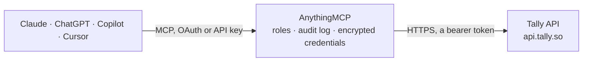

<!-- Generated by scripts/export-github-catalog.mjs in the anythingmcp-website repository. Do not edit by hand. -->

# Tally MCP connector

Read Tally form submissions and manage forms/workspaces from any AI agent. 6 tools, Bearer-token auth. The AnythingMCP connector gives Claude, ChatGPT, Microsoft Copilot, Cursor and Gemini 6 MCP tools for Tally, all read-only.

**Category:** [Forms & Surveys](../forms.md) · **Tools:** 6 · **Setup guide:** [anythingmcp.com](https://anythingmcp.com/guides/tally-to-mcp) · [Deutsch](https://anythingmcp.com/de/guides/tally-to-mcp) · [Italiano](https://anythingmcp.com/it/guides/tally-to-mcp) · [Español](https://anythingmcp.com/es/guides/tally-to-mcp) · [日本語](https://anythingmcp.com/ja/guides/tally-to-mcp) · [Русский](https://anythingmcp.com/ru/guides/tally-to-mcp) · [中文](https://anythingmcp.com/zh/guides/tally-to-mcp)

## Start without code

No installation and no terminal: AnythingMCP Cloud runs the Tally connector for you, operated by helpcode.ai in Frankfurt, Germany.

1. **Click the button above** and create an account or sign in. The Tally connector opens, ready to install.
2. **Paste the API key or token from your Tally account.** Every click is in the [step-by-step guide](https://anythingmcp.com/guides/tally-to-mcp).
3. **Click Install.** AnythingMCP shows the address of your MCP server.
4. **Add that address to your assistant:** [Claude](https://anythingmcp.com/guides/connect-tally-to-claude) · [ChatGPT](https://anythingmcp.com/guides/connect-tally-to-chatgpt) · [Microsoft Copilot](https://anythingmcp.com/guides/connect-tally-to-copilot) · [Cursor](https://anythingmcp.com/guides/connect-tally-to-cursor) · [Gemini CLI](https://anythingmcp.com/guides/connect-tally-to-gemini) · [Meta Muse](https://anythingmcp.com/guides/connect-tally-to-muse).
5. **Ask your first question**, for example: *Get submission sub_2026_048 from invoice-dispute form wbN0Wd, I need respondent details and answers.*

Prefer help with the setup? [Talk to us](https://anythingmcp.com/contact).

## How it works

- **The AI client** speaks MCP (Streamable HTTP) to AnythingMCP and only sees tool names, descriptions and results. It never gets the Tally credentials.
- **AnythingMCP** checks the client's role, builds the call from the tool definition, adds the credentials (a bearer token), calls Tally, logs the call and returns the result.
- **Tally** sees an ordinary API client with the rights of the account the credentials belong to.

## Tools

| Tool | What it does | Access |
|---|---|---|
| [`tally_list_workspaces`](#tally_list_workspaces) | List workspaces (teams). | read |
| [`tally_list_forms`](#tally_list_forms) | List forms in a workspace. | read |
| [`tally_get_form`](#tally_get_form) | Fetch a form's full definition: questions[], theme, settings, redirectUrl, isClosed. | read |
| [`tally_list_form_submissions`](#tally_list_form_submissions) | List submissions to a form. | read |
| [`tally_get_form_submission`](#tally_get_form_submission) | Fetch a single submission with its full responses[]. | read |
| [`tally_get_form_questions`](#tally_get_form_questions) | List the questions defined on a form, with id, type, title, isRequired, options. | read |

## Tool reference

Every parameter as the AI client sees it in `tools/list`. Source: [`packages/backend/src/adapters/intl/tally.json`](../../../packages/backend/src/adapters/intl/tally.json).

### `tally_list_workspaces`

List workspaces (teams). Returns id, name, slug, isOwner, isLeader.

**Access:** read · **Call:** `GET /workspaces`

| Parameter | Type | Required | Description |
|---|---|---|---|
| `page` | integer | no | Page number. |
| `limit` | integer | no | Per page (default 50, max 100). |

### `tally_list_forms`

List forms in a workspace. Each form has id, name, isClosed, numberOfSubmissions, createdAt, updatedAt.

**Access:** read · **Call:** `GET /forms`

| Parameter | Type | Required | Description |
|---|---|---|---|
| `workspaceId` | string | no | Workspace ID to filter (optional — defaults to all). |
| `page` | integer | no | Page. |
| `limit` | integer | no | Per page. |

### `tally_get_form`

Fetch a form's full definition: questions[], theme, settings, redirectUrl, isClosed.

**Access:** read · **Call:** `GET /forms/{formId}`

| Parameter | Type | Required | Description |
|---|---|---|---|
| `formId` | string | yes | Form ID. |

### `tally_list_form_submissions`

List submissions to a form. Each submission has id, formId, respondentId, submittedAt, isCompleted, responses[].

**Access:** read · **Call:** `GET /forms/{formId}/submissions`

| Parameter | Type | Required | Description |
|---|---|---|---|
| `formId` | string | yes | Form ID. |
| `page` | integer | no | Page. |
| `limit` | integer | no | Per page. |

### `tally_get_form_submission`

Fetch a single submission with its full responses[].

**Access:** read · **Call:** `GET /forms/{formId}/submissions/{submissionId}`

| Parameter | Type | Required | Description |
|---|---|---|---|
| `formId` | string | yes | Form ID. |
| `submissionId` | string | yes | Submission ID. |

### `tally_get_form_questions`

List the questions defined on a form, with id, type, title, isRequired, options. Required to map answer questionIds to human-readable titles.

**Access:** read · **Call:** `GET /forms/{formId}/questions`

| Parameter | Type | Required | Description |
|---|---|---|---|
| `formId` | string | yes | Form ID. |

## Run it yourself

AnythingMCP is open source (AGPL-3.0). [Run it with Docker](../../../README.md#run-it-yourself), open **Connectors → Store**, pick **Tally** and enter `TALLY_API_KEY`, then add your MCP server URL to the AI client.

[← Forms & Surveys connectors](../forms.md) · [All categories](../README.md)
