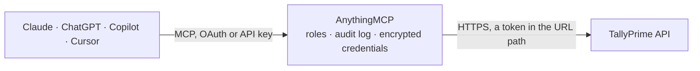

<!-- Generated by scripts/export-github-catalog.mjs in the anythingmcp-website repository. Do not edit by hand. -->

# TallyPrime MCP connector

TallyPrime accounting (Tally Solutions) over its XML/HTTP interface: companies, ledgers, groups, stock items, Trial Balance, Balance Sheet, Profit and Loss, Day Book, ledger statements and … The AnythingMCP connector gives Claude, ChatGPT, Microsoft Copilot, Cursor and Gemini 17 MCP tools for TallyPrime, all read-only.

**Category:** [Accounting](../accounting.md) · **Tools:** 17 · **Setup guide:** [anythingmcp.com](https://anythingmcp.com/guides/tallyprime-to-mcp) · [Deutsch](https://anythingmcp.com/de/guides/tallyprime-to-mcp) · [Italiano](https://anythingmcp.com/it/guides/tallyprime-to-mcp) · [Español](https://anythingmcp.com/es/guides/tallyprime-to-mcp) · [日本語](https://anythingmcp.com/ja/guides/tallyprime-to-mcp) · [Русский](https://anythingmcp.com/ru/guides/tallyprime-to-mcp) · [中文](https://anythingmcp.com/zh/guides/tallyprime-to-mcp)

## Start without code

No installation and no terminal: AnythingMCP Cloud runs the TallyPrime connector for you, operated by helpcode.ai in Frankfurt, Germany.

1. **Click the button above** and create an account or sign in. The TallyPrime connector opens, ready to install.
2. **Paste the API key or token from your TallyPrime account.** Every click is in the [step-by-step guide](https://anythingmcp.com/guides/tallyprime-to-mcp).
3. **Click Install.** AnythingMCP shows the address of your MCP server.
4. **Add that address to your assistant:** [Claude](https://anythingmcp.com/guides/connect-tallyprime-to-claude) · [ChatGPT](https://anythingmcp.com/guides/connect-tallyprime-to-chatgpt) · [Microsoft Copilot](https://anythingmcp.com/guides/connect-tallyprime-to-copilot) · [Cursor](https://anythingmcp.com/guides/connect-tallyprime-to-cursor) · [Gemini CLI](https://anythingmcp.com/guides/connect-tallyprime-to-gemini) · [Meta Muse](https://anythingmcp.com/guides/connect-tallyprime-to-muse).
5. **Ask your first question**, for example: *What's the closing balance and contact for customer Rajesh Traders as of 20261031 in our Mumbai books?*

Prefer help with the setup? [Talk to us](https://anythingmcp.com/contact).

## How it works

- **The AI client** speaks MCP (Streamable HTTP) to AnythingMCP and only sees tool names, descriptions and results. It never gets the TallyPrime credentials.
- **AnythingMCP** checks the client's role, builds the call from the tool definition, adds the credentials (a token in the URL path), calls TallyPrime, logs the call and returns the result.
- **TallyPrime** sees an ordinary API client with the rights of the account the credentials belong to.

## Tools

| Tool | What it does | Access |
|---|---|---|
| [`tallyprime_list_companies`](#tallyprime_list_companies) | List the companies currently open (loaded) in TallyPrime with their name, financial year start and books-beginning date. | read |
| [`tallyprime_list_ledgers`](#tallyprime_list_ledgers) | List every ledger (accounting head: customers, suppliers, banks, expenses, taxes) of a company with its parent group, opening and closing balance, phone and… | read |
| [`tallyprime_list_ledgers_in_group`](#tallyprime_list_ledgers_in_group) | List the ledgers under one group, including its sub-groups, with parent, opening and closing balance. | read |
| [`tallyprime_get_ledger`](#tallyprime_get_ledger) | Get one ledger master: parent group, opening and closing balance, mailing name, address, state, PIN code, country, phone, mobile and e-mail. | read |
| [`tallyprime_list_groups`](#tallyprime_list_groups) | List the account groups of a company (the chart of accounts) with each group's parent. | read |
| [`tallyprime_list_voucher_types`](#tallyprime_list_voucher_types) | List the voucher types of a company (Sales, Purchase, Receipt, Payment, Journal, Contra, Credit Note, Debit Note and any custom ones) with the type each is… | read |
| [`tallyprime_list_stock_items`](#tallyprime_list_stock_items) | List the stock items of a company with stock group, base unit, opening quantity and value, and closing quantity and value for the current period. | read |
| [`tallyprime_get_trial_balance`](#tallyprime_get_trial_balance) | Get the Trial Balance for a period, exploded down to ledgers: closing debit and credit balance per group and ledger. | read |
| [`tallyprime_get_balance_sheet`](#tallyprime_get_balance_sheet) | Get the Balance Sheet as at the end of a period: liabilities and assets by primary group with their closing amounts. | read |
| [`tallyprime_get_profit_and_loss`](#tallyprime_get_profit_and_loss) | Get the Profit and Loss account for a period: income and expenses by group (sales, purchases, direct and indirect expenses and incomes) and the net result. | read |
| [`tallyprime_get_day_book`](#tallyprime_get_day_book) | Get the Day Book: every voucher entered in a period with date, voucher type, number, party, narration, ledger entries and amounts, and inventory lines. | read |
| [`tallyprime_get_day_book_by_type`](#tallyprime_get_day_book_by_type) | Get the vouchers of one voucher type in a period (for example only Sales or only Receipt vouchers) with full ledger entries and amounts. | read |
| [`tallyprime_get_ledger_vouchers`](#tallyprime_get_ledger_vouchers) | Get the ledger account (statement) of one ledger for a period: opening balance, every voucher posted to it with date, type, number, counter ledger and debit… | read |
| [`tallyprime_get_bills_receivable`](#tallyprime_get_bills_receivable) | Get outstanding receivables: every open sales bill with bill date, reference, party, pending amount, due date and days overdue. | read |
| [`tallyprime_get_bills_payable`](#tallyprime_get_bills_payable) | Get outstanding payables: every open purchase bill with bill date, reference, party, pending amount, due date and days overdue. | read |
| [`tallyprime_get_ledger_outstandings`](#tallyprime_get_ledger_outstandings) | Get the open bills of one party ledger: bill date, reference, opening and pending amount, due date and days overdue. | read |
| [`tallyprime_get_group_outstandings`](#tallyprime_get_group_outstandings) | Get the outstanding balance of every ledger in one group, e.g. all customers under Sundry Debtors or all suppliers under Sundry Creditors, with debit and… | read |

## Tool reference

Every parameter as the AI client sees it in `tools/list`. Source: [`packages/backend/src/adapters/in/tallyprime.json`](../../../packages/backend/src/adapters/in/tallyprime.json).

### `tallyprime_list_companies`

List the companies currently open (loaded) in TallyPrime with their name, financial year start and books-beginning date. Call this first: every other tool needs the exact company name.

**Access:** read · **Call:** `POST /`

No parameters.

### `tallyprime_list_ledgers`

List every ledger (accounting head: customers, suppliers, banks, expenses, taxes) of a company with its parent group, opening and closing balance, phone and e-mail. Use it to find exact ledger names.

**Access:** read · **Call:** `POST /`

| Parameter | Type | Required | Description |
|---|---|---|---|
| `company` | string | yes | Exact name of a company that is open in TallyPrime, as returned by tallyprime_list_companies. |

### `tallyprime_list_ledgers_in_group`

List the ledgers under one group, including its sub-groups, with parent, opening and closing balance. Use Sundry Debtors for customers, Sundry Creditors for suppliers, Bank Accounts for banks.

**Access:** read · **Call:** `POST /`

| Parameter | Type | Required | Description |
|---|---|---|---|
| `company` | string | yes | Exact name of a company that is open in TallyPrime, as returned by tallyprime_list_companies. |
| `group` | string | yes | Exact group name, e.g. Sundry Debtors, Sundry Creditors, Bank Accounts, or a group from tallyprime_list_groups. |

### `tallyprime_get_ledger`

Get one ledger master: parent group, opening and closing balance, mailing name, address, state, PIN code, country, phone, mobile and e-mail. Use it for a customer's or supplier's contact and balance.

**Access:** read · **Call:** `POST /`

| Parameter | Type | Required | Description |
|---|---|---|---|
| `company` | string | yes | Exact name of a company that is open in TallyPrime, as returned by tallyprime_list_companies. |
| `ledger` | string | yes | Exact ledger name as shown in TallyPrime, e.g. a customer or supplier ledger from tallyprime_list_ledgers. |

### `tallyprime_list_groups`

List the account groups of a company (the chart of accounts) with each group's parent. Primary groups such as Current Assets or Sundry Debtors have the company itself as parent.

**Access:** read · **Call:** `POST /`

| Parameter | Type | Required | Description |
|---|---|---|---|
| `company` | string | yes | Exact name of a company that is open in TallyPrime, as returned by tallyprime_list_companies. |

### `tallyprime_list_voucher_types`

List the voucher types of a company (Sales, Purchase, Receipt, Payment, Journal, Contra, Credit Note, Debit Note and any custom ones) with the type each is based on. Use it before tallyprime_get_day_book_by_type.

**Access:** read · **Call:** `POST /`

| Parameter | Type | Required | Description |
|---|---|---|---|
| `company` | string | yes | Exact name of a company that is open in TallyPrime, as returned by tallyprime_list_companies. |

### `tallyprime_list_stock_items`

List the stock items of a company with stock group, base unit, opening quantity and value, and closing quantity and value for the current period. Use it for inventory questions.

**Access:** read · **Call:** `POST /`

| Parameter | Type | Required | Description |
|---|---|---|---|
| `company` | string | yes | Exact name of a company that is open in TallyPrime, as returned by tallyprime_list_companies. |

### `tallyprime_get_trial_balance`

Get the Trial Balance for a period, exploded down to ledgers: closing debit and credit balance per group and ledger. Use it for an overview of all balances.

**Access:** read · **Call:** `POST /`

| Parameter | Type | Required | Description |
|---|---|---|---|
| `company` | string | yes | Exact name of a company that is open in TallyPrime, as returned by tallyprime_list_companies. |
| `from_date` | string | yes | Start of the period, YYYYMMDD, e.g. 20250401 for the start of the 2025-26 financial year. |
| `to_date` | string | yes | End of the period, YYYYMMDD, e.g. 20260331. Must lie within the company's books. |

### `tallyprime_get_balance_sheet`

Get the Balance Sheet as at the end of a period: liabilities and assets by primary group with their closing amounts.

**Access:** read · **Call:** `POST /`

| Parameter | Type | Required | Description |
|---|---|---|---|
| `company` | string | yes | Exact name of a company that is open in TallyPrime, as returned by tallyprime_list_companies. |
| `from_date` | string | yes | Start of the period, YYYYMMDD, e.g. 20250401 for the start of the 2025-26 financial year. |
| `to_date` | string | yes | End of the period, YYYYMMDD, e.g. 20260331. Must lie within the company's books. |

### `tallyprime_get_profit_and_loss`

Get the Profit and Loss account for a period: income and expenses by group (sales, purchases, direct and indirect expenses and incomes) and the net result.

**Access:** read · **Call:** `POST /`

| Parameter | Type | Required | Description |
|---|---|---|---|
| `company` | string | yes | Exact name of a company that is open in TallyPrime, as returned by tallyprime_list_companies. |
| `from_date` | string | yes | Start of the period, YYYYMMDD, e.g. 20250401 for the start of the 2025-26 financial year. |
| `to_date` | string | yes | End of the period, YYYYMMDD, e.g. 20260331. Must lie within the company's books. |

### `tallyprime_get_day_book`

Get the Day Book: every voucher entered in a period with date, voucher type, number, party, narration, ledger entries and amounts, and inventory lines. This is how to list vouchers by date range; keep the range short, a busy company has thousands of vouchers a month.

**Access:** read · **Call:** `POST /`

| Parameter | Type | Required | Description |
|---|---|---|---|
| `company` | string | yes | Exact name of a company that is open in TallyPrime, as returned by tallyprime_list_companies. |
| `from_date` | string | yes | Start of the period, YYYYMMDD, e.g. 20250401 for the start of the 2025-26 financial year. |
| `to_date` | string | yes | End of the period, YYYYMMDD, e.g. 20260331. Must lie within the company's books. |

### `tallyprime_get_day_book_by_type`

Get the vouchers of one voucher type in a period (for example only Sales or only Receipt vouchers) with full ledger entries and amounts. Voucher type names come from tallyprime_list_voucher_types.

**Access:** read · **Call:** `POST /`

| Parameter | Type | Required | Description |
|---|---|---|---|
| `company` | string | yes | Exact name of a company that is open in TallyPrime, as returned by tallyprime_list_companies. |
| `from_date` | string | yes | Start of the period, YYYYMMDD, e.g. 20250401 for the start of the 2025-26 financial year. |
| `to_date` | string | yes | End of the period, YYYYMMDD, e.g. 20260331. Must lie within the company's books. |
| `voucher_type` | string | yes | Exact voucher type name, e.g. Sales, Purchase, Receipt, Payment, Journal, Credit Note. |

### `tallyprime_get_ledger_vouchers`

Get the ledger account (statement) of one ledger for a period: opening balance, every voucher posted to it with date, type, number, counter ledger and debit or credit amount, and the closing balance.

**Access:** read · **Call:** `POST /`

| Parameter | Type | Required | Description |
|---|---|---|---|
| `company` | string | yes | Exact name of a company that is open in TallyPrime, as returned by tallyprime_list_companies. |
| `from_date` | string | yes | Start of the period, YYYYMMDD, e.g. 20250401 for the start of the 2025-26 financial year. |
| `to_date` | string | yes | End of the period, YYYYMMDD, e.g. 20260331. Must lie within the company's books. |
| `ledger` | string | yes | Exact ledger name as shown in TallyPrime, e.g. a customer or supplier ledger from tallyprime_list_ledgers. |

### `tallyprime_get_bills_receivable`

Get outstanding receivables: every open sales bill with bill date, reference, party, pending amount, due date and days overdue. Needs bill-wise details enabled on the customer ledgers.

**Access:** read · **Call:** `POST /`

| Parameter | Type | Required | Description |
|---|---|---|---|
| `company` | string | yes | Exact name of a company that is open in TallyPrime, as returned by tallyprime_list_companies. |
| `from_date` | string | yes | Start of the period, YYYYMMDD, e.g. 20250401 for the start of the 2025-26 financial year. |
| `to_date` | string | yes | End of the period, YYYYMMDD, e.g. 20260331. Must lie within the company's books. |

### `tallyprime_get_bills_payable`

Get outstanding payables: every open purchase bill with bill date, reference, party, pending amount, due date and days overdue. Needs bill-wise details enabled on the supplier ledgers.

**Access:** read · **Call:** `POST /`

| Parameter | Type | Required | Description |
|---|---|---|---|
| `company` | string | yes | Exact name of a company that is open in TallyPrime, as returned by tallyprime_list_companies. |
| `from_date` | string | yes | Start of the period, YYYYMMDD, e.g. 20250401 for the start of the 2025-26 financial year. |
| `to_date` | string | yes | End of the period, YYYYMMDD, e.g. 20260331. Must lie within the company's books. |

### `tallyprime_get_ledger_outstandings`

Get the open bills of one party ledger: bill date, reference, opening and pending amount, due date and days overdue. Use it for a single customer's or supplier's outstanding.

**Access:** read · **Call:** `POST /`

| Parameter | Type | Required | Description |
|---|---|---|---|
| `company` | string | yes | Exact name of a company that is open in TallyPrime, as returned by tallyprime_list_companies. |
| `from_date` | string | yes | Start of the period, YYYYMMDD, e.g. 20250401 for the start of the 2025-26 financial year. |
| `to_date` | string | yes | End of the period, YYYYMMDD, e.g. 20260331. Must lie within the company's books. |
| `ledger` | string | yes | Exact ledger name as shown in TallyPrime, e.g. a customer or supplier ledger from tallyprime_list_ledgers. |

### `tallyprime_get_group_outstandings`

Get the outstanding balance of every ledger in one group, e.g. all customers under Sundry Debtors or all suppliers under Sundry Creditors, with debit and credit closing amounts.

**Access:** read · **Call:** `POST /`

| Parameter | Type | Required | Description |
|---|---|---|---|
| `company` | string | yes | Exact name of a company that is open in TallyPrime, as returned by tallyprime_list_companies. |
| `from_date` | string | yes | Start of the period, YYYYMMDD, e.g. 20250401 for the start of the 2025-26 financial year. |
| `to_date` | string | yes | End of the period, YYYYMMDD, e.g. 20260331. Must lie within the company's books. |
| `group` | string | yes | Exact group name, e.g. Sundry Debtors, Sundry Creditors, Bank Accounts, or a group from tallyprime_list_groups. |

## Run it yourself

AnythingMCP is open source (AGPL-3.0). [Run it with Docker](../../../README.md#run-it-yourself), open **Connectors → Store**, pick **TallyPrime** and enter `TALLY_URL`, then add your MCP server URL to the AI client.

[← Accounting connectors](../accounting.md) · [All categories](../README.md)
