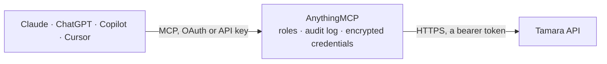

<!-- Generated by scripts/export-github-catalog.mjs in the anythingmcp-website repository. Do not edit by hand. -->

# Tamara MCP connector

Tamara buy now, pay later (Saudi Arabia, UAE, Kuwait, Bahrain, Oman): look up orders by your order number or Tamara id with status, captured, refunded and settled amounts, check payment types and customer eligibility. The AnythingMCP connector gives Claude, ChatGPT, Microsoft Copilot, Cursor and Gemini 8 MCP tools for Tamara: 6 read and 2 can change data.

**Category:** [Payments](../payments.md) · **Tools:** 8 · **Setup guide:** [anythingmcp.com](https://anythingmcp.com/guides/tamara-to-mcp) · [Deutsch](https://anythingmcp.com/de/guides/tamara-to-mcp) · [Italiano](https://anythingmcp.com/it/guides/tamara-to-mcp) · [Español](https://anythingmcp.com/es/guides/tamara-to-mcp) · [日本語](https://anythingmcp.com/ja/guides/tamara-to-mcp) · [Русский](https://anythingmcp.com/ru/guides/tamara-to-mcp) · [中文](https://anythingmcp.com/zh/guides/tamara-to-mcp)

## Start without code

No installation and no terminal: AnythingMCP Cloud runs the Tamara connector for you, operated by helpcode.ai in Frankfurt, Germany.

1. **Click the button above** and create an account or sign in. The Tamara connector opens, ready to install.
2. **Paste the API key or token from your Tamara account.** Every click is in the [step-by-step guide](https://anythingmcp.com/guides/tamara-to-mcp).
3. **Click Install.** AnythingMCP shows the address of your MCP server.
4. **Add that address to your assistant:** [Claude](https://anythingmcp.com/guides/connect-tamara-to-claude) · [ChatGPT](https://anythingmcp.com/guides/connect-tamara-to-chatgpt) · [Microsoft Copilot](https://anythingmcp.com/guides/connect-tamara-to-copilot) · [Cursor](https://anythingmcp.com/guides/connect-tamara-to-cursor) · [Gemini CLI](https://anythingmcp.com/guides/connect-tamara-to-gemini) · [Meta Muse](https://anythingmcp.com/guides/connect-tamara-to-muse).
5. **Ask your first question**, for example: *Find Tamara order for our shop order DT-2026-1587 and tell me status, amounts and settlement.*

Prefer help with the setup? [Talk to us](https://anythingmcp.com/contact).

## How it works

- **The AI client** speaks MCP (Streamable HTTP) to AnythingMCP and only sees tool names, descriptions and results. It never gets the Tamara credentials.
- **AnythingMCP** checks the client's role, builds the call from the tool definition, adds the credentials (a bearer token), calls Tamara, logs the call and returns the result.
- **Tamara** sees an ordinary API client with the rights of the account the credentials belong to.

## Tools

| Tool | What it does | Access |
|---|---|---|
| [`tamara_list_payment_types`](#tamara_list_payment_types) | List the Tamara payment types available to the merchant in a country (PAY_BY_INSTALMENTS, PAY_NOW...) with minimum and maximum order amounts and the… | read |
| [`tamara_get_order_by_reference`](#tamara_get_order_by_reference) | Get a Tamara order by your own order number (the order_reference_id sent at checkout, e.g. the shop order number): Tamara order_id, status, payment type and… | read |
| [`tamara_get_order`](#tamara_get_order) | Get a Tamara order by its Tamara order_id with the same details as tamara_get_order_by_reference: status, amounts (total, captured, refunded, canceled,… | read |
| [`tamara_check_payment_options`](#tamara_check_payment_options) | Check which Tamara payment options a specific customer can use for an order amount before checkout (has_available_payment_options, available_payment_labels… | read |
| [`tamara_check_customer_eligibility`](#tamara_check_customer_eligibility) | Check whether Tamara currently treats a customer as eligible (is_eligible), based on active decline records, for an order amount. | read |
| [`tamara_get_webhook`](#tamara_get_webhook) | Get a registered webhook by its id: url, subscribed events (order_approved, order_authorised, order_captured, order_refunded...) and headers. | read |
| [`tamara_capture_order`](#tamara_capture_order) | Capture an authorised Tamara order in full or in part when it ships, so Tamara settles it. | write |
| [`tamara_refund_order`](#tamara_refund_order) | Refund a captured Tamara order in full or in part (simplified refund). | write |

## Tool reference

Every parameter as the AI client sees it in `tools/list`. Source: [`packages/backend/src/adapters/intl/tamara.json`](../../../packages/backend/src/adapters/intl/tamara.json).

### `tamara_list_payment_types`

List the Tamara payment types available to the merchant in a country (PAY_BY_INSTALMENTS, PAY_NOW...) with minimum and maximum order amounts and the supported numbers of instalments. With order_value only the types eligible for that amount are returned. A cheap call that also checks the connection.

**Access:** read · **Call:** `GET /checkout/payment-types`

| Parameter | Type | Required | Description |
|---|---|---|---|
| `country` | `SA` \| `AE` \| `KW` \| `BH` \| `OM` | yes | Merchant country, ISO code: SA, AE, KW, BH or OM. |
| `currency` | `SAR` \| `AED` \| `BHD` \| `KWD` \| `OMR` | no | Currency; the country default when omitted. |
| `order_value` | number | no | Order total, to list only the types eligible for it. |
| `phone` | string | no | Customer phone number with country code, e.g. 966501234567, for customer-specific limits. |

### `tamara_get_order_by_reference`

Get a Tamara order by your own order number (the order_reference_id sent at checkout, e.g. the shop order number): Tamara order_id, status, payment type and instalments, consumer, addresses, items, total, captured, refunded, canceled and paid amounts, settlement status and date, and the transactions (captures, refunds, cancels). If several orders share the reference, the newest is returned.

**Access:** read · **Call:** `GET /merchants/orders/reference-id/{order_reference_id}`

| Parameter | Type | Required | Description |
|---|---|---|---|
| `order_reference_id` | string | yes | Your order number as sent to Tamara, e.g. A12345 or 000012345. |

### `tamara_get_order`

Get a Tamara order by its Tamara order_id with the same details as tamara_get_order_by_reference: status, amounts (total, captured, refunded, canceled, paid), settlement, items and transactions.

**Access:** read · **Call:** `GET /orders/{order_id}`

| Parameter | Type | Required | Description |
|---|---|---|---|
| `order_id` | string | yes | Tamara order_id (UUID) issued at checkout, e.g. 0ac038ef-de4a-491c-828e-b02ec0d4582d. tamara_get_order_by_reference returns it for your own order number. |

### `tamara_check_payment_options`

Check which Tamara payment options a specific customer can use for an order amount before checkout (has_available_payment_options, available_payment_labels with payment type and instalments, single_checkout_enabled). Reads only; nothing is created.

**Access:** read · **Call:** `POST /checkout/payment-options-pre-check`

| Parameter | Type | Required | Description |
|---|---|---|---|
| `country` | `SA` \| `AE` \| `KW` \| `BH` \| `OM` | yes | Merchant country: SA, AE, KW, BH or OM. |
| `phone_number` | string | yes | Customer phone number, e.g. 966501234567. |
| `amount` | number | yes | Order total. |
| `currency` | `SAR` \| `AED` \| `BHD` \| `KWD` \| `OMR` | yes | Currency of the amount. |
| `is_vip` | boolean | no | The customer is a VIP at your store. |

### `tamara_check_customer_eligibility`

Check whether Tamara currently treats a customer as eligible (is_eligible), based on active decline records, for an order amount. Give the phone number, the e-mail or both. Reads only.

**Access:** read · **Call:** `POST /pre-checkout/v1/eligibility`

| Parameter | Type | Required | Description |
|---|---|---|---|
| `amount` | number | yes | Order total. |
| `currency` | `SAR` \| `AED` \| `BHD` \| `KWD` \| `OMR` | yes | Currency of the amount. |
| `phone_number` | string | no | Customer phone number, e.g. 966501234567. |
| `email` | string | no | Customer e-mail address. |

### `tamara_get_webhook`

Get a registered webhook by its id: url, subscribed events (order_approved, order_authorised, order_captured, order_refunded...) and headers.

**Access:** read · **Call:** `GET /webhooks/{webhook_id}`

| Parameter | Type | Required | Description |
|---|---|---|---|
| `webhook_id` | string | yes | Webhook id (UUID) returned when the webhook was registered. |

### `tamara_capture_order`

Capture an authorised Tamara order in full or in part when it ships, so Tamara settles it. This moves money: show the order, amount and currency to the user and wait for a yes. Installed switched off.

**Access:** write · **Call:** `POST /payments/capture`

| Parameter | Type | Required | Description |
|---|---|---|---|
| `order_id` | string | yes | Tamara order_id (UUID) issued at checkout, e.g. 0ac038ef-de4a-491c-828e-b02ec0d4582d. tamara_get_order_by_reference returns it for your own order number. |
| `amount` | number | yes | Amount to capture out of the order total. |
| `currency` | `SAR` \| `AED` \| `BHD` \| `KWD` \| `OMR` | yes | Currency of the order. |
| `shipped_at` | string | yes | Shipping date-time, ISO 8601, e.g. 2026-10-20T10:00:00Z. |
| `shipping_company` | string | yes | Shipping company, e.g. Aramex, SMSA, DHL. |
| `tracking_number` | string | no | Shipment tracking number. |
| `tracking_url` | string | no | Tracking URL. |
| `items` | object[] | no | Items being captured, in the Tamara item format (reference_id, type, name, sku, quantity, total_amount). |

### `tamara_refund_order`

Refund a captured Tamara order in full or in part (simplified refund). The money goes back to the customer and cannot be taken back: show the order, amount and comment to the user and wait for a yes. Installed switched off.

**Access:** write · **Call:** `POST /payments/simplified-refund/{order_id}`

| Parameter | Type | Required | Description |
|---|---|---|---|
| `order_id` | string | yes | Tamara order_id (UUID) issued at checkout, e.g. 0ac038ef-de4a-491c-828e-b02ec0d4582d. tamara_get_order_by_reference returns it for your own order number. |
| `amount` | number | yes | Amount to refund, excluding any discount. |
| `currency` | `SAR` \| `AED` \| `BHD` \| `KWD` \| `OMR` | yes | Currency of the order. |
| `comment` | string | yes | Reason, stored in the order history, e.g. Refund for order A123. |
| `merchant_refund_id` | string | no | Your own refund id, e.g. the credit note number. |

## Run it yourself

AnythingMCP is open source (AGPL-3.0). [Run it with Docker](../../../README.md#run-it-yourself), open **Connectors → Store**, pick **Tamara** and enter `TAMARA_API_URL`, `TAMARA_API_TOKEN`, then add your MCP server URL to the AI client.

[← Payments connectors](../payments.md) · [All categories](../README.md)
