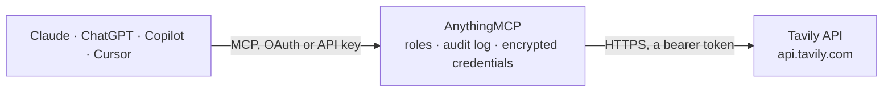

<!-- Generated by scripts/export-github-catalog.mjs in the anythingmcp-website repository. Do not edit by hand. -->

# Tavily MCP connector

Give your AI live web search built for agents with Tavily: search the web or the news with a short answer and sources, read pages as clean text, map and crawl websites, run longer research jobs and check your credits. The AnythingMCP connector gives Claude, ChatGPT, Microsoft Copilot, Cursor and Gemini 7 MCP tools for Tavily: 6 read and 1 can change data.

**Category:** [Public Data](../data.md) · **Tools:** 7 · **Setup guide:** [anythingmcp.com](https://anythingmcp.com/guides/tavily-to-mcp) · [Deutsch](https://anythingmcp.com/de/guides/tavily-to-mcp) · [Italiano](https://anythingmcp.com/it/guides/tavily-to-mcp) · [Español](https://anythingmcp.com/es/guides/tavily-to-mcp) · [日本語](https://anythingmcp.com/ja/guides/tavily-to-mcp) · [Русский](https://anythingmcp.com/ru/guides/tavily-to-mcp) · [中文](https://anythingmcp.com/zh/guides/tavily-to-mcp)

## Start without code

No installation and no terminal: AnythingMCP Cloud runs the Tavily connector for you, operated by helpcode.ai in Frankfurt, Germany.

1. **Click the button above** and create an account or sign in. The Tavily connector opens, ready to install.
2. **Paste the API key or token from your Tavily account.** Every click is in the [step-by-step guide](https://anythingmcp.com/guides/tavily-to-mcp).
3. **Click Install.** AnythingMCP shows the address of your MCP server.
4. **Add that address to your assistant:** [Claude](https://anythingmcp.com/guides/connect-tavily-to-claude) · [ChatGPT](https://anythingmcp.com/guides/connect-tavily-to-chatgpt) · [Microsoft Copilot](https://anythingmcp.com/guides/connect-tavily-to-copilot) · [Cursor](https://anythingmcp.com/guides/connect-tavily-to-cursor) · [Gemini CLI](https://anythingmcp.com/guides/connect-tavily-to-gemini) · [Meta Muse](https://anythingmcp.com/guides/connect-tavily-to-muse).
5. **Ask your first question**, for example: *Has AltaVista Software OÜ published an insolvency or restructuring notice on or after 2026-09-15?*

Prefer help with the setup? [Talk to us](https://anythingmcp.com/contact).

## How it works

- **The AI client** speaks MCP (Streamable HTTP) to AnythingMCP and only sees tool names, descriptions and results. It never gets the Tavily credentials.
- **AnythingMCP** checks the client's role, builds the call from the tool definition, adds the credentials (a bearer token), calls Tavily, logs the call and returns the result.
- **Tavily** sees an ordinary API client with the rights of the account the credentials belong to.

## Tools

| Tool | What it does | Access |
|---|---|---|
| [`tavily_search`](#tavily_search) | Search the web with Tavily and get ranked sources with a relevant snippet each, and optionally a short answer written from them. | read |
| [`tavily_extract`](#tavily_extract) | Read up to 20 web pages with Tavily and get their content as clean markdown or text. | read |
| [`tavily_map`](#tavily_map) | List the URLs of a website with Tavily, starting from one address, to find the right pages before extracting them. | read |
| [`tavily_crawl`](#tavily_crawl) | Crawl a website with Tavily from one address and get the content of each page found, as markdown. | read |
| [`tavily_start_research`](#tavily_start_research) | Start a Tavily research job: an agent runs many searches and writes a report with sources. | write |
| [`tavily_get_research`](#tavily_get_research) | Get the status and, once completed, the report and sources of a Tavily research job started with tavily_start_research. | read |
| [`tavily_get_usage`](#tavily_get_usage) | Show how many Tavily credits this API key and the account's plan have used in the current billing cycle and their limits, split by search, extract, crawl,… | read |

## Tool reference

Every parameter as the AI client sees it in `tools/list`. Source: [`packages/backend/src/adapters/intl/tavily.json`](../../../packages/backend/src/adapters/intl/tavily.json).

### `tavily_search`

Search the web with Tavily and get ranked sources with a relevant snippet each, and optionally a short answer written from them. Spends Tavily credits: 1 per call with search_depth basic, fast or ultra-fast, 2 with advanced. Use topic news for current events. Returns results (title, url, content, score), answer when asked for, and usage.credits. Read-only: it changes nothing in the account.

**Access:** read · **Call:** `POST /search`

| Parameter | Type | Required | Description |
|---|---|---|---|
| `query` | string | yes | What to search for, at least 2 characters, as a short question or keywords. Wrap a phrase in double quotes together with exact_match to require it literally. |
| `search_depth` | `basic` \| `fast` \| `ultra-fast` \| `advanced` | no | basic (1 credit) is the balanced default; fast and ultra-fast (1 credit) answer quicker; advanced (2 credits) gives the most relevant passages for detailed questions. |
| `topic` | `general` \| `news` \| `finance` | no | general for the web, news for recent articles from news sources (adds published dates), finance for financial sources. |
| `max_results` | integer | no | How many results to return, 0 to 20. Default 5; the credit cost does not depend on it, the length of the answer does. |
| `time_range` | `day` \| `week` \| `month` \| `year` | no | Only results published or updated within this period back from today. |
| `start_date` | string | no | Only results published or updated after this date, YYYY-MM-DD. |
| `end_date` | string | no | Only results published or updated before this date, YYYY-MM-DD. |
| `include_answer` | `basic` \| `advanced` | no | Add a short answer written by Tavily from the results: basic is quick, advanced more detailed. Leave out for sources only. |
| `include_raw_content` | `markdown` \| `text` | no | Also return the whole cleaned page of each result, as markdown or plain text. Makes the answer much longer; leave out unless snippets are not enough. |
| `include_domains` | string[] | no | Only search these domains, e.g. ["europa.eu", "who.int"] (up to 300). |
| `exclude_domains` | string[] | no | Never return results from these domains (up to 150). |
| `country` | string | no | Boost results from one country, as a lowercase English name such as germany or united states. Only with topic general. |
| `chunks_per_source` | integer | no | Passages per result in content, 1 to 3 (Tavily default 3). Not available with search_depth ultra-fast. |
| `exact_match` | boolean | no | Only return results that contain the quoted phrase(s) of the query literally. |
| `include_images` | boolean | no | Also return image URLs related to the query. |

### `tavily_extract`

Read up to 20 web pages with Tavily and get their content as clean markdown or text. Spends Tavily credits: 1 per 5 pages extracted with extract_depth basic, 2 per 5 with advanced; failed pages cost nothing. Pass query to keep only the passages that answer it. Returns results (url, raw_content), failed_results and usage.credits. Read-only: it changes nothing in the account.

**Access:** read · **Call:** `POST /extract`

| Parameter | Type | Required | Description |
|---|---|---|---|
| `urls` | string[] | yes | The page URLs to read, 1 to 20, each with https://. |
| `query` | string | no | A question or intent. When given, each page returns only its most relevant passages instead of the whole text. |
| `chunks_per_source` | integer | no | With query: how many passages to keep per page, 1 to 5 (Tavily default 3). |
| `extract_depth` | `basic` \| `advanced` | no | basic is cheaper and faster; advanced also gets tables and embedded content and succeeds on more pages, at twice the credits. |
| `format` | `markdown` \| `text` | no | markdown keeps headings and links; text is plain text. |
| `include_images` | boolean | no | Also return the image URLs found on each page. |
| `timeout` | number | no | Seconds Tavily may spend before giving up, 1 to 25 here (Tavily's own default is 10 for basic and 30 for advanced, which can exceed this connector's 30 second limit). |

### `tavily_map`

List the URLs of a website with Tavily, starting from one address, to find the right pages before extracting them. Spends Tavily credits: 1 per 10 pages found, 2 per 10 with instructions. Defaults keep it small (depth 1, up to 20 pages, 25 second timeout). Returns base_url, results (the URLs) and usage.credits. Read-only: it changes nothing in the account.

**Access:** read · **Call:** `POST /map`

| Parameter | Type | Required | Description |
|---|---|---|---|
| `url` | string | yes | Where to start, e.g. https://docs.example.com. |
| `instructions` | string | no | What to look for, in plain words, e.g. pages about pricing. Doubles the credit cost. |
| `max_depth` | integer | no | How many links away from the start page to go, 1 to 5. |
| `max_breadth` | integer | no | How many links to follow on each page. |
| `limit` | integer | no | Stop after this many pages. Default 20. |
| `select_paths` | string[] | no | Regular expressions; only URLs whose path matches one are kept, e.g. ["/docs/.*"]. |
| `exclude_paths` | string[] | no | Regular expressions for paths to skip, e.g. ["/blog/.*"]. |
| `select_domains` | string[] | no | Regular expressions for the domains or subdomains to stay on, e.g. ["^docs\\.example\\.com$"]. |
| `exclude_domains` | string[] | no | Regular expressions for domains or subdomains to skip. |
| `allow_external` | boolean | no | Also list links to other domains (Tavily default true). |
| `timeout` | number | no | Seconds Tavily may spend, 10 to 25 here so the call ends within this connector's 30 second limit. |

### `tavily_crawl`

Crawl a website with Tavily from one address and get the content of each page found, as markdown. Spends Tavily credits for the map (1 per 10 pages, 2 with instructions) plus the extraction (1 per 5 pages, 2 with advanced). Defaults keep it small (depth 1, up to 10 pages, 25 second timeout). Returns base_url, results (url, raw_content) and usage.credits. Read-only: it changes nothing in the account.

**Access:** read · **Call:** `POST /crawl`

| Parameter | Type | Required | Description |
|---|---|---|---|
| `url` | string | yes | Where to start, e.g. https://docs.example.com. |
| `instructions` | string | no | What to collect, in plain words, e.g. the API authentication pages. Doubles the mapping cost and enables chunks_per_source. |
| `chunks_per_source` | integer | no | With instructions: passages to keep per page, 1 to 5, instead of the whole page. |
| `max_depth` | integer | no | How many links away from the start page to go, 1 to 5. |
| `max_breadth` | integer | no | How many links to follow on each page. |
| `limit` | integer | no | Stop after this many pages. Default 10; every page costs credits. |
| `select_paths` | string[] | no | Regular expressions; only URLs whose path matches one are crawled, e.g. ["/docs/.*"]. |
| `exclude_paths` | string[] | no | Regular expressions for paths to skip. |
| `select_domains` | string[] | no | Regular expressions for the domains or subdomains to stay on. |
| `exclude_domains` | string[] | no | Regular expressions for domains or subdomains to skip. |
| `allow_external` | boolean | no | Also include pages on other domains (Tavily default true). |
| `extract_depth` | `basic` \| `advanced` | no | basic is cheaper; advanced also gets tables and embedded content, at twice the extraction credits. |
| `format` | `markdown` \| `text` | no | markdown keeps headings and links; text is plain text. |
| `timeout` | number | no | Seconds Tavily may spend, 10 to 25 here so the call ends within this connector's 30 second limit. |

### `tavily_start_research`

Start a Tavily research job: an agent runs many searches and writes a report with sources. Spends Tavily credits: 4 to 110 with model mini (the default), 15 to 250 with pro, so confirm with the user before using pro. Returns request_id and status at once; then call tavily_get_research every 20 to 30 seconds until status is completed or failed.

**Access:** write · **Call:** `POST /research`

| Parameter | Type | Required | Description |
|---|---|---|---|
| `input` | string | yes | The research question or task, with any scope the report should keep to. |
| `model` | `mini` \| `pro` \| `auto` | no | mini (cheapest) for narrow, well-scoped questions; pro for broad topics across many subtopics; auto lets Tavily choose. |
| `output_length` | `short` \| `standard` \| `long` | no | Target length of the report (Tavily default standard). |
| `citation_format` | `numbered` \| `mla` \| `apa` \| `chicago` | no | How sources are cited in the report (Tavily default numbered). |
| `include_domains` | string[] | no | Domains to prefer as sources; others can still appear. |
| `exclude_domains` | string[] | no | Domains that must never be used as sources (subdomains included). |
| `output_schema` | object | no | A JSON Schema with properties, when the report should come back as structured fields instead of text. |

### `tavily_get_research`

Get the status and, once completed, the report and sources of a Tavily research job started with tavily_start_research. status is pending or in_progress while it runs (call again in 20 to 30 seconds), completed with content and sources, or failed.

**Access:** read · **Call:** `GET /research/{request_id}`

| Parameter | Type | Required | Description |
|---|---|---|---|
| `request_id` | string | yes | The request_id returned by tavily_start_research. |

### `tavily_get_usage`

Show how many Tavily credits this API key and the account's plan have used in the current billing cycle and their limits, split by search, extract, crawl, map and research, plus pay-as-you-go usage. Reads the counters only, it runs no search.

**Access:** read · **Call:** `GET /usage`

| Parameter | Type | Required | Description |
|---|---|---|---|
| `project_id` | string | no | Optional Tavily project id, to count only that project's usage. |

## Run it yourself

AnythingMCP is open source (AGPL-3.0). [Run it with Docker](../../../README.md#run-it-yourself), open **Connectors → Store**, pick **Tavily** and enter `TAVILY_API_KEY`, then add your MCP server URL to the AI client.

[← Public Data connectors](../data.md) · [All categories](../README.md)
