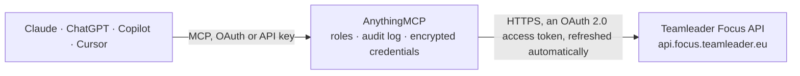

<!-- Generated by scripts/export-github-catalog.mjs in the anythingmcp-website repository. Do not edit by hand. -->

# Teamleader Focus MCP connector

Teamleader Focus — the Belgian CRM, project and invoicing suite: companies, contacts, deals, projects, time tracking, invoices and quotations. The AnythingMCP connector gives Claude, ChatGPT, Microsoft Copilot, Cursor and Gemini 10 MCP tools for Teamleader Focus, all read-only.

**Category:** [CRM](../crm.md) · **Tools:** 10 · **Setup guide:** [anythingmcp.com](https://anythingmcp.com/guides/teamleader-to-mcp) · [Deutsch](https://anythingmcp.com/de/guides/teamleader-to-mcp) · [Italiano](https://anythingmcp.com/it/guides/teamleader-to-mcp) · [Español](https://anythingmcp.com/es/guides/teamleader-to-mcp) · [日本語](https://anythingmcp.com/ja/guides/teamleader-to-mcp) · [Русский](https://anythingmcp.com/ru/guides/teamleader-to-mcp) · [中文](https://anythingmcp.com/zh/guides/teamleader-to-mcp)

## Start without code

No installation and no terminal: AnythingMCP Cloud runs the Teamleader Focus connector for you, operated by helpcode.ai in Frankfurt, Germany.

1. **Click the button above** and create an account or sign in. The Teamleader Focus connector opens, ready to install.
2. **Sign in with your Teamleader Focus account** when AnythingMCP asks. The first time, an admin creates a small app in the Teamleader Focus developer console. Every click is in the [step-by-step guide](https://anythingmcp.com/guides/teamleader-to-mcp).
3. **Click Install.** AnythingMCP shows the address of your MCP server.
4. **Add that address to your assistant:** [Claude](https://anythingmcp.com/guides/connect-teamleader-to-claude) · [ChatGPT](https://anythingmcp.com/guides/connect-teamleader-to-chatgpt) · [Microsoft Copilot](https://anythingmcp.com/guides/connect-teamleader-to-copilot) · [Cursor](https://anythingmcp.com/guides/connect-teamleader-to-cursor) · [Gemini CLI](https://anythingmcp.com/guides/connect-teamleader-to-gemini) · [Meta Muse](https://anythingmcp.com/guides/connect-teamleader-to-muse).
5. **Ask your first question**, for example: *Do we have invoice INV-2026-054 for customer Vandepoel BVBA and is it unpaid?*

Prefer help with the setup? [Talk to us](https://anythingmcp.com/contact).

## How it works

- **The AI client** speaks MCP (Streamable HTTP) to AnythingMCP and only sees tool names, descriptions and results. It never gets the Teamleader Focus credentials.
- **AnythingMCP** checks the client's role, builds the call from the tool definition, adds the credentials (an OAuth 2.0 access token, refreshed automatically), calls Teamleader Focus, logs the call and returns the result.
- **Teamleader Focus** sees an ordinary API client with the rights of the account the credentials belong to.

## Tools

| Tool | What it does | Access |
|---|---|---|
| [`teamleader_get_me`](#teamleader_get_me) | Read the user the token belongs to, with their name, e-mail, language and account. | read |
| [`teamleader_list_companies`](#teamleader_list_companies) | List client companies with their name, VAT number, address and tags. | read |
| [`teamleader_get_company`](#teamleader_get_company) | Read one company in full: addresses, VAT number, payment terms, custom fields, tags and the account manager. | read |
| [`teamleader_list_contacts`](#teamleader_list_contacts) | List individual contacts with their name, e-mail, phone and the companies they are linked to. | read |
| [`teamleader_list_deals`](#teamleader_list_deals) | List deals with their title, customer, value, phase and expected closing date — the sales-pipeline view. | read |
| [`teamleader_get_deal`](#teamleader_get_deal) | Read one deal in full: its value, phase, source, responsible user, linked quotations and the full phase history. | read |
| [`teamleader_list_invoices`](#teamleader_list_invoices) | List invoices with their number, date, due date, customer, totals and payment status — the receivables view. | read |
| [`teamleader_list_projects`](#teamleader_list_projects) | List projects with their title, customer, status, budget and the milestones they are broken into. | read |
| [`teamleader_list_time_tracking`](#teamleader_list_time_tracking) | List tracked time entries with their user, date, duration, project and invoiceability — the raw data behind 'how much did we spend on this client'. | read |
| [`teamleader_list_quotations`](#teamleader_list_quotations) | List quotations with their deal, total, status and validity date, optionally limited to given quotation ids. | read |

## Tool reference

Every parameter as the AI client sees it in `tools/list`. Source: [`packages/backend/src/adapters/be/teamleader.json`](../../../packages/backend/src/adapters/be/teamleader.json).

### `teamleader_get_me`

Read the user the token belongs to, with their name, e-mail, language and account. The fastest proof that the OAuth client and refresh token work.

**Access:** read · **Call:** `POST /users.me`

No parameters.

### `teamleader_list_companies`

List client companies with their name, VAT number, address and tags. A POST that only reads — that is how Teamleader's API is shaped.

**Access:** read · **Call:** `POST /companies.list`

| Parameter | Type | Required | Description |
|---|---|---|---|
| `term` | string | no | Search fragment matched against name, VAT number and e-mail. |
| `page_size` | number | no | Rows per page (default 20, max 100). |
| `page_number` | number | no | Page number, starting at 1. |

### `teamleader_get_company`

Read one company in full: addresses, VAT number, payment terms, custom fields, tags and the account manager.

**Access:** read · **Call:** `POST /companies.info`

| Parameter | Type | Required | Description |
|---|---|---|---|
| `id` | string | yes | Company UUID. |

### `teamleader_list_contacts`

List individual contacts with their name, e-mail, phone and the companies they are linked to.

**Access:** read · **Call:** `POST /contacts.list`

| Parameter | Type | Required | Description |
|---|---|---|---|
| `term` | string | no | Search fragment matched against name, e-mail and phone. |
| `page_size` | number | no | Rows per page (default 20, max 100). |
| `page_number` | number | no | Page number, starting at 1. |

### `teamleader_list_deals`

List deals with their title, customer, value, phase and expected closing date — the sales-pipeline view.

**Access:** read · **Call:** `POST /deals.list`

| Parameter | Type | Required | Description |
|---|---|---|---|
| `term` | string | no | Search fragment matched against the deal title and reference. |
| `phase_id` | string | no | Restrict to one pipeline phase UUID. |
| `status` | string[] | no | Statuses to include: open, won, lost. |
| `page_size` | number | no | Rows per page (default 20, max 100). |
| `page_number` | number | no | Page number, starting at 1. |

### `teamleader_get_deal`

Read one deal in full: its value, phase, source, responsible user, linked quotations and the full phase history.

**Access:** read · **Call:** `POST /deals.info`

| Parameter | Type | Required | Description |
|---|---|---|---|
| `id` | string | yes | Deal UUID — not the reference number. |

### `teamleader_list_invoices`

List invoices with their number, date, due date, customer, totals and payment status — the receivables view.

**Access:** read · **Call:** `POST /invoices.list`

| Parameter | Type | Required | Description |
|---|---|---|---|
| `status` | string[] | no | Statuses to include: draft, outstanding, matched. |
| `page_size` | number | no | Rows per page (default 20, max 100). |
| `page_number` | number | no | Page number, starting at 1. |

### `teamleader_list_projects`

List projects with their title, customer, status, budget and the milestones they are broken into.

**Access:** read · **Call:** `POST /projects-v2/projects.list`

| Parameter | Type | Required | Description |
|---|---|---|---|
| `page_size` | number | no | Rows per page (default 20, max 100). |
| `page_number` | number | no | Page number, starting at 1. |

### `teamleader_list_time_tracking`

List tracked time entries with their user, date, duration, project and invoiceability — the raw data behind 'how much did we spend on this client'.

**Access:** read · **Call:** `POST /timeTracking.list`

| Parameter | Type | Required | Description |
|---|---|---|---|
| `started_after` | string | no | Earliest start, ISO 8601 with a zone. |
| `started_before` | string | no | Latest start, ISO 8601 with a zone. |
| `page_size` | number | no | Rows per page (default 20, max 100). |
| `page_number` | number | no | Page number, starting at 1. |

### `teamleader_list_quotations`

List quotations with their deal, total, status and validity date, optionally limited to given quotation ids. Teamleader has no deal filter here: read a deal with teamleader_get_deal, take the ids of its quotations and pass them as `ids`.

**Access:** read · **Call:** `POST /quotations.list`

| Parameter | Type | Required | Description |
|---|---|---|---|
| `ids` | string[] | no | Quotation UUIDs to return. Omit for all quotations. |
| `page_size` | number | no | Rows per page. |
| `page_number` | number | no | Page number, starting at 1. |

## Run it yourself

AnythingMCP is open source (AGPL-3.0). [Run it with Docker](../../../README.md#run-it-yourself), open **Connectors → Store**, pick **Teamleader Focus** and enter `TEAMLEADER_CLIENT_ID`, `TEAMLEADER_CLIENT_SECRET`, then add your MCP server URL to the AI client.

[← CRM connectors](../crm.md) · [All categories](../README.md)
