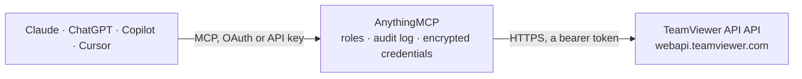

<!-- Generated by scripts/export-github-catalog.mjs in the anythingmcp-website repository. Do not edit by hand. -->

# TeamViewer API MCP connector

Read your TeamViewer account through the Web API: devices and their online status, contacts, groups, account details and service-queue sessions. The AnythingMCP connector gives Claude, ChatGPT, Microsoft Copilot, Cursor and Gemini 6 MCP tools for TeamViewer API, all read-only.

**Category:** [Remote Access](../remote.md) · **Tools:** 6 · **Setup guide:** [anythingmcp.com](https://anythingmcp.com/guides/teamviewer-to-mcp) · [Deutsch](https://anythingmcp.com/de/guides/teamviewer-to-mcp) · [Italiano](https://anythingmcp.com/it/guides/teamviewer-to-mcp) · [Español](https://anythingmcp.com/es/guides/teamviewer-to-mcp) · [日本語](https://anythingmcp.com/ja/guides/teamviewer-to-mcp) · [Русский](https://anythingmcp.com/ru/guides/teamviewer-to-mcp) · [中文](https://anythingmcp.com/zh/guides/teamviewer-to-mcp)

## Start without code

No installation and no terminal: AnythingMCP Cloud runs the TeamViewer API connector for you, operated by helpcode.ai in Frankfurt, Germany.

1. **Click the button above** and create an account or sign in. The TeamViewer API connector opens, ready to install.
2. **Paste the API key or token from your TeamViewer API account.** Every click is in the [step-by-step guide](https://anythingmcp.com/guides/teamviewer-to-mcp).
3. **Click Install.** AnythingMCP shows the address of your MCP server.
4. **Add that address to your assistant:** [Claude](https://anythingmcp.com/guides/connect-teamviewer-to-claude) · [ChatGPT](https://anythingmcp.com/guides/connect-teamviewer-to-chatgpt) · [Microsoft Copilot](https://anythingmcp.com/guides/connect-teamviewer-to-copilot) · [Cursor](https://anythingmcp.com/guides/connect-teamviewer-to-cursor) · [Gemini CLI](https://anythingmcp.com/guides/connect-teamviewer-to-gemini) · [Meta Muse](https://anythingmcp.com/guides/connect-teamviewer-to-muse).
5. **Ask your first question**, for example: *What's the TeamViewer device record for alias site-elk-03? I need its last seen and who it's assigned to.*

Prefer help with the setup? [Talk to us](https://anythingmcp.com/contact).

## How it works

- **The AI client** speaks MCP (Streamable HTTP) to AnythingMCP and only sees tool names, descriptions and results. It never gets the TeamViewer API credentials.
- **AnythingMCP** checks the client's role, builds the call from the tool definition, adds the credentials (a bearer token), calls TeamViewer API, logs the call and returns the result.
- **TeamViewer API** sees an ordinary API client with the rights of the account the credentials belong to.

## Tools

| Tool | What it does | Access |
|---|---|---|
| [`teamviewer_list_devices`](#teamviewer_list_devices) | List all devices registered in your TeamViewer account. | read |
| [`teamviewer_get_device`](#teamviewer_get_device) | Get detailed information about a specific TeamViewer device by its ID. | read |
| [`teamviewer_list_contacts`](#teamviewer_list_contacts) | List all contacts in your TeamViewer account. | read |
| [`teamviewer_list_groups`](#teamviewer_list_groups) | List all device groups in your TeamViewer account. | read |
| [`teamviewer_get_account_info`](#teamviewer_get_account_info) | Get information about the TeamViewer account associated with the API token, including name, email, and company. | read |
| [`teamviewer_list_sessions`](#teamviewer_list_sessions) | List active and recent remote support sessions. | read |

## Tool reference

Every parameter as the AI client sees it in `tools/list`. Source: [`packages/backend/src/adapters/de/teamviewer.json`](../../../packages/backend/src/adapters/de/teamviewer.json).

### `teamviewer_list_devices`

List all devices registered in your TeamViewer account. Returns device IDs, aliases, online status, and last seen timestamps.

**Access:** read · **Call:** `GET /devices`

| Parameter | Type | Required | Description |
|---|---|---|---|
| `online_state` | string | no | Filter by online status: 'online' or 'offline'. Leave empty for all. |

### `teamviewer_get_device`

Get detailed information about a specific TeamViewer device by its ID.

**Access:** read · **Call:** `GET /devices/{deviceId}`

| Parameter | Type | Required | Description |
|---|---|---|---|
| `deviceId` | string | yes | The TeamViewer device ID |

### `teamviewer_list_contacts`

List all contacts in your TeamViewer account. Returns contact names, IDs, and online status.

**Access:** read · **Call:** `GET /contacts`

No parameters.

### `teamviewer_list_groups`

List all device groups in your TeamViewer account.

**Access:** read · **Call:** `GET /groups`

No parameters.

### `teamviewer_get_account_info`

Get information about the TeamViewer account associated with the API token, including name, email, and company.

**Access:** read · **Call:** `GET /account`

No parameters.

### `teamviewer_list_sessions`

List active and recent remote support sessions.

**Access:** read · **Call:** `GET /sessions`

No parameters.

## Run it yourself

AnythingMCP is open source (AGPL-3.0). [Run it with Docker](../../../README.md#run-it-yourself), open **Connectors → Store**, pick **TeamViewer API** and enter `TEAMVIEWER_API_TOKEN`, then add your MCP server URL to the AI client.

[← Remote Access connectors](../remote.md) · [All categories](../README.md)
