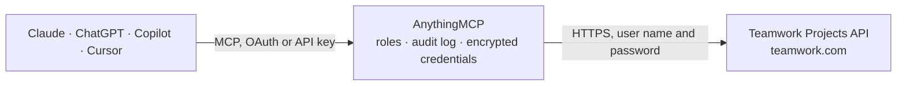

<!-- Generated by scripts/export-github-catalog.mjs in the anythingmcp-website repository. Do not edit by hand. -->

# Teamwork Projects MCP connector

Manage Teamwork.com (projects, tasks, milestones, time entries, comments, people) from any AI agent. 10 tools, basic-auth with API key. The AnythingMCP connector gives Claude, ChatGPT, Microsoft Copilot, Cursor and Gemini 10 MCP tools for Teamwork Projects: 6 read and 4 can change data.

**Category:** [Project Management](../project-management.md) · **Tools:** 10 · **Setup guide:** [anythingmcp.com](https://anythingmcp.com/guides/teamwork-projects-to-mcp) · [Deutsch](https://anythingmcp.com/de/guides/teamwork-projects-to-mcp) · [Italiano](https://anythingmcp.com/it/guides/teamwork-projects-to-mcp) · [Español](https://anythingmcp.com/es/guides/teamwork-projects-to-mcp) · [日本語](https://anythingmcp.com/ja/guides/teamwork-projects-to-mcp) · [Русский](https://anythingmcp.com/ru/guides/teamwork-projects-to-mcp) · [中文](https://anythingmcp.com/zh/guides/teamwork-projects-to-mcp)

## Start without code

No installation and no terminal: AnythingMCP Cloud runs the Teamwork Projects connector for you, operated by helpcode.ai in Frankfurt, Germany.

1. **Click the button above** and create an account or sign in. The Teamwork Projects connector opens, ready to install.
2. **Paste the API key or token from your Teamwork Projects account.** Every click is in the [step-by-step guide](https://anythingmcp.com/guides/teamwork-projects-to-mcp).
3. **Click Install.** AnythingMCP shows the address of your MCP server.
4. **Add that address to your assistant:** [Claude](https://anythingmcp.com/guides/connect-teamwork-projects-to-claude) · [ChatGPT](https://anythingmcp.com/guides/connect-teamwork-projects-to-chatgpt) · [Microsoft Copilot](https://anythingmcp.com/guides/connect-teamwork-projects-to-copilot) · [Cursor](https://anythingmcp.com/guides/connect-teamwork-projects-to-cursor) · [Gemini CLI](https://anythingmcp.com/guides/connect-teamwork-projects-to-gemini) · [Meta Muse](https://anythingmcp.com/guides/connect-teamwork-projects-to-muse).
5. **Ask your first question**, for example: *Show me the task details for the invoice review task for Solaria GmbH due 2026-11-05*

Prefer help with the setup? [Talk to us](https://anythingmcp.com/contact).

## How it works

- **The AI client** speaks MCP (Streamable HTTP) to AnythingMCP and only sees tool names, descriptions and results. It never gets the Teamwork Projects credentials.
- **AnythingMCP** checks the client's role, builds the call from the tool definition, adds the credentials (user name and password), calls Teamwork Projects, logs the call and returns the result.
- **Teamwork Projects** sees an ordinary API client with the rights of the account the credentials belong to.

## Tools

| Tool | What it does | Access |
|---|---|---|
| [`teamwork_list_projects`](#teamwork_list_projects) | List projects. | read |
| [`teamwork_get_project`](#teamwork_get_project) | Get one project with summary metrics. | read |
| [`teamwork_create_project`](#teamwork_create_project) | Create a project. | write |
| [`teamwork_list_tasks`](#teamwork_list_tasks) | List tasks across all projects (or one). | read |
| [`teamwork_get_task`](#teamwork_get_task) | Get one task with all custom fields, time logs, dependencies. | read |
| [`teamwork_create_task`](#teamwork_create_task) | Create a task inside a task list. | write |
| [`teamwork_complete_task`](#teamwork_complete_task) | Mark a task complete. | write |
| [`teamwork_log_time`](#teamwork_log_time) | Log time on a task or project. | write |
| [`teamwork_list_milestones`](#teamwork_list_milestones) | List milestones across projects. | read |
| [`teamwork_list_people`](#teamwork_list_people) | List users (people). | read |

## Tool reference

Every parameter as the AI client sees it in `tools/list`. Source: [`packages/backend/src/adapters/intl/teamwork-projects.json`](../../../packages/backend/src/adapters/intl/teamwork-projects.json).

### `teamwork_list_projects`

List projects. Filter by status (active, archived, current, late, upcoming, completed).

**Access:** read · **Call:** `GET /projects.json`

| Parameter | Type | Required | Description |
|---|---|---|---|
| `status` | string | no | active, archived, current, late, upcoming, completed, all. |
| `searchTerm` | string | no | Name search. |
| `page` | integer | no | 1-based. |
| `pageSize` | integer | no | Max 250. |

### `teamwork_get_project`

Get one project with summary metrics.

**Access:** read · **Call:** `GET /projects/{project_id}.json`

| Parameter | Type | Required | Description |
|---|---|---|---|
| `project_id` | integer | yes | Project ID. |

### `teamwork_create_project`

Create a project.

**Access:** write · **Call:** `POST /projects.json`

| Parameter | Type | Required | Description |
|---|---|---|---|
| `name` | string | yes | Project name. |
| `description` | string | no | Description. |
| `companyId` | integer | no | Owning company ID. |
| `categoryId` | integer | no | Category ID. |
| `startAt` | string | no | YYYYMMDD. |
| `endAt` | string | no | YYYYMMDD. |

### `teamwork_list_tasks`

List tasks across all projects (or one). Filter by assignee, status, due date.

**Access:** read · **Call:** `GET /tasks.json`

| Parameter | Type | Required | Description |
|---|---|---|---|
| `project_id` | integer | no | Filter to one project. |
| `assignedTo` | string | no | Comma-separated user IDs. |
| `status` | string | no | completed, incomplete, all. |
| `dueDateFrom` | string | no | YYYYMMDD. |
| `dueDateTo` | string | no | YYYYMMDD. |
| `page` | integer | no | 1-based. |
| `pageSize` | integer | no | Max 250. |

### `teamwork_get_task`

Get one task with all custom fields, time logs, dependencies.

**Access:** read · **Call:** `GET /tasks/{task_id}.json`

| Parameter | Type | Required | Description |
|---|---|---|---|
| `task_id` | integer | yes | Task ID. |

### `teamwork_create_task`

Create a task inside a task list.

**Access:** write · **Call:** `POST /tasklists/{tasklist_id}/tasks.json`

| Parameter | Type | Required | Description |
|---|---|---|---|
| `tasklist_id` | integer | yes | Tasklist ID. |
| `content` | string | yes | Task title. |
| `description` | string | no | Description (HTML). |
| `responsiblePartyId` | string | no | User ID(s), comma-separated for multi. |
| `priority` | string | no | low, medium, high. |
| `startDate` | string | no | YYYYMMDD. |
| `dueDate` | string | no | YYYYMMDD. |
| `estimatedMinutes` | integer | no | Estimated effort. |

### `teamwork_complete_task`

Mark a task complete.

**Access:** write · **Call:** `PUT /tasks/{task_id}/complete.json`

| Parameter | Type | Required | Description |
|---|---|---|---|
| `task_id` | integer | yes | Task ID. |

### `teamwork_log_time`

Log time on a task or project.

**Access:** write · **Call:** `POST /projects/{project_id}/time_entries.json`

| Parameter | Type | Required | Description |
|---|---|---|---|
| `task_id` | integer | no | Task ID (or use project_id). |
| `project_id` | integer | no | Project ID if no task. |
| `person_id` | integer | yes | User logging time. |
| `date` | string | yes | YYYYMMDD. |
| `hours` | integer | yes | Whole hours. |
| `minutes` | integer | no | Whole minutes. |
| `description` | string | no | Notes. |
| `isbillable` | boolean | no | Billable. |

### `teamwork_list_milestones`

List milestones across projects.

**Access:** read · **Call:** `GET /milestones.json`

| Parameter | Type | Required | Description |
|---|---|---|---|
| `project_id` | integer | no | Filter to one project. |
| `find` | string | no | all, upcoming, late, completed. |
| `page` | integer | no | 1-based. |
| `pageSize` | integer | no | Max 250. |

### `teamwork_list_people`

List users (people).

**Access:** read · **Call:** `GET /people.json`

| Parameter | Type | Required | Description |
|---|---|---|---|
| `page` | integer | no | 1-based. |
| `pageSize` | integer | no | Max 250. |
| `showDeleted` | boolean | no | Include deleted users. |

## Run it yourself

AnythingMCP is open source (AGPL-3.0). [Run it with Docker](../../../README.md#run-it-yourself), open **Connectors → Store**, pick **Teamwork Projects** and enter `TEAMWORK_SUBDOMAIN`, `TEAMWORK_API_KEY`, then add your MCP server URL to the AI client.

[← Project Management connectors](../project-management.md) · [All categories](../README.md)
