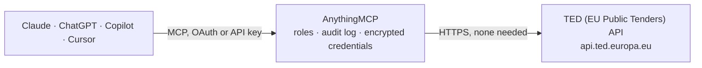

<!-- Generated by scripts/export-github-catalog.mjs in the anythingmcp-website repository. Do not edit by hand. -->

# TED (EU Public Tenders) MCP connector

Search EU public procurement on TED, Tenders Electronic Daily: calls for tenders, contract awards and other notices from every EU and EEA country by CPV code, buyer, country, deadline, value or full text. The AnythingMCP connector gives Claude, ChatGPT, Microsoft Copilot, Cursor and Gemini 4 MCP tools for TED (EU Public Tenders), all read-only.

**Category:** [Government](../government.md) · **Tools:** 4 · **Setup guide:** [anythingmcp.com](https://anythingmcp.com/guides/ted-to-mcp) · [Deutsch](https://anythingmcp.com/de/guides/ted-to-mcp) · [Italiano](https://anythingmcp.com/it/guides/ted-to-mcp) · [Español](https://anythingmcp.com/es/guides/ted-to-mcp) · [日本語](https://anythingmcp.com/ja/guides/ted-to-mcp) · [Русский](https://anythingmcp.com/ru/guides/ted-to-mcp) · [中文](https://anythingmcp.com/zh/guides/ted-to-mcp)

## Start without code

No installation and no terminal: AnythingMCP Cloud runs the TED (EU Public Tenders) connector for you, operated by helpcode.ai in Frankfurt, Germany.

1. **Click the button above** and create an account or sign in. The TED (EU Public Tenders) connector opens, ready to install.
2. **Nothing to enter:** this connector needs no credentials. Every click is in the [step-by-step guide](https://anythingmcp.com/guides/ted-to-mcp).
3. **Click Install.** AnythingMCP shows the address of your MCP server.
4. **Add that address to your assistant:** [Claude](https://anythingmcp.com/guides/connect-ted-to-claude) · [ChatGPT](https://anythingmcp.com/guides/connect-ted-to-chatgpt) · [Microsoft Copilot](https://anythingmcp.com/guides/connect-ted-to-copilot) · [Cursor](https://anythingmcp.com/guides/connect-ted-to-cursor) · [Gemini CLI](https://anythingmcp.com/guides/connect-ted-to-gemini) · [Meta Muse](https://anythingmcp.com/guides/connect-ted-to-muse).
5. **Ask your first question**, for example: *Get full TED notice for publication number 703792-2026, I need buyer and deadline.*

Prefer help with the setup? [Talk to us](https://anythingmcp.com/contact).

## How it works

- **The AI client** speaks MCP (Streamable HTTP) to AnythingMCP and only sees tool names, descriptions and results. It never gets the TED (EU Public Tenders) credentials.
- **AnythingMCP** checks the client's role, builds the call from the tool definition, adds the credentials (none needed), calls TED (EU Public Tenders), logs the call and returns the result.
- **TED (EU Public Tenders)** sees an ordinary API client with the rights of the account the credentials belong to.

## Tools

| Tool | What it does | Access |
|---|---|---|
| [`ted_search_notices`](#ted_search_notices) | Search EU public procurement notices on TED (Tenders Electronic Daily) with an expert query: calls for tenders, prior information, contract award notices… | read |
| [`ted_get_notice`](#ted_get_notice) | Get one TED notice by its publication number (for example 703792-2026): titles and descriptions of the procedure and its lots, buyer and contact, CPV codes,… | read |
| [`ted_count_notices`](#ted_count_notices) | Count the TED notices that match an expert query without fetching them, for market sizing and trends: how many calls for a CPV code in a country this year,… | read |
| [`ted_check_query`](#ted_check_query) | Check the syntax and field names of a TED expert query without running it. | read |

## Tool reference

Every parameter as the AI client sees it in `tools/list`. Source: [`packages/backend/src/adapters/intl/ted.json`](../../../packages/backend/src/adapters/intl/ted.json).

### `ted_search_notices`

Search EU public procurement notices on TED (Tenders Electronic Daily) with an expert query: calls for tenders, prior information, contract award notices and more from every EU and EEA country, by CPV code, buyer, country, dates, values, winners or full text. Each notice comes with `links` to its English HTML page, English PDF and multilingual XML on ted.europa.eu.

**Access:** read · **Call:** `POST /v3/notices/search`

| Parameter | Type | Required | Description |
|---|---|---|---|
| `query` | string | yes | TED expert search query. Fields compare with `=` (exact), `IN (a b)` (any of), `~` (contains words, e.g. `title-proc~"software"`), `!=` and `>`, `>=`, `<`, `<=`; combine with AND, OR, AND NOT and parentheses; end with `SORT BY <field> DESC\|ASC`. `FT~(words)` or `FT~"a phrase"` searches the full text. Dates are YYYYMMDD or `today()` / `today(-7)`. Countries are ISO 3166-1 alpha-3 (DEU, FRA, ITA). CPV codes match their sub-codes (`classification-cpv IN (72000000)` finds 72260000). Examples: `classification-cpv IN (72000000) AND buyer-country=DEU AND deadline-receipt-tender-date-lot>=today() SORT BY publication-date DESC`; `notice-type=can-standard AND winner-country=ITA AND publication-date>=20260101`. |
| `fields` | string[] | no | Fields to return for each notice (TED field names). Defaults to a compact summary. Useful extras: `description-proc`, `title-lot`, `description-lot`, `buyer-city`, `buyer-email`, `main-classification-proc`, `estimated-value-lot`, `deadline-receipt-tender-time-lot`, `place-of-performance-country-proc`, `document-url-lot`, `submission-url-lot`, `winner-country`, `result-value-notice`, `notice-title` (in all 24 languages, large). An unknown field is refused with QUERY_UNKNOWN_FIELD. limit x number of fields must stay within 10,000. |
| `limit` | integer | no | Notices per page, 1 to 250 (default 10). Keep it small: each notice can carry its text in several languages. |
| `page` | integer | no | Page number, from 1 (PAGE_NUMBER mode). PAGE_NUMBER mode reaches at most the first 15,000 notices of a query. |
| `scope` | `ALL` \| `ACTIVE` \| `LATEST` | no | ALL (default): every notice. ACTIVE: only active notices, which is what you want for calls you can still bid on. LATEST: only the notices of the latest daily edition (OJ S). |
| `paginationMode` | `PAGE_NUMBER` \| `ITERATION` | no | PAGE_NUMBER (default) pages with `page`. ITERATION walks through every result without the 15,000 cap: leave out `page`, then pass the returned `iterationNextToken` to get the next page until no notices come back. |
| `iterationNextToken` | string | no | In ITERATION mode, the `iterationNextToken` of the previous response. Leave it out on the first call. |
| `onlyLatestVersions` | boolean | no | true returns only the latest version of each notice (TED keeps corrected notices as new versions). Default false. |

### `ted_get_notice`

Get one TED notice by its publication number (for example 703792-2026): titles and descriptions of the procedure and its lots, buyer and contact, CPV codes, procedure type, deadline, estimated value, place of performance, links to the tender documents and submission, and for award notices the winners and values. Each notice comes with `links` to its English HTML page, English PDF and multilingual XML on ted.europa.eu.

**Access:** read · **Call:** `POST /v3/notices/search`

| Parameter | Type | Required | Description |
|---|---|---|---|
| `publicationNumber` | string | yes | Publication number as printed on TED: number, hyphen, year, e.g. 703792-2026 (the `publication-number` of a search result). |
| `fields` | string[] | no | Fields to return (TED field names). Defaults to the full detail set listed in the tool description. |

### `ted_count_notices`

Count the TED notices that match an expert query without fetching them, for market sizing and trends: how many calls for a CPV code in a country this year, how many awards a company won. Uses the same query syntax as ted_search_notices.

**Access:** read · **Call:** `POST /v3/notices/search`

| Parameter | Type | Required | Description |
|---|---|---|---|
| `query` | string | yes | TED expert search query, as in ted_search_notices (e.g. `classification-cpv IN (45000000) AND buyer-country=AUT AND publication-date>=20260101`). |
| `scope` | `ALL` \| `ACTIVE` \| `LATEST` | no | ALL (default): every notice. ACTIVE: only active notices, which is what you want for calls you can still bid on. LATEST: only the notices of the latest daily edition (OJ S). |

### `ted_check_query`

Check the syntax and field names of a TED expert query without running it. Returns valid: true, or TED's error with the type (QUERY_SYNTAX_ERROR, QUERY_UNKNOWN_FIELD, QUERY_UNSUPPORTED_FIELD_VALUE...) and the position in the query.

**Access:** read · **Call:** `POST /v3/notices/search`

| Parameter | Type | Required | Description |
|---|---|---|---|
| `query` | string | yes | TED expert search query to check. |

## Run it yourself

AnythingMCP is open source (AGPL-3.0). [Run it with Docker](../../../README.md#run-it-yourself), open **Connectors → Store**, pick **TED (EU Public Tenders)**, then add your MCP server URL to the AI client.

[← Government connectors](../government.md) · [All categories](../README.md)
