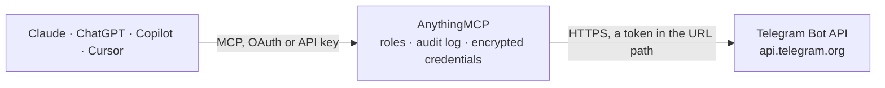

<!-- Generated by scripts/export-github-catalog.mjs in the anythingmcp-website repository. Do not edit by hand. -->

# Telegram Bot MCP connector

Send Telegram messages, photos, albums, documents, audio, video, animations, stickers, contacts, venues, locations and polls from any AI agent via the Telegram Bot API, react to and pin messages, and … The AnythingMCP connector gives Claude, ChatGPT, Microsoft Copilot, Cursor and Gemini 33 MCP tools for Telegram Bot: 7 read and 26 can change data.

**Category:** [Messaging](../messaging.md) · **Tools:** 33 · **Setup guide:** [anythingmcp.com](https://anythingmcp.com/guides/telegram-bot-to-mcp) · [Deutsch](https://anythingmcp.com/de/guides/telegram-bot-to-mcp) · [Italiano](https://anythingmcp.com/it/guides/telegram-bot-to-mcp) · [Español](https://anythingmcp.com/es/guides/telegram-bot-to-mcp) · [日本語](https://anythingmcp.com/ja/guides/telegram-bot-to-mcp) · [Русский](https://anythingmcp.com/ru/guides/telegram-bot-to-mcp) · [中文](https://anythingmcp.com/zh/guides/telegram-bot-to-mcp)

## Start without code

No installation and no terminal: AnythingMCP Cloud runs the Telegram Bot connector for you, operated by helpcode.ai in Frankfurt, Germany.

1. **Click the button above** and create an account or sign in. The Telegram Bot connector opens, ready to install.
2. **Paste the API key or token from your Telegram Bot account.** Every click is in the [step-by-step guide](https://anythingmcp.com/guides/telegram-bot-to-mcp).
3. **Click Install.** AnythingMCP shows the address of your MCP server.
4. **Add that address to your assistant:** [Claude](https://anythingmcp.com/guides/connect-telegram-bot-to-claude) · [ChatGPT](https://anythingmcp.com/guides/connect-telegram-bot-to-chatgpt) · [Microsoft Copilot](https://anythingmcp.com/guides/connect-telegram-bot-to-copilot) · [Cursor](https://anythingmcp.com/guides/connect-telegram-bot-to-cursor) · [Gemini CLI](https://anythingmcp.com/guides/connect-telegram-bot-to-gemini) · [Meta Muse](https://anythingmcp.com/guides/connect-telegram-bot-to-muse).
5. **Ask your first question**, for example: *Get chat info for public channel @invoices_nordic where we post customer invoices.*

Prefer help with the setup? [Talk to us](https://anythingmcp.com/contact).

## How it works

- **The AI client** speaks MCP (Streamable HTTP) to AnythingMCP and only sees tool names, descriptions and results. It never gets the Telegram Bot credentials.
- **AnythingMCP** checks the client's role, builds the call from the tool definition, adds the credentials (a token in the URL path), calls Telegram Bot, logs the call and returns the result.
- **Telegram Bot** sees an ordinary API client with the rights of the account the credentials belong to.

## Tools

| Tool | What it does | Access |
|---|---|---|
| [`telegram_bot_get_me`](#telegram_bot_get_me) | Return the bot's own user info: id, username, first_name, can_join_groups, can_read_all_group_messages, supports_inline_queries. | read |
| [`telegram_bot_send_message`](#telegram_bot_send_message) | Send a text message to a chat. | write |
| [`telegram_bot_send_photo`](#telegram_bot_send_photo) | Send a photo (JPG/PNG, ≤5MB via URL) by HTTPS URL or by reusable file_id. | write |
| [`telegram_bot_send_document`](#telegram_bot_send_document) | Send a document (any type, ≤20MB via URL) by HTTPS URL or file_id. | write |
| [`telegram_bot_send_audio`](#telegram_bot_send_audio) | Send an audio file (MP3, M4A, ≤20MB via URL). | write |
| [`telegram_bot_send_voice`](#telegram_bot_send_voice) | Send a voice note (OGG-Opus encoded). | write |
| [`telegram_bot_send_video`](#telegram_bot_send_video) | Send a video (MP4, H.264, AAC, ≤20MB via URL). | write |
| [`telegram_bot_send_location`](#telegram_bot_send_location) | Send a location point. | write |
| [`telegram_bot_send_poll`](#telegram_bot_send_poll) | Send a poll (regular or quiz). | write |
| [`telegram_bot_edit_message_text`](#telegram_bot_edit_message_text) | Edit the text of a previously-sent message (your bot's own messages only). | write |
| [`telegram_bot_delete_message`](#telegram_bot_delete_message) | Delete a message the bot sent (within ~48 hours for groups, anytime for own DMs). | write |
| [`telegram_bot_get_chat`](#telegram_bot_get_chat) | Fetch chat info: title, type (private/group/supergroup/channel), photo, description, invite_link, member_count, permissions. | read |
| [`telegram_bot_get_file`](#telegram_bot_get_file) | Look up a file the bot received (photo, document, voice note, video) by its file_id, from a message in telegram_bot_get_updates. | read |
| [`telegram_bot_download_file`](#telegram_bot_download_file) | Download a file by the file_path telegram_bot_get_file returned. | read |
| [`telegram_bot_get_updates`](#telegram_bot_get_updates) | Long-poll recent inbound messages (one-shot: pulls all updates since the last `offset+1`). | read |
| [`telegram_bot_send_album`](#telegram_bot_send_album) | Send 2 to 10 photos or videos as one album (sendMediaGroup), or 2 to 10 documents, or 2 to 10 audio files; documents and audio cannot be mixed with other types. | write |
| [`telegram_bot_send_animation`](#telegram_bot_send_animation) | Send a GIF or a silent MP4 animation by HTTPS URL or file_id; Telegram plays it on a loop. | write |
| [`telegram_bot_send_sticker`](#telegram_bot_send_sticker) | Send a sticker by file_id (any sticker the bot has seen, e.g. from telegram_bot_get_updates) or by HTTPS URL of a .WEBP image. | write |
| [`telegram_bot_fetch_sticker_set`](#telegram_bot_fetch_sticker_set) | Read a sticker set (or custom emoji set) by its name: title, sticker_type (regular, mask, custom_emoji) and every sticker with its emoji, file_id and… | read |
| [`telegram_bot_send_contact`](#telegram_bot_send_contact) | Send a phone contact card that the recipient can save or call. | write |
| [`telegram_bot_send_venue`](#telegram_bot_send_venue) | Send a venue: a map pin with a name and address, e.g. a shop or meeting point. | write |
| [`telegram_bot_react_to_message`](#telegram_bot_react_to_message) | Set the bot's reaction on a message (the emoji under a message), or remove it with an empty list. | write |
| [`telegram_bot_pin_message`](#telegram_bot_pin_message) | Pin a message in a chat, so it shows at the top. | write |
| [`telegram_bot_unpin_chat_message`](#telegram_bot_unpin_chat_message) | Unpin a pinned message in a chat; without message_id the most recently pinned message is unpinned. | write |
| [`telegram_bot_rename_chat`](#telegram_bot_rename_chat) | Change the title of a group, supergroup or channel (1 to 128 characters); not possible for private chats. | write |
| [`telegram_bot_update_chat_description`](#telegram_bot_update_chat_description) | Change the description of a group, supergroup or channel (0 to 255 characters; empty removes it). | write |
| [`telegram_bot_add_forum_topic`](#telegram_bot_add_forum_topic) | Create a topic in a forum supergroup (a group with topics enabled). | write |
| [`telegram_bot_edit_message_caption`](#telegram_bot_edit_message_caption) | Edit the caption of a photo, video, document, audio or animation message the bot sent (an empty caption removes it). | write |
| [`telegram_bot_create_chat_invite_link`](#telegram_bot_create_chat_invite_link) | Create an additional invite link for a group, supergroup or channel, optionally named, expiring, limited to a number of joins, or requiring admin approval. | write |
| [`telegram_bot_create_sticker_set`](#telegram_bot_create_sticker_set) | Create a new sticker set owned by a user, with 1 to 50 first stickers from existing image files. | write |
| [`telegram_bot_extend_sticker_set`](#telegram_bot_extend_sticker_set) | Add one sticker to a sticker set the bot created (telegram_bot_create_sticker_set). | write |
| [`telegram_bot_get_webhook_info`](#telegram_bot_get_webhook_info) | Show whether the bot has a webhook: its url (empty when none), pending_update_count, the last error date and message, and allowed_updates. | read |
| [`telegram_bot_remove_webhook`](#telegram_bot_remove_webhook) | Remove the bot's webhook so updates can be read with telegram_bot_get_updates again. | write |

## Tool reference

Every parameter as the AI client sees it in `tools/list`. Source: [`packages/backend/src/adapters/intl/telegram-bot.json`](../../../packages/backend/src/adapters/intl/telegram-bot.json).

### `telegram_bot_get_me`

Return the bot's own user info: id, username, first_name, can_join_groups, can_read_all_group_messages, supports_inline_queries. Health check + whoami in one call.

**Access:** read · **Call:** `GET /getMe`

No parameters.

### `telegram_bot_send_message`

Send a text message to a chat. Required: chat_id + text. Use parse_mode='HTML' for safe formatting (`<b>`, `<i>`, `<code>`, `<a href>`). reply_to_message_id quotes a prior message.

**Access:** write · **Call:** `POST /sendMessage`

| Parameter | Type | Required | Description |
|---|---|---|---|
| `chat_id` | string | yes | Numeric chat_id OR '@channelusername' for public channels. For users, they must have started the bot first. |
| `business_connection_id` | string | no | Business connection id, to send on behalf of a connected business account. |
| `text` | string | yes | Message text, max 4096 chars. For longer, split into multiple sends. |
| `parse_mode` | string | no | MarkdownV2, HTML, or omit for no formatting. HTML is safer for agents. |
| `disable_web_page_preview` | boolean | no | If true, no link preview is shown for URLs in the text. |
| `disable_notification` | boolean | no | If true, send silently (no push notification sound). |
| `reply_to_message_id` | integer | no | Quote a prior message by its message_id. |
| `reply_markup` | object | no | Inline keyboard or reply keyboard markup. See Telegram docs for InlineKeyboardMarkup shape. |

### `telegram_bot_send_photo`

Send a photo (JPG/PNG, ≤5MB via URL) by HTTPS URL or by reusable file_id. Optional caption supports parse_mode.

**Access:** write · **Call:** `POST /sendPhoto`

| Parameter | Type | Required | Description |
|---|---|---|---|
| `chat_id` | string | yes | Chat ID or @channelusername. |
| `business_connection_id` | string | no | Business connection id, to send on behalf of a connected business account. |
| `photo` | string | yes | Either a public HTTPS URL OR a file_id from a prior send. |
| `caption` | string | no | Caption ≤1024 chars. |
| `parse_mode` | string | no | MarkdownV2, HTML, or omit. |
| `disable_notification` | boolean | no | Silent send. |
| `reply_to_message_id` | integer | no | Reply target message_id. |

### `telegram_bot_send_document`

Send a document (any type, ≤20MB via URL) by HTTPS URL or file_id. Use for PDFs, spreadsheets, code, etc.

**Access:** write · **Call:** `POST /sendDocument`

| Parameter | Type | Required | Description |
|---|---|---|---|
| `chat_id` | string | yes | Chat ID or @channelusername. |
| `business_connection_id` | string | no | Business connection id, to send on behalf of a connected business account. |
| `document` | string | yes | Public HTTPS URL or file_id. |
| `caption` | string | no | Caption ≤1024 chars. |
| `parse_mode` | string | no | MarkdownV2, HTML, or omit. |
| `disable_notification` | boolean | no | Silent. |
| `reply_to_message_id` | integer | no | Reply target. |

### `telegram_bot_send_audio`

Send an audio file (MP3, M4A, ≤20MB via URL). Telegram displays it with a music player + duration + title. For voice notes use sendVoice instead.

**Access:** write · **Call:** `POST /sendAudio`

| Parameter | Type | Required | Description |
|---|---|---|---|
| `chat_id` | string | yes | Chat ID or @channelusername. |
| `business_connection_id` | string | no | Business connection id, to send on behalf of a connected business account. |
| `audio` | string | yes | HTTPS URL or file_id. |
| `caption` | string | no | Optional caption. |
| `duration` | integer | no | Duration in seconds (improves UX). |
| `performer` | string | no | Performer/artist name. |
| `title` | string | no | Track title. |
| `disable_notification` | boolean | no | Silent. |

### `telegram_bot_send_voice`

Send a voice note (OGG-Opus encoded). Telegram renders it as a microphone bubble with waveform, the canonical 'voice memo' format. Other audio codecs use sendAudio instead.

**Access:** write · **Call:** `POST /sendVoice`

| Parameter | Type | Required | Description |
|---|---|---|---|
| `chat_id` | string | yes | Chat ID. |
| `business_connection_id` | string | no | Business connection id, to send on behalf of a connected business account. |
| `voice` | string | yes | HTTPS URL of an OGG-Opus file OR a file_id. |
| `caption` | string | no | Optional caption. |
| `duration` | integer | no | Duration in seconds. |

### `telegram_bot_send_video`

Send a video (MP4, H.264, AAC, ≤20MB via URL). Telegram streams it inline.

**Access:** write · **Call:** `POST /sendVideo`

| Parameter | Type | Required | Description |
|---|---|---|---|
| `chat_id` | string | yes | Chat ID. |
| `business_connection_id` | string | no | Business connection id, to send on behalf of a connected business account. |
| `video` | string | yes | HTTPS URL of MP4 or file_id. |
| `caption` | string | no | Caption ≤1024 chars. |
| `duration` | integer | no | Duration seconds. |
| `width` | integer | no | Width px. |
| `height` | integer | no | Height px. |
| `supports_streaming` | boolean | no | If true, video is streamable. |
| `parse_mode` | string | no | Markup mode for caption. |

### `telegram_bot_send_location`

Send a location point. Optional `live_period` (60-86400 sec) makes the location auto-update in real time for that duration.

**Access:** write · **Call:** `POST /sendLocation`

| Parameter | Type | Required | Description |
|---|---|---|---|
| `chat_id` | string | yes | Chat ID. |
| `business_connection_id` | string | no | Business connection id, to send on behalf of a connected business account. |
| `latitude` | number | yes | Latitude decimal degrees. |
| `longitude` | number | yes | Longitude decimal degrees. |
| `live_period` | integer | no | Seconds the location stays live (60-86400). Omit for static. |
| `horizontal_accuracy` | number | no | Accuracy in meters (0-1500). |

### `telegram_bot_send_poll`

Send a poll (regular or quiz). For a quiz, set type='quiz' and correct_option_id (zero-based). Anonymous unless is_anonymous=false. Closes after open_period seconds or manually with stopPoll.

**Access:** write · **Call:** `POST /sendPoll`

| Parameter | Type | Required | Description |
|---|---|---|---|
| `chat_id` | string | yes | Chat ID. |
| `business_connection_id` | string | no | Business connection id, to send on behalf of a connected business account. |
| `question` | string | yes | Poll question (1-300 chars). |
| `options` | any[] | yes | Array of 2-10 string options. |
| `type` | string | no | regular or quiz. |
| `is_anonymous` | boolean | no | Default true. |
| `allows_multiple_answers` | boolean | no | Only for type=regular. |
| `correct_option_id` | integer | no | 0-based index, required for type=quiz. |
| `explanation` | string | no | Explanation shown when a quiz answer is wrong (≤200 chars). |
| `open_period` | integer | no | Seconds before the poll auto-closes (5-600). |

### `telegram_bot_edit_message_text`

Edit the text of a previously-sent message (your bot's own messages only). Use to refresh status messages, fix typos, or update interactive UIs without sending a new bubble.

**Access:** write · **Call:** `POST /editMessageText`

| Parameter | Type | Required | Description |
|---|---|---|---|
| `chat_id` | string | yes | Chat ID containing the message. |
| `business_connection_id` | string | no | Business connection id, when the message was sent on behalf of a connected business account. |
| `message_id` | integer | yes | message_id of the message to edit. |
| `text` | string | yes | New text. |
| `parse_mode` | string | no | MarkdownV2 / HTML. |
| `disable_web_page_preview` | boolean | no | Hide link preview. |
| `reply_markup` | object | no | New inline keyboard (or omit to keep current). |

### `telegram_bot_delete_message`

Delete a message the bot sent (within ~48 hours for groups, anytime for own DMs). Bots cannot delete arbitrary user messages without group-admin rights.

**Access:** write · **Call:** `POST /deleteMessage`

| Parameter | Type | Required | Description |
|---|---|---|---|
| `chat_id` | string | yes | Chat ID. |
| `message_id` | integer | yes | message_id to delete. |

### `telegram_bot_get_chat`

Fetch chat info: title, type (private/group/supergroup/channel), photo, description, invite_link, member_count, permissions.

**Access:** read · **Call:** `POST /getChat`

| Parameter | Type | Required | Description |
|---|---|---|---|
| `chat_id` | string | yes | Chat ID. |

### `telegram_bot_get_file`

Look up a file the bot received (photo, document, voice note, video) by its file_id, from a message in telegram_bot_get_updates. Returns file_path and file_size; pass file_path to telegram_bot_download_file. The link is valid for at least one hour, and the Bot API only serves files up to 20 MB.

**Access:** read · **Call:** `POST /getFile`

| Parameter | Type | Required | Description |
|---|---|---|---|
| `file_id` | string | yes | file_id from the message, e.g. photo[-1].file_id (the largest size) or document.file_id. |

### `telegram_bot_download_file`

Download a file by the file_path telegram_bot_get_file returned. An image comes back as an image the assistant can see, any other file (PDF, audio, document) as an attached file with its type and size. Files over 4 MB are described, not attached.

**Access:** read · **Call:** `GET https://api.telegram.org/file/bot{{TELEGRAM_BOT_TOKEN}}/{file_path}`

| Parameter | Type | Required | Description |
|---|---|---|---|
| `file_path` | string | yes | file_path from telegram_bot_get_file, e.g. photos/file_12.jpg. |

### `telegram_bot_get_updates`

Long-poll recent inbound messages (one-shot: pulls all updates since the last `offset+1`). For continuous inbound, use webhooks instead. Telegram queues updates for 24 hours if not consumed; consuming with this tool clears them.

**Access:** read · **Call:** `POST /getUpdates`

| Parameter | Type | Required | Description |
|---|---|---|---|
| `offset` | integer | no | Return updates with update_id >= this value. Pass last_seen_id+1 to ack prior batch. |
| `limit` | integer | no | Max updates 1-100 (default 100). |
| `timeout` | integer | no | Long-poll wait in seconds 0-25 (default 0 = short poll). The call is cut off after 30 s, so a longer wait fails instead of returning updates. |
| `allowed_updates` | any[] | no | Update types to receive, e.g. ['message','callback_query']. Omit for all except chat_member. |

### `telegram_bot_send_album`

Send 2 to 10 photos or videos as one album (sendMediaGroup), or 2 to 10 documents, or 2 to 10 audio files; documents and audio cannot be mixed with other types. Each item is a public HTTPS URL or a file_id. The caption goes on the first item and shows under the album. Returns the sent messages.

**Access:** write · **Call:** `POST /sendMediaGroup`

| Parameter | Type | Required | Description |
|---|---|---|---|
| `chat_id` | string | yes | Chat ID or @channelusername. |
| `media` | object[] | yes | Album items, e.g. [{"type": "photo", "media": "https://example.com/1.jpg", "caption": "<b>New in</b>", "parse_mode": "HTML"}, {"type": "photo", "media": "https://example.com/2.jpg"}]. type is photo, video, document or audio; media is an HTTPS URL or file_id. |
| `disable_notification` | boolean | no | Silent send. |
| `protect_content` | boolean | no | If true, the message cannot be forwarded or saved. |
| `message_thread_id` | integer | no | Forum topic (message_thread_id) to post in, for forum supergroups. |
| `reply_parameters` | object | no | Reply target, e.g. {"message_id": 42}. |
| `business_connection_id` | string | no | Business connection id, to send on behalf of a connected business account. |

### `telegram_bot_send_animation`

Send a GIF or a silent MP4 animation by HTTPS URL or file_id; Telegram plays it on a loop. Optional caption supports parse_mode.

**Access:** write · **Call:** `POST /sendAnimation`

| Parameter | Type | Required | Description |
|---|---|---|---|
| `chat_id` | string | yes | Chat ID or @channelusername. |
| `business_connection_id` | string | no | Business connection id, to send on behalf of a connected business account. |
| `animation` | string | yes | HTTPS URL of a GIF or MP4 (up to 20 MB) or a file_id. |
| `caption` | string | no | Caption, at most 1024 characters. |
| `parse_mode` | string | no | MarkdownV2, HTML, or omit. |
| `has_spoiler` | boolean | no | Hide it behind a spoiler. |
| `disable_notification` | boolean | no | Silent send. |
| `reply_parameters` | object | no | Reply target, e.g. {"message_id": 42}. |

### `telegram_bot_send_sticker`

Send a sticker by file_id (any sticker the bot has seen, e.g. from telegram_bot_get_updates) or by HTTPS URL of a .WEBP image.

**Access:** write · **Call:** `POST /sendSticker`

| Parameter | Type | Required | Description |
|---|---|---|---|
| `chat_id` | string | yes | Chat ID or @channelusername. |
| `business_connection_id` | string | no | Business connection id, to send on behalf of a connected business account. |
| `sticker` | string | yes | Sticker file_id, or HTTPS URL of a .WEBP file. |
| `disable_notification` | boolean | no | Silent send. |
| `reply_parameters` | object | no | Reply target, e.g. {"message_id": 42}. |

### `telegram_bot_fetch_sticker_set`

Read a sticker set (or custom emoji set) by its name: title, sticker_type (regular, mask, custom_emoji) and every sticker with its emoji, file_id and custom_emoji_id. Use a file_id with telegram_bot_send_sticker. The name is the part after t.me/addstickers/ or t.me/addemoji/, or sticker.set_name from a message in telegram_bot_get_updates. Read-only.

**Access:** read · **Call:** `POST /getStickerSet`

| Parameter | Type | Required | Description |
|---|---|---|---|
| `name` | string | yes | Short name of the set, e.g. the last part of https://t.me/addstickers/<name>. |

### `telegram_bot_send_contact`

Send a phone contact card that the recipient can save or call. Needs a phone number and a first name; an optional vCard adds more fields.

**Access:** write · **Call:** `POST /sendContact`

| Parameter | Type | Required | Description |
|---|---|---|---|
| `chat_id` | string | yes | Chat ID or @channelusername. |
| `business_connection_id` | string | no | Business connection id, to send on behalf of a connected business account. |
| `phone_number` | string | yes | Phone number, ideally in international format, e.g. +4915112345678. |
| `first_name` | string | yes | Contact's first name. |
| `last_name` | string | no | Contact's last name. |
| `vcard` | string | no | Extra data as a vCard, up to 2048 bytes. |
| `disable_notification` | boolean | no | Silent send. |

### `telegram_bot_send_venue`

Send a venue: a map pin with a name and address, e.g. a shop or meeting point. For a bare location or live location use telegram_bot_send_location.

**Access:** write · **Call:** `POST /sendVenue`

| Parameter | Type | Required | Description |
|---|---|---|---|
| `chat_id` | string | yes | Chat ID or @channelusername. |
| `business_connection_id` | string | no | Business connection id, to send on behalf of a connected business account. |
| `latitude` | number | yes | Latitude in decimal degrees. |
| `longitude` | number | yes | Longitude in decimal degrees. |
| `title` | string | yes | Name of the venue. |
| `address` | string | yes | Address of the venue. |
| `google_place_id` | string | no | Optional Google Places id. |
| `disable_notification` | boolean | no | Silent send. |

### `telegram_bot_react_to_message`

Set the bot's reaction on a message (the emoji under a message), or remove it with an empty list. A bot can set one reaction per message, chosen from the reactions the chat allows (by default the standard emoji set); paid reactions are not available to bots. Use it to acknowledge a message without sending a reply.

**Access:** write · **Call:** `POST /setMessageReaction`

| Parameter | Type | Required | Description |
|---|---|---|---|
| `chat_id` | string | yes | Chat id (numeric; groups and channels start with -100) or @channelusername. |
| `message_id` | integer | yes | message_id of the message, from the send result or telegram_bot_get_updates. |
| `reaction` | object[] | no | Reactions to set, e.g. [{"type": "emoji", "emoji": "👍"}] or [{"type": "custom_emoji", "custom_emoji_id": "..."}]. An empty list [] removes the bot's reaction. |
| `is_big` | boolean | no | true plays the big reaction animation. |

### `telegram_bot_pin_message`

Pin a message in a chat, so it shows at the top. In groups and channels the bot must be an administrator with the right to pin messages; in private chats it works without. Members are notified unless disable_notification is true.

**Access:** write · **Call:** `POST /pinChatMessage`

| Parameter | Type | Required | Description |
|---|---|---|---|
| `chat_id` | string | yes | Chat id (numeric; groups and channels start with -100) or @channelusername. |
| `message_id` | integer | yes | message_id of the message, from the send result or telegram_bot_get_updates. |
| `business_connection_id` | string | no | Business connection id, when acting on behalf of a connected business account. |
| `disable_notification` | boolean | no | true pins silently, without notifying members. |

### `telegram_bot_unpin_chat_message`

Unpin a pinned message in a chat; without message_id the most recently pinned message is unpinned. Same admin rights as pinning.

**Access:** write · **Call:** `POST /unpinChatMessage`

| Parameter | Type | Required | Description |
|---|---|---|---|
| `chat_id` | string | yes | Chat id (numeric; groups and channels start with -100) or @channelusername. |
| `message_id` | integer | no | message_id to unpin; leave out for the most recent pinned message. |
| `business_connection_id` | string | no | Business connection id, when acting on behalf of a connected business account. |

### `telegram_bot_rename_chat`

Change the title of a group, supergroup or channel (1 to 128 characters); not possible for private chats. The bot must be an administrator with the right to change chat info. Every member sees the new title at once, so confirm it with the user first.

**Access:** write · **Call:** `POST /setChatTitle`

| Parameter | Type | Required | Description |
|---|---|---|---|
| `chat_id` | string | yes | Chat id (numeric; groups and channels start with -100) or @channelusername. |
| `title` | string | yes | New chat title, 1 to 128 characters. |

### `telegram_bot_update_chat_description`

Change the description of a group, supergroup or channel (0 to 255 characters; empty removes it). The bot must be an administrator with the right to change chat info.

**Access:** write · **Call:** `POST /setChatDescription`

| Parameter | Type | Required | Description |
|---|---|---|---|
| `chat_id` | string | yes | Chat id (numeric; groups and channels start with -100) or @channelusername. |
| `description` | string | no | New description, up to 255 characters. |

### `telegram_bot_add_forum_topic`

Create a topic in a forum supergroup (a group with topics enabled). Returns the topic with its message_thread_id, which the Bot API send methods take to post into that topic. The bot must be an administrator with the right to manage topics.

**Access:** write · **Call:** `POST /createForumTopic`

| Parameter | Type | Required | Description |
|---|---|---|---|
| `chat_id` | string | yes | Chat id (numeric; groups and channels start with -100) or @channelusername. |
| `name` | string | yes | Topic name, 1 to 128 characters. |
| `icon_color` | `7322096` \| `16766590` \| `13338331` \| `9367192` \| `16749490` \| `16478047` | no | Icon colour as RGB integer, one of 7322096 (blue), 16766590 (yellow), 13338331 (violet), 9367192 (green), 16749490 (rose), 16478047 (red). |
| `icon_custom_emoji_id` | string | no | Custom emoji id to use as the topic icon. |

### `telegram_bot_edit_message_caption`

Edit the caption of a photo, video, document, audio or animation message the bot sent (an empty caption removes it). Use telegram_bot_edit_message_text for text messages.

**Access:** write · **Call:** `POST /editMessageCaption`

| Parameter | Type | Required | Description |
|---|---|---|---|
| `chat_id` | string | yes | Chat id (numeric; groups and channels start with -100) or @channelusername. |
| `message_id` | integer | yes | message_id of the message, from the send result or telegram_bot_get_updates. |
| `business_connection_id` | string | no | Business connection id, when acting on behalf of a connected business account. |
| `caption` | string | no | New caption, up to 1024 characters. |
| `parse_mode` | `MarkdownV2` \| `HTML` | no | Formatting of the caption. |
| `show_caption_above_media` | boolean | no | true shows the caption above the media. |
| `reply_markup` | object | no | New inline keyboard (or omit to keep the current one). |

### `telegram_bot_create_chat_invite_link`

Create an additional invite link for a group, supergroup or channel, optionally named, expiring, limited to a number of joins, or requiring admin approval. Returns the link (invite_link). The bot must be an administrator with the right to invite users. Anyone with the link can join, so confirm the limits with the user.

**Access:** write · **Call:** `POST /createChatInviteLink`

| Parameter | Type | Required | Description |
|---|---|---|---|
| `chat_id` | string | yes | Chat id (numeric; groups and channels start with -100) or @channelusername. |
| `name` | string | no | Name of the link, up to 32 characters, shown to admins. |
| `expire_date` | integer | no | When the link expires, Unix time in seconds. |
| `member_limit` | integer | no | How many users can join with the link, 1 to 99999. Not with creates_join_request. |
| `creates_join_request` | boolean | no | true makes users who open the link ask to join; an admin approves them. |

### `telegram_bot_create_sticker_set`

Create a new sticker set owned by a user, with 1 to 50 first stickers from existing image files. The set name must end in _by_<bot username> (telegram_bot_get_me gives the username) and the owner must have started the bot. Returns true; the set is then at t.me/addstickers/<name>. This only packages images you pass in; it generates nothing.

**Access:** write · **Call:** `POST /createNewStickerSet`

| Parameter | Type | Required | Description |
|---|---|---|---|
| `user_id` | integer | yes | Telegram user id of the set owner. |
| `name` | string | yes | Short name for t.me/addstickers/<name>: letters, digits and underscores, ending in _by_<bot username>, up to 64 characters. |
| `title` | string | yes | Set title, up to 64 characters. |
| `stickers` | object[] | yes | First stickers of the set, 1 to 50 InputSticker objects. |
| `sticker_type` | `regular` \| `mask` \| `custom_emoji` | no | Type of the set; regular by default. |

### `telegram_bot_extend_sticker_set`

Add one sticker to a sticker set the bot created (telegram_bot_create_sticker_set). A set holds up to 120 stickers (200 for custom emoji). Returns true. Check the set first with telegram_bot_fetch_sticker_set.

**Access:** write · **Call:** `POST /addStickerToSet`

| Parameter | Type | Required | Description |
|---|---|---|---|
| `user_id` | integer | yes | Telegram user id of the set owner. |
| `name` | string | yes | Short name of the set (ends in _by_<bot username>). |
| `sticker` | object | yes | InputSticker: {"sticker": "<file_id or HTTPS URL of a .webp/.png image>", "format": "static" \| "animated" \| "video", "emoji_list": ["😀"], "keywords": ["smile"]}. Animated (.tgs) and video (.webm) stickers cannot be passed by URL; use a file_id. Static images are 512 px on the longer side. |

### `telegram_bot_get_webhook_info`

Show whether the bot has a webhook: its url (empty when none), pending_update_count, the last error date and message, and allowed_updates. While a webhook is set, telegram_bot_get_updates fails with 409 Conflict, because Telegram delivers updates either to the webhook or to getUpdates, never both. Read-only.

**Access:** read · **Call:** `POST /getWebhookInfo`

No parameters.

### `telegram_bot_remove_webhook`

Remove the bot's webhook so updates can be read with telegram_bot_get_updates again. Whatever service received the webhook (a chatbot, an automation) stops getting messages, so only do this when the user confirms that integration is no longer needed. Installed switched off.

**Access:** write · **Call:** `POST /deleteWebhook`

| Parameter | Type | Required | Description |
|---|---|---|---|
| `drop_pending_updates` | boolean | no | true also discards the updates waiting for delivery. |

## Run it yourself

AnythingMCP is open source (AGPL-3.0). [Run it with Docker](../../../README.md#run-it-yourself), open **Connectors → Store**, pick **Telegram Bot** and enter `TELEGRAM_BOT_TOKEN`, then add your MCP server URL to the AI client.

[← Messaging connectors](../messaging.md) · [All categories](../README.md)
