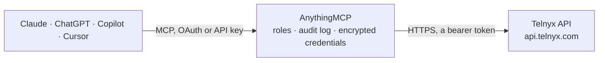

<!-- Generated by scripts/export-github-catalog.mjs in the anythingmcp-website repository. Do not edit by hand. -->

# Telnyx MCP connector

Let your AI work with Telnyx: check balance and usage, list and search phone numbers, send SMS and MMS, place calls that speak a message, read call recordings and detail records, look up numbers, … The AnythingMCP connector gives Claude, ChatGPT, Microsoft Copilot, Cursor and Gemini 26 MCP tools for Telnyx: 19 read and 7 can change data.

**Category:** [Messaging](../messaging.md) · **Tools:** 26 · **Setup guide:** [anythingmcp.com](https://anythingmcp.com/guides/telnyx-to-mcp) · [Deutsch](https://anythingmcp.com/de/guides/telnyx-to-mcp) · [Italiano](https://anythingmcp.com/it/guides/telnyx-to-mcp) · [Español](https://anythingmcp.com/es/guides/telnyx-to-mcp) · [日本語](https://anythingmcp.com/ja/guides/telnyx-to-mcp) · [Русский](https://anythingmcp.com/ru/guides/telnyx-to-mcp) · [中文](https://anythingmcp.com/zh/guides/telnyx-to-mcp)

## Start without code

No installation and no terminal: AnythingMCP Cloud runs the Telnyx connector for you, operated by helpcode.ai in Frankfurt, Germany.

1. **Click the button above** and create an account or sign in. The Telnyx connector opens, ready to install.
2. **Paste the API key or token from your Telnyx account.** Every click is in the [step-by-step guide](https://anythingmcp.com/guides/telnyx-to-mcp).
3. **Click Install.** AnythingMCP shows the address of your MCP server.
4. **Add that address to your assistant:** [Claude](https://anythingmcp.com/guides/connect-telnyx-to-claude) · [ChatGPT](https://anythingmcp.com/guides/connect-telnyx-to-chatgpt) · [Microsoft Copilot](https://anythingmcp.com/guides/connect-telnyx-to-copilot) · [Cursor](https://anythingmcp.com/guides/connect-telnyx-to-cursor) · [Gemini CLI](https://anythingmcp.com/guides/connect-telnyx-to-gemini) · [Meta Muse](https://anythingmcp.com/guides/connect-telnyx-to-muse).
5. **Ask your first question**, for example: *What's the status and messaging profile of our support number +441632960960?*

Prefer help with the setup? [Talk to us](https://anythingmcp.com/contact).

## How it works

- **The AI client** speaks MCP (Streamable HTTP) to AnythingMCP and only sees tool names, descriptions and results. It never gets the Telnyx credentials.
- **AnythingMCP** checks the client's role, builds the call from the tool definition, adds the credentials (a bearer token), calls Telnyx, logs the call and returns the result.
- **Telnyx** sees an ordinary API client with the rights of the account the credentials belong to.

## Tools

| Tool | What it does | Access |
|---|---|---|
| [`telnyx_get_balance`](#telnyx_get_balance) | Read the account balance: balance, pending, credit_limit, available_credit and currency. | read |
| [`telnyx_list_phone_numbers`](#telnyx_list_phone_numbers) | List the phone numbers the account owns, newest first: id, phone_number (E.164), status, phone_number_type, country, the voice connection (connection_id)… | read |
| [`telnyx_get_phone_number`](#telnyx_get_phone_number) | Read one owned phone number by its id (from telnyx_list_phone_numbers): status, type, country, voice connection, messaging profile, emergency settings, call… | read |
| [`telnyx_search_available_numbers`](#telnyx_search_available_numbers) | Search phone numbers that can be bought, by country, area, digits, type and features. | read |
| [`telnyx_order_phone_numbers`](#telnyx_order_phone_numbers) | Buy phone numbers found with telnyx_search_available_numbers. | write |
| [`telnyx_get_number_order`](#telnyx_get_number_order) | Read a number order by its id: status (pending, success, failure), the numbers with their own status and whether the regulatory requirements are met. | read |
| [`telnyx_send_message`](#telnyx_send_message) | Send an SMS or MMS from a Telnyx number. | write |
| [`telnyx_get_message`](#telnyx_get_message) | Read one message by its id: direction, from, to with per-recipient delivery status (queued, sending, sent, delivered, sending_failed, delivery_failed,… | read |
| [`telnyx_list_messaging_profiles`](#telnyx_list_messaging_profiles) | List the messaging profiles: id, name, enabled, webhook_url, whitelisted_destinations (countries the profile may send to), daily spend limit and number pool… | read |
| [`telnyx_list_call_control_applications`](#telnyx_list_call_control_applications) | List the Call Control applications (voice connections): id, application_name, active, webhook_event_url and outbound settings. | read |
| [`telnyx_dial_call`](#telnyx_dial_call) | Place an outbound phone call through a Call Control application. | write |
| [`telnyx_get_call_status`](#telnyx_get_call_status) | Read the status of a call by its call_control_id: is_alive (false once it ended), call_duration in seconds, start_time and end_time. | read |
| [`telnyx_speak_text`](#telnyx_speak_text) | Speak text to the other party on an answered call. | write |
| [`telnyx_hangup_call`](#telnyx_hangup_call) | Hang up a call that is still in progress. | write |
| [`telnyx_search_detail_records`](#telnyx_search_detail_records) | Search detail records (CDRs and MDRs): one record per message, call leg, verification, recording and so on, with direction, numbers, status, duration and cost. | read |
| [`telnyx_get_usage_report_options`](#telnyx_get_usage_report_options) | List the products of the usage report and, for each, the dimensions and metrics telnyx_get_usage_report accepts (for example product messaging with… | read |
| [`telnyx_get_usage_report`](#telnyx_get_usage_report) | Get aggregated usage and cost for one product over at most 31 days, broken out by dimensions (e.g. date, direction, country) with metrics such as cost or count. | read |
| [`telnyx_list_recordings`](#telnyx_list_recordings) | List call recordings, newest first: id, from, to, duration_millis, channels, status, start and end time and download_urls (mp3 and wav links that expire… | read |
| [`telnyx_get_recording`](#telnyx_get_recording) | Read one call recording by its id with fresh download_urls (mp3, wav), duration, channels and the call it belongs to. | read |
| [`telnyx_lookup_number`](#telnyx_lookup_number) | Look up a phone number: country, national format, E.164 form, and with type carrier the carrier name, line type (mobile, landline, voip) and portability… | read |
| [`telnyx_list_verify_profiles`](#telnyx_list_verify_profiles) | List the Verify profiles: id, name, language and the settings per channel (sms, call, whatsapp, flashcall) such as code length and validity. | read |
| [`telnyx_send_verification`](#telnyx_send_verification) | Send a one-time code to a phone number by SMS, voice call or WhatsApp through a Verify profile. | write |
| [`telnyx_check_verification_code`](#telnyx_check_verification_code) | Check the code a person entered against the latest verification sent to that number. | write |
| [`telnyx_get_verification`](#telnyx_get_verification) | Read a verification by its id: phone_number, channel type, status (pending, accepted, invalid, expired, error) and when it was created. | read |
| [`telnyx_list_ai_assistants`](#telnyx_list_ai_assistants) | List the account's Telnyx AI assistants (voice and chat agents): id, name, description, model, greeting, enabled features and creation date. | read |
| [`telnyx_get_ai_assistant`](#telnyx_get_ai_assistant) | Read one AI assistant by its id: name, model, instructions (system prompt), greeting, tools, voice and transcription settings, telephony and messaging… | read |

## Tool reference

Every parameter as the AI client sees it in `tools/list`. Source: [`packages/backend/src/adapters/intl/telnyx.json`](../../../packages/backend/src/adapters/intl/telnyx.json).

### `telnyx_get_balance`

Read the account balance: balance, pending, credit_limit, available_credit and currency. Free, and the quickest check that the API key works. Read-only.

**Access:** read · **Call:** `GET /balance`

No parameters.

### `telnyx_list_phone_numbers`

List the phone numbers the account owns, newest first: id, phone_number (E.164), status, phone_number_type, country, the voice connection (connection_id) and messaging profile the number uses, tags and purchase date. Use these numbers as from in telnyx_send_message and telnyx_dial_call. The answer has data[] and meta with total_results and total_pages. Read-only.

**Access:** read · **Call:** `GET /phone_numbers`

| Parameter | Type | Required | Description |
|---|---|---|---|
| `phone_number` | string | no | Only numbers containing these digits (at least three), e.g. 4930 or 555. |
| `status` | `purchase-pending` \| `purchase-failed` \| `port-pending` \| `active` \| `deleted` \| `port-failed` \| `emergency-only` \| `ported-out` \| `port-out-pending` | no | Only numbers with this status. |
| `country_code` | string | no | Only numbers of this country, ISO alpha-2 code such as DE or US. |
| `tag` | string | no | Only numbers with this tag. |
| `page_number` | integer | no | Page to read, starting at 1. |
| `page_size` | integer | no | Results per page (default 20, up to 250). |

### `telnyx_get_phone_number`

Read one owned phone number by its id (from telnyx_list_phone_numbers): status, type, country, voice connection, messaging profile, emergency settings, call forwarding, caller id name and recording flags. Read-only.

**Access:** read · **Call:** `GET /phone_numbers/{id}`

| Parameter | Type | Required | Description |
|---|---|---|---|
| `id` | string | yes | The phone number id (a numeric string), not the number itself. |

### `telnyx_search_available_numbers`

Search phone numbers that can be bought, by country, area, digits, type and features. Each result has phone_number, cost_information (upfront and monthly cost with currency), features, region_information, quickship and reservable. Searching is free and buys nothing. Read-only.

**Access:** read · **Call:** `GET /available_phone_numbers`

| Parameter | Type | Required | Description |
|---|---|---|---|
| `country_code` | string | no | Country, ISO alpha-2 code such as US, DE or GB. |
| `contains` | string | no | Only numbers containing these digits. |
| `starts_with` | string | no | Only numbers starting with these digits (after the country code). |
| `ends_with` | string | no | Only numbers ending with these digits. |
| `locality` | string | no | City, e.g. Chicago or Berlin. |
| `administrative_area` | string | no | US state or Canadian province, e.g. IL. |
| `national_destination_code` | string | no | Area code or national destination code, e.g. 312 or 30. |
| `phone_number_type` | `local` \| `toll_free` \| `mobile` \| `national` \| `shared_cost` | no | Type of number. |
| `features` | string | no | Required features, comma-separated: sms, mms, voice, fax, emergency, hd_voice, international_sms, local_calling (e.g. sms,voice). |
| `limit` | integer | no | Maximum results (default 10). |

### `telnyx_order_phone_numbers`

Buy phone numbers found with telnyx_search_available_numbers. This costs money: the upfront price and a monthly fee per number are charged to the account until the number is released. Installed switched off. Before calling, show the user every number with its upfront and monthly cost from the search and call only after the user confirms. Some countries need regulatory documents first (requirements_met false in the answer). Returns the order with id and status (pending, success, failure); check it with telnyx_get_number_order.

**Access:** write · **Call:** `POST /number_orders`

| Parameter | Type | Required | Description |
|---|---|---|---|
| `phone_numbers` | object[] | yes | Numbers to buy, each as an object: [{"phone_number": "+13125550123"}]. |
| `connection_id` | string | no | Voice connection (Call Control application) id to attach the numbers to, from telnyx_list_call_control_applications. |
| `messaging_profile_id` | string | no | Messaging profile id to attach the numbers to, from telnyx_list_messaging_profiles. |
| `customer_reference` | string | no | Your own reference for the order. |

### `telnyx_get_number_order`

Read a number order by its id: status (pending, success, failure), the numbers with their own status and whether the regulatory requirements are met. Read-only.

**Access:** read · **Call:** `GET /number_orders/{number_order_id}`

| Parameter | Type | Required | Description |
|---|---|---|---|
| `number_order_id` | string | yes | The number order id from telnyx_order_phone_numbers. |

### `telnyx_send_message`

Send an SMS or MMS from a Telnyx number. This sends a real message to a real person and costs money: before calling, show the user the recipient, the sender and the text, and call only after the user confirms. Set from (a Telnyx number in E.164 with messaging enabled, or an alphanumeric sender id together with messaging_profile_id), or only messaging_profile_id to send from the profile's number pool. Adding media_urls sends an MMS (US and Canada). Returns the message with id and to[].status (usually queued); read the delivery status later with telnyx_get_message.

**Access:** write · **Call:** `POST /messages`

| Parameter | Type | Required | Description |
|---|---|---|---|
| `to` | string | yes | Recipient in E.164, e.g. +4915112345678. |
| `from` | string | no | Sender: a Telnyx number in E.164 with messaging, a short code, or an alphanumeric sender id (needs messaging_profile_id). |
| `text` | string | no | Message text. Long texts are split into several parts, each billed. |
| `messaging_profile_id` | string | no | Messaging profile id from telnyx_list_messaging_profiles; required for alphanumeric senders and number pool sending. |
| `media_urls` | string[] | no | Public URLs of images or files to send as MMS (US and Canada only, extra cost). |
| `subject` | string | no | MMS subject. |
| `type` | `SMS` \| `MMS` | no | SMS or MMS; detected from media_urls when left out. |
| `webhook_url` | string | no | URL that receives delivery status webhooks for this message instead of the profile's. |

### `telnyx_get_message`

Read one message by its id: direction, from, to with per-recipient delivery status (queued, sending, sent, delivered, sending_failed, delivery_failed, delivery_unconfirmed, expired), text, parts, cost and errors. Read-only.

**Access:** read · **Call:** `GET /messages/{id}`

| Parameter | Type | Required | Description |
|---|---|---|---|
| `id` | string | yes | The message id (UUID) from telnyx_send_message or a webhook. |

### `telnyx_list_messaging_profiles`

List the messaging profiles: id, name, enabled, webhook_url, whitelisted_destinations (countries the profile may send to), daily spend limit and number pool settings. A number needs a messaging profile to send SMS. The webhook signing secret is left out. Read-only.

**Access:** read · **Call:** `GET /messaging_profiles`

| Parameter | Type | Required | Description |
|---|---|---|---|
| `name_contains` | string | no | Only profiles whose name contains this text. |
| `page_number` | integer | no | Page to read, starting at 1. |
| `page_size` | integer | no | Results per page (default 20, up to 250). |

### `telnyx_list_call_control_applications`

List the Call Control applications (voice connections): id, application_name, active, webhook_event_url and outbound settings. telnyx_dial_call needs one of these ids as connection_id, and the from number should be assigned to it. Read-only.

**Access:** read · **Call:** `GET /call_control_applications`

| Parameter | Type | Required | Description |
|---|---|---|---|
| `name_contains` | string | no | Only applications whose name contains this text (at least three characters). |
| `page_number` | integer | no | Page to read, starting at 1. |
| `page_size` | integer | no | Results per page (default 20, up to 250). |

### `telnyx_dial_call`

Place an outbound phone call through a Call Control application. This calls a real person and costs money per minute: before calling, show the user the number to call, the caller id and what will happen, and call only after the user confirms. Returns call_control_id; then use telnyx_get_call_status to see whether the call is still alive, telnyx_speak_text once it is answered, and telnyx_hangup_call to end it. Call events (answered, hangup) go to the application's webhook URL.

**Access:** write · **Call:** `POST /calls`

| Parameter | Type | Required | Description |
|---|---|---|---|
| `connection_id` | string | yes | Call Control application id from telnyx_list_call_control_applications. |
| `to` | string | yes | Number to call in E.164 (e.g. +4930123456) or a SIP URI. |
| `from` | string | yes | Caller id: a Telnyx number in E.164 assigned to that application. |
| `from_display_name` | string | no | Caller name shown where supported. |
| `timeout_secs` | integer | no | Seconds to wait for an answer, 5 to 600 (default 30). |
| `time_limit_secs` | integer | no | Maximum call length in seconds, 30 to 14400. Set a short limit (e.g. 300) to cap the cost. |
| `audio_url` | string | no | Public URL of a WAV or MP3 file to play when the call is answered. |
| `answering_machine_detection` | `detect` \| `detect_beep` \| `detect_words` \| `greeting_end` \| `premium` \| `disabled` | no | Detect answering machines (billed extra). |
| `webhook_url` | string | no | URL that receives this call's events instead of the application's. |

### `telnyx_get_call_status`

Read the status of a call by its call_control_id: is_alive (false once it ended), call_duration in seconds, start_time and end_time. Read-only.

**Access:** read · **Call:** `GET /calls/{call_control_id}`

| Parameter | Type | Required | Description |
|---|---|---|---|
| `call_control_id` | string | yes | The call_control_id from telnyx_dial_call (starts with v3:). |

### `telnyx_speak_text`

Speak text to the other party on an answered call. Text to speech costs money (billed per use) and a real person hears it: show the user the text and call only after the user confirms. The call must be answered (telnyx_get_call_status shows is_alive true); otherwise Telnyx answers 422. Returns result ok when the command was accepted; speaking takes place afterwards.

**Access:** write · **Call:** `POST /calls/{call_control_id}/actions/speak`

| Parameter | Type | Required | Description |
|---|---|---|---|
| `call_control_id` | string | yes | The call_control_id from telnyx_dial_call. |
| `payload` | string | yes | Text (or SSML with payload_type ssml) to speak, up to 3,000 characters. |
| `voice` | string | no | Voice: female or male (default female), or a provider voice such as AWS.Polly.Joanna-Neural, AWS.Polly.Vicki-Neural (German) or Telnyx.KokoroTTS.af. |
| `language` | string | no | Language for female or male voices, e.g. en-US, de-DE, it-IT, fr-FR, es-ES (ignored for AWS.Polly voices). |
| `payload_type` | `text` \| `ssml` | no | text (default) or ssml. |
| `service_level` | `basic` \| `premium` | no | premium (default) or basic (en-US text only). |

### `telnyx_hangup_call`

Hang up a call that is still in progress. Confirm with the user before ending a call that someone is on. Returns result ok.

**Access:** write · **Call:** `POST /calls/{call_control_id}/actions/hangup`

| Parameter | Type | Required | Description |
|---|---|---|---|
| `call_control_id` | string | yes | The call_control_id of the call to end. |

### `telnyx_search_detail_records`

Search detail records (CDRs and MDRs): one record per message, call leg, verification, recording and so on, with direction, numbers, status, duration and cost. record_type is required; date_range narrows the period. Results are capped at 60 KB; use page_size and page_number for more. Read-only.

**Access:** read · **Call:** `GET /detail_records`

| Parameter | Type | Required | Description |
|---|---|---|---|
| `record_type` | `messaging` \| `call-control` \| `sip-trunking` \| `verify` \| `recording` \| `conference` \| `conference-participant` \| `fax` \| `tts` \| `stt` \| `ai-voice-assistant` \| `amd` \| `media-streaming` \| `webrtc` \| `wireless` \| `inference` \| `embedding` | yes | Kind of record: messaging (SMS and MMS), call-control (calls), verify, recording, sip-trunking, conference, tts, stt, ai-voice-assistant and others. |
| `date_range` | string | no | Period: yesterday, today, last_week, this_week, last_month, this_month, or last_N_days such as last_7_days. |
| `sort` | string | no | Sort field, minus for descending: -created_at for messaging, -started_at for calls. |
| `page_number` | integer | no | Page to read, starting at 1. |
| `page_size` | integer | no | Records per page, up to 50 (default 20). |

### `telnyx_get_usage_report_options`

List the products of the usage report and, for each, the dimensions and metrics telnyx_get_usage_report accepts (for example product messaging with dimension direction and metric cost). Read-only.

**Access:** read · **Call:** `GET /usage_reports/options`

| Parameter | Type | Required | Description |
|---|---|---|---|
| `product` | string | no | Only this product, e.g. messaging, call-control or verify. |

### `telnyx_get_usage_report`

Get aggregated usage and cost for one product over at most 31 days, broken out by dimensions (e.g. date, direction, country) with metrics such as cost or count. Find valid product, dimensions and metrics with telnyx_get_usage_report_options first. Read-only.

**Access:** read · **Call:** `GET /usage_reports`

| Parameter | Type | Required | Description |
|---|---|---|---|
| `product` | string | yes | Product, e.g. messaging or call-control. |
| `dimensions` | string | yes | Comma-separated dimensions to break out by, e.g. date,direction. |
| `metrics` | string | yes | Comma-separated metrics, e.g. cost,count. |
| `date_range` | string | no | Period such as today, yesterday, last_7_days or last_30_days; or use start_date and end_date. |
| `start_date` | string | no | Start, YYYY-MM-DDTHH:mm:ssZ (at most 31 days before end_date). |
| `end_date` | string | no | End, YYYY-MM-DDTHH:mm:ssZ. |
| `page_number` | integer | no | Page to read, starting at 1. |
| `page_size` | integer | no | Rows per page (default 20). |

### `telnyx_list_recordings`

List call recordings, newest first: id, from, to, duration_millis, channels, status, start and end time and download_urls (mp3 and wav links that expire after a few minutes; read them again with telnyx_get_recording when needed). Read-only.

**Access:** read · **Call:** `GET /recordings`

| Parameter | Type | Required | Description |
|---|---|---|---|
| `call_control_id` | string | no | Only recordings of this call. |
| `from` | string | no | Only recordings whose from matches exactly. |
| `to` | string | no | Only recordings whose to matches exactly. |
| `created_after` | string | no | Only recordings created at or after this time, ISO 8601 (e.g. 2026-10-01T00:00:00Z). |
| `created_before` | string | no | Only recordings created at or before this time, ISO 8601. |
| `page_number` | integer | no | Page to read, starting at 1. |
| `page_size` | integer | no | Results per page (default 20, up to 250). |

### `telnyx_get_recording`

Read one call recording by its id with fresh download_urls (mp3, wav), duration, channels and the call it belongs to. Read-only.

**Access:** read · **Call:** `GET /recordings/{recording_id}`

| Parameter | Type | Required | Description |
|---|---|---|---|
| `recording_id` | string | yes | The recording id from telnyx_list_recordings. |

### `telnyx_lookup_number`

Look up a phone number: country, national format, E.164 form, and with type carrier the carrier name, line type (mobile, landline, voip) and portability data, or with type caller-name the registered caller name (US). Each lookup is billed by Telnyx (fractions of a cent to about a cent, caller name costs more): tell the user and confirm before looking up many numbers. Read-only.

**Access:** read · **Call:** `GET /number_lookup/{phone_number}`

| Parameter | Type | Required | Description |
|---|---|---|---|
| `phone_number` | string | yes | The number in E.164, e.g. +4915112345678. |
| `type` | `carrier` \| `caller-name` | no | carrier for carrier and line type, caller-name for the caller name (US). |

### `telnyx_list_verify_profiles`

List the Verify profiles: id, name, language and the settings per channel (sms, call, whatsapp, flashcall) such as code length and validity. telnyx_send_verification needs a profile id; create a profile once in the Mission Control Portal under Verify. Read-only.

**Access:** read · **Call:** `GET /verify_profiles`

| Parameter | Type | Required | Description |
|---|---|---|---|
| `name` | string | no | Only the profile with this name. |
| `page_number` | integer | no | Page to read, starting at 1. |
| `page_size` | integer | no | Results per page (default 20, up to 250). |

### `telnyx_send_verification`

Send a one-time code to a phone number by SMS, voice call or WhatsApp through a Verify profile. This contacts a real person and each verification costs money: before calling, show the user the number and channel and call only after the user confirms. Returns the verification with id and status pending; check the code the person received with telnyx_check_verification_code.

**Access:** write · **Call:** `POST /verifications/{channel}`

| Parameter | Type | Required | Description |
|---|---|---|---|
| `channel` | `sms` \| `call` \| `whatsapp` | no | How to send the code. |
| `phone_number` | string | yes | Recipient in E.164, e.g. +4915112345678. |
| `verify_profile_id` | string | yes | Verify profile id from telnyx_list_verify_profiles. |
| `timeout_secs` | integer | no | Seconds the code stays valid (default from the profile). |

### `telnyx_check_verification_code`

Check the code a person entered against the latest verification sent to that number. Returns response_code accepted when the code is right, rejected when it is wrong or expired.

**Access:** write · **Call:** `POST /verifications/by_phone_number/{phone_number}/actions/verify`

| Parameter | Type | Required | Description |
|---|---|---|---|
| `phone_number` | string | yes | The number the code was sent to, in E.164 exactly as in telnyx_send_verification. |
| `code` | string | yes | The code the person entered. |
| `verify_profile_id` | string | yes | The Verify profile id used to send the code. |

### `telnyx_get_verification`

Read a verification by its id: phone_number, channel type, status (pending, accepted, invalid, expired, error) and when it was created. Read-only.

**Access:** read · **Call:** `GET /verifications/{verification_id}`

| Parameter | Type | Required | Description |
|---|---|---|---|
| `verification_id` | string | yes | The verification id from telnyx_send_verification. |

### `telnyx_list_ai_assistants`

List the account's Telnyx AI assistants (voice and chat agents): id, name, description, model, greeting, enabled features and creation date. Read-only.

**Access:** read · **Call:** `GET /ai/assistants`

No parameters.

### `telnyx_get_ai_assistant`

Read one AI assistant by its id: name, model, instructions (system prompt), greeting, tools, voice and transcription settings, telephony and messaging settings and enabled features. Read-only.

**Access:** read · **Call:** `GET /ai/assistants/{assistant_id}`

| Parameter | Type | Required | Description |
|---|---|---|---|
| `assistant_id` | string | yes | The assistant id from telnyx_list_ai_assistants (starts with assistant-). |

## Run it yourself

AnythingMCP is open source (AGPL-3.0). [Run it with Docker](../../../README.md#run-it-yourself), open **Connectors → Store**, pick **Telnyx** and enter `TELNYX_API_KEY`, then add your MCP server URL to the AI client.

[← Messaging connectors](../messaging.md) · [All categories](../README.md)
