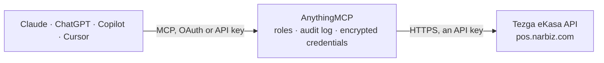

<!-- Generated by scripts/export-github-catalog.mjs in the anythingmcp-website repository. Do not edit by hand. -->

# Tezga eKasa MCP connector

Tezga eKasa, the online fiscal cash register for Serbian companies: fiscal setup and tax labels, status and fiscal data of issued receipts, and bank transactions. The AnythingMCP connector gives Claude, ChatGPT, Microsoft Copilot, Cursor and Gemini 8 MCP tools for Tezga eKasa: 4 read and 4 can change data.

**Category:** [Accounting](../accounting.md) · **Tools:** 8 · **Setup guide:** [anythingmcp.com](https://anythingmcp.com/guides/tezga-to-mcp) · [Deutsch](https://anythingmcp.com/de/guides/tezga-to-mcp) · [Italiano](https://anythingmcp.com/it/guides/tezga-to-mcp) · [Español](https://anythingmcp.com/es/guides/tezga-to-mcp) · [日本語](https://anythingmcp.com/ja/guides/tezga-to-mcp) · [Русский](https://anythingmcp.com/ru/guides/tezga-to-mcp) · [中文](https://anythingmcp.com/zh/guides/tezga-to-mcp)

## Start without code

No installation and no terminal: AnythingMCP Cloud runs the Tezga eKasa connector for you, operated by helpcode.ai in Frankfurt, Germany.

1. **Click the button above** and create an account or sign in. The Tezga eKasa connector opens, ready to install.
2. **Paste the API key or token from your Tezga eKasa account.** Every click is in the [step-by-step guide](https://anythingmcp.com/guides/tezga-to-mcp).
3. **Click Install.** AnythingMCP shows the address of your MCP server.
4. **Add that address to your assistant:** [Claude](https://anythingmcp.com/guides/connect-tezga-to-claude) · [ChatGPT](https://anythingmcp.com/guides/connect-tezga-to-chatgpt) · [Microsoft Copilot](https://anythingmcp.com/guides/connect-tezga-to-copilot) · [Cursor](https://anythingmcp.com/guides/connect-tezga-to-cursor) · [Gemini CLI](https://anythingmcp.com/guides/connect-tezga-to-gemini) · [Meta Muse](https://anythingmcp.com/guides/connect-tezga-to-muse).
5. **Ask your first question**, for example: *Did we fiscalise order ORD-2026-045 for client InterNova d.o.o. — show receipt status and public PDF*

Prefer help with the setup? [Talk to us](https://anythingmcp.com/contact).

## How it works

- **The AI client** speaks MCP (Streamable HTTP) to AnythingMCP and only sees tool names, descriptions and results. It never gets the Tezga eKasa credentials.
- **AnythingMCP** checks the client's role, builds the call from the tool definition, adds the credentials (an API key), calls Tezga eKasa, logs the call and returns the result.
- **Tezga eKasa** sees an ordinary API client with the rights of the account the credentials belong to.

## Tools

| Tool | What it does | Access |
|---|---|---|
| [`tezga_get_account_setup`](#tezga_get_account_setup) | Read the account's fiscal setup: the environment (produkcija = real receipts at the Tax Administration, sandbox = official test environment, simulacija =… | read |
| [`tezga_get_document`](#tezga_get_document) | Get a document (receipt, proforma, refund) by its Tezga id: number, type, status (nacrt draft, izdat issued, storniran cancelled), total with VAT, payment… | read |
| [`tezga_find_document`](#tezga_find_document) | Find the document issued for one of your order numbers (externalId) and return its status, fiscal data (PFR number, verification URL) and public PDF link. | read |
| [`tezga_list_bank_transactions`](#tezga_list_bank_transactions) | List the company's bank transactions imported from statements (incoming payments and outgoing payments), newest first, for matching payments to invoices. | read |
| [`tezga_issue_receipt`](#tezga_issue_receipt) | Issue and fiscalise a receipt (or a proforma) for an order: Tezga signs it at the Tax Administration (V-PFR) and returns the PFR number, verification URL… | write |
| [`tezga_refund_document`](#tezga_refund_document) | Cancel (storno) or refund an issued receipt. | write |
| [`tezga_upsert_customers`](#tezga_upsert_customers) | Create or update 1 to 500 customers in Tezga. | write |
| [`tezga_upsert_products`](#tezga_upsert_products) | Create or update 1 to 500 catalogue items. | write |

## Tool reference

Every parameter as the AI client sees it in `tools/list`. Source: [`packages/backend/src/adapters/intl/tezga.json`](../../../packages/backend/src/adapters/intl/tezga.json).

### `tezga_get_account_setup`

Read the account's fiscal setup: the environment (produkcija = real receipts at the Tax Administration, sandbox = official test environment, simulacija = demo, nothing reported, nepovezano = no security element yet), whether the company is in the VAT system and subject to fiscalisation, and the tax rates and labels it uses. Call it first; it also checks the key.

**Access:** read · **Call:** `GET /api/integrations/tax-labels`

No parameters.

### `tezga_get_document`

Get a document (receipt, proforma, refund) by its Tezga id: number, type, status (nacrt draft, izdat issued, storniran cancelled), total with VAT, payment method, the fiscal data (PFR number and time, receipt counter, verification URL, QR payload; null when not fiscalised) and public links to the receipt page and PDF.

**Access:** read · **Call:** `GET /api/integrations/documents/{document_id}`

| Parameter | Type | Required | Description |
|---|---|---|---|
| `document_id` | string | yes | Tezga document UUID (documentId from an issued receipt or from tezga_find_document). |

### `tezga_find_document`

Find the document issued for one of your order numbers (externalId) and return its status, fiscal data (PFR number, verification URL) and public PDF link. Use it to check whether an order already has a fiscal receipt.

**Access:** read · **Call:** `GET /api/integrations/documents`

| Parameter | Type | Required | Description |
|---|---|---|---|
| `externalId` | string | yes | Your order number as it was sent to Tezga, e.g. NALOG-1042. |
| `provider` | `woocommerce` \| `shopify` \| `prestashop` \| `opencart` \| `magento` \| `bigcommerce` \| `custom` | no | Where the order came from; default custom (orders sent through this API). Use the shop name for orders a connected web shop sent. |

### `tezga_list_bank_transactions`

List the company's bank transactions imported from statements (incoming payments and outgoing payments), newest first, for matching payments to invoices.

**Access:** read · **Call:** `GET /api/integrations/transactions`

| Parameter | Type | Required | Description |
|---|---|---|---|
| `smer` | `uplata` \| `isplata` | no | uplata = incoming payments, isplata = outgoing payments; omit for both. |
| `since` | string | no | Only transactions from this moment on, ISO 8601 (e.g. 2026-10-01T00:00:00Z). |
| `limit` | integer | no | How many, default 200, at most 500. |

### `tezga_issue_receipt`

Issue and fiscalise a receipt (or a proforma) for an order: Tezga signs it at the Tax Administration (V-PFR) and returns the PFR number, verification URL and public PDF; with tok sef it sends an e-invoice to SEF instead. Idempotent per externalId: the same order number never creates a second receipt. In produkcija this is a real fiscal receipt. Installed switched off; confirm the items, prices and payment method with the user first.

**Access:** write · **Call:** `POST /api/integrations/order`

| Parameter | Type | Required | Description |
|---|---|---|---|
| `externalId` | string | yes | Your unique order number, up to 200 characters. The same number never issues a second receipt. |
| `stavke` | object[] | yes | Receipt lines. |
| `kupac` | object | no | Buyer: naziv, pib (tax id, for companies), email, adresa, mesto, postanskiBroj, maticniBroj. Without pib it is a sale to a private person. |
| `nacinPlacanja` | string | no | Payment method as text: gotovina (cash), kartica (card, default), instant/IPS, prenos (bank transfer), vaucer, cek; anything else counts as other non-cash. |
| `tipDokumenta` | `racun` \| `predracun` | no | racun (receipt, default) or predracun (proforma, needs pozivNaBroj). |
| `tok` | `fiskalni` \| `sef` \| `fiskalni_i_sef` \| `avans` | no | fiskalni = fiscal receipt; sef = e-invoice on SEF (needs kupac.pib); fiskalni_i_sef = both; avans = order paid in advance, delivered later. Without a buyer pib always fiscal. |
| `posaljiMejl` | boolean | no | E-mail the PDF to the buyer. |
| `posaljiNaSef` | boolean | no | Send the e-invoice to SEF automatically (tok sef). |
| `fiskalizujPredracun` | boolean | no | Fiscalise the proforma itself (fiscal flow only). |
| `model` | string | no | Payment reference model, e.g. 97. |
| `pozivNaBroj` | string | no | Payment reference number; required for a proforma. |
| `popustProcenat` | number | no | Discount on the whole receipt in percent (not together with popustRsd). |
| `popustRsd` | number | no | Discount on the whole receipt in RSD (not together with popustProcenat). |
| `cenaIzZahteva` | boolean | no | true: prices and discounts from this request apply to catalogue items too. |
| `datumUplate` | string | no | Only with tok avans: day the payment arrived, YYYY-MM-DD. |

### `tezga_refund_document`

Cancel (storno) or refund an issued receipt. A fiscal receipt is never changed: Tezga issues a new refund document referring to the original and reports it to the Tax Administration. A refund can be partial by line. A refund of a cash payment needs the buyer's identity document number when the original has none. Installed switched off; confirm with the user first.

**Access:** write · **Call:** `POST /api/integrations/refund`

| Parameter | Type | Required | Description |
|---|---|---|---|
| `vrsta` | `storno` \| `refundacija` | yes | storno = receipt issued by mistake; refundacija = money returned to the buyer. |
| `documentId` | string | no | Tezga UUID of the original receipt. |
| `externalId` | string | no | Or your order number of the original instead of documentId. |
| `provider` | `woocommerce` \| `shopify` \| `prestashop` \| `opencart` \| `magento` \| `bigcommerce` \| `custom` | no | Where the order came from; default custom (orders sent through this API). Use the shop name for orders a connected web shop sent. |
| `razlog` | string | no | Reason, up to 500 characters. |
| `stavke` | object[] | no | Only for a partial refund: lines to refund. |
| `kupacIdTip` | string | no | Buyer ID document type code of the Tax Administration: 20 ID card (default), 23 domestic passport, 30 foreign passport, 36 EU ID card, 10 PIB, 11 JMBG. |
| `kupacIdBroj` | string | no | Buyer ID document number; needed only to refund a cash payment when the original has no buyer identification. |

### `tezga_upsert_customers`

Create or update 1 to 500 customers in Tezga. A customer is matched by PIB, then e-mail, then name: a match is updated with the fields you send (empty fields do not overwrite), otherwise a new customer is created; nothing is deleted. Returns the outcome per customer (kreiran, izmenjen, bez_izmene, greska). Installed switched off.

**Access:** write · **Call:** `POST /api/integrations/customers`

| Parameter | Type | Required | Description |
|---|---|---|---|
| `kupci` | object[] | yes | Customers to write, 1 to 500. |

### `tezga_upsert_products`

Create or update 1 to 500 catalogue items. An item is matched by code (sifra): a match gets the name, price and fields you send (the price change goes into the price history), otherwise a new item is created; nothing is deleted and stock is not changed here. Returns the outcome per item. Installed switched off; prices change at the till at once.

**Access:** write · **Call:** `POST /api/integrations/products`

| Parameter | Type | Required | Description |
|---|---|---|---|
| `stavke` | object[] | yes | Items to write, 1 to 500. |

## Run it yourself

AnythingMCP is open source (AGPL-3.0). [Run it with Docker](../../../README.md#run-it-yourself), open **Connectors → Store**, pick **Tezga eKasa** and enter `TEZGA_API_KEY`, then add your MCP server URL to the AI client.

[← Accounting connectors](../accounting.md) · [All categories](../README.md)
