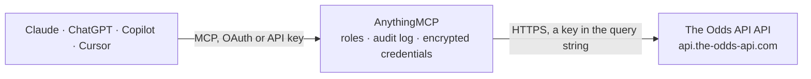

<!-- Generated by scripts/export-github-catalog.mjs in the anythingmcp-website repository. Do not edit by hand. -->

# The Odds API MCP connector

The Odds API (the-odds-api.com) v4: betting odds from US, UK, EU and Australian bookmakers for soccer, NFL, NBA, MLB, NHL, tennis and more, event odds with player props, live scores, participants and historical odds. The AnythingMCP connector gives Claude, ChatGPT, Microsoft Copilot, Cursor and Gemini 10 MCP tools for The Odds API: 8 read and 2 can change data.

**Category:** [Sports](../sports.md) · **Tools:** 10 · **Setup guide:** [anythingmcp.com](https://anythingmcp.com/guides/the-odds-api-to-mcp) · [Deutsch](https://anythingmcp.com/de/guides/the-odds-api-to-mcp) · [Italiano](https://anythingmcp.com/it/guides/the-odds-api-to-mcp) · [Español](https://anythingmcp.com/es/guides/the-odds-api-to-mcp) · [日本語](https://anythingmcp.com/ja/guides/the-odds-api-to-mcp) · [Русский](https://anythingmcp.com/ru/guides/the-odds-api-to-mcp) · [中文](https://anythingmcp.com/zh/guides/the-odds-api-to-mcp)

## Start without code

No installation and no terminal: AnythingMCP Cloud runs the The Odds API connector for you, operated by helpcode.ai in Frankfurt, Germany.

1. **Click the button above** and create an account or sign in. The The Odds API connector opens, ready to install.
2. **Paste the API key or token from your The Odds API account.** Every click is in the [step-by-step guide](https://anythingmcp.com/guides/the-odds-api-to-mcp).
3. **Click Install.** AnythingMCP shows the address of your MCP server.
4. **Add that address to your assistant:** [Claude](https://anythingmcp.com/guides/connect-the-odds-api-to-claude) · [ChatGPT](https://anythingmcp.com/guides/connect-the-odds-api-to-chatgpt) · [Microsoft Copilot](https://anythingmcp.com/guides/connect-the-odds-api-to-copilot) · [Cursor](https://anythingmcp.com/guides/connect-the-odds-api-to-cursor) · [Gemini CLI](https://anythingmcp.com/guides/connect-the-odds-api-to-gemini) · [Meta Muse](https://anythingmcp.com/guides/connect-the-odds-api-to-muse).
5. **Ask your first question**, for example: *Find the upcoming English Premier League event id for Chelsea vs Manchester United on 2026-11-07 UTC.*

Prefer help with the setup? [Talk to us](https://anythingmcp.com/contact).

## How it works

- **The AI client** speaks MCP (Streamable HTTP) to AnythingMCP and only sees tool names, descriptions and results. It never gets the The Odds API credentials.
- **AnythingMCP** checks the client's role, builds the call from the tool definition, adds the credentials (a key in the query string), calls The Odds API, logs the call and returns the result.
- **The Odds API** sees an ordinary API client with the rights of the account the credentials belong to.

## Tools

| Tool | What it does | Access |
|---|---|---|
| [`the_odds_api_list_sports`](#the_odds_api_list_sports) | Sports and competitions The Odds API covers, with the sport key the other tools need, group, title, whether it is in season and whether it has outright… | read |
| [`the_odds_api_list_events`](#the_odds_api_list_events) | Upcoming and live events of a sport with event id, teams and start time, without odds. | read |
| [`the_odds_api_get_odds`](#the_odds_api_get_odds) | Odds for the upcoming and live games of a sport from many bookmakers, per market (h2h, spreads, totals, outrights). | read |
| [`the_odds_api_get_scores`](#the_odds_api_get_scores) | Live scores and, with days_from, results of games completed in the last 1 to 3 days for a sport. | read |
| [`the_odds_api_get_event_odds`](#the_odds_api_get_event_odds) | Odds of one event in any market the bookmakers offer, including player props, alternate lines and period markets (e.g. player_pass_tds, alternate_spreads,… | read |
| [`the_odds_api_get_event_markets`](#the_odds_api_get_event_markets) | Which market keys each bookmaker currently offers for one event, to pick markets for the_odds_api_get_event_odds. | read |
| [`the_odds_api_list_participants`](#the_odds_api_list_participants) | Teams or players of a sport with their participant id, as The Odds API names them. | read |
| [`the_odds_api_get_historical_odds`](#the_odds_api_get_historical_odds) | Odds of a sport as they were at a past moment (snapshots since June 2020). | write |
| [`the_odds_api_get_historical_events`](#the_odds_api_get_historical_events) | Events of a sport as listed at a past moment, with their event ids, for the historical event odds tool. | read |
| [`the_odds_api_get_historical_event_odds`](#the_odds_api_get_historical_event_odds) | Odds of one event in any market as they were at a past moment (props and extra markets from May 2023). | write |

## Tool reference

Every parameter as the AI client sees it in `tools/list`. Source: [`packages/backend/src/adapters/intl/the-odds-api.json`](../../../packages/backend/src/adapters/intl/the-odds-api.json).

### `the_odds_api_list_sports`

Sports and competitions The Odds API covers, with the sport key the other tools need, group, title, whether it is in season and whether it has outright (futures) markets. Free: costs no credits.

**Access:** read · **Call:** `GET /sports`

| Parameter | Type | Required | Description |
|---|---|---|---|
| `all` | boolean | no | true to also list competitions that are out of season. |

### `the_odds_api_list_events`

Upcoming and live events of a sport with event id, teams and start time, without odds. Free: costs no credits. Use it to find the event id for the event tools.

**Access:** read · **Call:** `GET /sports/{sport}/events`

| Parameter | Type | Required | Description |
|---|---|---|---|
| `sport` | string | yes | Sport key from the_odds_api_list_sports, e.g. soccer_epl, soccer_germany_bundesliga, americanfootball_nfl, basketball_nba, baseball_mlb, icehockey_nhl, tennis_atp_paris. upcoming covers the next games across all sports (odds only). |
| `commence_time_from` | string | no | Only events starting at or after this time, ISO 8601 UTC such as 2026-10-20T00:00:00Z. |
| `commence_time_to` | string | no | Only events starting at or before this time, ISO 8601 UTC. |
| `event_ids` | string | no | Comma separated event ids to narrow the list. |

### `the_odds_api_get_odds`

Odds for the upcoming and live games of a sport from many bookmakers, per market (h2h, spreads, totals, outrights). Costs credits: number of markets times number of regions (1 for one market in one region). Keep to one region and one market unless more are needed; narrow with event_ids or a time window.

**Access:** read · **Call:** `GET /sports/{sport}/odds`

| Parameter | Type | Required | Description |
|---|---|---|---|
| `sport` | string | yes | Sport key from the_odds_api_list_sports, e.g. soccer_epl, soccer_germany_bundesliga, americanfootball_nfl, basketball_nba, baseball_mlb, icehockey_nhl, tennis_atp_paris. upcoming covers the next games across all sports (odds only). |
| `regions` | string | no | Bookmaker region(s), comma separated: us, us2, uk, eu, au. Each region costs credits; default eu. Leave regions out only when you pass bookmakers. |
| `markets` | string | no | Market(s), comma separated: h2h (match winner, 1X2 for soccer), spreads (handicap), totals (over/under), outrights (futures), h2h_lay. Each market costs credits; default h2h. |
| `bookmakers` | string | no | Bookmaker keys, comma separated, e.g. pinnacle,bet365,williamhill. Overrides regions; every 10 bookmakers count as one region. |
| `odds_format` | `decimal` \| `american` | no | decimal (default) or american. |
| `event_ids` | string | no | Comma separated event ids to narrow the list. |
| `commence_time_from` | string | no | Only events starting at or after this time, ISO 8601 UTC such as 2026-10-20T00:00:00Z. |
| `commence_time_to` | string | no | Only events starting at or before this time, ISO 8601 UTC. |

### `the_odds_api_get_scores`

Live scores and, with days_from, results of games completed in the last 1 to 3 days for a sport. Costs 1 credit, 2 with days_from. Covers the major leagues; not every sport has scores.

**Access:** read · **Call:** `GET /sports/{sport}/scores`

| Parameter | Type | Required | Description |
|---|---|---|---|
| `sport` | string | yes | Sport key from the_odds_api_list_sports, e.g. soccer_epl, soccer_germany_bundesliga, americanfootball_nfl, basketball_nba, baseball_mlb, icehockey_nhl, tennis_atp_paris. upcoming covers the next games across all sports (odds only). |
| `days_from` | integer | no | Also return games completed in the last 1 to 3 days (2 credits instead of 1). |
| `event_ids` | string | no | Comma separated event ids to narrow the list. |

### `the_odds_api_get_event_odds`

Odds of one event in any market the bookmakers offer, including player props, alternate lines and period markets (e.g. player_pass_tds, alternate_spreads, h2h_q1, btts, draw_no_bet). Costs credits: markets returned times regions. Call the_odds_api_get_event_markets first to see which markets exist.

**Access:** read · **Call:** `GET /sports/{sport}/events/{event_id}/odds`

| Parameter | Type | Required | Description |
|---|---|---|---|
| `sport` | string | yes | Sport key from the_odds_api_list_sports, e.g. soccer_epl, soccer_germany_bundesliga, americanfootball_nfl, basketball_nba, baseball_mlb, icehockey_nhl, tennis_atp_paris. upcoming covers the next games across all sports (odds only). |
| `event_id` | string | yes | Event id (32 hex characters) from the_odds_api_list_events or an odds list. |
| `regions` | string | no | Bookmaker region(s), comma separated: us, us2, uk, eu, au. Each region costs credits; default eu. Leave regions out only when you pass bookmakers. |
| `markets` | string | no | Market(s), comma separated: h2h (match winner, 1X2 for soccer), spreads (handicap), totals (over/under), outrights (futures), h2h_lay. Each market costs credits; default h2h. |
| `bookmakers` | string | no | Bookmaker keys, comma separated, e.g. pinnacle,bet365,williamhill. Overrides regions; every 10 bookmakers count as one region. |
| `odds_format` | `decimal` \| `american` | no | decimal (default) or american. |

### `the_odds_api_get_event_markets`

Which market keys each bookmaker currently offers for one event, to pick markets for the_odds_api_get_event_odds. Costs 1 credit.

**Access:** read · **Call:** `GET /sports/{sport}/events/{event_id}/markets`

| Parameter | Type | Required | Description |
|---|---|---|---|
| `sport` | string | yes | Sport key from the_odds_api_list_sports, e.g. soccer_epl, soccer_germany_bundesliga, americanfootball_nfl, basketball_nba, baseball_mlb, icehockey_nhl, tennis_atp_paris. upcoming covers the next games across all sports (odds only). |
| `event_id` | string | yes | Event id (32 hex characters) from the_odds_api_list_events or an odds list. |
| `regions` | string | no | Bookmaker region(s), comma separated: us, us2, uk, eu, au. Each region costs credits; default eu. Leave regions out only when you pass bookmakers. |
| `bookmakers` | string | no | Bookmaker keys, comma separated, e.g. pinnacle,bet365,williamhill. Overrides regions; every 10 bookmakers count as one region. |

### `the_odds_api_list_participants`

Teams or players of a sport with their participant id, as The Odds API names them. Costs 1 credit.

**Access:** read · **Call:** `GET /sports/{sport}/participants`

| Parameter | Type | Required | Description |
|---|---|---|---|
| `sport` | string | yes | Sport key from the_odds_api_list_sports, e.g. soccer_epl, soccer_germany_bundesliga, americanfootball_nfl, basketball_nba, baseball_mlb, icehockey_nhl, tennis_atp_paris. upcoming covers the next games across all sports (odds only). |

### `the_odds_api_get_historical_odds`

Odds of a sport as they were at a past moment (snapshots since June 2020). Paid plans only. Costs 10 credits per market per region: ask the user before calling, with one market and one region.

**Access:** write · **Call:** `GET /historical/sports/{sport}/odds`

| Parameter | Type | Required | Description |
|---|---|---|---|
| `sport` | string | yes | Sport key from the_odds_api_list_sports, e.g. soccer_epl, soccer_germany_bundesliga, americanfootball_nfl, basketball_nba, baseball_mlb, icehockey_nhl, tennis_atp_paris. upcoming covers the next games across all sports (odds only). |
| `date` | string | yes | Snapshot time, ISO 8601 UTC such as 2025-10-18T12:00:00Z. The closest snapshot at or before it is returned (every 5 minutes since September 2022, every 10 minutes from June 2020). |
| `regions` | string | no | Bookmaker region(s), comma separated: us, us2, uk, eu, au. Each region costs credits; default eu. Leave regions out only when you pass bookmakers. |
| `markets` | string | no | Market(s), comma separated: h2h (match winner, 1X2 for soccer), spreads (handicap), totals (over/under), outrights (futures), h2h_lay. Each market costs credits; default h2h. |
| `bookmakers` | string | no | Bookmaker keys, comma separated, e.g. pinnacle,bet365,williamhill. Overrides regions; every 10 bookmakers count as one region. |
| `odds_format` | `decimal` \| `american` | no | decimal (default) or american. |
| `event_ids` | string | no | Comma separated event ids to narrow the list. |

### `the_odds_api_get_historical_events`

Events of a sport as listed at a past moment, with their event ids, for the historical event odds tool. Paid plans only. Costs 1 credit (nothing when no events are found).

**Access:** read · **Call:** `GET /historical/sports/{sport}/events`

| Parameter | Type | Required | Description |
|---|---|---|---|
| `sport` | string | yes | Sport key from the_odds_api_list_sports, e.g. soccer_epl, soccer_germany_bundesliga, americanfootball_nfl, basketball_nba, baseball_mlb, icehockey_nhl, tennis_atp_paris. upcoming covers the next games across all sports (odds only). |
| `date` | string | yes | Snapshot time, ISO 8601 UTC such as 2025-10-18T12:00:00Z. The closest snapshot at or before it is returned (every 5 minutes since September 2022, every 10 minutes from June 2020). |
| `commence_time_from` | string | no | Only events starting at or after this time, ISO 8601 UTC such as 2026-10-20T00:00:00Z. |
| `commence_time_to` | string | no | Only events starting at or before this time, ISO 8601 UTC. |
| `event_ids` | string | no | Comma separated event ids to narrow the list. |

### `the_odds_api_get_historical_event_odds`

Odds of one event in any market as they were at a past moment (props and extra markets from May 2023). Paid plans only. Costs 10 credits per market returned per region: ask the user before calling.

**Access:** write · **Call:** `GET /historical/sports/{sport}/events/{event_id}/odds`

| Parameter | Type | Required | Description |
|---|---|---|---|
| `sport` | string | yes | Sport key from the_odds_api_list_sports, e.g. soccer_epl, soccer_germany_bundesliga, americanfootball_nfl, basketball_nba, baseball_mlb, icehockey_nhl, tennis_atp_paris. upcoming covers the next games across all sports (odds only). |
| `event_id` | string | yes | Event id (32 hex characters) from the_odds_api_list_events or an odds list. |
| `date` | string | yes | Snapshot time, ISO 8601 UTC such as 2025-10-18T12:00:00Z. The closest snapshot at or before it is returned (every 5 minutes since September 2022, every 10 minutes from June 2020). |
| `regions` | string | no | Bookmaker region(s), comma separated: us, us2, uk, eu, au. Each region costs credits; default eu. Leave regions out only when you pass bookmakers. |
| `markets` | string | no | Market(s), comma separated: h2h (match winner, 1X2 for soccer), spreads (handicap), totals (over/under), outrights (futures), h2h_lay. Each market costs credits; default h2h. |
| `bookmakers` | string | no | Bookmaker keys, comma separated, e.g. pinnacle,bet365,williamhill. Overrides regions; every 10 bookmakers count as one region. |
| `odds_format` | `decimal` \| `american` | no | decimal (default) or american. |

## Run it yourself

AnythingMCP is open source (AGPL-3.0). [Run it with Docker](../../../README.md#run-it-yourself), open **Connectors → Store**, pick **The Odds API** and enter `THE_ODDS_API_KEY`, then add your MCP server URL to the AI client.

[← Sports connectors](../sports.md) · [All categories](../README.md)
