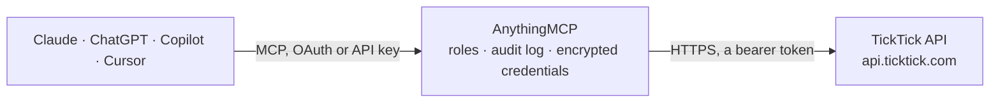

<!-- Generated by scripts/export-github-catalog.mjs in the anythingmcp-website repository. Do not edit by hand. -->

# TickTick MCP connector

Drive TickTick (cross-platform task manager) from any AI agent: projects, tasks, completed-tasks reporting. 6 tools, OAuth2 Bearer auth. The AnythingMCP connector gives Claude, ChatGPT, Microsoft Copilot, Cursor and Gemini 6 MCP tools for TickTick: 3 read and 3 can change data.

**Category:** [Project Management](../project-management.md) · **Tools:** 6 · **Setup guide:** [anythingmcp.com](https://anythingmcp.com/guides/ticktick-to-mcp) · [Deutsch](https://anythingmcp.com/de/guides/ticktick-to-mcp) · [Italiano](https://anythingmcp.com/it/guides/ticktick-to-mcp) · [Español](https://anythingmcp.com/es/guides/ticktick-to-mcp) · [日本語](https://anythingmcp.com/ja/guides/ticktick-to-mcp) · [Русский](https://anythingmcp.com/ru/guides/ticktick-to-mcp) · [中文](https://anythingmcp.com/zh/guides/ticktick-to-mcp)

## Start without code

No installation and no terminal: AnythingMCP Cloud runs the TickTick connector for you, operated by helpcode.ai in Frankfurt, Germany.

1. **Click the button above** and create an account or sign in. The TickTick connector opens, ready to install.
2. **Paste the API key or token from your TickTick account.** Every click is in the [step-by-step guide](https://anythingmcp.com/guides/ticktick-to-mcp).
3. **Click Install.** AnythingMCP shows the address of your MCP server.
4. **Add that address to your assistant:** [Claude](https://anythingmcp.com/guides/connect-ticktick-to-claude) · [ChatGPT](https://anythingmcp.com/guides/connect-ticktick-to-chatgpt) · [Microsoft Copilot](https://anythingmcp.com/guides/connect-ticktick-to-copilot) · [Cursor](https://anythingmcp.com/guides/connect-ticktick-to-cursor) · [Gemini CLI](https://anythingmcp.com/guides/connect-ticktick-to-gemini) · [Meta Muse](https://anythingmcp.com/guides/connect-ticktick-to-muse).
5. **Ask your first question**, for example: *Show me the tasks in project 'NovaForge — Client: Helion Energy proposal' and any task due this week.*

Prefer help with the setup? [Talk to us](https://anythingmcp.com/contact).

## How it works

- **The AI client** speaks MCP (Streamable HTTP) to AnythingMCP and only sees tool names, descriptions and results. It never gets the TickTick credentials.
- **AnythingMCP** checks the client's role, builds the call from the tool definition, adds the credentials (a bearer token), calls TickTick, logs the call and returns the result.
- **TickTick** sees an ordinary API client with the rights of the account the credentials belong to.

## Tools

| Tool | What it does | Access |
|---|---|---|
| [`ticktick_get_user_projects`](#ticktick_get_user_projects) | List the user's projects (lists). | read |
| [`ticktick_get_project_with_data`](#ticktick_get_project_with_data) | Get a project with its tasks and columns. | read |
| [`ticktick_get_task`](#ticktick_get_task) | Get a single task by project + task ID. | read |
| [`ticktick_create_task`](#ticktick_create_task) | Create a task. | write |
| [`ticktick_update_task`](#ticktick_update_task) | Update a task. | write |
| [`ticktick_complete_task`](#ticktick_complete_task) | Mark a task complete. | write |

## Tool reference

Every parameter as the AI client sees it in `tools/list`. Source: [`packages/backend/src/adapters/intl/ticktick.json`](../../../packages/backend/src/adapters/intl/ticktick.json).

### `ticktick_get_user_projects`

List the user's projects (lists). Each project has id, name, color, sortOrder, closed, groupId, viewMode, permission, kind.

**Access:** read · **Call:** `GET /project`

No parameters.

### `ticktick_get_project_with_data`

Get a project with its tasks and columns. Returns {project, tasks[], columns[]}.

**Access:** read · **Call:** `GET /project/{projectId}/data`

| Parameter | Type | Required | Description |
|---|---|---|---|
| `projectId` | string | yes | Project ID. |

### `ticktick_get_task`

Get a single task by project + task ID.

**Access:** read · **Call:** `GET /project/{projectId}/task/{taskId}`

| Parameter | Type | Required | Description |
|---|---|---|---|
| `projectId` | string | yes | Project ID. |
| `taskId` | string | yes | Task ID. |

### `ticktick_create_task`

Create a task. Required: title + projectId. Other common fields: content (description), startDate, dueDate, priority, items (subtasks).

**Access:** write · **Call:** `POST /task`

| Parameter | Type | Required | Description |
|---|---|---|---|
| `title` | string | yes | Task title. |
| `projectId` | string | yes | Target project ID (use inbox project if free-floating). |
| `content` | string | no | Description / content. |
| `desc` | string | no | Subtitle-style description. |
| `isAllDay` | boolean | no | If true, all-day task. |
| `startDate` | string | no | ISO 8601. |
| `dueDate` | string | no | ISO 8601. |
| `timeZone` | string | no | TZ name (e.g. 'America/New_York'). |
| `reminders` | any[] | no | iCalendar TRIGGER strings like 'TRIGGER:-PT0S'. |
| `repeatFlag` | string | no | RRULE for recurrence. |
| `priority` | integer | no | 0=none, 1=low, 3=medium, 5=high. |
| `sortOrder` | integer | no | Display order. |
| `items` | any[] | no | Subtasks: [{title, status?:0\|2 for not_done/done, completedTime?, sortOrder?}]. |

### `ticktick_update_task`

Update a task. POST to /task/{id}. Pass full task object (TickTick replaces rather than patches).

**Access:** write · **Call:** `POST /task/{taskId}`

| Parameter | Type | Required | Description |
|---|---|---|---|
| `taskId` | string | yes | Task ID. |
| `title` | string | no | Title. |
| `projectId` | string | no | Required for update — current project. |
| `content` | string | no | Content. |
| `dueDate` | string | no | ISO 8601 due. |
| `priority` | integer | no | Priority. |
| `items` | any[] | no | Subtasks. |

### `ticktick_complete_task`

Mark a task complete.

**Access:** write · **Call:** `POST /project/{projectId}/task/{taskId}/complete`

| Parameter | Type | Required | Description |
|---|---|---|---|
| `projectId` | string | yes | Project ID. |
| `taskId` | string | yes | Task ID. |

## Run it yourself

AnythingMCP is open source (AGPL-3.0). [Run it with Docker](../../../README.md#run-it-yourself), open **Connectors → Store**, pick **TickTick** and enter `TICKTICK_ACCESS_TOKEN`, then add your MCP server URL to the AI client.

[← Project Management connectors](../project-management.md) · [All categories](../README.md)
