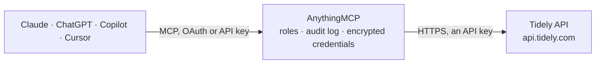

<!-- Generated by scripts/export-github-catalog.mjs in the anythingmcp-website repository. Do not edit by hand. -->

# Tidely MCP connector

Tidely cash flow planning: the cash flow and forecast per month, week or day, scenarios, categories, bank accounts with balances and transactions, sales and purchase invoices, and planned values. The AnythingMCP connector gives Claude, ChatGPT, Microsoft Copilot, Cursor and Gemini 27 MCP tools for Tidely: 16 read and 11 can change data.

**Category:** [Finance](../finance.md) · **Tools:** 27 · **Setup guide:** [anythingmcp.com](https://anythingmcp.com/guides/tidely-to-mcp) · [Deutsch](https://anythingmcp.com/de/guides/tidely-to-mcp) · [Italiano](https://anythingmcp.com/it/guides/tidely-to-mcp) · [Español](https://anythingmcp.com/es/guides/tidely-to-mcp) · [日本語](https://anythingmcp.com/ja/guides/tidely-to-mcp) · [Русский](https://anythingmcp.com/ru/guides/tidely-to-mcp) · [中文](https://anythingmcp.com/zh/guides/tidely-to-mcp)

## Start without code

No installation and no terminal: AnythingMCP Cloud runs the Tidely connector for you, operated by helpcode.ai in Frankfurt, Germany.

1. **Click the button above** and create an account or sign in. The Tidely connector opens, ready to install.
2. **Paste the API key or token from your Tidely account.** Every click is in the [step-by-step guide](https://anythingmcp.com/guides/tidely-to-mcp).
3. **Click Install.** AnythingMCP shows the address of your MCP server.
4. **Add that address to your assistant:** [Claude](https://anythingmcp.com/guides/connect-tidely-to-claude) · [ChatGPT](https://anythingmcp.com/guides/connect-tidely-to-chatgpt) · [Microsoft Copilot](https://anythingmcp.com/guides/connect-tidely-to-copilot) · [Cursor](https://anythingmcp.com/guides/connect-tidely-to-cursor) · [Gemini CLI](https://anythingmcp.com/guides/connect-tidely-to-gemini) · [Meta Muse](https://anythingmcp.com/guides/connect-tidely-to-muse).
5. **Ask your first question.**

Prefer help with the setup? [Talk to us](https://anythingmcp.com/contact).

## How it works

- **The AI client** speaks MCP (Streamable HTTP) to AnythingMCP and only sees tool names, descriptions and results. It never gets the Tidely credentials.
- **AnythingMCP** checks the client's role, builds the call from the tool definition, adds the credentials (an API key), calls Tidely, logs the call and returns the result.
- **Tidely** sees an ordinary API client with the rights of the account the credentials belong to.

## Tools

| Tool | What it does | Access |
|---|---|---|
| [`tidely_verify_auth`](#tidely_verify_auth) | Check that the API key is valid; returns success and the name of the user the key belongs to. | read |
| [`tidely_list_companies`](#tidely_list_companies) | List the companies of the Tidely account (paged): id, parentId, name, currency, country and industry. | read |
| [`tidely_get_company`](#tidely_get_company) | Get one company of the Tidely account by id: name, parent company, currency, country and industry. | read |
| [`tidely_get_cashflow`](#tidely_get_cashflow) | Get the cash flow of the company per period (month, week or day) for a scenario: for each period start date the opening and closing balances (actual,… | read |
| [`tidely_list_scenarios`](#tidely_list_scenarios) | List the planning scenarios: id, name and isBaseCase. | read |
| [`tidely_get_scenario`](#tidely_get_scenario) | Get one planning scenario by id: id, name and whether it is the base case. | read |
| [`tidely_list_categories`](#tidely_list_categories) | List the cash flow categories: id, name, type (INCOME_/EXPENSE_ OPERATIONAL, INVESTMENT or FINANCING), parentId for the hierarchy and whether plans may be… | read |
| [`tidely_get_category`](#tidely_get_category) | Get one category by id: name, type, parent and whether it accepts planned values. | read |
| [`tidely_list_bank_accounts`](#tidely_list_bank_accounts) | List the bank accounts in Tidely: id, companyId, account name, bank, IBAN or account number, currency, type (CHECKING, SAVINGS, CREDITCARD ...), provider… | read |
| [`tidely_get_bank_account`](#tidely_get_bank_account) | Get one bank account by id: name, bank, IBAN, currency, type, provider, reference balance and visibility. | read |
| [`tidely_list_bank_account_balances`](#tidely_list_bank_account_balances) | List the balance history of one bank account (paged): date and amount per day. | read |
| [`tidely_list_bank_account_transactions`](#tidely_list_bank_account_transactions) | List the transactions of one bank account (paged): id, booking date, amount, counterpart name, IBAN and reference, purpose, category and external id. | read |
| [`tidely_get_bank_account_transaction`](#tidely_get_bank_account_transaction) | Get one bank account transaction by id: booking date, amount, counterpart, purpose, category and external id. | read |
| [`tidely_check_transactions_exist`](#tidely_check_transactions_exist) | Check which of up to 1000 external ids already exist as transactions on a bank account, before importing transactions from another system. | read |
| [`tidely_list_invoices`](#tidely_list_invoices) | List sales or purchase invoices (paged): id, number, contact, dates, gross and open amount, status, category, type, source (ERP sync, manual, API, upload)… | read |
| [`tidely_get_invoice`](#tidely_get_invoice) | Get one invoice by id; invoiceTypeFilter must match its type. | read |
| [`tidely_create_invoice`](#tidely_create_invoice) | Create a sales or purchase invoice (or credit note) so it shows up in the cash flow forecast on its due date. | write |
| [`tidely_update_invoice`](#tidely_update_invoice) | Update an invoice: only the fields you pass change (status, paid date, open amount, due date, amounts, category, note ...). | write |
| [`tidely_delete_invoice`](#tidely_delete_invoice) | Delete an invoice (not those synced from an ERP integration). | write |
| [`tidely_create_category`](#tidely_create_category) | Create a cash flow category, optionally under a parent category. | write |
| [`tidely_update_category`](#tidely_update_category) | Rename a cash flow category or change its type (income or expense, operational, investment or financing). | write |
| [`tidely_delete_category`](#tidely_delete_category) | Delete a cash flow category by id. | write |
| [`tidely_create_plan`](#tidely_create_plan) | Add a planned value to the forecast: a one-time amount on a category in a scenario for a day, week or month (negative for expenses, positive for income). | write |
| [`tidely_delete_plans`](#tidely_delete_plans) | Delete all planned values of one category in one scenario. | write |
| [`tidely_create_bank_account_transaction`](#tidely_create_bank_account_transaction) | Add a transaction to a bank account kept in Tidely (an API or offline account), e.g. imported from another system. | write |
| [`tidely_update_bank_account_transaction`](#tidely_update_bank_account_transaction) | Update a bank account transaction: only the fields you pass change, typically its category. | write |
| [`tidely_delete_bank_account_transaction`](#tidely_delete_bank_account_transaction) | Delete a bank account transaction. | write |

## Tool reference

Every parameter as the AI client sees it in `tools/list`. Source: [`packages/backend/src/adapters/be/tidely.json`](../../../packages/backend/src/adapters/be/tidely.json).

### `tidely_verify_auth`

Check that the API key is valid; returns success and the name of the user the key belongs to. Use it first or when other calls fail with 401 or 403.

**Access:** read · **Call:** `GET /authentication/verify-auth`

No parameters.

### `tidely_list_companies`

List the companies of the Tidely account (paged): id, parentId, name, currency, country and industry.

**Access:** read · **Call:** `GET /companies`

| Parameter | Type | Required | Description |
|---|---|---|---|
| `page` | integer | no | Page number, from 0. |
| `pageSize` | integer | no | Items per page (default 50). |

### `tidely_get_company`

Get one company of the Tidely account by id: name, parent company, currency, country and industry.

**Access:** read · **Call:** `GET /companies/{id}`

| Parameter | Type | Required | Description |
|---|---|---|---|
| `id` | integer | yes | Company id. |

### `tidely_get_cashflow`

Get the cash flow of the company per period (month, week or day) for a scenario: for each period start date the opening and closing balances (actual, forecast, total, plan), open sales and purchase invoices, amounts per category, income and expense details, KPIs, plus overdraft and liquidity per period. Default: base scenario, monthly, 6 periods back and 18 ahead of today. Use it for liquidity questions and forecasts.

**Access:** read · **Call:** `GET /cashflow`

| Parameter | Type | Required | Description |
|---|---|---|---|
| `scenarioId` | integer | no | Scenario id (tidely_list_scenarios). Default: the base forecast. |
| `period` | `MONTH` \| `WEEK` \| `DAY` | no | Bucket size. Default MONTH. |
| `from` | string | no | First day of the first period (first of the month for MONTH, a Monday for WEEK), YYYY-MM-DD. |
| `to` | string | no | Last day of the last period (end of month for MONTH, a Sunday for WEEK), YYYY-MM-DD. |

### `tidely_list_scenarios`

List the planning scenarios: id, name and isBaseCase. Pass a scenario id to tidely_get_cashflow or tidely_create_plan to work on a scenario other than the base case.

**Access:** read · **Call:** `GET /scenarios`

No parameters.

### `tidely_get_scenario`

Get one planning scenario by id: id, name and whether it is the base case.

**Access:** read · **Call:** `GET /scenarios/{scenarioId}`

| Parameter | Type | Required | Description |
|---|---|---|---|
| `scenarioId` | integer | yes | Scenario id. |

### `tidely_list_categories`

List the cash flow categories: id, name, type (INCOME_/EXPENSE_ OPERATIONAL, INVESTMENT or FINANCING), parentId for the hierarchy and whether plans may be booked on it. Filter by exact name.

**Access:** read · **Call:** `GET /categories`

| Parameter | Type | Required | Description |
|---|---|---|---|
| `name` | string | no | Exact category name, case-insensitive. |

### `tidely_get_category`

Get one category by id: name, type, parent and whether it accepts planned values.

**Access:** read · **Call:** `GET /categories/{id}`

| Parameter | Type | Required | Description |
|---|---|---|---|
| `id` | integer | yes | Category id. |

### `tidely_list_bank_accounts`

List the bank accounts in Tidely: id, companyId, account name, bank, IBAN or account number, currency, type (CHECKING, SAVINGS, CREDITCARD ...), provider (ONLINE synced, API or OFFLINE), reference balance with its date, external id and visibility.

**Access:** read · **Call:** `GET /bank-accounts`

No parameters.

### `tidely_get_bank_account`

Get one bank account by id: name, bank, IBAN, currency, type, provider, reference balance and visibility.

**Access:** read · **Call:** `GET /bank-accounts/{id}`

| Parameter | Type | Required | Description |
|---|---|---|---|
| `id` | integer | yes | Bank account id. |

### `tidely_list_bank_account_balances`

List the balance history of one bank account (paged): date and amount per day. Use it for balance trends.

**Access:** read · **Call:** `GET /bank-accounts/{id}/balances`

| Parameter | Type | Required | Description |
|---|---|---|---|
| `id` | integer | yes | Bank account id. |
| `page` | integer | no | Page number, from 0. |
| `pageSize` | integer | no | Items per page (default 50). |

### `tidely_list_bank_account_transactions`

List the transactions of one bank account (paged): id, booking date, amount, counterpart name, IBAN and reference, purpose, category and external id.

**Access:** read · **Call:** `GET /bank-account-transactions`

| Parameter | Type | Required | Description |
|---|---|---|---|
| `bankAccountId` | integer | yes | Bank account id. |
| `page` | integer | no | Page number, from 0. |
| `pageSize` | integer | no | Items per page (default 50). |

### `tidely_get_bank_account_transaction`

Get one bank account transaction by id: booking date, amount, counterpart, purpose, category and external id.

**Access:** read · **Call:** `GET /bank-account-transactions/{id}`

| Parameter | Type | Required | Description |
|---|---|---|---|
| `id` | integer | yes | Transaction id. |

### `tidely_check_transactions_exist`

Check which of up to 1000 external ids already exist as transactions on a bank account, before importing transactions from another system. Read-only.

**Access:** read · **Call:** `POST /bank-account-transactions/exists`

| Parameter | Type | Required | Description |
|---|---|---|---|
| `bankAccountId` | integer | yes | Bank account id. |
| `externalIds` | string[] | yes | External ids to look up. |

### `tidely_list_invoices`

List sales or purchase invoices (paged): id, number, contact, dates, gross and open amount, status, category, type, source (ERP sync, manual, API, upload) and external id. Filter by status, number, external id, category, source or exact contact name; array filters take up to 100 values.

**Access:** read · **Call:** `GET /invoices`

| Parameter | Type | Required | Description |
|---|---|---|---|
| `invoiceTypeFilter` | `SALE` \| `PURCHASE` | yes | SALE for sales invoices, PURCHASE for purchase invoices. |
| `invoiceStatus` | `DRAFT` \| `OPEN` \| `PAID` \| `PARTIALLY_PAID` \| `CANCELED` \| `WITHHELD` \| `OFFER` \| `ORDER` \| `PLANNED` \| `RELEASED`[] | no | Statuses to include, e.g. ["OPEN"]. |
| `invoiceNumber` | string[] | no | Exact invoice numbers. |
| `externalId` | string[] | no | External ids. |
| `categoryId` | integer[] | no | Category ids. |
| `source` | string[] | no | Sources, e.g. LEXOFFICE, OPEN_API. |
| `contactName` | string | no | Exact contact name, case-insensitive. |
| `page` | integer | no | Page number, from 0. |
| `pageSize` | integer | no | Items per page (default 50). |

### `tidely_get_invoice`

Get one invoice by id; invoiceTypeFilter must match its type.

**Access:** read · **Call:** `GET /invoices/{id}`

| Parameter | Type | Required | Description |
|---|---|---|---|
| `id` | integer | yes | Invoice id. |
| `invoiceTypeFilter` | `SALE` \| `PURCHASE` | yes | SALE for sales invoices, PURCHASE for purchase invoices. |

### `tidely_create_invoice`

Create a sales or purchase invoice (or credit note) so it shows up in the cash flow forecast on its due date. Required: invoiceType, invoiceNumber, contactName, totalGrossAmount. Returns the invoice with its id.

**Access:** write · **Call:** `POST /invoices`

| Parameter | Type | Required | Description |
|---|---|---|---|
| `invoiceType` | `SALES_INVOICE` \| `SALES_CREDIT_NOTE` \| `PURCHASE_INVOICE` \| `PURCHASE_CREDIT_NOTE` | yes | Kind of invoice. |
| `invoiceNumber` | string | yes | Invoice number. |
| `contactName` | string | yes | Customer (sales) or supplier (purchase) name. |
| `totalGrossAmount` | number | yes | Total amount including tax. |
| `invoiceDate` | string | no | Invoice date, YYYY-MM-DD. |
| `dueDate` | string | no | Due date, YYYY-MM-DD; drives when the invoice lands in the cash flow forecast. |
| `paidDate` | string | no | Payment date, YYYY-MM-DD. |
| `invoiceStatus` | `DRAFT` \| `OPEN` \| `PAID` \| `PARTIALLY_PAID` \| `CANCELED` \| `WITHHELD` \| `OFFER` \| `ORDER` \| `PLANNED` \| `RELEASED` | no | Invoice status. |
| `openAmount` | number | no | Amount still unpaid. |
| `note` | string | no | Description or notes. |
| `categoryId` | integer | no | Category id (tidely_list_categories). |
| `externalId` | string | no | Your own id for the invoice, e.g. from the ERP. |

### `tidely_update_invoice`

Update an invoice: only the fields you pass change (status, paid date, open amount, due date, amounts, category, note ...). Invoices synced from an ERP integration cannot be changed. invoiceTypeFilter must match its type.

**Access:** write · **Call:** `PATCH /invoices/{id}`

| Parameter | Type | Required | Description |
|---|---|---|---|
| `id` | integer | yes | Invoice id. |
| `invoiceTypeFilter` | `SALE` \| `PURCHASE` | yes | SALE for sales invoices, PURCHASE for purchase invoices. |
| `invoiceNumber` | string | no | Invoice number. |
| `contactName` | string | no | Customer (sales) or supplier (purchase) name. |
| `totalGrossAmount` | number | no | Total amount including tax. |
| `invoiceDate` | string | no | Invoice date, YYYY-MM-DD. |
| `dueDate` | string | no | Due date, YYYY-MM-DD; drives when the invoice lands in the cash flow forecast. |
| `paidDate` | string | no | Payment date, YYYY-MM-DD. |
| `invoiceStatus` | `DRAFT` \| `OPEN` \| `PAID` \| `PARTIALLY_PAID` \| `CANCELED` \| `WITHHELD` \| `OFFER` \| `ORDER` \| `PLANNED` \| `RELEASED` | no | Invoice status. |
| `openAmount` | number | no | Amount still unpaid. |
| `note` | string | no | Description or notes. |
| `categoryId` | integer | no | Category id (tidely_list_categories). |

### `tidely_delete_invoice`

Delete an invoice (not those synced from an ERP integration). Irreversible; installed switched off.

**Access:** write · **Call:** `DELETE /invoices/{id}`

| Parameter | Type | Required | Description |
|---|---|---|---|
| `id` | integer | yes | Invoice id. |
| `invoiceTypeFilter` | `SALE` \| `PURCHASE` | yes | SALE for sales invoices, PURCHASE for purchase invoices. |

### `tidely_create_category`

Create a cash flow category, optionally under a parent category. Returns it with its id.

**Access:** write · **Call:** `POST /categories`

| Parameter | Type | Required | Description |
|---|---|---|---|
| `name` | string | yes | Category name. |
| `type` | `INCOME_OPERATIONAL` \| `INCOME_INVESTMENT` \| `INCOME_FINANCING` \| `EXPENSE_OPERATIONAL` \| `EXPENSE_INVESTMENT` \| `EXPENSE_FINANCING` | yes | Income or expense, operational, investment or financing. |
| `parentId` | integer | no | Parent category id. |

### `tidely_update_category`

Rename a cash flow category or change its type (income or expense, operational, investment or financing).

**Access:** write · **Call:** `PATCH /categories/{id}`

| Parameter | Type | Required | Description |
|---|---|---|---|
| `id` | integer | yes | Category id. |
| `name` | string | no | New name. |
| `type` | `INCOME_OPERATIONAL` \| `INCOME_INVESTMENT` \| `INCOME_FINANCING` \| `EXPENSE_OPERATIONAL` \| `EXPENSE_INVESTMENT` \| `EXPENSE_FINANCING` | no | New type. |

### `tidely_delete_category`

Delete a cash flow category by id. Irreversible; installed switched off.

**Access:** write · **Call:** `DELETE /categories/{id}`

| Parameter | Type | Required | Description |
|---|---|---|---|
| `id` | integer | yes | Category id. |

### `tidely_create_plan`

Add a planned value to the forecast: a one-time amount on a category in a scenario for a day, week or month (negative for expenses, positive for income). By default it adds to existing planned values of that period; replaceCurrentValuesForThePeriod true replaces them. Without a category it goes to uncategorized income or expenses; without a scenario to the base case.

**Access:** write · **Call:** `POST /plans`

| Parameter | Type | Required | Description |
|---|---|---|---|
| `name` | string | yes | Name of the plan. |
| `amount` | number | yes | Amount, negative for expenses. |
| `period` | `DAILY` \| `WEEKLY` \| `MONTHLY` | yes | Period the value applies to. |
| `date` | string | yes | YYYY-MM-DD; first day of the month for MONTHLY, first day of the week for WEEKLY. |
| `type` | `ONE_TIME` | no | Plan type; ONE_TIME is the only one. |
| `categoryId` | integer | no | Category id (must accept planned values). |
| `categoryName` | string | no | Category path instead of the id, parts joined with ->. |
| `scenarioId` | integer | no | Scenario id. Default: base case. |
| `scenarioName` | string | no | Scenario name instead of the id. |
| `replaceCurrentValuesForThePeriod` | boolean | no | true replaces the existing planned values of the period. |

### `tidely_delete_plans`

Delete all planned values of one category in one scenario. Irreversible; installed switched off.

**Access:** write · **Call:** `DELETE /plans`

| Parameter | Type | Required | Description |
|---|---|---|---|
| `categoryId` | integer | yes | Category id. |
| `scenarioId` | integer | yes | Scenario id. |

### `tidely_create_bank_account_transaction`

Add a transaction to a bank account kept in Tidely (an API or offline account), e.g. imported from another system. Required: bankAccountId, bookingDate, amount, counterpartName. Records data only; it moves no money.

**Access:** write · **Call:** `POST /bank-account-transactions`

| Parameter | Type | Required | Description |
|---|---|---|---|
| `bankAccountId` | integer | yes | Bank account id. |
| `bookingDate` | string | yes | Booking date, YYYY-MM-DD. |
| `amount` | number | yes | Amount in the account currency, negative for outgoing. |
| `counterpartName` | string | yes | Counterpart name. |
| `counterpartIban` | string | no | Counterpart IBAN. |
| `counterpartAccountNumber` | string | no | Counterpart account number. |
| `counterpartCustomerReference` | string | no | Counterpart customer reference. |
| `purpose` | string | no | Transaction description (remittance text). |
| `categoryId` | integer | no | Category id. |
| `externalId` | string | no | Your own id for the transaction (max 255), to avoid duplicates. |

### `tidely_update_bank_account_transaction`

Update a bank account transaction: only the fields you pass change, typically its category.

**Access:** write · **Call:** `PATCH /bank-account-transactions/{id}`

| Parameter | Type | Required | Description |
|---|---|---|---|
| `id` | integer | yes | Transaction id. |
| `bookingDate` | string | no | Booking date, YYYY-MM-DD. |
| `amount` | number | no | Amount in the account currency, negative for outgoing. |
| `counterpartName` | string | no | Counterpart name. |
| `counterpartIban` | string | no | Counterpart IBAN. |
| `counterpartAccountNumber` | string | no | Counterpart account number. |
| `counterpartCustomerReference` | string | no | Counterpart customer reference. |
| `purpose` | string | no | Transaction description (remittance text). |
| `categoryId` | integer | no | Category id. |
| `externalId` | string | no | Your own id for the transaction (max 255), to avoid duplicates. |

### `tidely_delete_bank_account_transaction`

Delete a bank account transaction. Irreversible; installed switched off.

**Access:** write · **Call:** `DELETE /bank-account-transactions/{id}`

| Parameter | Type | Required | Description |
|---|---|---|---|
| `id` | integer | yes | Transaction id. |

## Run it yourself

AnythingMCP is open source (AGPL-3.0). [Run it with Docker](../../../README.md#run-it-yourself), open **Connectors → Store**, pick **Tidely** and enter `TIDELY_API_KEY`, then add your MCP server URL to the AI client.

[← Finance connectors](../finance.md) · [All categories](../README.md)
