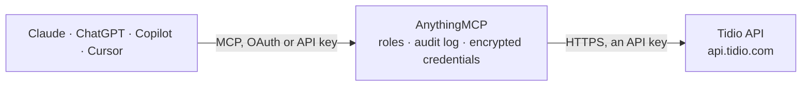

<!-- Generated by scripts/export-github-catalog.mjs in the anythingmcp-website repository. Do not edit by hand. -->

# Tidio MCP connector

Manage Tidio (live chat, helpdesk and Lyro AI) contacts, contact conversations, tickets and ticket replies from any AI agent via the Tidio OpenAPI. 10 tools, Client ID + Client Secret (Tidio Plus or Premium). The AnythingMCP connector gives Claude, ChatGPT, Microsoft Copilot, Cursor and Gemini 10 MCP tools for Tidio: 8 read and 2 can change data.

**Category:** [Customer Support](../support.md) · **Tools:** 10 · **Setup guide:** [anythingmcp.com](https://anythingmcp.com/guides/tidio-to-mcp) · [Deutsch](https://anythingmcp.com/de/guides/tidio-to-mcp) · [Italiano](https://anythingmcp.com/it/guides/tidio-to-mcp) · [Español](https://anythingmcp.com/es/guides/tidio-to-mcp) · [日本語](https://anythingmcp.com/ja/guides/tidio-to-mcp) · [Русский](https://anythingmcp.com/ru/guides/tidio-to-mcp) · [中文](https://anythingmcp.com/zh/guides/tidio-to-mcp)

## Start without code

No installation and no terminal: AnythingMCP Cloud runs the Tidio connector for you, operated by helpcode.ai in Frankfurt, Germany.

1. **Click the button above** and create an account or sign in. The Tidio connector opens, ready to install.
2. **Paste the API key or token from your Tidio account.** Every click is in the [step-by-step guide](https://anythingmcp.com/guides/tidio-to-mcp).
3. **Click Install.** AnythingMCP shows the address of your MCP server.
4. **Add that address to your assistant:** [Claude](https://anythingmcp.com/guides/connect-tidio-to-claude) · [ChatGPT](https://anythingmcp.com/guides/connect-tidio-to-chatgpt) · [Microsoft Copilot](https://anythingmcp.com/guides/connect-tidio-to-copilot) · [Cursor](https://anythingmcp.com/guides/connect-tidio-to-cursor) · [Gemini CLI](https://anythingmcp.com/guides/connect-tidio-to-gemini) · [Meta Muse](https://anythingmcp.com/guides/connect-tidio-to-muse).
5. **Ask your first question**, for example: *Show me the Tidio contact for emma.baker@windstream.co.uk*

Prefer help with the setup? [Talk to us](https://anythingmcp.com/contact).

## How it works

- **The AI client** speaks MCP (Streamable HTTP) to AnythingMCP and only sees tool names, descriptions and results. It never gets the Tidio credentials.
- **AnythingMCP** checks the client's role, builds the call from the tool definition, adds the credentials (an API key), calls Tidio, logs the call and returns the result.
- **Tidio** sees an ordinary API client with the rights of the account the credentials belong to.

## Tools

| Tool | What it does | Access |
|---|---|---|
| [`tidio_get_project`](#tidio_get_project) | Return the Tidio project the keys belong to: its project ID and whether it is currently online or offline. | read |
| [`tidio_list_contacts`](#tidio_list_contacts) | List contacts (identified website visitors) with their name, email, phone, language, country, consent and custom properties. | read |
| [`tidio_get_contact_by_email`](#tidio_get_contact_by_email) | Find the contact(s) with an exact email address. | read |
| [`tidio_get_contact`](#tidio_get_contact) | Get one contact by ID with all its fields and custom properties. | read |
| [`tidio_update_contact`](#tidio_update_contact) | Update a contact's email, first/last name, phone or custom properties. | write |
| [`tidio_get_contact_messages`](#tidio_get_contact_messages) | Read the chat history with a contact: messages from the contact, operators and bots, plus a link to the conversation in the Tidio panel. | read |
| [`tidio_list_tickets`](#tidio_list_tickets) | List helpdesk tickets with subject, status (open, pending, solved), priority, contact and assignee, without messages. | read |
| [`tidio_get_ticket`](#tidio_get_ticket) | Get one helpdesk ticket with all its details and messages (public replies and internal notes). | read |
| [`tidio_reply_to_ticket`](#tidio_reply_to_ticket) | Add a reply to a helpdesk ticket, as an operator (needs operator_id) or as the contact. | write |
| [`tidio_list_operators`](#tidio_list_operators) | List the project's operators (support agents) with their IDs, names and emails — the operator_id for tidio_reply_to_ticket. | read |

## Tool reference

Every parameter as the AI client sees it in `tools/list`. Source: [`packages/backend/src/adapters/intl/tidio.json`](../../../packages/backend/src/adapters/intl/tidio.json).

### `tidio_get_project`

Return the Tidio project the keys belong to: its project ID and whether it is currently online or offline.

**Access:** read · **Call:** `GET /project`

No parameters.

### `tidio_list_contacts`

List contacts (identified website visitors) with their name, email, phone, language, country, consent and custom properties. Cursor-paginated: pass meta.cursor back as cursor.

**Access:** read · **Call:** `GET /contacts`

| Parameter | Type | Required | Description |
|---|---|---|---|
| `cursor` | string | no | Cursor from the previous page's meta.cursor; omit for the first page. |

### `tidio_get_contact_by_email`

Find the contact(s) with an exact email address. Returns the same contact objects as tidio_list_contacts, so take the id from contacts[0].

**Access:** read · **Call:** `GET /contacts`

| Parameter | Type | Required | Description |
|---|---|---|---|
| `email` | string | yes | Email address to look up. |

### `tidio_get_contact`

Get one contact by ID with all its fields and custom properties.

**Access:** read · **Call:** `GET /contacts/{contact_id}`

| Parameter | Type | Required | Description |
|---|---|---|---|
| `contact_id` | string | yes | Contact ID (UUID), from tidio_list_contacts or tidio_get_contact_by_email. |

### `tidio_update_contact`

Update a contact's email, first/last name, phone or custom properties. Only the fields you pass change; null clears a field. Custom properties must already exist in the Tidio panel.

**Access:** write · **Call:** `PATCH /contacts/{contact_id}`

| Parameter | Type | Required | Description |
|---|---|---|---|
| `contact_id` | string | yes | Contact ID (UUID), from tidio_list_contacts or tidio_get_contact_by_email. |
| `email` | string | no | New email address. |
| `first_name` | string | no | New first name. |
| `last_name` | string | no | New last name. |
| `phone` | string | no | New phone number. |
| `properties` | object[] | no | Custom properties to set, as [{"name": "shoe_size", "value": "44"}]; a null value clears one. |

### `tidio_get_contact_messages`

Read the chat history with a contact: messages from the contact, operators and bots, plus a link to the conversation in the Tidio panel. Cursor-paginated: pass meta.cursor back as cursor.

**Access:** read · **Call:** `GET /contacts/{contact_id}/messages`

| Parameter | Type | Required | Description |
|---|---|---|---|
| `contact_id` | string | yes | Contact ID (UUID), from tidio_list_contacts or tidio_get_contact_by_email. |
| `cursor` | string | no | Cursor from the previous page's meta.cursor; omit for the first page. |

### `tidio_list_tickets`

List helpdesk tickets with subject, status (open, pending, solved), priority, contact and assignee, without messages. Cursor-paginated: pass meta.cursor back as cursor.

**Access:** read · **Call:** `GET /tickets`

| Parameter | Type | Required | Description |
|---|---|---|---|
| `cursor` | string | no | Cursor from the previous page's meta.cursor; omit for the first page. |

### `tidio_get_ticket`

Get one helpdesk ticket with all its details and messages (public replies and internal notes).

**Access:** read · **Call:** `GET /tickets/{ticket_id}`

| Parameter | Type | Required | Description |
|---|---|---|---|
| `ticket_id` | integer | yes | Ticket ID, from tidio_list_tickets. |

### `tidio_reply_to_ticket`

Add a reply to a helpdesk ticket, as an operator (needs operator_id) or as the contact. message_type internal makes it a note only operators see.

**Access:** write · **Call:** `POST /tickets/{ticket_id}/reply`

| Parameter | Type | Required | Description |
|---|---|---|---|
| `ticket_id` | integer | yes | Ticket ID, from tidio_list_tickets. |
| `content` | string | yes | Reply text. |
| `author_type` | `operator` \| `contact` | no | Who the reply is from: operator (default) or contact. |
| `operator_id` | string | no | Operator ID (UUID) from tidio_list_operators; needed when author_type is operator. |
| `message_type` | `public` \| `internal` | no | public (sent to the contact) or internal (a note for operators). |

### `tidio_list_operators`

List the project's operators (support agents) with their IDs, names and emails — the operator_id for tidio_reply_to_ticket. Cursor-paginated: pass meta.cursor back as cursor.

**Access:** read · **Call:** `GET /operators`

| Parameter | Type | Required | Description |
|---|---|---|---|
| `cursor` | string | no | Cursor from the previous page's meta.cursor; omit for the first page. |

## Run it yourself

AnythingMCP is open source (AGPL-3.0). [Run it with Docker](../../../README.md#run-it-yourself), open **Connectors → Store**, pick **Tidio** and enter `TIDIO_CLIENT_ID`, `TIDIO_CLIENT_SECRET`, then add your MCP server URL to the AI client.

[← Customer Support connectors](../support.md) · [All categories](../README.md)
